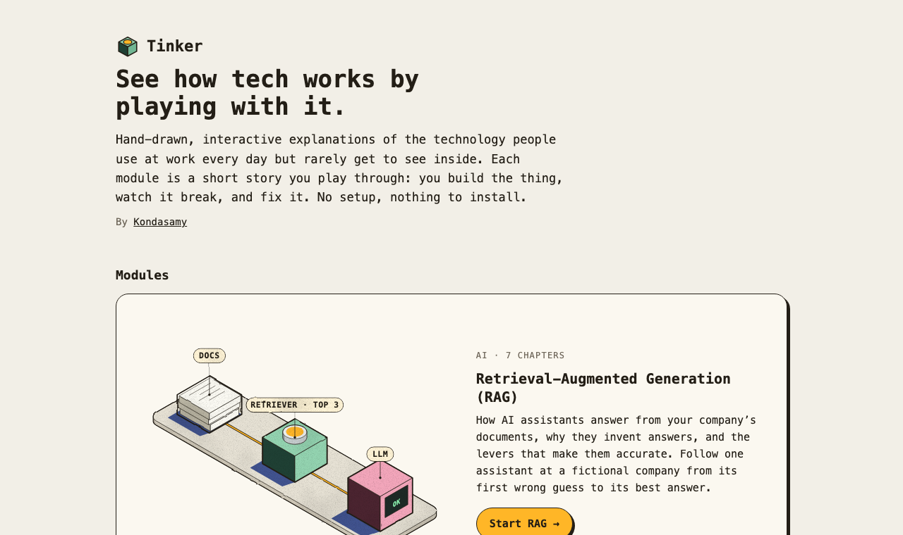
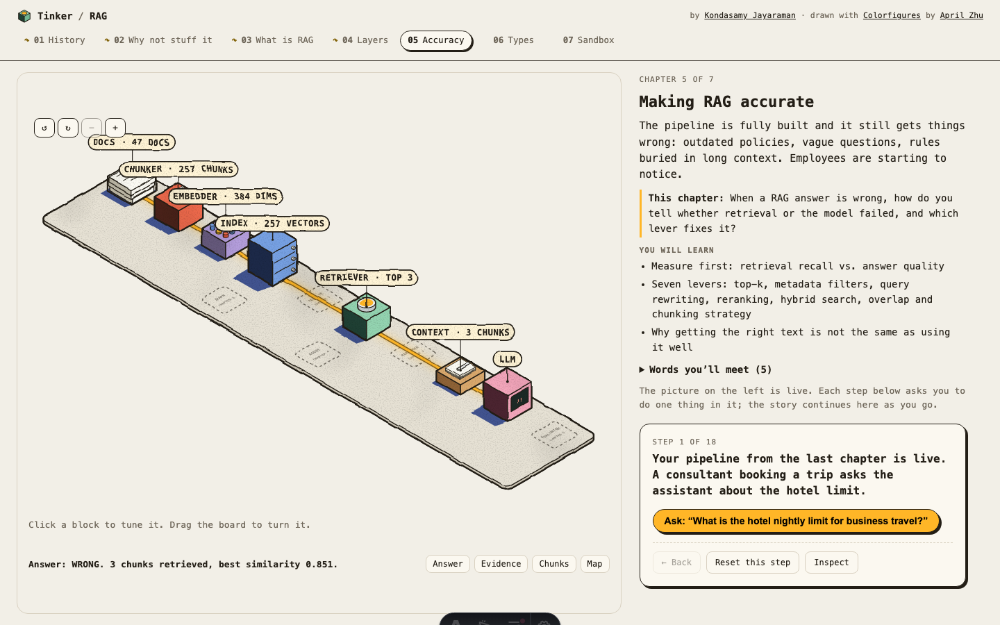
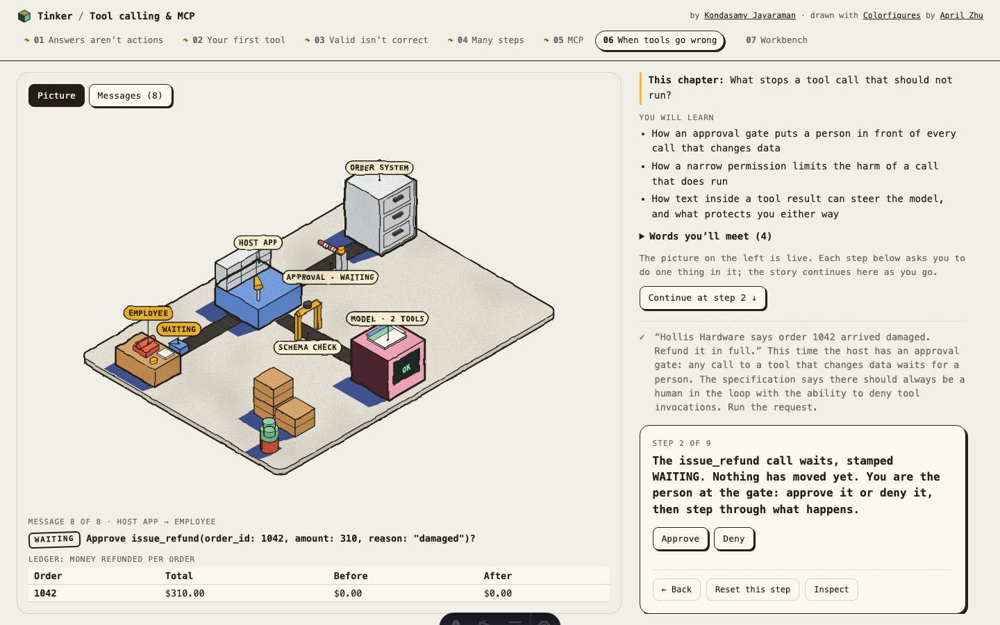
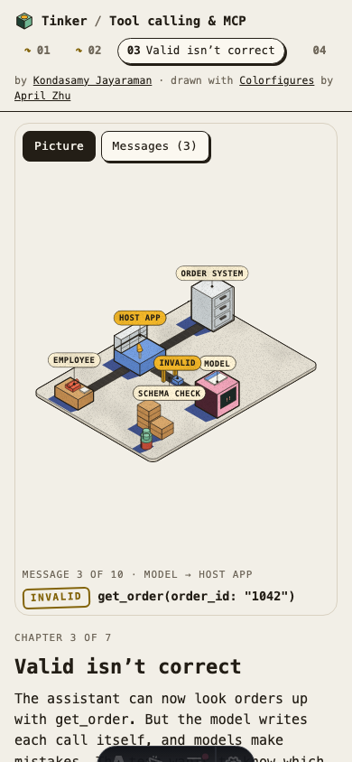

# Tinker

> See how tech works by playing with it. Hand-drawn, interactive explanations of tech concepts, by [Kondasamy Jayaraman](https://kondasamy.com). Home: **https://tinker.kondasamy.com**.

Each module is a short story you play through: the picture on the left is live, the story on the right asks you to do one thing at a time in it, and you watch what changes. Build the thing, break it, fix it.



---

## Modules

Every module has a level, a story, an intro at `/<module>/`, its chapters, and a recap at `/<module>/recap/`. The home page lists them by level.

| Level | Module | Status |
|---|---|---|
| Beginner | [RAG: Retrieval-Augmented Generation](#rag-retrieval-augmented-generation-rag) | Live, 7 chapters |
| Beginner | [Tokens & embeddings](#tokens--embeddings-tokens) | Live, 7 chapters |
| Intermediate | [Tool calling & MCP](#tool-calling--mcp-tool-calling) (RAG recommended first) | Live, 7 chapters |
| Intermediate | [Evals & LLM testing](#evals--llm-testing-evals) (RAG recommended first) | Live, 7 chapters |
| Intermediate | [Prompt injection & guardrails](#prompt-injection--guardrails-guardrails) (Tool calling recommended first) | Live, 7 chapters |
| Intermediate | [Context engineering & memory](#context-engineering--memory-context) (RAG and Tool calling recommended first) | Live, 7 chapters |
| Intermediate | [Structured outputs](#structured-outputs-structured-outputs) (Tool calling and Tokens recommended first) | Live, 7 chapters |
| Intermediate | [Reasoning models & thinking budgets](#reasoning-models--thinking-budgets-reasoning) (Evals recommended first) | Live, 7 chapters |
| Advanced | [AI agents](#ai-agents-agents) (Tool calling recommended first) | Live, 7 chapters |
| Advanced | [Transformer architecture](#transformer-architecture-transformers) (Tokens recommended first) | Live, 7 chapters |
| Advanced | [Fine-tuning vs prompting](#fine-tuning-vs-prompting-fine-tuning) (Evals and Transformers recommended first) | Live, 7 chapters |
| Advanced | [Small models: distillation & routing](#small-models-distillation--routing-small-models) (Fine-tuning and Evals recommended first) | Live, 7 chapters |

### RAG: Retrieval-Augmented Generation (`/rag/`)

How AI assistants answer from a company's documents, why they invent answers, and the levers that make them accurate. You join the team building an assistant for **Larkspur Supply Co.**, a fictional hardware company, and follow it from its first confident wrong answer to its best one.

| # | Chapter | What you do |
|---|---|---|
| 1 | How RAG came to be | Watch a model invent a refund policy, then walk the 2020–2026 history: small context windows, then RAG, then agents that use retrieval as one tool |
| 2 | Why not stuff it all in the prompt? | Grow the company drive from 50 KB to petabytes against a context window; see size, lost-in-the-middle, freshness and permissions |
| 3 | What is RAG? | Wire docs → retriever → LLM and turn an invented answer into a cited one |
| 4 | The layers of a RAG system | Chunker, embedder, vector index, context assembler: find the bad cut that hid a rule, fix it with overlap |
| 5 | Making RAG accurate | Two meters (retrieval recall vs. answer) and seven levers: top-k, metadata filters, query rewrite, reranking, hybrid search, overlap, chunking strategy |
| 6 | Types of RAG | Naive, advanced, agentic, GraphRAG, self-correcting and multimodal RAG, each on a question that needs it |
| 7 | Sandbox | Rewire the whole pipeline on a workbench, then match five teams to the RAG type each needs |



### Tool calling & MCP (`/tool-calling/`)

How AI assistants go from answering to acting. The Larkspur story continues: staff want the assistant to check an order or issue a refund, which an answer from documents cannot do.

| # | Chapter | What you do |
|---|---|---|
| 1 | Answers aren’t actions | Ask the documents-only assistant where an order is, watch it guess, and see why only the software around the model can act |
| 2 | Your first tool | Give the model a tool definition (name, description, schema) and follow the loop: the model proposes a call, the host runs it, the result goes back |
| 3 | Valid isn’t correct | Validate calls against the schema, send a rejected one back as an error the model fixes, and catch a valid but wrong call with a business check |
| 4 | Many tools, many steps | Send independent lookups together, make a dependent call wait for its input, and cap the loop |
| 5 | MCP: one plug for many tools | Connect a host to an orders server and a calendar server over the Model Context Protocol: hosts, clients, servers, and the tools, resources and prompts they offer |
| 6 | When tools go wrong | Put an approval gate in front of a refund, narrow its permission, and stop an instruction planted in a tool result |
| 7 | Workbench | Set up servers, the gate and the limits for four requests, each needing its own setup |

The chapters play out in Larkspur's **back office**, an isometric diorama: the employee's desk, the host app's sorting desk, the model and the order system's filing cabinet, joined by conveyor belts. Each message rides its belt as an envelope. A schema arch holds back a malformed call, an approval barrier waits for a person, a cabinet drawer slides out when an order is read, and a planted instruction pokes out of an envelope. The same run is one tab away as a message-by-message sequence.



### AI agents (`/agents/`)

How an assistant goes from one request to a whole case. The Larkspur story continues: the assistant now gets support cases, and the model picks each next step itself.

| # | Chapter | What you do |
|---|---|---|
| 1 | Workflow or agent? | Run a damaged-delivery case as a fixed script and as an agent, with the stock in and out, and see when each one fits |
| 2 | The loop, and who says done | Follow act, look, decide, again, and see that a turn with no tool call is the answer |
| 3 | Plans, and approving a plan | Have the agent write a plan, re-plan on a surprise, and approve the plan instead of every call; catch a planted line in an email |
| 4 | Budgets and stuck loops | Set a step budget, watch the token meter, and stop an agent that retries a failing call |
| 5 | Memory, and what survives it | Watch the history grow, summarise it, and pin the one note that must not be lost |
| 6 | Sub-agents, and the cost of a handoff | Hand each order to a helper with a clean context, and compare what the lead and the whole run spend |
| 7 | Workbench | Every control from chapters 1–6 on one case at a time |

The chapters play out in the same back office. The agent adds four props: the plan on a clipboard, a step and context gauge on the host's desk, an in-tray of history that becomes one binder when the host compacts it, and small desks for helpers. The same run is one tab away as a step-by-step sequence.

### Evals & LLM testing (`/evals/`)

How a team shows a change made the assistant better, and not just better on the questions it tried. Back at Larkspur, the team keeps changing the RAG assistant; RAG's questions are the test set.

| # | Chapter | What you do |
|---|---|---|
| 1 | It worked when I tried it | Try two questions a change fixes, then run the whole test set on both versions and find the one it broke |
| 2 | The test set | Pick cases from a support log, give each a reference answer, and find the gap your set leaves |
| 3 | Graders | Grade answers by code, by a model judge and by a person, and see where each goes wrong |
| 4 | Judge the judge | Check the judge against people's labels, fix its rubric, and catch position bias by swapping the order |
| 5 | Grading the path | Grade a Tool calling run by its reply, its ledger and its calls, and catch a refund nobody asked for |
| 6 | Run it twice | Ask the same cases five times and compare pass@k with pass^k |
| 7 | Release day | Pick a candidate, a grader and a release gate, and decide what ships |

The chapters play on a test bench: RAG's pipeline at the back, a stack of test cards riding a belt into it, and a grader's desk where answers pile up PASS and FAIL. The same run is one tab away as a results grid, a column per version.

### Prompt injection & guardrails (`/guardrails/`)

What happens when the text an assistant reads tries to give it orders, and the defences that hold. Larkspur's assistant now works the support inbox: it reads customer email, looks up customer records and can send email out.

| # | Chapter | What you do |
|---|---|---|
| 1 | Data or instructions? | Run a direct attack and a note planted in a forwarded invoice, then add a prompt rule and see which one still gets through |
| 2 | Input filters | Slide a classifier's threshold and count the attacks it holds against the customers it holds too |
| 3 | The way out | Stop a leak with an allow-list of recipients, an output filter for links, or a person approving each email |
| 4 | The lethal trifecta | Take away private data, untrusted text or the way out, and see what each costs the customer |
| 5 | Defence in depth | Stack defences until no attack gets through, blocking as few customers as possible |
| 6 | When the user is the attacker | Stop a customer who asks for too much with policy checks, without refusing fair requests |
| 7 | Red team | Run both suites under every defence and decide whether the assistant ships |

The chapters play in a mail room added to Tool calling's back office: email rides in from an inbox tray past a screening arch, and an outbound chute with a barrier leads to a post box, the way out. The same run is one tab away as a step-by-step sequence.

### Tokens & embeddings (`/tokens/`)

How text becomes the numbers a model reads: tokens to count and pay for, and embeddings that carry meaning. Larkspur's team starts where the model does, with what it reads and what that costs.

| # | Chapter | What you do |
|---|---|---|
| 1 | What the model reads | Predict how many tokens a sentence cuts into, then type your own and watch the count |
| 2 | How the vocabulary is learned | Step through the merges a byte-level tokenizer learned from Larkspur's documents |
| 3 | Tokens are the meter | Count Larkspur's documents by the rule of thumb and by real tokenizers, then price them |
| 4 | Every tokenizer splits differently | Compare tokenizers on spaces, numbers, code and other languages |
| 5 | From token to vector | See why a token id carries no meaning, and compare questions by their embeddings |
| 6 | Meaning by neighbours | Find the piece closest in meaning to a question, whatever words it shares |
| 7 | Workbench: fit the prompt | Pick the parts of a prompt that fit a token budget, counted live |

The chapters play at a token press: a paper strip of text feeds the press, and one coloured tile per token drops onto a belt. The same tokens are one tab away as a row of tiles, each with its id. This site's small tokenizer runs live in your browser; GPT-2's and GPT-4o's output was recorded ahead of time (`pnpm record:tokens`). Chapters 5 and 6 read RAG's map of meaning, built from the same embeddings.

### Transformer architecture (`/transformers/`)

What happens inside the model between a prompt and its next word. Larkspur's team opens up Larkspur mini, a tiny model trained only on Larkspur's documents, and watches it work in your browser.

| # | Chapter | What you do |
|---|---|---|
| 1 | One token at a time | Predict the next token, see the model's probabilities, and grow a reply one token at a time |
| 2 | Tokens become vectors | Look up a token's vector, and see how position makes two copies of a word differ |
| 3 | Attention | Read who looks at whom in an attention heatmap, and find the causal mask |
| 4 | Heads and layers | Compare every head, and find the one that looks back to where a word began |
| 5 | Choosing the next token | Slide temperature and top-p, and watch a seeded sampler write |
| 6 | Why long prompts cost more | Grow a prompt token by token and count the attention pairs and the KV cache |
| 7 | Trace a prompt | Type any prompt and follow it through every stage, past the window too |

The chapters play in an engine room: two floors, one per layer, with a desk per head, and the prompt's tokens as tiles along the front, joined by threads of attention. The same run is one tab away as an attention heatmap with the next-token bar. Nothing is recorded: Larkspur mini (about 51 thousand numbers) runs live in your browser.

### Context engineering & memory (`/context/`)

What goes into the model's window each turn, in what order, and what it should remember between conversations. Larkspur's assistant now answers from documents, calls tools and holds long conversations, so the team has to choose what it reads.

| # | Chapter | What you do |
|---|---|---|
| 1 | What's in the window | Build one turn part by part and read each part's live token count against the budget |
| 2 | More isn't better | Bury the fact among distractors, early, in the middle or late, and watch the answers worsen |
| 3 | Fetch it when you need it | Send every document up front, then let the model search, and compare tokens and answers |
| 4 | Order for the cache | Reorder a turn's blocks so the stable ones come first and the cache reads them back |
| 5 | Clearing the desk | Clear old tool results or summarise the history, and see what each does to the cache |
| 6 | Memory outside the window | Let the assistant write a note in one conversation and read it in the next |
| 7 | Workbench: the context policy | Set Larkspur's policy and read answers, tokens and cost across a session |

The chapters play at a window desk: a glass case of fixed size is the window, and the turn's parts lie in it as papers, as thick as their tokens. A cache shelf, a filing cabinet for memory and an in-tray for cleared results come on as the chapters need them. The same call is one tab away as one stacked bar. Windows, token counts, cache hits and costs are computed in your browser; the model's answers were recorded ahead of time.

### Fine-tuning vs prompting (`/fine-tuning/`)

When to train the model, when to prompt it, and when to give it documents. Larkspur wants replies in its own voice, and the team has to choose between a better prompt, better documents and training the model itself.

| # | Chapter | What you do |
|---|---|---|
| 1 | Three ways to change an answer | Pull the prompt, documents and weights levers, then ask three versions of the assistant one question |
| 2 | What training does | Ask Larkspur mini a question, swap in its fine-tuned weights, and read the reply and the training run's loss curve |
| 3 | Small adapters | Count what a full fine-tune trains against a rank-4 LoRA adapter, then clip the adapter on and ask again |
| 4 | Facts move, style stays | A price changes: ask the fine-tuned and RAG versions, then run every test question on both |
| 5 | What training costs you | Score the base model and both fine-tunes on held-out text, and see which forgot most |
| 6 | Measure before you train | Score the shipped version, then run the candidates through the release gate from the Evals module |
| 7 | Larkspur's decision | Send each kind of request to one version and find a plan with the best score |

The chapters play at a training bench: the model at the back, three levers in front (a prompt card, a document binder and a weights wrench), and a small LoRA adapter that clips onto the model. The training runs are one tab away as loss curves, and the versions as the Evals module's grid. Larkspur mini's fine-tunes are real, trained ahead of time and run in your browser; the assistant's answers were recorded ahead of time and are graded live.

### Structured outputs (`/structured-outputs/`)

How a model is made to answer in valid JSON, every time. Larkspur's order system wants the assistant's answers as JSON it can read without a person, and the team makes Larkspur mini answer in a schema.

| # | Chapter | What you do |
|---|---|---|
| 1 | Asking nicely | Ask Larkspur mini for JSON and read what it writes |
| 2 | A schema is a contract | Check each answer against the schema and retry, paying for every try |
| 3 | The mask | Turn the schema on and watch it block tokens before the model writes them |
| 4 | Tokens are not characters | Write near a length cap and see which tokens still fit |
| 5 | Choices from a list | Swap a free-text field for a list and draw the model's pick |
| 6 | Valid isn't right | Ask for values the model can't know, and a schema too long for its window |
| 7 | Workbench: Larkspur's order schema | Design the schema field by field until every order comes back valid and right |

The chapters play at a stencil press: the token press from Tokens, its belt crossing a stencil plate, the schema, which stops the tokens it blocks. The vocabulary is one tab away as a grid, the allowed tokens lit. Everything is decoded live in your browser on Larkspur mini; nothing is recorded.

### Reasoning models & thinking budgets (`/reasoning/`)

Models that think before they answer: what a thinking budget buys, what it costs, and when more thinking hurts. Back at Larkspur Supply Co., the assistant starts getting quotes and delivery questions with several steps, and the team decides how much it should think before it answers.

| # | Chapter | What you do |
|---|---|---|
| 1 | Answer now or think first | Ask a split-order quote at once, then again with thinking, and compare |
| 2 | Thinking is tokens | Turn the effort up and watch the thinking tokens, the cost and the wait grow |
| 3 | The effort dial | Sweep the multi-step questions across every effort level |
| 4 | When more thinking hurts | Watch a simple count with distracting details go wrong at high effort |
| 5 | Effort is a hint, not a counter | Give a lookup and a multi-step question the same effort and compare how long each thinks |
| 6 | Measure, then pick | Put each kind of question through a release gate and find the lowest effort that passes |
| 7 | Workbench: an effort per request | Pick an effort per kind of request for the most right answers at the lowest cost |

The chapters play at a scratchpad desk: the model, a pad of thinking papers that grows with the thinking tokens, an effort dial and a clock. Accuracy against effort is one tab away. The thinking and answers are recorded, written to illustrate published findings; token counts, grades, cost and wait are computed in your browser.

### Small models: distillation & routing (`/small-models/`)

Teach a small model from a big one, send it the easy questions, and fall back when it isn't sure. Back at Larkspur Supply Co., the model bill has grown, and the team wants a smaller, cheaper model to answer what it can without losing the answers that matter.

| # | Chapter | What you do |
|---|---|---|
| 1 | Big model, small model | Ask Larkspur mini and its student the same prompt, and compare their sizes and work per token |
| 2 | Learning from a teacher | See the teacher's soft targets the student learnt from, and its training run |
| 3 | How close is the student? | Measure how often the student picks the teacher's next token on text neither has seen |
| 4 | Send it the easy ones | Send every question to a small model, then a large one, and compare right answers and cost |
| 5 | Fall back when unsure | Set a confidence threshold and watch right answers and cost trade along the frontier |
| 6 | Gate the switch | Put the router through the release gate and find the cheapest threshold that ships |
| 7 | Larkspur's routing policy | Send each kind of question small, large or through the router for the best score |

The chapters play at an apprentice's bench: the big model, its student in front, and a router switch with a fallback chute. The quality and cost frontier is one tab away. The teacher and the student run live in your browser; the small and large tiers' answers are recorded, written to illustrate published findings, and graded live.

---

## How it's built

- **Static site:** Astro with React islands. No backend, no API key, no live model, so it runs on any static host, and a chapter keeps working offline once its data has loaded.
- **Real retrieval, precomputed answers (RAG):** the corpus is embedded at build time (`pnpm build:index`, all-MiniLM-L6-v2 and a cross-encoder reranker); the browser runs the real similarity, BM25, reranking, graph-walk and agent maths over those vectors. Model answers are pre-recorded for each kind of evidence that can reach the model, so every knob changes the outcome honestly.
- **Recorded turns, live tools (Tool calling, AI agents):** the model's turns are pre-recorded per scenario (`data/tool-calling/turns/`). The host loop, a JSON Schema subset validator, the approval gate, the tools running on fixture data and an MCP-shaped JSON-RPC server all run in the browser (`src/lib/tools/`). A unit test checks every reachable control setting has a recorded turn. MCP facts come from `data/tool-calling/facts.json`, each with its source. The agent loop (`src/lib/agents/`) reuses those tools and adds plans, approval, budgets, a repeat detector, memory and helpers, all computed in the browser; its recorded turns are in `data/agents/turns/` and its facts in `data/agents/facts.json`. The guardrails loop (`src/lib/guardrails/`) puts defences around the model as host stages (input filters, the taint rule, the allow-list, the output filter, policy checks, approval); its turns are in `data/guardrails/turns/`, its stand-in classifier's hand-set scores in `data/guardrails/inbox.json`, and its attack and customer suites in `data/guardrails/suite.json`.
- **Real retrieval, recorded grading (Evals):** each version of the assistant runs RAG's real retrieval over the same 12 questions and reads the recorded answer for what it found. Code graders run in the browser (`src/lib/evals/`); the model judge's verdicts, people's labels and repeated tries are recorded in `data/evals/`, and every combination a control can reach is checked by a unit test.
- **Pictures:** hand-inked isometric figures drawn by the Colorfigures engine (see Credits), extended to orbit, zoom and turn the view. Each module leads with a scene you can picture rather than a flow chart: RAG's pipeline on a workbench, tool calling's back office (`src/components/scenes/officeScene.ts`), evals' test bench (`evalScene.ts`), guardrails' mail room (`guardScene.ts`), tokens' token press (`tokenScene.ts`), transformers' engine room (`engineScene.ts`), context's window desk (`windowScene.ts`), fine-tuning's training bench (`trainScene.ts`), structured outputs' stencil press (`stencilScene.ts`), reasoning's scratchpad desk (`thinkScene.ts`), small models' apprentice's bench (`routerScene.ts`), and the home page's animated workshop with a plot per module (`heroScene.ts`): a wave hops each plot and names it in turn. Flat sequence figures (lanes and message cards, `src/lib/iso/flat.ts`) in the same ink show the exact messages, a tab away. Names sit in label pills so they stay readable.
- **Search:** every page has its own title, description, canonical URL and share image; intros and chapters carry schema.org course and lesson data with breadcrumbs; `/sitemap.xml` and `/robots.txt` are built from the page list, and recaps and the 404 page stay out of search.
- **Works on a phone:** below 861px the picture stacks above the story, pills grow, and the sequence shows one message at a time.

- **Story:** every chapter is a list of steps run by one step runner (`src/components/story/`): each step has narration, the one control it needs, a check that advances it, hints after a few tries and, for puzzles, “Show me”. Progress is saved in the browser, per module.
- **Pictures first, words on request:** each module intro opens in a Pictures reading mode (pictures, headings and one-line captions, the chapters as picture cards); a Words switch shows the full text.
- **Making it stick:** chapters ask for a prediction before a reveal, quizzes explain why each option is right or wrong and offer “I’m not sure”, each module's recap asks recall questions from the chapters you finished, and a reader who returns 20 hours or more after finishing a chapter is offered a short warm-up. Nothing leaves the browser.
- **Tests:** unit tests for the engine and story logic (Vitest), and end-to-end tests that play every chapter, check accessibility with axe, keyboard-only play, reduced motion, phone size and offline use (Playwright).

<p align="center"></p>

---

## Project layout

| Path | What lives there |
|---|---|
| `src/pages/index.astro` | Tinker home: a centred hero over the workshop picture, then the modules as picture cards, grouped by level |
| `src/lib/modules.ts` | The module registry: every module, live or planned, with its level, chapters and recall bank |
| `src/pages/<module>/` | A module's pages: its intro (`index.astro`), the chapter route (`[chapter].astro`) and the recap (`recap.astro`) |
| `src/content/<module>/` | A module's registry entry (`module.ts`: chapters and each chapter's opening context), its chapter scripts and its recall bank (`recall.ts`) |
| `src/lib/rag/`, `data/` | RAG engine (retrieval maths, agent, graph) and its corpus, questions, answers and index |
| `src/lib/tools/`, `data/tool-calling/` | Tool calling engine (host loop, schema validator, MCP-shaped server) and its recorded turns, fixtures and facts |
| `src/lib/agents/`, `data/agents/` | Agent engine (the agent loop, its budgets, memory and helpers) and its recorded turns, fixtures and facts |
| `src/lib/evals/`, `data/evals/` | Evals engine (versions, the suite, code graders, the release gate) and its references, judge verdicts, labels, samples and facts |
| `src/lib/guardrails/`, `data/guardrails/` | Guardrails engine (the loop and its defence layers, the suites' metrics) and its recorded turns, inbox, customers, suites and facts |
| `src/lib/transformers/`, `data/transformers/` | Transformers engine (the attention trace, the seeded sampler, cost counts) and its chapter prompts, the word-start head and facts |
| `src/lib/context/`, `data/context/` | Context engine (the turn assembler, the cache model, memory files) and its recorded answers, cases, documents and facts |
| `src/lib/fine-tuning/`, `data/fine-tuning/` | Fine-tuning engine (parameter counts, live replies and held-out scores from Larkspur mini's fine-tunes, the versions graded by Evals' graders, the workbench) and its recorded answers, changed-price fixture, workbench notes and facts |
| `src/lib/structured-outputs/`, `data/structured-outputs/` | Structured outputs engine (the schema grammar, the token mask, masked decoding on Larkspur mini, the workbench) and its pinned prompts, orders and facts |
| `src/lib/reasoning/`, `data/reasoning/` | Reasoning engine (recorded answers per question and effort, graded live by Evals' graders, thinking tokens, cost and wait, the workbench) and its questions, references, answers, assumptions and facts |
| `src/lib/small-models/`, `data/small-models/` | Small models engine (the teacher and its student compared live, the small and large tiers' recorded answers graded by Evals' graders, the router, the frontier and the workbench) and its answers, prompts, workbench scores and facts |
| `src/lib/tokens/`, `data/tokens/` | Tokens engine (counts, merges, neighbours over RAG's vectors, the prompt workbench) and its recorded real tokenizers, sentences and facts |
| `src/lib/iso/` | The drawing engine (Colorfigures, adapted), the isometric stage and the flat figure kit, shared by every module |
| `src/components/story/` | The step runner every chapter uses: the live picture on the left, the story column on the right |
| `src/components/quiz/` | Quizzes, predictions and the recap |
| `templates/module/`, `scripts/new-module.mjs` | The new-module template and the script that copies it (`pnpm new-module`) |

Decisions behind the design (layout, story rules, pictures, share images, tooling) are recorded in [AGENTS.md](AGENTS.md); read it before changing things.

---

## Run locally

**Requires** Node.js 22.22 or newer (the version is pinned in `.node-version`) and pnpm 11 (pinned in `package.json` `packageManager`; `corepack enable` installs the right version).

```bash
pnpm install    # install exact dependency versions from pnpm-lock.yaml
pnpm dev        # start the dev server on http://localhost:4321
```

Open http://localhost:4321 for the Tinker home; the modules are at http://localhost:4321/rag/, http://localhost:4321/tool-calling/, http://localhost:4321/agents/, http://localhost:4321/evals/, http://localhost:4321/guardrails/, http://localhost:4321/tokens/, http://localhost:4321/transformers/, http://localhost:4321/context/, http://localhost:4321/fine-tuning/, http://localhost:4321/structured-outputs/, http://localhost:4321/reasoning/ and http://localhost:4321/small-models/. The dev server also serves internal test pages at `/dev/blocks`, `/dev/canvas`, `/dev/runner`, `/dev/flat`, `/dev/quiz`, `/dev/recap`, `/dev/warmup`, `/dev/agents`, `/dev/evals`, `/dev/guardrails`, `/dev/tokens`, `/dev/transformers`, `/dev/context`, `/dev/fine-tuning`, `/dev/structured-outputs`, `/dev/reasoning` and `/dev/small-models`. These pages are left out of production builds.

To try the production build locally:

```bash
pnpm build      # writes the static site to dist/
pnpm preview    # serves dist/ on http://localhost:4321
```

### Tests and checks

```bash
pnpm check                              # type-check Astro and TypeScript
pnpm test                               # unit tests (Vitest)
pnpm exec playwright install chromium   # one-time browser download for e2e
pnpm test:e2e                           # end-to-end, accessibility, mobile and offline tests (Playwright)
```

`pnpm test:e2e` builds the site and starts its own preview server on port 4399.

### Share images

Every public page has its own 1200×630 share image in `public/og/`. After changing a page's title or text (`src/lib/pages.ts`), a chapter, or a share picture, redraw them and commit the result:

```bash
pnpm og     # builds with the dev pages, captures src/dev/og.astro for each page into public/og/<page>.jpg
```

### Regenerating the data (only when the corpus or questions change)

The retrieval index in `public/data/index/` is committed. Normal development and deploys never rebuild it. Run these steps only after you edit `data/corpus/` or `data/questions/`:

```bash
pnpm build:index                  # re-embed and re-score; the first run downloads two small models into .cache/ (about 8 minutes cold, seconds when cached)
node scripts/draft-answers.mjs    # redraft data/answers/*.json from rules; review the answers before committing
pnpm record:tokens                # re-record GPT-2's and GPT-4o's tokens for data/tokens/ (downloads the tokenizers into .cache/ once)
pnpm test                         # the scenario and answer-coverage tests must still pass
```

---

## Deploy

The site is fully static. Every host does the same three things:

- **Install command:** `pnpm install` (hosts pick pnpm from `pnpm-lock.yaml`)
- **Build command:** `pnpm build`
- **Output directory:** `dist`
- **Node version:** 22.22 or newer (both hosts below read it from `.node-version` or `package.json` `engines`)

Do not run `build:index` on the host. The committed `public/data/index/` files (about 8 MB) ship as they are.

### Cloudflare Pages

**From Git (recommended):**

1. In the Cloudflare dashboard, open **Workers & Pages → Create → Pages → Connect to Git** and pick this repository.
2. Set **Framework preset** to *Astro*, **Build command** to `pnpm build` and **Build output directory** to `dist`.
3. Under **Environment variables**, add `PNPM_VERSION` = `11.22.0` (the build image's default pnpm is older and can't read this lockfile). If the build uses an older Node, also add `NODE_VERSION` = `22.23.1`.
4. Deploy. Each push to `main` deploys production, and other branches get preview URLs.

**From your machine (direct upload):**

```bash
pnpm build
pnpm dlx wrangler pages deploy dist --project-name tinker
```

The first run asks you to log in to Cloudflare and creates the project.

### Vercel

**From Git (recommended):**

1. In the Vercel dashboard, choose **Add New → Project** and import this repository.
2. Vercel detects Astro. Keep **Install command** `pnpm install`, **Build command** `pnpm build` and **Output directory** `dist`. Add the environment variable `ENABLE_EXPERIMENTAL_COREPACK` = `1` so Vercel uses the pnpm version in `packageManager`.
3. Under **Settings → General → Node.js Version**, choose 22.x if it isn't already selected.
4. Deploy. Pushes to `main` go to production, and pull requests get preview URLs.

**From your machine:**

```bash
pnpm dlx vercel          # first run links the project and makes a preview deploy
pnpm dlx vercel --prod   # production deploy
```

### Custom domain: tinker.kondasamy.com

- **Cloudflare Pages:** project → **Custom domains** → add `tinker.kondasamy.com`. With kondasamy.com's DNS on Cloudflare, the CNAME is created for you; otherwise add a CNAME `tinker` → `<project>.pages.dev`.
- **Vercel:** project → **Settings → Domains** → add `tinker.kondasamy.com`, then a CNAME `tinker` → `cname.vercel-dns.com` at your DNS provider.
- `astro.config.mjs` sets `site` to this address (canonical URLs). Change it there if the domain changes.
- The site used to live at `explain.kondasamy.com`. Keep that hostname attached and redirect it (301, path kept) to `https://tinker.kondasamy.com`, so links already shared keep working.
- Optional: on whatever serves kondasamy.com, redirect a short path (for example `/tinker`) to `https://tinker.kondasamy.com/`.

### After deploying

1. Open the home page, then the RAG module at `/rag/`, and confirm chapter 1 loads.
2. Open `/data/index/manifest.json` and confirm it returns JSON. This proves the data files are served.
3. Go through chapters 3–7 once. The canvas should show answers, not stay on "Preparing…".

No monitoring is needed, because there is no backend.

---

## Contributing

Twelve modules are live and five more are on the roadmap (the planned cards on the home page): build one of them, or propose another. New modules and fixes arrive as pull requests to this repository. Start with [CONTRIBUTING.md](CONTRIBUTING.md) (setup, checks, the PR flow, credit) and [docs/writing-a-module.md](docs/writing-a-module.md) (the house style for a module). `pnpm new-module <id> "<Title>"` scaffolds a module, and `pnpm test` lists what it still needs.

---

## Credits

The illustrations are drawn with [Colorfigures](https://april-zhu.com/colorfigures) by [April Zhu](https://april-zhu.com/): the hand-inked isometric style and the drawing engine in `src/lib/iso/core.js` come from it, adapted for Tinker. Colorfigures builds on April's [ISO-GLOW](https://isoglow.dev), which builds on [iso-figure](https://github.com/MrBongoC/ai-iso-skill) by Tolga Cohce. All MIT licensed (see `src/lib/iso/LICENSE`).

The tokenizer in `src/lib/lm/` follows the byte-level BPE algorithm of Andrej Karpathy's [minbpe](https://github.com/karpathy/minbpe) (MIT). Larkspur mini, the tiny model in `scripts/train/` and `src/lib/lm/model.ts`, is shaped after his [nanoGPT](https://github.com/karpathy/nanoGPT) (MIT).

