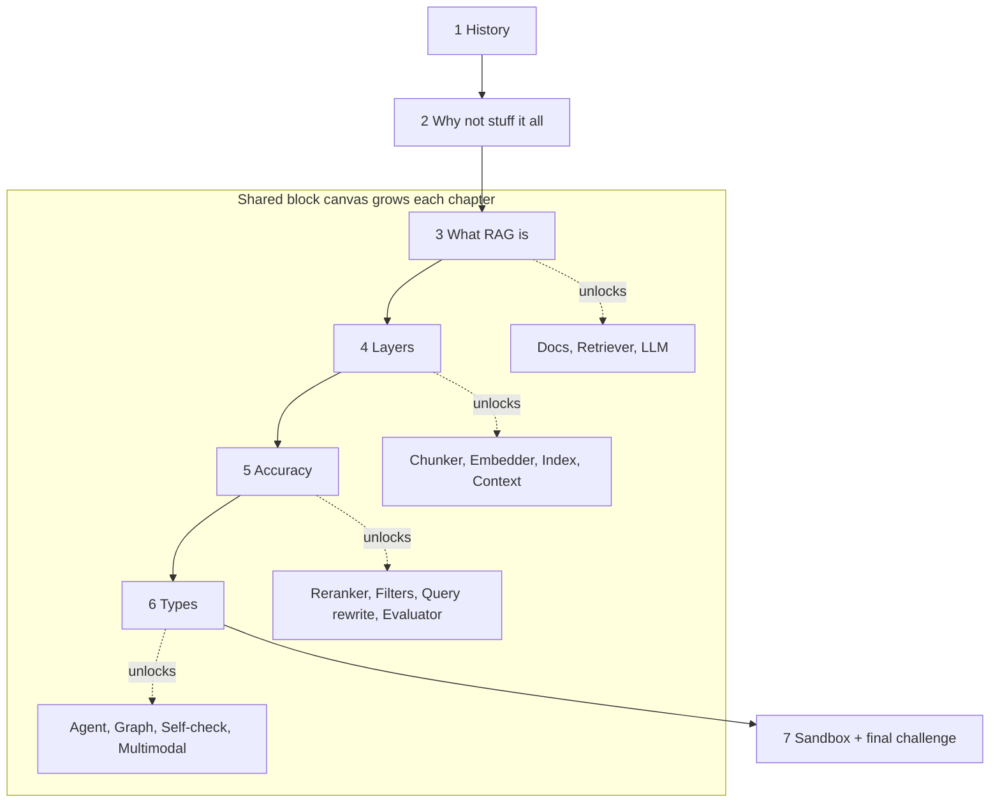
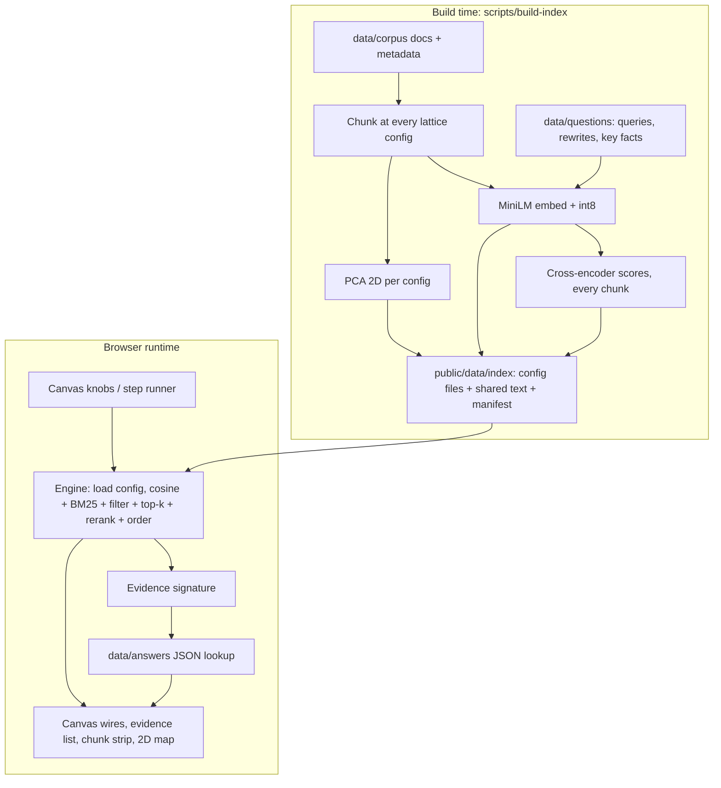
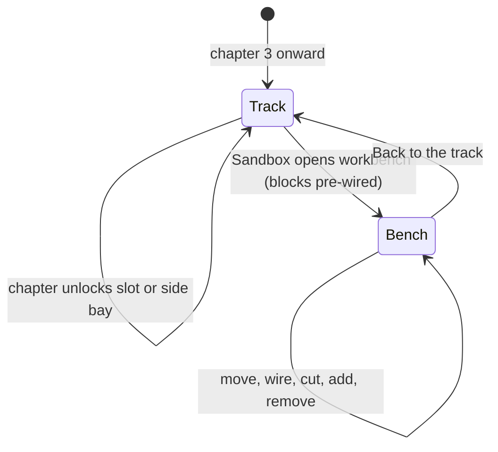

# Visual RAG Learning Module - Plan

## Goal Capsule

- **Objective:** Ship a free, visually rich, interactive website module that teaches Retrieval-Augmented Generation end to end — why it exists, how it works, how to make it accurate, and which type to use — through guided chapters and a hands-on block canvas.
- **Product authority:** This plan owns the RAG module only. The broader multi-concept learning platform is context, not active scope (see How This Work Fits Together).
- **Open blockers:** None.
- **Authority order:** Product Contract requirements (R-IDs) win on product behavior; Key Technical Decisions win on mechanism; units carry only unit-local detail.
- **Execution profile:** Greenfield Astro site in this repo. Deliver in four phases (see Phased Delivery); each phase ships a working site.
- **Stop conditions:** Stop and ask if a requirement cannot be met without a live model, a backend, or accounts (R22), or if a history claim cannot be sourced (R5).
- **Product Contract preservation:** Product Contract unchanged except that its former Outstanding Questions section was removed; its deferred items are resolved by KTD4, KTD9, KTD10 and U3.

---

## Product Contract

### Summary

A guided, chapter-based RAG course for enterprise PMs and engineers, drawn in the colorfigures hand-inked isometric style.
Every chapter opens with a confidently wrong AI answer that the learner fixes on one shared block canvas; the canvas gains blocks chapter by chapter and becomes a free sandbox at the end.
Quizzes and fix-the-pipeline puzzles confirm the learner can explain, diagnose, and choose.

### Problem Frame

In 2026 RAG is everywhere in enterprise products, yet many PMs and engineers in large organisations still cannot say why it exists, why "just put all our docs in the prompt" fails, or why their RAG bot gave a wrong answer.
Existing material is either static architecture diagrams or framework docs; neither lets someone change a parameter and watch the consequence.

The history matters to understanding. In 2023 context windows were small and tool calling was unreliable, so the only way to give a model private or fresh knowledge was to retrieve text and paste it into the prompt.
As tool calling matured, retrieval became one tool an agent chooses to call.
Meanwhile enterprise knowledge sits in terabytes to petabytes of documents that will never fit in any context window, so retrieval stays necessary even as models improve.
People who skip this history misjudge when RAG is the right tool.

### Key Decisions

- **RAG module only; platform later.** One excellent module, structured so other concepts can be added, with no catalog or platform shell now. Governs R1. (session-settled: user-directed — chosen over a platform shell with a concept catalog, or a full multi-concept platform: focus the first release on RAG.)
- **Real history, no fictional cast.** The story is the real 2023→2026 evolution of RAG; the noir detective characters and heist plot from `research/04_noir_forensic_playground_spec.md` are dropped. Governs R4, R5. (session-settled: user-directed — chosen over the researched noir detective storyline: learners must leave with understanding, and fiction they don't recognise gets in the way.)
- **Colorfigures as the base visual style.** Warm, colourful, hand-inked isometric figures where every object does something; iso-glow touches (glowing data pulses on wires) are allowed as accents. Governs R2. (session-settled: user-directed — chosen over iso-glow alone or deferring style to planning: user wants colorfigures as the base, extended from there; confirmed against the canvas prototype.)
- **Guided track that opens into a workbench.** Chapters use a fixed isometric track of slots; the Sandbox opens the same blocks, already wired, into a free workbench. Governs R11, R28. (session-settled: user-directed — chosen over a pure fixed track and a pure free workbench, after driving all three in the prototype.)
- **Story first, one step at a time, canvas as the hero.** The prototype's all-at-once tool layout was overwhelming and the figures lacked prominence. Governs R25, R26, R27. (session-settled: user-directed — user feedback on the canvas prototype: "the interface is overwhelming, I'm not getting what to do".)
- **Pre-computed corpora with real retrieval math.** Chunking, similarity search, top-k, filtering and prompt assembly compute for real in the browser over pre-computed embeddings; model answers are pre-recorded per setting. Governs R20, R21. (session-settled: user-approved — chosen over in-browser embedding of the learner's own text, and over live LLM with bring-your-own-key: instant, free, offline, reproducible.)
- **Hybrid course shape.** Guided chapters, one growing block canvas shared across chapters, and a broken-answer opening in every chapter. Governs R6, R7, R8. (session-settled: user-approved — chosen over separate per-chapter playgrounds, a playground-first canvas home, and a pure broken-first case structure.)
- **One shared fictional-company corpus.** All chapters and RAG types run against the same invented enterprise knowledge base, so the canvas stays coherent and pre-recorded answers stay affordable. Governs R19. (session-settled: user-approved — chosen over a separate scenario per chapter.)
- **All four RAG type families are hands-on.** Naive→Advanced, Agentic, GraphRAG, and Self-correcting/Multimodal are each tunable on the canvas. Governs R16, R17. (session-settled: user-directed — user selected all four over making some explainer-only.)
- **Cut line if time runs short.** GraphRAG and Self-correcting/Multimodal fall back to visual explainers first; Naive→Advanced and Agentic stay playable. Governs R17. (session-settled: user-approved — confirmed at scope synthesis.)
- **Desktop-first canvas.** Full drag-to-build on desktop; on phones the story, explainers and quizzes work fully and the canvas is view-and-tweak only. Governs R24. (session-settled: user-approved — confirmed at scope synthesis.)
- **Cited history.** Dated claims about context sizes, tool-calling reliability and benchmarks use real sources, never illustrative numbers. Governs R5. (session-settled: user-approved — confirmed at scope synthesis.)

### Requirements

**Look and feel**

- R1. The module is a standalone website experience about RAG, organised so later concepts can reuse its chapter, canvas and quiz patterns without rework of the RAG content.
- R2. Every chapter is visually rich: colorfigures-style isometric figures that respond to the learner (press, open, drop, move), never static stock diagrams.
- R3. Each concept offers progressive depth: a plain-language visual first, and an optional deeper layer showing the real mechanics (for example the similarity score and how it is computed).

**Story and chapters**

- R4. The module runs as ordered chapters: (1) History, (2) Why not put everything in the prompt, (3) What RAG is, (4) The layers of a RAG pipeline, (5) Increasing accuracy, (6) Types of RAG, then (7) Sandbox.
- R5. The History chapter tells the real 2023→2026 arc — small context windows and unreliable tool calling made retrieval-into-prompt the only option; retrieval techniques matured; retrieval became one tool among many for agents — with every dated or numeric claim cited to a source the learner can open.
- R6. Each chapter opens with a realistic, confidently wrong answer from the fictional company's assistant, which the learner then fixes using that chapter's concept.
- R7. Learners can move forward linearly, and can also jump to any chapter directly; jumping ahead shows the canvas as it would be at that chapter.
- R8. Copy uses plain enterprise language aimed at both PMs and engineers; jargon is introduced only when the learner first needs it and is defined in place.

**Why not stuff it all in the prompt**

- R9. The learner can grow a corpus from one document up to terabyte and petabyte scale and watch it overflow the model's context window, with tokens, cost, and latency shown as the corpus grows.
- R10. The chapter shows the non-size reasons too: answer quality drops when relevant facts sit in the middle of long context, documents change daily, and different users may see different documents.

**The block canvas**

- R11. One block canvas persists across chapters as a guided track of slots; each chapter unlocks new slots (for example documents, chunker, embedder, index, retriever, reranker, context assembler, LLM, evaluator), and learners tune a block or swap what sits in a slot. Agentic and graph types attach as side bays off the track.
- R12. Every block exposes its key parameters as direct controls (for example chunk size, overlap, split strategy, top-k, similarity threshold, hybrid weighting, reranker on/off, context order), and changing any control updates the visuals and the outcome immediately.
- R13. The learner can inspect what flows between blocks at any step: the chunks produced, the query's nearest neighbours with their scores, the assembled prompt, and the final answer with citations.
- R14. When the canvas shows embeddings on a 2D map, the true similarity score is shown next to the visual distance so learners never mistake picture-closeness for real similarity.

**Accuracy and types**

- R15. The Accuracy chapter lets the learner apply each lever (chunking strategy, overlap, hybrid keyword+vector search, query rewriting, metadata filters, reranking, top-k, context ordering) and see whether retrieval quality or answer quality changed, measured separately.
- R16. The Types chapter makes each family hands-on on the canvas: Naive→Advanced RAG, Agentic RAG (an agent decides whether and how often to call retrieval), GraphRAG (entities and relationships across documents), and Self-correcting/Multimodal RAG (the system grades its own retrieval and retries; retrieval over images, tables, and PDFs).
- R17. For each type the learner sees which kinds of question it handles better than the alternatives, using the same shared corpus so differences are attributable to the type.

**Checking understanding**

- R18. The module includes short quizzes and fix-the-pipeline puzzles — at minimum one puzzle per accuracy lever introduced in R15, and a final "pick the right RAG type for this problem" challenge.

**Engine and content**

- R19. All chapters, puzzles and types run against one shared fictional-company knowledge base (no real company names or brands) large enough to make retrieval trade-offs visible.
- R20. Retrieval mechanics compute for real in the browser for every parameter value the learner can choose; no result is a canned picture unrelated to the current settings.
- R21. Model answers are pre-recorded per supported setting; when a learner reaches a setting with no recorded answer, the site says so visibly rather than showing an unrelated answer.
- R22. The module works without accounts, sign-in, API keys or network calls after load.

**Access**

- R23. All controls are keyboard-operable, figures have text alternatives, and motion respects the reduced-motion preference.
- R24. Desktop gets the full drag-to-build canvas; phones get the full story, explainers and quizzes with a view-and-tweak canvas.

**Guidance and focus**

- R25. Story narration leads every chapter step; the canvas appears inside the story rather than as a standalone tool.
- R26. At any moment the learner sees one clear next action; controls, inspectors, and panels not needed for that action stay hidden until they are.
- R27. The isometric canvas is the largest, most prominent element on screen; supporting panels (answer, retrieved chunks, chunk boundaries) are secondary and appear when the step calls for them.
- R28. The Sandbox opens the guided track into a free workbench with the same blocks already wired, where learners move blocks, draw wires, and cut wires.

### Key Flows



- F1. Chapter loop
  - **Trigger:** Learner enters any chapter.
  - **Steps:** Assistant gives a confident wrong answer; short illustrated explainer; learner changes blocks or parameters on the canvas; answer and visuals update; a quiz or puzzle confirms the concept.
  - **Outcome:** The fix is retained on the canvas into the next chapter.
  - **Covered by:** R6, R11, R12, R18, R25, R26, R27
- F2. Free sandbox
  - **Trigger:** Learner finishes chapter 6 or jumps to the Sandbox.
  - **Steps:** The track opens into the free workbench with all blocks unlocked and wired; learner rebuilds any pipeline over the shared corpus; final "pick the right type" challenge.
  - **Covered by:** R4, R16, R18, R28

### Acceptance Examples

- AE1. **Covers R6, R12, R15.** Given chunk size is small and overlap is 0 so the sentence "The refund policy does NOT apply to enterprise contracts" is split across two chunks, when the learner asks about enterprise refunds, the assistant answers wrongly; when the learner adds overlap or switches to sentence splitting, the split disappears and the answer becomes correct with a citation.
- AE2. **Covers R9.** When the learner drags the corpus size from one document to 5 TB, the context-window container overflows and the shown token count, cost, and latency rise past any real model's limit.
- AE3. **Covers R21.** When a learner sets a parameter combination that has no recorded answer, retrieval results still update live and the answer panel states that no recorded answer exists for this exact setting.
- AE4. **Covers R7.** When a learner opens chapter 5 directly, the canvas shows the blocks unlocked through chapter 4, pre-wired.
- AE5. **Covers R14.** When the learner hovers a chunk on the 2D map, its true similarity score to the query is shown next to its on-screen distance.

### Success Criteria

- After 30–45 minutes, a learner can explain why a terabyte-scale knowledge base cannot simply go into the prompt.
- A learner can diagnose why a RAG answer was wrong (retrieval missed it vs the model mishandled retrieved text) and name the lever that fixes it.
- A learner can choose between naive/advanced, agentic, GraphRAG, and self-correcting/multimodal RAG for a described problem, shown by passing the final challenge.
- Every parameter change produces a visible change within a moment, with no loading wait.

### Scope Boundaries

**Deferred for later**

- Multi-concept platform: concept catalog, other topics, shared navigation across concepts.
- Accounts, cloud-saved progress, certificates.
- Learner-uploaded or pasted documents, live LLM answers, bring-your-own-key.
- Full drag-to-build canvas on phones.

**Outside this product's identity**

- A production RAG builder or framework for real enterprise data; the canvas is for learning, not deploying.
- Fiction-led storytelling; the story is real history.

<!-- ce-section: work-relationships -->
### How This Work Fits Together

This plan owns the RAG module. The breakdown below is the current understanding, not a committed roadmap.

- Learning platform shell (catalog, cross-concept navigation, progress)
  - Depends on this module's chapter, canvas and quiz patterns proving out.
- Further concepts (for example agents, embeddings, evaluation)
  - Shares the visual style and canvas pattern with this module; still to decide which comes next.
- Live mode (own documents, live models)
  - Can proceed independently of new concepts; still to decide.

### Dependencies / Assumptions

- Sourced history: credible, citable sources exist for context-window sizes and tool-calling reliability by year from 2023 to 2026.
- The fictional corpus and pre-recorded answers are authored content; their volume grows with each hands-on RAG type and supported parameter value.
- The research in `research/` remains the reference for pedagogy (`research/01_visual_rag_storytelling_and_pedagogy.md`), engine design (`research/02_simulation_technical_architecture.md`), and failure-mode puzzles (`research/03_rag_failure_modes_and_interactive_puzzles.md`); its noir narrative is superseded by the Key Decisions above.

### Sources / Research

- `research/00_master_blueprint_and_curriculum.md` — martini-glass progression, four levels of disclosure, chapter mechanics.
- `research/02_simulation_technical_architecture.md` — deterministic engine with real math, projection honesty, reproducible runs.
- `research/03_rag_failure_modes_and_interactive_puzzles.md` — failure taxonomy and puzzle designs reusable as R18 puzzles.
- Skills `colorfigures` and `iso-glow` (user-level) — the visual language for figures and accents.
- Canvas prototype `.context/compound-engineering/ce-prototype/2026-10-19-rag-canvas-shape/` (gitignored, local) — three canvas variants, the toy retrieval engine reused by AE1, and `decisions.md`.

---

## Planning Contract

### Key Technical Decisions

- KTD1. **Astro with React islands, static output.** Chapters are MDX content pages; only the canvas, scenes, step runner and quizzes hydrate. Static output satisfies R22 and hosts anywhere. (session-settled: user-directed — chosen over a Vite + React SPA and Next.js static export: content pages with interactive islands, least framework for a no-backend site.)
- KTD2. **The colorfigures engine is the single drawing kernel.** Vendor `core.js` (MIT, credited) as an ES module and wrap it in one React stage component that owns viewBox framing, ink scaling and the wobble filter. Iso-glow appears only as CSS glow and pulse on live wires. No three.js or canvas libraries. Governs R2.
- KTD3. **Embeddings are computed once at build time, never in the browser.** A Node script embeds every chunk and every fixed query with `all-MiniLM-L6-v2` (384-d) via `@huggingface/transformers`, quantizes to int8, and writes one file per chunking configuration. Chunk text is stored once per document as word ranges, not repeated per file. After a chapter's first paint, the browser prefetches every configuration file in the background, so no knob change needs the network (R22). The browser runs real cosine, BM25, filtering and top-k on those vectors. Generated data is committed so site builds never download models. Implements R20, R22. (session-settled: user-approved — chosen over in-browser embedding of learner text: instant, offline, reproducible.)
- KTD4. **Chunking controls snap to a fixed lattice.** Chunk size ∈ {8, 16, 24, 32, 48, 64, 96} words, overlap ∈ {0, 10, 25, 50}%, strategy ∈ {fixed, sentence}. Top-k (1–10), hybrid weight, filters, rerank on/off and context order are continuous at runtime because they need no new vectors. Resolves the parameter-values question for R12, R20. (session-settled: user-approved — chosen over precomputing every integer value: keeps data small.)
- KTD5. **Reranker scores are precomputed for every chunk.** The build script scores every chunk of every configuration against every question and rewrite with the `ms-marco-MiniLM-L-6-v2` cross-encoder; the small corpus makes this affordable. The browser applies them when the Reranker block is on, so hybrid weight and filters never surface an unscored chunk. A chunk that still lacks a score sorts last and is flagged in the run record.
- KTD6. **Answers are keyed by evidence signature, not by settings.** Each question defines key facts. The signature records, for each fact, whether it reached the model intact, split, or not at all, plus the position of the gold fact in long contexts. Answers live in reviewed JSON per (question, signature); writers may draft them with an LLM, a human reviews every entry, and a coverage test proves every reachable signature has an answer or shows the R21 notice. Implements R21. (session-settled: user-approved — chosen over one answer per setting combination: far fewer answers to review.)
- KTD7. **Agent, self-check and graph behavior are explicit rule tables over engine outputs.** No model runs at runtime. Each run returns a visible call log. Rewritten queries come from a fixed list with precomputed vectors.
- KTD8. **GraphRAG uses an authored entity graph.** A JSON graph of entities and relations, each linked to source chunks; traversal (1–3 hops) runs for real in the browser.
- KTD9. **Story steps are data, rendered by one step runner.** Each chapter declares ordered steps: narration, the one control or block in focus, and a completion predicate over engine state. The layout gives the canvas or scene about two thirds of the viewport, a narration card with the single next action, and a drawer for answer, evidence and chunk views. Steps open the drawer when they need it; learners can also open it any time from an Inspect action on any unlocked block, which does not change the step's focused action. Controls outside the current step stay hidden. Implements R25, R26, R27; resolves the layout question.
- KTD10. **Progress lives in localStorage only.** Completed chapters and per-chapter canvas state are saved per browser, with every access wrapped in try/catch so the site works without storage. No share links. Resolves the progress question for R7, R22.
- KTD11. **The 2D map is a PCA projection precomputed per configuration.** Hover shows true cosine next to screen distance (R14).
- KTD12. **Tests target the engine, answers and scenarios, plus one smoke flow per chapter.** Vitest for pure logic and scenario fixtures; Playwright with axe for chapter flows and accessibility. Visual finish is reviewed by eye.

### High-Level Technical Design

Build time turns authored content into static data; runtime does real math over it.



The canvas has two modes and one transition:



Each chapter page runs one loop: step narration → learner acts on the single focused control → engine recomputes → completion predicate passes → next step.

### Output Structure

```text
astro.config.mjs
package.json
data/
  corpus/            fictional company docs (markdown, tables, images) + metadata
  questions/         per-chapter questions, rewrites, key facts
  answers/           reviewed answers keyed by evidence signature
  graph/             GraphRAG entities and relations
  history/           cited timeline entries
public/data/index/   generated by scripts/build-index (committed)
scripts/build-index.mjs
src/
  lib/iso/           vendored colorfigures core + stage helpers
  lib/rag/           engine, lattice, signatures, agent/self-check/graph rules
  lib/progress.ts
  components/canvas/ canvas island, block renderers, knobs
  components/story/  step runner, narration card, drawer
  components/scenes/ history timeline, context-overflow scene
  components/panels/ answer card, evidence list, chunk strip, 2D map
  components/quiz/   quiz and puzzle
  layouts/ChapterLayout.astro
  content/rag/       01-history.mdx … 07-sandbox.mdx (+ step scripts)
  pages/             index.astro, rag/[chapter].astro
tests/unit/          vitest
tests/e2e/           playwright
```

### Phased Delivery

| Phase | Units | Ships |
|---|---|---|
| 1. Foundation + story start | U1–U9 | Chapters 1–4 playable end to end |
| 2. Accuracy | U10 | Chapter 5 with all levers and puzzles |
| 3. Types | U11, U12, U13 | Chapter 6; cut line drops U12, U13 to explainer-only if time runs short |
| 4. Finish | U14, U15 | Sandbox, final challenge, a11y and performance pass |

### Assumptions

- `all-MiniLM-L6-v2` produces the intended failure cases on an authored corpus; scenario tests (U3) prove it, and the corpus is edited until they pass.
- The corpus stays within a total word budget set in U3 (about 15,000 words across 30–60 documents), sized so the worst configuration (8-word chunks, 50% overlap) stays within the per-file budget and all 35 files stay under a few MB combined.
- Credible public sources exist for 2023–2026 context-window sizes and tool-calling reliability; uncitable claims are cut (R5).

### Risks

| Risk | Mitigation |
|---|---|
| Real embeddings do not reproduce a scripted failure (e.g. the negation split never ranks) | Scenario fixture tests in U3 fail the build; tune corpus wording, not the engine |
| Answer table drifts from reachable signatures after corpus edits | Coverage test in U5 enumerates every config × question |
| Hidden-controls layout feels restrictive to engineers | Jump-to-chapter (R7) and the Sandbox (R28) give free access |
| Content volume for four hands-on types | Phase 3 cut line, per Product Contract Key Decisions |

### Sources

- `research/02_simulation_technical_architecture.md` — deterministic mode, exact cosine, projection honesty, lattice precompute (§3.2).
- `research/03_rag_failure_modes_and_interactive_puzzles.md` — puzzle designs for U10.
- `.context/compound-engineering/ce-prototype/2026-10-19-rag-canvas-shape/01-canvas-shape/screens/` — prototype `rag.js` (signature-style answers) and block renderers to port in U2, U4, U6.
- The user-level colorfigures skill, `assets/core.js` — drawing kernel to vendor (MIT).

---

## Implementation Units

| U-ID | Title | Key files | Depends on |
|---|---|---|---|
| U1 | Project scaffold | `package.json`, `astro.config.mjs` | — |
| U2 | Iso drawing kit | `src/lib/iso/` | U1 |
| U3 | Corpus and build-time index | `data/`, `scripts/build-index.mjs` | U1 |
| U4 | Retrieval engine | `src/lib/rag/engine.ts` | U3 |
| U5 | Evidence signatures and answers | `src/lib/rag/signature.ts`, `data/answers/` | U4 |
| U6 | Canvas island | `src/components/canvas/` | U2, U4, U5 |
| U7 | Chapter layout, step runner, quiz | `src/layouts/`, `src/components/story/`, `src/components/quiz/` | U1, U2 |
| U8 | Chapters 1–2: history and scale | `src/content/rag/01-*`, `02-*`, `src/components/scenes/` | U2, U7 |
| U9 | Chapters 3–4: what RAG is, the layers | `src/content/rag/03-*`, `04-*`, `src/components/panels/` | U6, U7 |
| U10 | Chapter 5: accuracy | `src/content/rag/05-*` | U9 |
| U11 | Chapter 6a: naive→advanced and agentic | `src/lib/rag/agent.ts` | U10 |
| U12 | Chapter 6b: GraphRAG | `src/lib/rag/graph.ts`, `data/graph/` | U11 |
| U13 | Chapter 6c: self-correcting and multimodal | `src/lib/rag/selfcheck.ts` | U11 |
| U14 | Chapter 7: sandbox and final challenge | `src/content/rag/07-*` | U6, U11, U12, U13 |
| U15 | Accessibility, mobile and performance pass | `tests/e2e/` | U14 |

### U1. Project scaffold

- **Goal:** A static Astro + React + TypeScript site that builds, tests and serves an empty chapter route.
- **Requirements:** R1, R22. KTD1.
- **Dependencies:** none.
- **Files:** `package.json`, `astro.config.mjs`, `tsconfig.json`, `src/pages/index.astro`, `src/pages/rag/[chapter].astro`, `src/styles/tokens.css`, `vitest.config.ts`, `playwright.config.ts`, `tests/e2e/smoke.spec.ts`.
- **Approach:**
  1. Astro with the React and MDX integrations, static output.
  2. Theme tokens on `:root` taken from the colorfigures paper, ink and palette values in the prototype.
  3. Scripts: `dev`, `build`, `build:index`, `test`, `test:e2e`, `check`.
- **Execution note:** Mostly config; prove it with a build and one smoke test.
- **Test scenarios:**
  - Home page and `/rag/01-history` return 200 in a static build.
  - Built output contains no server routes.
- **Verification:** `npm run build` and `npm run test:e2e` pass on a clean clone.

### U2. Iso drawing kit

- **Goal:** One React stage that renders colorfigures scenes, plus block renderers for every block type.
- **Requirements:** R2, R23. KTD2.
- **Dependencies:** U1.
- **Files:** `src/lib/iso/core.js`, `src/lib/iso/LICENSE`, `src/lib/iso/IsoStage.tsx`, `src/lib/iso/blocks.ts`, `tests/unit/iso.test.ts`.
- **Approach:**
  1. Vendor `core.js` as an ES module exporting the primitives the figures need, without `mountFigure` or its page shell. Keep the MIT notice and credit.
  2. `IsoStage` frames a board, sets ink scale and the wobble filter, and takes an SVG string or render function. It sets the module-level framing state (origin, ink scale, light) right before each synchronous render and prefixes every clip and filter id per stage, so several stages can share a page.
  3. Port block renderers (docs, chunker, embedder, index, retriever, query rewrite, reranker, context assembler, LLM, agent, graph, grader) from the prototype `001-canvas-shapes.html`, with live side-face stats and a selected ring.
  4. Every interactive block group gets `role="button"`, `tabindex` and a label.
- **Patterns to follow:** prototype `drawNode` and `frame`.
- **Test scenarios:**
  - Projection maps the board corners into the computed viewBox with padding.
  - Each block renderer returns SVG containing its label and an aria label.
  - Ink scaling rescales every stroke width by the frame factor.
  - Two stages rendered on one page produce no duplicate clip or filter ids and keep their own framing.
- **Verification:** A dev page renders every block at rest and matches the prototype look by eye.

### U3. Corpus and build-time index

- **Goal:** The fictional company corpus, chapter questions with key facts, and generated per-configuration index files.
- **Requirements:** R19, R20, R14. KTD3, KTD4, KTD5, KTD11.
- **Dependencies:** U1.
- **Files:** `data/corpus/*.md`, `data/corpus/meta.json`, `data/questions/*.json`, `scripts/build-index.mjs`, `public/data/index/`, `tests/unit/scenarios.test.ts`.
- **Approach:**
  1. Author 30–60 documents for one invented company (policies, handbooks, release notes from different years, a price table, an org-chart image with caption). Plant the failure cases the chapters need: the negation split (AE1), a stale 2018 vs 2025 policy, a red-herring chunk, a fact buried mid-context, a multi-hop fact for GraphRAG.
  2. Each question file lists query, rewrites, key facts (with the exact sentence each must contain) and gold chunk sentences.
  3. The script chunks at every lattice configuration, embeds chunks, queries and rewrites, runs PCA, scores every chunk with the cross-encoder, and writes int8 vectors + word-range chunk references per configuration, one shared text file, and one manifest. The sentence strategy ignores overlap, so its four overlap points share one file: 35 files, not 56.
  4. Set the per-file budget from the worst configuration and enforce a total corpus word budget.
- **Test scenarios:**
  - Covers AE1. Default config (fixed, 16 words, 0% overlap) splits "does NOT apply to enterprise contracts" across two chunks and the fragment ranks in the top 2.
  - With 25% overlap or sentence strategy the full sentence sits in one chunk that ranks in the top 2.
  - The stale-policy question ranks the 2018 document above the 2025 one without a filter, and the 2025 one first with `year >= 2025`.
  - Every configuration file is within the per-file budget, the corpus is within the word budget, and the manifest maps all 56 lattice points to 35 files.
  - Every chunk has a cross-encoder score for every question and rewrite.
  - Vectors dequantize to unit length within 0.02.
- **Verification:** `npm run build:index` is deterministic: two runs produce identical files.

### U4. Retrieval engine

- **Goal:** Pure browser functions that run a pipeline over one configuration and return every intermediate artifact.
- **Requirements:** R12, R13, R15, R20. KTD3, KTD4, KTD5.
- **Dependencies:** U3.
- **Files:** `src/lib/rag/engine.ts`, `src/lib/rag/lattice.ts`, `src/lib/rag/bm25.ts`, `src/lib/rag/load.ts`, `tests/unit/engine.test.ts`.
- **Approach:**
  1. Load the active configuration first, then prefetch and cache all others in the background (KTD3); snap slider values to the lattice. Until prefetch finishes, a knob change to an unloaded configuration keeps the previous result visible with a short "preparing" note.
  2. Stages: cosine scores → optional BM25 blend (hybrid weight) → metadata filter → top-k → optional rerank → context order (as ranked, best-first-and-last, or learner order).
  3. Return a run record: chunks, scores per stage, context, and retrieval metrics (recall@k against gold chunks).
- **Patterns to follow:** prototype `rag.js` `search`; `research/02` §4.1 exact search rules.
- **Test scenarios:**
  - Cosine on a hand-built 3-vector fixture returns the known order.
  - Hybrid weight 0 equals pure vector order; weight 1 equals pure BM25 order.
  - Filter removes non-matching chunks before top-k, so k results still return when enough remain.
  - Rerank on reorders by cross-encoder score; off keeps vector order.
  - Rerank with hybrid weight 1 plus a year filter still returns only scored chunks.
  - A slider value snaps to the nearest lattice value, ties going to the lower one: 20 snaps to 16, and the snap is reported to the UI.
  - Recompute for one config completes in under 50 ms on the fixture corpus.
- **Verification:** All engine tests pass; a run record for each chapter question matches its scenario test.

### U5. Evidence signatures and answers

- **Goal:** Map any run's context to a signature and a reviewed answer, or the explicit no-recorded-answer state.
- **Requirements:** R6, R21. KTD6.
- **Dependencies:** U4.
- **Files:** `src/lib/rag/signature.ts`, `data/answers/*.json`, `tests/unit/answers.test.ts`.
- **Approach:**
  1. Join consecutive chunks of the same document in the context (overlap removed), then classify each key fact as intact, split, or absent; plus gold-fact position bucket when context exceeds a set length. This matches the prototype `rag.js` neighbour expansion.
  2. Answers carry verdict (correct, wrong, not found, made up), text, citation sentence, and a one-line why.
  3. No context at all maps to the made-up answer for that question.
- **Test scenarios:**
  - Covers AE1. Fragment without "NOT" yields the wrong "yes" answer with its why.
  - Covers AE3. A signature missing from the table returns the no-recorded-answer state, and retrieval results still show.
  - Both fragments of a split fact present as adjacent chunks classify as intact.
  - Coverage: for each question, every signature in its finite space (each key fact intact/split/absent × position bucket) has an answer or an allow-listed no-record entry.
  - Reachability report: sweeping lattice configs, k 1–10, rerank on/off, hybrid weight in 0.1 steps, each filter preset, context order and rewrite reaches only signatures that have answers or are allow-listed.
- **Verification:** Coverage test passes with an empty or justified allow-list.

### U6. Canvas island

- **Goal:** The shared canvas in track mode and bench mode, driven by the engine.
- **Requirements:** R11, R12, R13, R24, R28. KTD2, KTD9.
- **Dependencies:** U2, U4, U5.
- **Files:** `src/components/canvas/Canvas.tsx`, `src/components/canvas/track.ts`, `src/components/canvas/bench.ts`, `src/components/canvas/Knobs.tsx`, `src/components/canvas/state.ts`, `tests/unit/canvas-state.test.ts`, `tests/e2e/canvas.spec.ts`.
- **Approach:**
  1. One state model: unlocked blocks, slot contents, knob values, bench graph, selected block.
  2. Track mode: fixed slots, locked slots shown as dashed pads, side bays for agent and graph blocks.
  3. Bench mode: grid placement, drag to move, drag from port to wire, click wire to cut, parts bin; opening from track pre-wires the same blocks with a short morph.
  4. Wire liveness comes from path analysis (port from prototype `analyse`); live wires glow and pulse after a change, with reduced motion respected.
  5. Keyboard in bench mode: arrow keys move the selected block between cells, a "Connect to…" action lists valid targets, and Delete cuts the selected wire.
  6. Mobile width: no drag or wiring; knobs still work.
- **Patterns to follow:** prototype `layout`, `analyse`, pointer handlers.
- **Test scenarios:**
  - Track with all chain blocks reports a wired pipeline; removing the retriever→LLM edge in bench reports unwired and the made-up answer.
  - Agent wired to retriever and LLM counts as a valid path without a direct retriever→LLM edge.
  - Dropping a block on an occupied cell swaps the two.
  - Keyboard: Tab reaches each block, Enter selects it and shows its knobs.
  - Keyboard in bench: arrow keys move a block one cell, "Connect to…" adds a wire, Delete on a selected wire removes it.
  - At 390 px width, dragging does nothing and knobs still change results.
- **Verification:** Canvas e2e passes; behavior matches the prototype variant C.

### U7. Chapter layout, step runner and quiz

- **Goal:** The story-first page shell with one next action at a time, chapter navigation, progress, and quiz/puzzle components.
- **Requirements:** R4, R7, R8, R18, R25, R26, R27. KTD9, KTD10.
- **Dependencies:** U1, U2.
- **Files:** `src/layouts/ChapterLayout.astro`, `src/components/story/StepRunner.tsx`, `src/components/story/Drawer.tsx`, `src/components/quiz/Quiz.tsx`, `src/components/quiz/Puzzle.tsx`, `src/lib/progress.ts`, `tests/unit/steps.test.ts`, `tests/unit/progress.test.ts`.
- **Approach:**
  1. Layout: hero stage about two thirds of the viewport, narration card with the single next action, drawer for supporting panels.
  2. Step script: narration, focus target, visible controls, completion predicate; the runner hides everything else.
  3. Chapter nav with jump-ahead. A jump seeds the canvas with the blocks unlocked through the previous chapter only when that chapter has no saved state; saved work is never overwritten. Nav marks chapters as done, current or skipped.
  4. Puzzle = a broken starting state + a predicate on the fixed answer verdict.
  5. Recovery: a hint line after 3 failed attempts or a set idle time, a Back-one-step control, "Reset this step", and "Show me" on puzzles, which applies the solution.
  6. Inspect action on any unlocked block opens the drawer on that block's artifact (KTD9).
- **Test scenarios:**
  - Only controls named by the current step render.
  - A step advances when its predicate passes and not before.
  - Jumping to the third chapter of a fixture chapter list seeds the canvas with the fixture unlocks of the first two.
  - Progress survives reload; with localStorage throwing, the page still works and nothing is saved.
  - A quiz answer shows right or wrong feedback and the explanation.
  - After 3 failed attempts the hint appears; Back returns to the previous step; Reset restores the step's starting canvas; Show me solves the puzzle.
  - Jumping to a chapter with saved state restores it instead of seeding.
  - Inspect opens the drawer during a step without changing the focused control.
- **Verification:** A sample two-step chapter runs end to end in e2e.

### U8. Chapters 1–2: history and scale

- **Goal:** The real 2023→2026 history and the "why not stuff it all in" chapter.
- **Requirements:** R4, R5, R6, R9, R10. 
- **Dependencies:** U2, U7.
- **Files:** `data/history/timeline.json`, `src/content/rag/01-history.mdx`, `src/content/rag/02-why-not-stuff-it.mdx`, `src/components/scenes/Timeline.tsx`, `src/components/scenes/ContextOverflow.tsx`, `tests/unit/scale.test.ts`, `tests/e2e/ch1-2.spec.ts`.
- **Approach:**
  1. Research and record each timeline entry with date, claim and source URL; drop anything without a source.
  2. Timeline scene in colorfigures style: eras as objects the learner clicks through.
  3. Overflow scene: a log-scale corpus slider (one document → 5 PB) filling a context-window container; tokens, cost and latency from stated, cited rates.
  4. Side panels for the non-size reasons (lost in the middle, freshness, access control).
- **Execution note:** Source research needs web access; record sources before writing copy.
- **Test scenarios:**
  - Covers AE2. At 5 TB the token count exceeds the largest cited context window and the overflow state shows.
  - Every timeline entry has a non-empty source URL.
  - Token estimate is bytes ÷ 4 within rounding at each slider stop.
- **Verification:** Both chapters complete in e2e; every claim links to its source.

### U9. Chapters 3–4: what RAG is, the layers

- **Goal:** The first two canvas chapters: retrieve-augment-generate, then every pipeline layer.
- **Requirements:** R3, R6, R11–R14. 
- **Dependencies:** U6, U7.
- **Files:** `src/content/rag/03-what-is-rag.mdx`, `src/content/rag/04-layers.mdx`, `src/components/panels/AnswerCard.tsx`, `src/components/panels/EvidenceList.tsx`, `src/components/panels/ChunkStrip.tsx`, `src/components/panels/ProjectionMap.tsx`, `tests/e2e/ch3-4.spec.ts`.
- **Approach:**
  1. Chapter 3 opens with the made-up answer, unlocks Docs → Retriever → LLM, and ends grounded with a citation.
  2. Chapter 4 opens with the negation split (AE1) and unlocks chunker, embedder/index and context blocks one step at a time.
  3. Each concept offers the optional deeper layer (R3): the cosine formula and the actual numbers for the current run.
  4. Map points are focusable and tappable with the same readout as hover; an aria-live region announces the answer verdict and retrieval summary after each recompute.
- **Test scenarios:**
  - Covers AE1. Default settings show WRONG; setting overlap to 25% shows CORRECT with a citation.
  - Covers AE5. Hovering, focusing or tapping a map point shows its true cosine and its screen distance.
  - After a knob change, the aria-live region contains the new verdict.
  - The chunk strip marks the cut right after "NOT" in red.
- **Verification:** Chapters 3–4 complete in e2e with their puzzles.

### U10. Chapter 5: accuracy

- **Goal:** Every accuracy lever, with retrieval quality and answer quality shown separately, and one puzzle per lever.
- **Requirements:** R15, R18. 
- **Dependencies:** U9.
- **Files:** `src/content/rag/05-accuracy.mdx`, `src/components/panels/QualityMeters.tsx`, `tests/e2e/ch5.spec.ts`.
- **Approach:**
  1. Unlock reranker slot, query rewrite, hybrid weight, metadata filter, context order.
  2. Quality meters: recall@k (retrieval) beside answer verdict (generation).
  3. Puzzles, one per R15 lever. From `research/03`: stale policy (filter), hidden needle (rerank and order), distractor (hybrid or rerank), broken sentence (overlap). New: vague question (query rewriting), too few or too many results (top-k), mid-sentence cut (sentence vs fixed strategy).
  4. Unlock the evaluator block as the answer-verdict block; U13 adds the grader as a setting on it.
- **Test scenarios:**
  - Stale-policy puzzle solves with `year >= 2025` and stays unsolved without it.
  - Buried fact in the middle of 10 chunks yields NOT FOUND; best-first-and-last order yields CORRECT.
  - Recall meter changes while the answer verdict stays the same in at least one scenario, showing the two are separate.
  - Vague-question puzzle solves only with query rewrite on.
  - Top-k puzzle fails at k=1 and solves at a mid value.
  - Covers AE4. Opening chapter 5 directly shows blocks unlocked through chapter 4.
- **Verification:** All seven puzzles are unsolved by default and solvable in e2e.

### U11. Chapter 6a: naive→advanced and agentic

- **Goal:** Type comparisons on the shared corpus, starting with the agent side bay.
- **Requirements:** R16, R17. KTD7.
- **Dependencies:** U10.
- **Files:** `src/lib/rag/agent.ts`, `src/content/rag/06-types.mdx`, `tests/unit/agent.test.ts`, `tests/e2e/ch6.spec.ts`.
- **Approach:**
  1. Agent rules: decide to search, inspect results, expand neighbours or search a rewrite, stop at max calls; log every call.
  2. A question that naive RAG fails and the agent fixes, and one where the agent adds cost without benefit.
  3. Comparison interaction for R17: the learner picks a question card, runs it under the current type, and a result strip (verdict, retrieval calls, chunks used) accumulates one row per type. U12 and U13 add their rows to the same strip.
- **Test scenarios:**
  - With the negation split and agent on (max calls 2), the log shows search then expand, and the answer is CORRECT.
  - Max calls 1 behaves like naive retrieval.
  - A simple lookup question answers in one call.
  - Running one question under naive then agentic adds two rows to the result strip with different call counts.
- **Verification:** Agent comparison step completes in e2e.

### U12. Chapter 6b: GraphRAG

- **Goal:** A graph side bay that answers a multi-hop question naive retrieval misses.
- **Requirements:** R16, R17. KTD8.
- **Dependencies:** U11.
- **Files:** `data/graph/entities.json`, `src/lib/rag/graph.ts`, `src/components/canvas/graphView.ts`, `tests/unit/graph.test.ts`, `tests/e2e/ch6.spec.ts` (extend).
- **Approach:** Seed entities from the query, traverse 1–3 hops, collect linked chunks into context; draw the graph as iso nodes on the board.
- **Test scenarios:**
  - Multi-hop question fails at 1 hop and succeeds at 2.
  - Every graph edge references an existing chunk sentence.
- **Verification:** GraphRAG step completes in e2e; if cut, the explainer renders instead.

### U13. Chapter 6c: self-correcting and multimodal

- **Goal:** A grader block that rejects weak retrieval and retries, and retrieval over a table and an image.
- **Requirements:** R16, R17. KTD7.
- **Dependencies:** U11.
- **Files:** `src/lib/rag/selfcheck.ts`, `data/corpus/assets/`, `tests/unit/selfcheck.test.ts`, `tests/e2e/ch6.spec.ts` (extend).
- **Approach:**
  1. Grader is a setting on the U10 evaluator block: a threshold over precomputed cross-encoder scores; below threshold → retry with rewrite or answer "I don't know".
  2. Multimodal toggles: parse tables to text, parse PDFs to text, caption images; off means those sources are invisible to retrieval. The corpus gains one PDF-sourced document.
- **Test scenarios:**
  - Distractor-only context with grader on yields a retry, then CORRECT or an honest "I don't know", never WRONG.
  - Price question fails with table parsing off and succeeds with it on.
  - A fact that exists only in the PDF is retrievable only with PDF parsing on.
- **Verification:** Both steps complete in e2e; if cut, explainers render instead.

### U14. Chapter 7: sandbox and final challenge

- **Goal:** The track opens into the free workbench, and a "pick the right RAG type" challenge closes the module.
- **Requirements:** R4, R18, R28. 
- **Dependencies:** U6, U11, U12, U13. A unit dropped under the cut line leaves its block off the bench.
- **Files:** `src/content/rag/07-sandbox.mdx`, `src/components/quiz/TypeChallenge.tsx`, `tests/e2e/ch7.spec.ts`.
- **Approach:** Open bench with all unlocked blocks pre-wired; challenge presents 4–5 problem cards, each with one best type and a reason.
- **Test scenarios:**
  - Opening the workbench keeps the current answer unchanged.
  - Each challenge card accepts only its best type and explains why.
- **Verification:** Full module completes in e2e from chapter 1 to the challenge.

### U15. Accessibility, mobile and performance pass

- **Goal:** Meet R23, R24 and the responsiveness success criterion across all chapters.
- **Requirements:** R23, R24. 
- **Dependencies:** U14.
- **Files:** `tests/e2e/a11y.spec.ts`, `tests/e2e/mobile.spec.ts`.
- **Approach:** axe on every chapter, keyboard-only walk, reduced-motion check, 390 px run, and a timing check on parameter changes.
- **Test scenarios:**
  - No serious or critical axe violations on any chapter.
  - Every chapter completes with keyboard only.
  - With reduced motion on, no pulse or morph animation runs and answers appear at once.
  - Changing a knob updates the answer within 200 ms once prefetch has finished.
  - With the network turned off after prefetch, every chunking knob still updates results.
- **Verification:** All e2e specs pass on desktop and mobile projects.

---

## Verification Contract

| Gate | Command | Applies to |
|---|---|---|
| Types and content | `npm run check` | All units |
| Unit and scenario tests | `npm test` | U2–U7, U8, U11–U13 |
| Index reproducibility | `npm run build:index` twice, no diff | U3, any corpus change |
| Static build | `npm run build` | All units |
| End-to-end and a11y | `npm run test:e2e` | U1, U6–U15 |

---

## Definition of Done

- Every R-ID is implemented or, for R16–R17 under the cut line, replaced by a working explainer with the cut recorded in the PR.
- All Verification Contract gates pass.
- Every history claim links to a real source.
- The answer coverage test passes.
- Generated index data in `public/data/index/` matches a fresh `npm run build:index`.
- No experimental or abandoned code remains in the diff.
