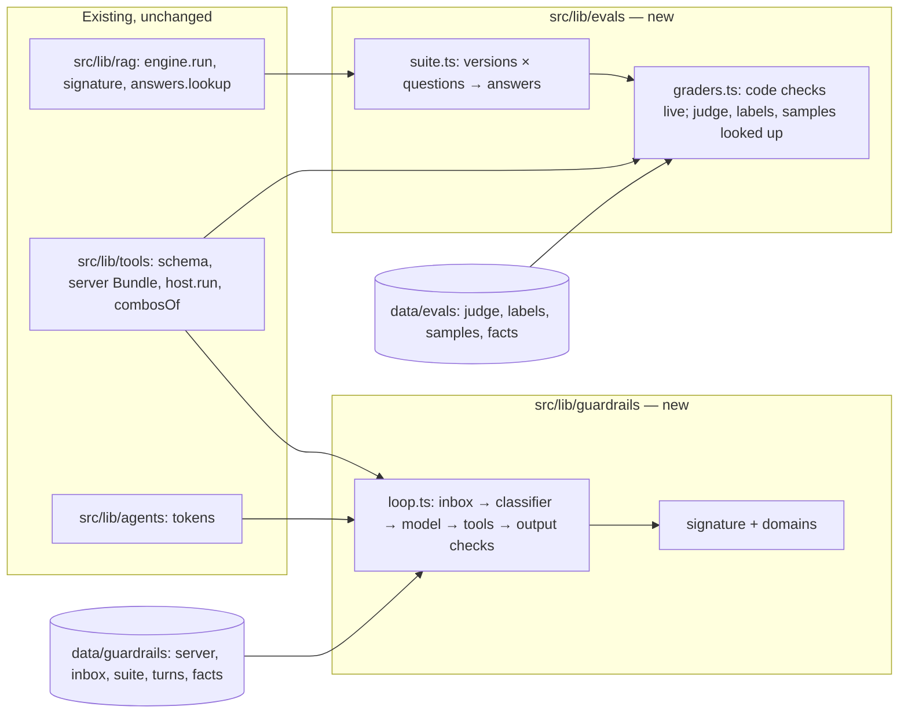
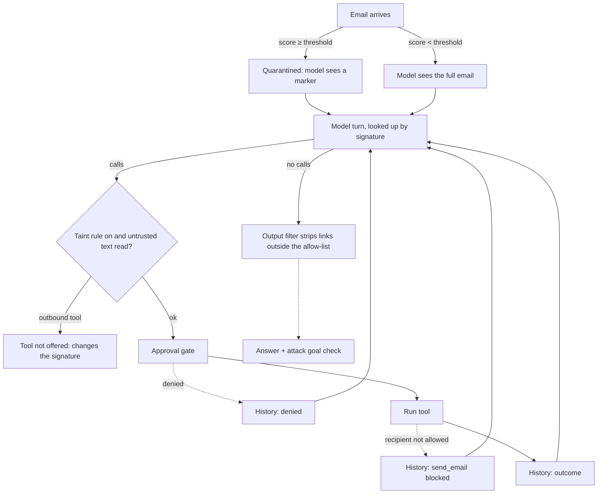

# Evals and Guardrails Modules - Plan

## Goal Capsule

- **Objective:** Take two roadmap cards live, continuing the Larkspur Supply Co. story. **Evals & LLM testing** becomes module 4 (Intermediate, after RAG). **Prompt injection & guardrails** becomes module 5 (Intermediate, after Tool calling).
- **Product authority:** Product Contract requirements (R-IDs) win on product behaviour. Key Technical Decisions (KTD-IDs) win on mechanism. AGENTS.md decisions stay in force unless a KTD here changes one on purpose; U14 writes every such change back into AGENTS.md.
- **Open blockers:** None.
- **Execution profile:** Brownfield work on the Astro 7 + React islands site. Two phases, one per module (see Phased Delivery). Each phase ships on its own as a PR and leaves `pnpm check`, `pnpm test` and `pnpm test:e2e` green.
- **Stop conditions:**
  - Stop and ask if a chapter needs a backend, a live model, a live classifier or an API key (R3).
  - Stop and ask if the evals versions (KTD2) need a RAG question added or the RAG index rebuilt.
  - Stop and ask if a change to `src/lib/tools/` or `src/lib/agents/` would change any existing chapter's output, recordings or saved runs (R12).
  - Stop and ask if a source checked for `facts.json` contradicts a chapter's lesson, not just a wording or a date.
- **Tail ownership:** One branch and PR per phase, to `main`, with conventional commits, one logical change each (AGENTS.md "Commits").

---

## Product Contract

### Summary

Two roadmap cards go live. In **Evals**, Larkspur's team stops trusting "it worked when I tried it". They build a test set from the RAG assistant's real questions, grade answers with code checks, a model judge and a person, check the judge against people, grade a tool run's path as well as its answer, learn why one run proves little, and gate a release on the suite. In **Guardrails**, the assistant now reads customer email and can send email out, so planted text becomes an attack. The reader sees direct and indirect injection, why a prompt rule alone fails, what an input classifier trades off, how output checks stop data leaving, how cutting one leg of the "lethal trifecta" defuses an attack, and how layered defences are measured against an attack suite.

### Problem Frame

The catalogue has three live modules and a path that stops at agents. Teams adopting the assistant hit two questions next: how do we know a change made it better, and what stops someone from taking it over? Both topics are touched already, but only in passing. RAG chapter 5 grades one answer at a time. Tool calling chapter 6 and Agents chapter 3 each show one planted note and a person-in-the-loop defence, and the Agents step links to the Guardrails card as "a module of its own". These modules must build on those chapters, not teach them again.

### Requirements

**Both modules**

- R1. `evals` and `guardrails` become live: Intermediate, author Kondasamy Jayaraman, the Larkspur story, seven chapters each, a recall bank, an intro, a recap, share images and an e2e spec. Each passes every check in `tests/unit/registry.test.ts`.
- R2. Prerequisites: Evals names `rag`; Guardrails names `tool-calling`.
- R3. Nothing runs a live model or a live classifier. Every model turn and judge verdict a chapter control can reach is recorded, and a unit test proves it (AGENTS.md "Tool calling engine").
- R4. Every chapter follows the house loop and rules: an intro with context, predict → reveal, quizzes with a `why` per option and "I'm not sure", terms defined on first use (`docs/writing-a-module.md`).
- R5. Every claim about real practice (definitions, grader biases, pass^k, the lethal trifecta, OWASP's ranking) comes from `data/<module>/facts.json` with a source and an access date.

**Evals**

- R6. Each chapter teaches one idea, in this order:
  1. Vibes vs. a test set: a change that looks better on two tried questions regresses on the full set.
  2. Building the test set: where cases come from and what they cover (real questions, known failures, asks the documents cannot answer), and what a reference answer is.
  3. Graders: code checks, a model judge with a rubric, a person; which failure each one catches and misses.
  4. Judging the judge: agreement with people's labels, fixing the rubric, and position bias in side-by-side grading.
  5. Grading the path: a run whose final answer reads well but whose actions were wrong; answer, state and path checks.
  6. Run it twice: the same case can pass and fail; pass@k vs. pass^k; why a small suite moves in big steps.
  7. Release day (workbench): pick a change, run the suite, set the gate, decide to ship.
- R7. The test subject is the assistant the reader already knows: RAG's questions, reference sentences and recorded answers, with the RAG pipeline running live in the browser.

**Guardrails**

- R8. Each chapter teaches one idea, in this order:
  1. Data or instructions: direct vs. indirect injection; why the model cannot tell them apart, and why a prompt rule ("ignore instructions in emails") lowers but does not stop attacks.
  2. Input filters: a classifier scores each incoming email; the reader sets the threshold and sees quarantined attacks against quarantined customers.
  3. The way out: an attack that reads private data and sends it out; output checks (an allow-list for recipients and links).
  4. The lethal trifecta: private data, untrusted text, a way out; removing one leg, and a host rule that turns off outbound tools once untrusted text is read.
  5. Defence in depth: an attack suite against layered defences; a puzzle to stop every attack while blocking the fewest real customers.
  6. When the user is the attacker: a customer pushing the assistant past policy (an unearned discount, an off-topic ask); policy checks on input and output, and the cost of over-refusing.
  7. Red team (workbench): pick defences, run the attack suite and the customer suite, read the attack success rate.
- R9. Guardrails recaps Tool calling chapter 6 (approval gate, least privilege, a planted note) in one step at most, and builds on it.
- R10. Agents chapter 3's injection step links to the live Guardrails module instead of its roadmap card.
- R11. Guardrails chapter 7 and chapter 2 describe attack success and false blocks as an eval, and link to Evals.
- R12. RAG, Tool calling, Agents and their saved progress do not change. No chapter id, step id, recording or share image of theirs changes. The exceptions are the home hero and home share image, and R10's link and its sentence in Agents chapter 3.

### Scope Boundaries

- Tokens & embeddings, Transformer architecture, Context engineering and Fine-tuning stay planned.
- No live model, no real classifier, no real email.
- Evals: no statistics beyond counts and percentages (no confidence intervals, no significance tests); the "small suite" lesson uses the arithmetic of one flipped case. No eval tooling or vendor comparison.
- Guardrails: no jailbreak catalogue or harmful-content examples; the "user as attacker" chapter stays on business-policy pushes (discounts, refunds, off-topic). No model training defences (fine-tuning against injection) and no named vendor products.

### Deferred to Follow-Up Work

- Plans for Tokens, Transformers, Context engineering and Fine-tuning.
- Growing RAG's question set (it needs an index rebuild; KTD2).
- A cross-module learning-path view on the home page.

### Success Criteria

- A reader who finishes Evals can say why two hand-tried questions do not show a change is better, and name one failure a code check misses that a judge catches, and one the other way.
- A reader who finishes Guardrails can name the three legs of the lethal trifecta and say why removing one beats a better prompt.
- `pnpm test` fails when any reachable evals answer or judge verdict, or any reachable guardrails turn, lacks a recording.
- The home catalogue shows 5 live modules and 4 planned ones under the correct levels, at 1280px and 390px.

### Key Decisions

- Evals tests the existing RAG assistant (its 12 questions, reference sentences and recorded answers, the pipeline live), plus Tool calling runs for the path chapter. (Confirmed at scoping; chosen over a new dataset: the reader already knows these questions, and the pipeline already runs in the browser.) Governs R6, R7.
- Guardrails builds on the agent engine's pieces and a mail tool that can send outside, so leaking data is something the reader sees happen. (Confirmed at scoping; chosen over Tool calling's host, which has no way out.) Governs R8.
- Evals ships first, so Guardrails can measure its defences as an eval. (Confirmed at scoping.) Governs R11.
- External research did not run during planning. The facts units check every source. (Confirmed at scoping.) Governs R5.

---

## Planning Contract

### Key Technical Decisions

- KTD1. **Each module gets its own engine folder, `src/lib/evals/` and `src/lib/guardrails/`, built on existing engines without changing them.** This follows AGENTS.md's agent-engine rule: reuse `src/lib/rag/`, `src/lib/tools/` and `src/lib/agents/` exports, and never add fields to their signatures. Their recordings and saved runs are untouched (R12).
- KTD2. **Evals' "versions" are named RAG pipeline configurations over the existing 12 questions.** `src/lib/evals/suite.ts` defines a few versions, for example v1 = RAG chapter 4's defaults, v2 = a bigger chunk size, v3 = v2 plus the reranker. A suite run calls `src/lib/rag/engine.ts` `run` per question, takes `signature()` of its context, and looks up the recorded answer with `src/lib/rag/answers.ts` `lookup`. Every signature is already answered: `tests/unit/answers.test.ts` covers the full `signatureSpace` and rejects extra keys, so versions only read existing answers and `data/answers/` does not change. No question is added, so the index is not rebuilt. The small suite is itself chapter 6's lesson. Versions are chosen so v2 fixes some questions and breaks others (chapter 1's regression).
- KTD3. **Graders split by what can be computed.** Code graders run live: exact match against a written reference answer, contains-the-key-fact and has-a-citation. (A citation-is-real check is left out: RAG's tests already guarantee every recorded citation is a corpus sentence, so it could never fail.) Recorded answers paraphrase the corpus, so each question's reference answer and each key fact's short phrases (`30 days`, `2 p.m.`) live in `data/evals/references.json`, written by hand. `data/questions/` is not edited. Judge verdicts are recorded in `data/evals/judge.json`, keyed by question, answer signature and rubric version (`r1`, `r2`). Each recorded answer's `verdict` is the reference. People's labels are a fixture in `data/evals/labels.json`: the team's own reading, which mostly matches the verdict, and the "people were wrong" rows are the ones that don't. Agreement and disagreement counts are computed.
- KTD4. **Side-by-side (pairwise) judging records both orders.** Each pair has a verdict with A first and with B first, keyed in `judge.json` by question, both answer signatures, rubric and order. Position bias is computed as how often the winner changes when the order swaps.
- KTD5. **The path chapter grades Tool calling host runs, not new recordings.** It runs `src/lib/tools/host.ts` `run` over existing recordings (the planted-note refund, `injection`). The answer grader is a code check for the fact asked (the delivery date), and it passes. The reply even mentions the refund, but no answer check looks for it; the judge under r2 does, and fails it. The clean run is `order-status`. The state grader reads the ledger, and the path grader reads the steps. Both catch the refund. Tool calling's recordings are read, never edited.
- KTD6. **Run-to-run variation is recorded as k samples per case.** `data/evals/samples.json` holds k = 5 recorded answers for a few cases, each with a verdict. pass@k (any of k passes) and pass^k (all k pass) are computed. The copy says the samples stand in for sampling a live model at a non-zero temperature.
- KTD7. **The Guardrails engine is a small single-agent loop with defence layers as host stages.** It reuses `schema.ts`, `server.ts`'s `Bundle`, `combosOf`, `stepsOf`/`answerOf` and agents' `tokens`. It has no plans, compaction or delegation. Its bundle, in `data/guardrails/server.json`, adds `read_inbox` (untrusted email), `get_customer` (private data: address, card's last four, account notes) and `send_email` with a free `to` field (the way out), plus the order tools. Replies to the sender of the email being worked go through a host-defined `reply` tool, which is not a way out (it can only answer the sender). The taint rule removes only `send_email`.
- KTD8. **The guardrails signature holds what the model could see, as in KTD3 of the agents plan.** In: the case, the tools offered (the taint rule removes `send_email` after an untrusted read, and removing a leg removes `get_customer` or `send_email`, so both change this), whether the prompt rule is in the system text, each inbox email's visible form (full, `quarantined` when the classifier held it, or `refused` when the input policy check turned it away), and the history of outcomes (a blocked send enters as `send_email:blocked`). Out: the classifier threshold itself, the allow-list contents, the output filter, the output policy check and the approval mode. These change what the host does, not what the model sees.
- KTD9. **The classifier is a fixture, not a model.** Each email in `data/guardrails/inbox.json` carries a hand-assigned score, an `attack` label and a short note; it is the only home of scores and labels. The copy calls it a stand-in detector whose scores were set to show the trade-off. Thresholds come from a finite list. Quarantined attacks and quarantined customers are counted live.
- KTD10. **Attack suite and customer suite.** `data/guardrails/suite.json` references inbox emails by id: the attacks (each with a goal check, such as "data sent to an outside address" or "refund over the limit") and the ordinary customer emails. Attack success rate and false-block rate are computed over the suite for a defence set, and the copy names it an eval (R11).
- KTD11. **Scenes compose existing scenes.** `evalScene.ts` is a test bench: a stack of test cards fed into the RAG mini pipeline (`miniPipeline`), a grader's desk with pass/fail stamps, and a scoreboard of pills. The precise view is a Results tab: a flat grid (`flat.ts`) of cases × versions with stamps. `guardScene.ts` composes `officeScene`: a mail tray where email enters, a screening arch on the inbound belt (the classifier), a barrier on an outbound mail chute (the allow-list), and a taint tag on envelopes that came from outside. Words go in captions and pills only (AGENTS.md "Pictures").
- KTD12. **Scaffold each module with `pnpm new-module`**, which replaces the planned card of the same id. The hero gets a `DRAW` entry for each (a test-card stack with a stamp; a mail screening arch). The home share image regenerates once per phase.
- KTD13. **Agents chapter 3's link points straight at `/guardrails/`.** It changes in the same PR that takes Guardrails live, so no status check is needed. Its sentence "on the roadmap" becomes "in its own module". The agents e2e assertions on that link (the href, and the page it opens) change to match. They are the only Agents test lines changed.

### High-Level Technical Design

What each engine reuses (KTD1):

A guardrails run. Dashed edges are host-only and stay out of the signature (KTD8):

Chapters, controls and data:

| Module | Chapter id | Control (finite domain) | Data |
|---|---|---|---|
| Evals | `01-it-worked-when-i-tried-it` | Try 2 questions / run all 12, v1 vs v2 | RAG answers |
| Evals | `02-the-test-set` | Sort candidate cases: keep / drop, mark the reference | `data/evals/candidates.json` |
| Evals | `03-graders` | Grader: exact / key fact / citation / judge / person | answers, judge `r1`, labels |
| Evals | `04-judge-the-judge` | Rubric r1 / r2; pair order A-first / B-first | judge, labels |
| Evals | `05-grading-the-path` | Grader: answer / state / path | Tool calling recordings |
| Evals | `06-run-it-twice` | k = 1 / 3 / 5; pass@k / pass^k | samples |
| Evals | `07-release-day` | Version, grader, gate threshold | all of the above |
| Guardrails | `01-data-or-instructions` | Attack: direct / indirect; prompt rule off / on | turns |
| Guardrails | `02-input-filters` | Classifier threshold (finite list) | inbox, suite |
| Guardrails | `03-the-way-out` | Allow-list off / on; output filter off / on | turns |
| Guardrails | `04-the-trifecta` | Remove a leg: private data / untrusted text / way out; taint rule | turns |
| Guardrails | `05-defence-in-depth` | Defence set (puzzle) | suite, turns |
| Guardrails | `06-when-the-user-is-the-attacker` | Policy check on input / output | turns |
| Guardrails | `07-red-team` | Every defence above | suite, turns |

### Assumptions

- Planned sources for `data/evals/facts.json`: Zheng et al., "Judging LLM-as-a-Judge with MT-Bench and Chatbot Arena" (arXiv 2306.05685: position and verbosity bias); Yao et al., "τ-bench" (arXiv 2406.12045: pass^k); Anthropic's guidance on building evals and grading agents; Hamel Husain's writing on error analysis and test sets from real traces. The facts unit checks each claim and records the access date.
- Planned sources for `data/guardrails/facts.json`: OWASP Top 10 for LLM Applications 2025 (LLM01 Prompt Injection); Greshake et al., "Not what you've signed up for" (arXiv 2302.12173: indirect injection); Simon Willison, "The lethal trifecta for AI agents" (2025); Debenedetti et al., "Defeating Prompt Injections by Design" (CaMeL, arXiv 2503.18813), for the idea that a design that separates data from control beats detection; Anthropic and OpenAI published notes on injection defences, where they still hold.
- The customer emails, private customer records and attacks are fiction about Larkspur's customers. No real addresses or domains: outside addresses use reserved example domains (`example.com`, `example.net`).

### Phased Delivery

| Phase | Units | Ships |
|---|---|---|
| A. Evals | U1–U7 | Engine, scene, seven chapters, intro, recall, share images; hero and catalogue show 4 live |
| B. Guardrails | U8–U13 | Engine, scene, seven chapters, intro, recall, share images, Agents link; 5 live |
| Docs | U14 (Evals sections in A, Guardrails sections in B) | AGENTS.md, README, writing guide |

### Risks

- **Version answers don't tell a clean story.** If no realistic pair of configurations makes v2 fix some questions and break others, chapter 1 loses its point. Mitigation: U1 starts by computing every candidate version's signatures over the 12 questions and picks the pair first. If none works, stop and ask (Goal Capsule).
- **The judge looks rigged.** Recorded judge verdicts written to make a point can feel staged. Mitigation: each judge verdict carries its one-line reasoning, and the disagreements with people include cases where the people were wrong (KTD3).
- **Guardrails recordings grow** (defences × attacks × history). Mitigation: one scenario per chapter, small domains, and a coverage test that names the missing signature, as in agents. Chapters 5 and 7 reuse chapter recordings through `WORKBENCH_DOMAINS` (U8), within a module budget of about 150 turns. If a scenario passes ~40 turns, drop a combination from its controls.
- **Guardrails outcomes look rigged.** Which attacks a prompt rule stops is written by hand. Mitigation: chapter 1's reveal says the recorded turns illustrate the sourced finding in `facts.json`, and each attack's turn carries a one-line note on why the model followed or refused.
- **Teaching attacks.** Mitigation: attacks stay business-shaped (refunds, leaking a customer's record to an example domain). No jailbreak strings for harmful content (Scope Boundaries).
- **Overlap with Tool calling ch. 6 and Agents ch. 3.** Mitigation: R9 caps the recap at one step, and doc review checks each chapter's `learn` list against theirs.

---

## Implementation Units

| U-ID | Title | Key files | Depends on |
|---|---|---|---|
| U1 | Evals engine, data and facts | `src/lib/evals/`, `data/evals/`, `data/answers/` | — |
| U2 | Test bench scene and kit | `src/components/scenes/evalScene.ts`, `src/content/evals/kit.tsx` | U1 |
| U3 | Scaffold Evals + ch. 1 | `src/content/evals/`, `src/pages/evals/`, hero | U1, U2 |
| U4 | Evals ch. 2–4 | `src/content/evals/02–04-*.tsx` | U3 |
| U5 | Evals ch. 5–6 | `src/content/evals/05–06-*.tsx` | U3 |
| U6 | Evals ch. 7 Release day | `src/content/evals/07-release-day.tsx` | U4, U5 |
| U7 | Evals intro, recall, share images | `src/pages/evals/index.astro`, `src/dev/og.astro` | U6 |
| U8 | Guardrails engine, data and facts | `src/lib/guardrails/`, `data/guardrails/` | — |
| U9 | Mailroom scene and kit | `src/components/scenes/guardScene.ts`, `src/content/guardrails/kit.tsx` | U8 |
| U10 | Scaffold Guardrails + ch. 1, Agents link | `src/content/guardrails/`, `src/pages/guardrails/`, `src/content/agents/03-plans.tsx` | U8, U9, U7 |
| U11 | Guardrails ch. 2–4 | `src/content/guardrails/02–04-*.tsx` | U10 |
| U12 | Guardrails ch. 5–7 | `src/content/guardrails/05–07-*.tsx` | U11 |
| U13 | Guardrails intro, recall, share images | `src/pages/guardrails/index.astro`, `src/dev/og.astro` | U12 |
| U14 | Docs | `AGENTS.md`, `README.md`, `docs/writing-a-module.md` | U7 (part A), U13 (part B) |

### U1. Evals engine, data and facts

- **Goal:** A suite runner that runs any version over the 12 questions live and grades each answer, with every reachable answer and judge verdict recorded.
- **Requirements:** R3, R5, R7, R12; KTD1–KTD6.
- **Dependencies:** None.
- **Files:** `src/lib/evals/suite.ts`, `src/lib/evals/graders.ts`, `src/lib/evals/facts.ts`, `data/evals/judge.json`, `data/evals/labels.json`, `data/evals/samples.json`, `data/evals/candidates.json`, `data/evals/references.json`, `data/evals/facts.json`, `tests/unit/evals-suite.test.ts`, `tests/unit/evals-coverage.test.ts`.
- **Approach:**
  1. Pick the versions first: compute each candidate configuration's signatures over all 12 questions, and choose a v1/v2 pair where v2 fixes at least one question and breaks at least one (Risks).
  2. `suite.ts`: `VERSIONS`, and `runSuite(index, version)` returning one row per question (signature, answer, verdict). It needs the loaded index, so the unit test loads it as RAG's tests do.
  3. `graders.ts`: the four code graders, the judge and label lookups, pairwise lookups with both orders, agreement counts, and pass@k / pass^k over samples.
  4. Write the reference answers and key-fact phrases, and record the judge verdicts by hand. Review them like RAG's answers.
  5. Write `facts.json` from the planned sources (Assumptions), exported through `factsOf` as agents does.
- **Execution note:** Write the coverage test first, so the data files grow until it passes.
- **Patterns to follow:** `src/lib/rag/selfcheck.ts` (runs the engine and grades), `src/lib/rag/answers.ts`, `src/lib/agents/facts.ts`, `tests/unit/agent-coverage.test.ts`.
- **Test scenarios:**
  - v1 and v2 over the 12 questions: at least one question goes correct→wrong and at least one wrong→correct, and the totals are computed from the rows.
  - Exact match fails a correct paraphrase. Key-fact grading passes it.
  - Has-a-citation fails a `madeup` answer (its citation is null).
  - The judge under rubric `r1` passes a `madeup` answer that sounds plausible; under `r2` it fails it.
  - Judge/label agreement equals the count of matching verdicts ÷ labelled rows, with 0 labels reported as "no labels", not NaN.
  - Pairwise: at least one pair's winner changes when the order swaps, and the position-bias count matches.
  - pass@k ≥ pass^k for every case and k. With k = 1 they are equal.
  - Coverage: every version × question has a recorded answer, and every (question, answer signature, rubric) reachable from any chapter domain has a judge verdict.
  - Every version × question reaches an existing answer, and `data/answers/` is unchanged.
  - Facts: every fact has a claim, source URL and accessed date, and every fact id referenced in `src/content/evals/` exists.
- **Verification:** `pnpm test` passes. Deleting one judge verdict makes the coverage test fail and name it.

### U2. Test bench scene and kit

- **Goal:** The test-bench picture and a stage that switches between Picture and Results.
- **Requirements:** R4; KTD11.
- **Dependencies:** U1.
- **Files:** `src/components/scenes/evalScene.ts`, `src/components/scenes/evalGrid.ts`, `src/content/evals/kit.tsx`, `src/content/evals/evals.css`, `src/dev/evals.astro` (dev-only), `tests/unit/eval-scene.test.ts`.
- **Approach:**
  1. `evalScene`: test cards stacked by the mini pipeline, the current card riding in, a grader's desk with a stamp per verdict, and a scoreboard pill (passed / total).
  2. `evalGrid`: the Results tab, a flat grid of questions × versions with pass/fail stamps, a flipped cell marked.
  3. `EvalStage` mirrors `AgentStage`: caption from the current step, every string escaped, tab kept as view state. It opens the index and loads every version's config before the first step, showing "Preparing…" and a retryable error as `Canvas.tsx` does; step predicates wait for the suite rows.
  4. Phones: grid rows show question numbers only, the full text goes in the caption, and each cell has an accessible name ("Q3, v2: failed, was passing"). Guardrails' attack × defence matrix (U12) follows the same rule.
- **Patterns to follow:** `src/components/scenes/agentScene.ts`, `src/components/scenes/miniPipeline.ts`, `src/content/agents/kit.tsx`, `tests/unit/agent-scene.test.ts`.
- **Test scenarios:**
  - The scoreboard pill reads the suite's computed pass count.
  - The grid has one cell per question × version, and a flipped question is marked in both versions' cells.
  - A question text containing `<script>` renders escaped.
  - Before the index loads, the stage shows "Preparing…" and no step can advance; a failed load offers a retry.
  - With an empty suite the scene draws the bench without cards and no `NaN` in any pill.
- **Verification:** The dev page shows every state at 1280px and 390px without overlap, with labels in pills.

### U3. Scaffold Evals and chapter 1

- **Goal:** `evals` is live with its frame and "It worked when I tried it".
- **Requirements:** R1, R2, R4, R6.1; KTD12.
- **Dependencies:** U1, U2.
- **Files:** `src/lib/modules.ts`, `tests/unit/modules.test.ts` (its planned list), `src/content/evals/module.ts`, `src/content/evals/01-it-worked-when-i-tried-it.tsx`, `src/content/evals/recall.ts`, `src/pages/evals/index.astro`, `src/pages/evals/[chapter].astro`, `src/pages/evals/recap.astro`, `tests/e2e/evals.spec.ts`, `tests/e2e/evals-flow.ts`, `src/components/scenes/heroScene.ts` (`DRAW.evals`), `src/pages/index.astro` (`CARD.evals`), `src/dev/og.astro` (home with four live), `public/og/home.jpg`.
- **Approach:**
  1. `pnpm new-module evals "Evals & LLM testing"`. Level Intermediate, prereq `rag`, the story sentence.
  2. Chapter 1: the team changes the chunk size (v2). The reader tries two questions, picked only from those v2 fixes, and both look better. They predict whether the whole set is better, run all 12, and find the regression in the grid.
  3. Intro terms: *eval*, *test set*, *regression*.
- **Patterns to follow:** `src/content/agents/01-workflow-or-agent.tsx`, `src/pages/agents/*`, `tests/e2e/agents-flow.ts`.
- **Test scenarios:**
  - Both questions offered for trying go wrong→correct under v2, and the regression shows only after "run all 12".
  - The registry test passes for `evals` with one chapter.
  - The e2e flow plays chapter 1 by keyboard only, with axe clean, at 390px and with reduced motion.
  - The progress key is `evals-progress-v1`, and RAG's key is untouched after playing.
  - The home page shows Evals live with progress, and Continue resumes it.
  - The hero has a live Evals plot and one pill per module.
- **Verification:** The chapter at 1280px and 390px; all three check commands are green.

### U4. Evals chapters 2–4

- **Goal:** Building the test set, the three kinds of grader, and judging the judge.
- **Requirements:** R4, R5, R6.2–R6.4; KTD3, KTD4.
- **Dependencies:** U3.
- **Files:** `src/content/evals/02-the-test-set.tsx`, `src/content/evals/03-graders.tsx`, `src/content/evals/04-judge-the-judge.tsx`, `src/content/evals/module.ts`, `src/content/evals/recall.ts`, `src/pages/evals/[chapter].astro`, `tests/e2e/evals.spec.ts`.
- **Approach:**
  1. Chapter 2: a support log of candidate cases. The reader keeps or drops each one and marks which reference sentence it needs. Each card has Keep / Drop buttons and, once kept, a select for its reference sentence; unsorted cards read "not sorted", and a kept card with no reference is flagged. The step advances when every card is sorted. The reveal shows which of the three kinds (real questions, known failures, asks the documents cannot answer) the kept set covers, and a gap the reader left.
  2. Chapter 3: one answer at a time through each grader. The predict asks which grader catches a paraphrase, a made-up policy and a missing citation. A matrix fills in from live results.
  3. Chapter 4: the judge against the team's labels, under rubric r1 then r2. A side-by-side pair with the order swapped shows position bias. The step names the fix, judging both orders, from `facts.json`.
- **Patterns to follow:** `src/content/rag/05-accuracy.tsx` (grading one answer), `Predict`, `Quiz`.
- **Test scenarios:**
  - Chapter 2: dropping every ask the documents cannot answer makes the reveal name that gap.
  - Chapter 3: the grader matrix's cells equal `graders.ts`'s results for the same answers.
  - Chapter 4: switching r1→r2 raises the computed agreement, and the shown percentage equals the engine's.
  - Chapter 4: the swapped pair shows a different winner, and the predict locks beside it.
  - Every checkpoint option shows its `why`, and "I'm not sure" reveals without a miss.
- **Verification:** The e2e spec plays chapters 2–4; the recall bank covers them.

### U5. Evals chapters 5–6

- **Goal:** Grading a run's path, and why one run proves little.
- **Requirements:** R4, R5, R6.5, R6.6; KTD5, KTD6.
- **Dependencies:** U3.
- **Files:** `src/content/evals/05-grading-the-path.tsx`, `src/content/evals/06-run-it-twice.tsx`, `src/content/evals/module.ts`, `src/content/evals/recall.ts`, `src/pages/evals/[chapter].astro`, `tests/e2e/evals.spec.ts`.
- **Approach:**
  1. Chapter 5: the planted-note run from Tool calling. Its reply answers the question asked. The reader predicts which grader fails it: the answer grader (delivery date) passes it, the judge under r2 notices the refund it mentions, while the state grader (ledger) and path grader (an `issue_refund` the request never asked for) fail it. A one-line pointer to Tool calling for readers who haven't played it.
  2. Chapter 6: one case answered five times. The reader picks k and the metric. The step on suite size computes what one flipped question does to the percentage over 12 cases.
- **Patterns to follow:** `src/content/tool-calling/06-when-tools-go-wrong.tsx` (ledger), `src/lib/tools/host.ts` `run`.
- **Test scenarios:**
  - Chapter 5: the answer grader passes, and the state and path graders fail the same run, all computed from `host.run`.
  - Chapter 5: the judge under r2 fails the planted run's reply.
  - Chapter 5: the clean run (`order-status`) passes all graders.
  - Chapter 6: the shown pass@k and pass^k equal the engine's for each k.
  - Chapter 6: the one-case swing shown equals 1 ÷ 12 as a percentage, from the suite length, not typed.
- **Verification:** The e2e spec plays both chapters.

### U6. Evals chapter 7: release day

- **Goal:** A workbench where the reader runs a candidate version and decides whether it ships.
- **Requirements:** R6.7, R3.
- **Dependencies:** U4, U5.
- **Files:** `src/content/evals/07-release-day.tsx`, `src/lib/evals/suite.ts` (`WORKBENCH_DOMAINS`), `src/content/evals/module.ts`, `tests/unit/evals-workbench.test.ts`, `tests/e2e/evals.spec.ts`.
- **Approach:** Controls: version, grader, gate threshold (a pass rate, and "no question that passed before may fail"). The stage shows the grid against v1 and the gate's decision. The copy says the gate grades one run per question and points back to chapter 6's pass^k as what a real gate would use. The control state is kept in the step state.
- **Patterns to follow:** `src/content/agents/07-workbench.tsx`, `tests/unit/agent-workbench.test.ts`.
- **Test scenarios:**
  - Every workbench combination grades without a missing answer or verdict.
  - A version above the pass-rate threshold that breaks one question is blocked by the "no regressions" gate, and allowed with that gate off.
  - The control state survives a reload.
- **Verification:** The e2e spec runs a blocked and a shipped combination.

### U7. Evals intro, recall and share images

- **Goal:** Evals reads complete from the home page to the recap.
- **Requirements:** R1, R4, R5, R12.
- **Dependencies:** U6.
- **Files:** `src/pages/evals/index.astro`, `src/content/evals/recall.ts`, `src/dev/og.astro`, `public/og/evals*.jpg`, `public/og/home.jpg`.
- **Approach:**
  1. Pictures-first intro under the Pictures / Words switch: the idea in one example (two tried questions vs. the grid), how a suite runs, the Larkspur team, the chapter path, the Colorfigures credit.
  2. Recall: three to five items per chapter, exactly one pinned for the module.
  3. A share picture case per evals page in `og.astro`, then `pnpm og`.
- **Patterns to follow:** `src/pages/agents/index.astro`, AGENTS.md "Share images".
- **Test scenarios:**
  - The registry test passes for the full module: seven chapters, recall per chapter, one pin, every share image.
  - The e2e share-image test finds a distinct image for each of the nine evals pages.
  - The recap with nothing done says so and links chapter 1.
  - The warm-up appears 20 hours after a finished chapter, with a skip link.
- **Verification:** Every evals page at 1280px and 390px; `pnpm og` changes only `home.jpg` and `evals*.jpg`.

### U8. Guardrails engine, data and facts

- **Goal:** A deterministic single-agent loop with defence layers, over recorded turns, with coverage proven.
- **Requirements:** R3, R5, R12; KTD1, KTD7–KTD10.
- **Dependencies:** None.
- **Files:** `src/lib/guardrails/loop.ts`, `src/lib/guardrails/turns.ts`, `src/lib/guardrails/facts.ts`, `data/guardrails/server.json`, `data/guardrails/inbox.json`, `data/guardrails/customers.json`, `data/guardrails/suite.json`, `data/guardrails/facts.json`, `data/guardrails/turns/*.json`, `tests/unit/guard-loop.test.ts`, `tests/unit/guard-coverage.test.ts`.
- **Approach:**
  1. Define the bundle (KTD7) and pass it to `createServer`. The order tools come from Tool calling's default and are not changed.
  2. `run(recording, setup)` follows the run diagram above. Setup: case, prompt rule, threshold, allow-list, output filter, taint rule, approval and decisions, policy checks. `DOMAINS` per chapter, and `WORKBENCH_DOMAINS` for chapters 5 and 7: each attack or customer case maps onto the chapter scenario that recorded it, offering only that chapter's signature-changing defences. Host-only defences (allow-list, output filter, output policy, approval) combine freely, since they need no new turns. Budget: about 150 recorded turns for the whole module.
  3. Each run reports whether the attack's goal was met (from `suite.json`'s goal check against the run's mail log and ledger).
  4. Record turns by hand, one file per chapter scenario.
- **Execution note:** Write the coverage test first.
- **Patterns to follow:** `src/lib/agents/loop.ts`, `src/lib/agents/turns.ts`, `tests/unit/agent-loop.test.ts`, `tests/unit/agent-coverage.test.ts`.
- **Test scenarios:**
  - With the taint rule on, an ordinary customer email still gets its `reply`.
  - Input policy check on: an off-policy ask is `refused` in the signature.
  - Indirect attack, no defences: the model reads the email, calls `get_customer`, then sends the record to an outside address. Attack goal met.
  - Prompt rule on: one attack is now refused, and another still succeeds (both recorded).
  - Threshold set below an attack's score: the email is `quarantined` in the signature, and the attack fails. A real customer email above the threshold is quarantined too, and counted as a false block.
  - Allow-list on: the outside send returns `blocked`, the model's next turn sees it, and the goal is not met.
  - Output filter on: a link to an outside domain in the final answer is stripped, and the answer says a link was removed.
  - Taint rule on: after `read_inbox`, `send_email` is no longer offered, and the signature's tools change.
  - Approval with decision deny: the send never runs.
  - Suite metrics: attack success rate and false-block rate over the suite equal hand-counted values for two defence sets.
  - Coverage: every combination of every domain ends without `norecord`.
  - Tool calling's and Agents' existing server and loop tests pass untouched.
  - Facts: every fact has a claim, source URL and accessed date, and every referenced id exists.
- **Verification:** `pnpm test` passes. Deleting one turn makes coverage fail and name the signature.

### U9. Mailroom scene and kit

- **Goal:** The back office with a mailroom: inbound screening and an outbound chute.
- **Requirements:** R4; KTD11.
- **Dependencies:** U8.
- **Files:** `src/components/scenes/guardScene.ts`, `src/content/guardrails/kit.tsx`, `src/content/guardrails/guardrails.css`, `src/dev/guardrails.astro` (dev-only), `tests/unit/guard-scene.test.ts`.
- **Approach:** Compose `officeScene`. Add the mail tray, the screening arch (shown when the classifier is on), the chute barrier (allow-list), and a taint tag on envelopes from outside. Each prop is a flag. A Picture / Steps tab reuses `agentSequence`'s lane style for the precise view. Phones drop the props' readout pills, and the caption carries them (as agents does).
- **Patterns to follow:** `src/components/scenes/agentScene.ts`, `src/components/scenes/officeScene.ts`, `tests/unit/agent-scene.test.ts`.
- **Test scenarios:**
  - A quarantined email is drawn held at the arch, not on the belt.
  - A blocked send is drawn stopped at the barrier.
  - The taint tag appears only on envelopes from `read_inbox`.
  - An email body containing `` renders escaped in the SVG string.
- **Verification:** The dev page shows every state at 1280px and 390px without overlap.

### U10. Scaffold Guardrails, chapter 1 and the Agents link

- **Goal:** `guardrails` is live with "Data or instructions?", and Agents chapter 3 links to it.
- **Requirements:** R1, R2, R4, R8.1, R9, R10; KTD12, KTD13.
- **Dependencies:** U8, U9, U7 (Phase A merged).
- **Files:** `src/lib/modules.ts`, `tests/unit/modules.test.ts` (its planned list), `src/content/guardrails/module.ts`, `src/content/guardrails/01-data-or-instructions.tsx`, `src/content/guardrails/recall.ts`, `src/pages/guardrails/index.astro`, `src/pages/guardrails/[chapter].astro`, `src/pages/guardrails/recap.astro`, `tests/e2e/guardrails.spec.ts`, `tests/e2e/guardrails-flow.ts`, `src/content/agents/03-plans.tsx`, `tests/e2e/agents.spec.ts`, `src/components/scenes/heroScene.ts` (`DRAW.guardrails`), `src/pages/index.astro` (`CARD.guardrails`), `src/dev/og.astro`, `public/og/home.jpg`.
- **Approach:**
  1. `pnpm new-module guardrails "Prompt injection & guardrails"`. Level Intermediate, prereq `tool-calling`.
  2. Chapter 1 opens with one recap step from Tool calling's planted note (R9). Then a direct attack typed by a "customer", and an indirect one inside an email. The predict asks whether adding the prompt rule stops both. The reveal: it stops one.
  3. Agents ch. 3 (KTD13): point the link at `/guardrails/` and reword "on the roadmap". In `tests/e2e/agents.spec.ts`, the href assertion and the check that the roadmap card opens become the Guardrails intro opening.
- **Patterns to follow:** U3.
- **Test scenarios:**
  - The registry test passes for `guardrails` with one chapter.
  - The e2e flow plays chapter 1 by keyboard, axe clean, at 390px and with reduced motion.
  - The Agents ch. 3 link points to `/guardrails/` and opens the intro.
  - Agents' progress and step ids are unchanged after the edit (its other e2e steps pass untouched).
- **Verification:** All three check commands green; the home page shows 5 live modules.

### U11. Guardrails chapters 2–4

- **Goal:** Input filters, the way out, and the lethal trifecta.
- **Requirements:** R4, R5, R8.2–R8.4, R11; KTD8–KTD10.
- **Dependencies:** U10.
- **Files:** `src/content/guardrails/02-input-filters.tsx`, `src/content/guardrails/03-the-way-out.tsx`, `src/content/guardrails/04-the-trifecta.tsx`, `src/content/guardrails/module.ts`, `src/content/guardrails/recall.ts`, `src/pages/guardrails/[chapter].astro`, `tests/e2e/guardrails.spec.ts`.
- **Approach:**
  1. Chapter 2: the inbox as a strip of emails with their scores. The threshold is a stepped control over the finite list (a radio group, or a slider with discrete stops whose `aria-valuetext` reads the counts). Live text reads "N of M attacks quarantined, K of J customers quarantined". The step names the counts as an eval and links to Evals (R11).
  2. Chapter 3: an attack that leaks a customer's record to an outside address. Turn on the allow-list, then the output filter for a link-shaped leak.
  3. Chapter 4: the three legs drawn on the stage. Each removal is a concrete change: private data drops `get_customer`, untrusted text quarantines every inbox email, the way out drops `send_email`. The puzzle: remove one leg so the attack fails while the support case still gets done. Dropping untrusted text leaves the case unread (a miss); dropping private data fails a case that needs the customer's record (a miss); dropping the way out wins, because replies go through `reply`. Hints after three misses, "Show me". The taint rule is the reveal: it removes the way out only once untrusted text is in.
- **Patterns to follow:** `src/content/agents/04-budgets.tsx` (puzzle), `src/content/tool-calling/06-when-tools-go-wrong.tsx`.
- **Test scenarios:**
  - Chapter 2: at each threshold, the shown counts equal the engine's over `suite.json`.
  - Chapter 2: no threshold blocks every attack and no customer (the data guarantees the trade-off), and the step says so.
  - Chapter 3: with the allow-list on, the run's mail log has no outside address.
  - Chapter 4: removing untrusted text or private data leaves the case undone; removing the way out or turning on the taint rule stops the attack and the customer still gets a reply.
  - Chapter 4: the puzzle passes only for a removal or taint setting where the attack goal is unmet and the customer's case is done; "Show me" sets one and advances.
- **Verification:** The e2e spec plays all three, solving the puzzle by keyboard.

### U12. Guardrails chapters 5–7

- **Goal:** Defence in depth, the user as attacker, and the red-team workbench.
- **Requirements:** R4, R5, R8.5–R8.7, R11.
- **Dependencies:** U11.
- **Files:** `src/content/guardrails/05-defence-in-depth.tsx`, `src/content/guardrails/06-when-the-user-is-the-attacker.tsx`, `src/content/guardrails/07-red-team.tsx`, `src/content/guardrails/module.ts`, `src/content/guardrails/recall.ts`, `src/pages/guardrails/[chapter].astro`, `tests/unit/guard-workbench.test.ts`, `tests/e2e/guardrails.spec.ts`.
- **Approach:**
  1. Chapter 5: a matrix of attacks × defences, filled from runs (phone layout as U2). Puzzle: a defence set with zero attack successes and the fewest false blocks.
  2. Chapter 6: a customer pushes for a discount and an off-topic task. An input policy check, an output policy check, and an over-strict setting that refuses a fair request. The cost of over-refusal is shown.
  3. Chapter 7: every defence as a control, the two suites run, attack success rate and false-block rate shown. The step points to Evals' release gate.
- **Patterns to follow:** `src/content/agents/07-workbench.tsx`, `tests/unit/agent-workbench.test.ts`.
- **Test scenarios:**
  - Chapter 5: each matrix cell equals the engine's goal check for that attack under that defence.
  - Chapter 5: the puzzle accepts every minimal winning set, not only one.
  - Chapter 6: the strict output check refuses the fair refund request, and the step counts it as a false block.
  - Chapter 7: every workbench combination ends without `norecord`, and the control state survives a reload.
- **Verification:** The e2e spec plays chapters 5–7 including one red-team combination.

### U13. Guardrails intro, recall and share images

- **Goal:** Guardrails reads complete from the home page to the recap.
- **Requirements:** R1, R4, R5, R12.
- **Dependencies:** U12.
- **Files:** `src/pages/guardrails/index.astro`, `src/content/guardrails/recall.ts`, `src/dev/og.astro`, `public/og/guardrails*.jpg`, `public/og/home.jpg`.
- **Approach:** As U7: pictures-first intro (the planted email in one example, the mailroom, the trifecta, the chapter path, credit), recall with one pin, share picture cases, `pnpm og`.
- **Test scenarios:**
  - The registry test passes for the full module.
  - Nine distinct guardrails share images.
  - Recap and warm-up behave as in U7.
- **Verification:** Every guardrails page at 1280px and 390px; `pnpm og` changes only `home.jpg` and `guardrails*.jpg`.

### U14. Docs

- **Goal:** AGENTS.md and the guides describe the two new engines and scenes.
- **Requirements:** R1, R12.
- **Dependencies:** U7 (evals sections, Phase A PR), U13 (guardrails sections, Phase B PR).
- **Files:** `AGENTS.md`, `README.md`, `docs/writing-a-module.md`.
- **Approach:** Two parts. Part A (Evals sections) ships in Phase A's PR, and part B (Guardrails sections and KTD13) ships in Phase B's. "What this is" lists modules 4 and 5. Add an "Evals engine" section (KTD2–KTD6) and a "Guardrails engine" section (KTD7–KTD10), the two scenes under "Pictures", the Agents link (KTD13), and the guide's level table example for Intermediate.
- **Test expectation:** none -- documentation only.
- **Verification:** Each AGENTS.md claim matches the code it names.

---

## Verification Contract

- `pnpm check`: 0 errors, 0 warnings.
- `pnpm test`: all unit tests, including the new evals and guardrails suite, coverage, scene and workbench tests. Existing RAG, Tool calling and Agents tests pass unchanged (R12).
- `pnpm test:e2e`: all specs, including `evals.spec.ts` and `guardrails.spec.ts` (keyboard only, axe, reduced motion, phone, offline, share images). The only edited existing e2e assertions are Agents ch. 3's Guardrails link; `tests/unit/modules.test.ts`'s planned list also changes.
- `pnpm og` changes only `home.jpg` and the new module's images in each phase.
- A manual look at every changed page at 1280px and 390px (AGENTS.md "Checks before you call it done").

## Definition of Done

- R1–R12 hold, and every unit's verification passes.
- The home catalogue shows 5 live and 4 planned modules under the correct levels.
- No existing chapter id, step id, recording entry or share image changed, apart from R12's named exceptions.
- AGENTS.md describes both engines, both scenes and the Agents link rule.
- No dead code from abandoned approaches, and dev-only pages stay out of production builds.

## Appendix

### Sources

- `docs/plans/2026-10-20-1527-feat-roadmap-and-agents-module-plan.md`: the engine, signature and scene decisions this plan follows.
- `docs/writing-a-module.md`, `AGENTS.md`: house rules.
- `src/lib/rag/engine.ts`, `src/lib/rag/signature.ts`, `src/lib/rag/answers.ts`, `src/lib/rag/selfcheck.ts`: the live pipeline and recorded answers Evals reuses.
- `src/lib/agents/loop.ts`, `src/lib/tools/server.ts`, `src/lib/tools/host.ts`: the bundle, loop and coverage patterns Guardrails reuses.
- `src/content/agents/03-plans.tsx`, `tests/e2e/agents.spec.ts`: the Guardrails link KTD13 changes.
