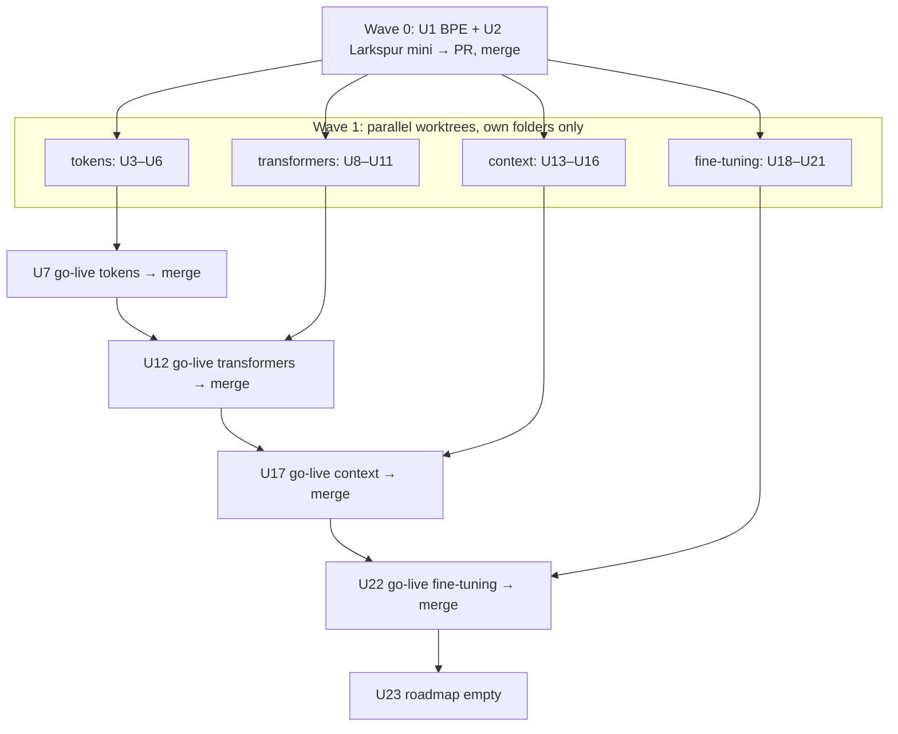

# Tokens, Transformers, Context and Fine-tuning Modules - Plan

## Goal Capsule

- **Objective:** Take the last four roadmap cards live, all continuing the Larkspur Supply Co. story. **Tokens & embeddings** becomes module 6 (Beginner), **Transformer architecture** module 7 (Advanced), **Context engineering & memory** module 8 (Intermediate) and **Fine-tuning vs prompting** module 9 (Advanced). After this, the roadmap is empty.
- **Product authority:** Product Contract requirements (R-IDs) win on product behaviour. Key Technical Decisions (KTD-IDs) win on mechanism. AGENTS.md decisions stay in force unless a KTD here changes one on purpose; each go-live unit writes its changes back into AGENTS.md.
- **Open blockers:** None.
- **Execution profile:** Brownfield work on the Astro 7 + React islands site, run by subagents (KTD12):
  - **Wave 0** (one agent): the shared language-model kit (U1, U2), shipped as its own PR.
  - **Wave 1** (four agents in parallel): one per module, each in its own git worktree on its own branch. Each builds its engine, scene and chapters without touching the shared hotspots.
  - **Wave 2** (serial): each module's go-live unit, merged in the fixed order tokens → transformers → context → fine-tuning, then U23.
  - Every PR leaves `pnpm check`, `pnpm test` and `pnpm test:e2e` green.
- **Stop conditions:**
  - Stop and ask if a chapter needs a backend, a live LLM, an API key, or any training in the browser (R3).
  - Stop and ask if the toy model (U2) cannot clear the "readable" bar at the KTD3 size: a held-out top-5 hit rate of at least 50%, and a top-1 probability of at least 0.25 on every chapter prompt.
  - Stop and ask if a change to `src/lib/rag/`, `tools/`, `agents/`, `evals/` or `guardrails/` would change any existing chapter's output, recordings, saved runs or share images (R13).
  - Stop and ask if a source checked for a `facts.json` contradicts a chapter's lesson, not just a wording or a date.
  - A Wave 1 agent stops and reports if it needs to edit a shared hotspot outside its go-live unit (KTD12).
- **Tail ownership:** One branch and PR per wave-0 kit and per module, to `main`, with conventional commits, one logical change each (AGENTS.md "Commits").

---

## Product Contract

### Summary

The four remaining roadmap cards go live:

- **Tokens.** The reader learns why Larkspur's bill and window count tokens. They type into a real tokenizer trained on Larkspur's own documents, watch its vocabulary being learned merge by merge, see how real tokenizers split the same text, then follow tokens into embeddings and meaning-by-neighbours over RAG's committed vectors.
- **Transformers.** The reader opens up "Larkspur mini", a tiny model trained on the same documents, and watches it run live in the browser: next-token probabilities, attention, heads and layers, temperature and top-p, and why long prompts cost more.
- **Context.** The reader decides what goes into the assistant's window each turn: the budget, why more context can answer worse, retrieving at the moment of need, prompt caching, clearing old tool results, and memory kept outside the window.
- **Fine-tuning.** The reader weighs a prompt, documents and new weights for Larkspur's asks. They watch a real fine-tune of Larkspur mini (full and LoRA), see it learn a style and forget other things, and gate the choice with Evals.

### Problem Frame

The catalogue's path covers retrieval, tools, agents, evals and guardrails, but never opens the model or its window. Readers meet tokens (RAG chapter 2, Agents chapter 5's gauge), context limits (RAG's overflow, Agents' compaction) and "should we just train it?" questions without a home for them. These modules fill that in. Each must build on what the earlier modules already teach, not repeat it.

### Requirements

**All four modules**

- R1. `tokens`, `transformers`, `context` and `fine-tuning` become live: author Kondasamy Jayaraman, the Larkspur story, six or seven chapters each (the last a workbench; six only where a seventh would pad, e.g. Tokens merging chapters 5 and 6), a recall bank, an intro, a recap, share images and an e2e spec. Each passes every check in `tests/unit/registry.test.ts`.
- R2. Levels and prerequisites:

  | Module | Level | Prerequisites |
  |---|---|---|
  | Tokens | Beginner | none |
  | Transformers | Advanced | `tokens` |
  | Context | Intermediate | `rag`, `tool-calling` |
  | Fine-tuning | Advanced | `evals`, `transformers` |

- R3. Nothing runs a live LLM. Two kinds of live maths are allowed: the site's BPE tokenizer and the Larkspur mini forward pass, both over data built ahead of time (KTD1–KTD3). Every other model output a chapter control can reach is recorded, and a unit test proves it.
- R4. Every chapter follows the house loop and rules: an intro with context, predict → reveal, quizzes with a `why` per option and "I'm not sure", and terms defined on first use (`docs/writing-a-module.md`).
- R5. Every claim about real practice (provider limits, prices, paper results, availability) comes from `data/<module>/facts.json` with a source and an access date. Provider facts are re-checked when each module goes live, because several moved in 2026.
- R6. Wherever a chapter shows numbers computed from the site's own tokenizer or Larkspur mini, the copy says so. They teach the mechanism; they are not any provider's numbers.

**Tokens** (Beginner)

- R7. Each chapter teaches one idea, in this order:
  1. What the model reads: type text, see tokens and IDs live, and count tokens against words and characters.
  2. How the vocabulary is learned: BPE merges replayed step by step on a Larkspur paragraph, live.
  3. Tokens are the meter: Larkspur's documents counted, tokens as the billing and window unit. The 4-bytes rule of thumb is checked against the recorded real tokenizers' counts. The site tokenizer's count is shown too, labelled as text it was trained on.
  4. Every tokenizer splits differently: the same sentences through recorded real tokenizers (KTD4); leading spaces, numbers, other languages, code.
  5. From token to vector: what an embedding is, over RAG's committed vectors and 2D map.
  6. Meaning by neighbours: cosine similarity and nearest neighbours between committed questions and chunks; a puzzle.
  7. Workbench: fit a Larkspur prompt into a token budget, with a live count.
- R8. Tokens recaps RAG chapter 2's window and RAG's embeddings in one step at most, and links to them.

**Transformers** (Advanced)

- R9. Each chapter teaches one idea, in this order:
  1. One token at a time: Larkspur mini continues a prompt, with live next-token probabilities.
  2. Tokens become vectors: embedding lookup plus position.
  3. Attention: who looks at whom, as a live heatmap. A causal mask, and a one-line formula that is optional to read.
  4. Heads and layers: different heads attend differently; the residual stream in one picture.
  5. Choosing the next token: temperature and top-p change the distribution, with a seeded live sampler.
  6. Why long prompts cost more: attention pairs grow as n², and the KV cache, computed live as the prompt grows.
  7. Workbench: trace any prompt through the model, step by step.

**Context** (Intermediate)

- R10. Each chapter teaches one idea, in this order:
  1. What's in the window: system prompt, tools, history, retrieved documents and the reply share one budget. The reader assembles a turn and sees each part's live token count.
  2. More isn't better: the same fact placed early, in the middle or late, with distractors, gives recorded answers that worsen as the window fills ("lost in the middle", context rot).
  3. Fetch it when you need it: stuffing every document up front vs retrieving just in time.
  4. Order for the cache: prompt caching rewards a stable prefix. The cost is computed live from the turn's parts and the `facts.json` multipliers.
  5. Clearing the desk: dropping old tool results and keeping the decisions. This builds past Agents chapter 5's summaries, which it recaps in one step at most.
  6. Memory outside the window: notes the assistant writes to files and reads in a later session.
  7. Workbench: set Larkspur's context policy, then read answer quality, tokens and cost across a set of cases.

**Fine-tuning** (Advanced)

- R11. Each chapter teaches one idea, in this order:
  1. Three ways to change an answer: a prompt, documents and weights, and what each one changes.
  2. What training does: Larkspur mini fine-tuned on Larkspur's reply style. A recorded loss curve, and before/after generation live.
  3. Small adapters: LoRA's trainable parameter count, computed from the model's real shapes, against a full fine-tune.
  4. Facts move, style stays: a price changes. The fine-tuned version answers with the old price and RAG answers with the new one, graded by Evals' code graders.
  5. What training costs you: held-out text scored live before and after a full fine-tune and after LoRA (forgetting).
  6. Measure before you train: prompted, RAG and fine-tuned versions run through Evals' release gate.
  7. Workbench: Larkspur's decision. Pick an approach per kind of request, then read quality, cost and upkeep.
- R12. Fine-tuning names no platform as the place to fine-tune. Availability facts carry dates, because providers' offers changed in 2026.

**Existing modules**

- R13. RAG, Tool calling, Agents, Evals, Guardrails and their saved progress do not change: no chapter id, step id, recording or share image changes. The exceptions are the KTD12 shared hotspots (the home page, the home hero and home share image, the registry, the og template, the dev page list, the catalogue e2e test, `tests/unit/modules.test.ts`, `tests/unit/new-module.test.ts`, README, AGENTS.md, `flat.ts`'s `Stamp` union), and links that newly point at a live module (KTD13).

### Scope Boundaries

- No live LLM, no in-browser embedding of new text (RAG KTD3 stands), and no training in the browser. Tokens chapter 2 replays committed merges.
- Maths stays optional: formulas appear only in fold-away "the maths" notes. No backpropagation and no gradient maths.
- Transformers: decoder-only only. No encoder–decoder, mixture-of-experts, quantisation or hardware chapters.
- Context: Anthropic's and OpenAI's caching facts are cited as facts. No SDK code and no vendor walkthrough.
- Fine-tuning: no RLHF/RL chapter (DPO gets one term at most), no data-volume rule (no source gives one), and no guide to any platform.

### Deferred to Follow-Up Work

- A "real model" attention panel from recorded GPT-2 attention.
- Typing free text into a real production tokenizer (shipping `gpt-tokenizer`).
- Module proposal issues per CONTRIBUTING.md, if the author wants them for the record (see Assumptions).
- A cross-module learning-path view on the home page.

### Success Criteria

- After Tokens, a reader can say why the same text costs a different number of tokens on different models, and what an embedding's neighbours mean.
- After Transformers, a reader can say what attention computes, in plain words, and why temperature changes answers.
- After Context, a reader can say why adding documents can make an answer worse, and what caching needs from prompt order.
- After Fine-tuning, a reader can say when to fine-tune instead of prompting or retrieving, and one thing it can break.
- `pnpm test` fails when any reachable recorded turn or answer is missing, when the TS forward pass drifts from the training script's goldens, or when the committed tokenizer merges differ from a fresh training run.
- The home catalogue shows nine live modules under the correct levels and no roadmap cards, at 1280px and 390px.

### Key Decisions

- All four continue the Larkspur story. (Confirmed at scoping; chosen over neutral framing for the internals modules.) Governs R1, R7–R11.
- Real tokenizer and toy-model maths run live in the browser; everything else is recorded. (Confirmed at scoping; chosen over all-recorded, so readers can type their own text.) Governs R3, R6, R7, R9.
- All four modules are in one plan, one PR each, built in parallel by subagents. (Confirmed at scoping; chosen over a subset first or a sequential build.) Governs the Execution profile and KTD12.
- External research ran while planning (facts, and the in-browser maths approach). Its findings shape KTD1–KTD4, R5 and R12. Provider numbers are re-checked at go-live.

---

## Planning Contract

### Key Technical Decisions

- KTD1. **A shared language-model kit in `src/lib/lm/`**, used by Tokens, Transformers, Context and Fine-tuning:
  - **Tokenizer.** A byte-level BPE whose merges are trained by a Node script, `scripts/train-bpe.mjs`, on `data/corpus/`, about 1,000 merges.
    - Pre-tokenisation uses GPT-2's regex with the `u` flag. Training counts word frequencies and breaks ties explicitly (highest count, then lowest pair), so its output is byte-identical every run.
    - `data/lm/merges.json` is committed. The vocab is derived from it, not committed.
    - Encode and decode are plain TypeScript over UTF-8 bytes (`TextEncoder`/`TextDecoder`). There is no unknown token.
  - **Why train our own:** a production vocab is 1–4 MB and adds nothing that recorded encodings (KTD4) don't give.
- KTD2. **Larkspur mini is trained once in Python, and the browser only runs it.**
  - **Training.** A pinned one-off script, `scripts/train/train.py` with `requirements.txt` (nanoGPT-style, MIT), is run by hand and its outputs are committed. CI never runs Python.
    - The run is seeded and deterministic on CPU.
    - It writes the weights, the training loss curve, and goldens: logits and attention for five fixed prompts.
  - **Browser.** `src/lib/lm/model.ts` is a forward pass in plain TypeScript: LayerNorm, causal softmax attention (minus the max before `exp`), an MLP with tanh-GELU, and tied unembedding. It returns logits and every attention matrix.
  - **One tokenizer.** A Node step (`scripts/encode-for-training.mjs`) writes the token IDs of the training split, the held-out split and the style set to `data/lm/ids.json`. `train.py` reads those IDs and never re-tokenizes, so Python needs no copy of the regex.
  - **Held-out text.** It is a fixed set of documents withheld from training (about 10% of `data/corpus/`), listed in `meta.json`.
  - **Tests.** A golden test checks the TS forward pass against the goldens with a tolerance: max |Δlogit| < 1e-4, the same top-5 order, and attention rows summing to 1. It never compares bit-exact, because `Math.exp` differs across engines.
  - **Goldens come from the shipped weights.** `train.py` rounds the trained weights to Float16, casts them back, and computes every golden (logits, attention, held-out loss) in float64 from those rounded weights. The fine-tunes in U18 follow the same rule.
  - **Rejected: a pure-TS trainer.** It means about 400 lines of hand-written backprop for one run.
- KTD3. **Model size ceiling:** 2 layers, 2 heads, d_model 32, context 32, using the KTD1 vocabulary.
  - The corpus is small: 47 documents and about 7.5k words, roughly 10k tokens. Most parameters sit in the embedding table (about 1,256 rows), so the size is about 67k parameters.
  - The weights are Float16 in `public/data/lm/model.bin` (target ≤ 150 KB), fetched the way RAG's index is and decoded to `Float32Array` at load.
  - If predictions are noise, the first fallback is a smaller vocabulary (256–500 merges) at the same width. A wider model adds parameters the data cannot fill.
  - d_model 64 (about 360 KB) breaks the payload budget. It is a stop-and-ask, not a routine fallback.
  - The copy says the model only knows Larkspur's documents and is odd on anything else (R6).
- KTD4. **Real tokenizers are recorded, not shipped.** A build script, `scripts/record-tokenizers.mjs`, uses `@huggingface/transformers` (a dev dependency already) to encode a fixed sentence set with GPT-2's tokenizer and one current tokenizer available in transformers.js format (e.g. GPT-4o's). It writes `data/tokens/encodings.json`.
  - If no current tokenizer is available, GPT-2 alone is enough. The copy says which tokenizers were used.
  - A test pins a few IDs known from published sources.
- KTD5. **Tokens' embeddings reuse RAG's committed vectors and 2D map read-only**: questions, chunks and cosine computed live. RAG's embedding model uses WordPiece, not our BPE, and the copy says so in one line. `public/data/index/` is not rebuilt.
- KTD6. **Each module gets its own engine folder** (`src/lib/tokens/`, `transformers/`, `context/`, `fine-tuning/`) on top of `src/lib/lm/` and the existing engines. It reuses their exports and never adds fields to their signatures (R13).
- KTD7. **Context engine: a turn assembler plus recorded answers keyed by what the model saw** (`src/lib/context/`), mirroring `guardrails/turns.ts`.
  - **Window.** The window is built from parts: system, tools, history (`full`, `cleared` when old tool results are dropped, `summary`), retrieved documents (set, order and position of the needed fact), memory notes (none or read).
  - **Signature.** It holds the case and those parts. Host-only settings stay out: the token budget, cache breakpoints and cache lifetime. They change cost or where a run stops, not what the model sees.
  - **Live, computed values:** token counts (KTD1 tokenizer), cache hits and cost (facts multipliers).
    - The cache hit is the prefix shared with the previous turn, up to the last cache breakpoint at or before the first difference.
  - **Over budget.** The host refuses an over-budget window: no model turn, so nothing needs recording. That keeps the budget host-only.
  - **Recorded values:** answers, in `data/context/turns/<chapter>.json` as one merged recording, as Guardrails does. A coverage test walks every chapter domain and `WORKBENCH_DOMAINS`, and fails on a `norecord`, a signature recorded in two files, or an unreachable turn. Budget: about 150 turns.
- KTD8. **Chapter 2's effect is illustrated, not measured.** Recorded answers by position and distractor count follow the sourced findings (Liu et al. 2023; Chroma 2025). Each answer carries a one-line note, and the reveal cites the facts.
- KTD9. **Fine-tuning's training is real; its Larkspur assistant answers are recorded.**
  - `train.py` gains two runs over a Larkspur reply-style set: a full fine-tune and a LoRA run (rank 4 on the attention projections). Both are committed.
    - The full fine-tune's weights are the same size as `model.bin`, because the model shape doesn't change.
    - The LoRA adapter is a few KB.
    - Each run also commits its loss curve and goldens.
    - Both runs start from the committed `model.bin`. The base is never retrained.
  - The browser runs base, base + adapter, and fully tuned. Held-out loss (forgetting) is computed live over the KTD2 held-out set.
  - The Larkspur-assistant comparison has prompted, RAG and fine-tuned versions. Their answers are recorded in `data/fine-tuning/answers.json`, keyed by version and question, over Evals' questions. They are graded live by `src/lib/evals/graders.ts` code graders against `data/evals/references.json`, and the release gate is Evals' `decide`. Evals' data is read, never edited.
  - **The changed-price case keeps its own fixture** in `data/fine-tuning/`: a price-update passage, which the RAG version's recorded answer cites, and a reference with the new price as its key fact.
    - It is graded with the same normalise-and-contains rule as Evals' key-fact grader. That rule's code is reused, through a helper that takes a reference, if `graders.ts` only reads `REFERENCES`; its behaviour doesn't change.
    - `data/corpus/`, the RAG index and `data/evals/` stay unchanged.
- KTD10. **Transformers' engine is views over the kit**:
  - an attention trace;
  - a seeded sampler (temperature and top-p, with a fixed PRNG so e2e is deterministic);
  - counts of attention pairs and KV-cache entries.

  Nothing is recorded, so it needs no coverage test: the golden test covers it.
- KTD11. **One scene per module, composed from existing pieces.** Words go in pills and captions only (AGENTS.md "Pictures"):
  - **Tokens: the token press.** A paper strip feeds a cutting press on the workshop board, and token tiles drop onto a belt. A flat tile row is the precise view. The embedding map reuses RAG's projection.
  - **Transformers: the engine room.** Two stacked floors (layers) with a pair of desks each (heads). Attention is drawn as threads between token tiles. A flat heatmap and a probability bar are the precise view.
  - **Context: the window desk.** A desk with a fixed-size tray (the window) holding papers by kind, a cache shelf, and a filing cabinet for memory. It composes `agentScene`'s `gaugeProp` and `trayProp`.
  - **Fine-tuning: the training bench.** The model block, a clip-on adapter, and three levers (prompt card, document binder, weights wrench). The loss curve is a flat chart. The release gate reuses Evals' grid.

  Each module also gets a hero `DRAW` plot and a home `CARD`, and a stage with Picture / precise-view tabs as in Agents.

  **Rules for every stage:**
  - Every precise view (heatmap, window bar, loss chart, tile row) shows its items as a focusable list or table, with arrow keys and a read-out line under the figure. Hover is never the only way in.
  - Sliders (temperature, top-p) are native range inputs over the finite value list, with the value shown.
  - Puzzles that reorder parts use move up / move down buttons. "Show me" displays one valid answer, labelled "one of N that work".
  - A model-dependent stage keeps its frame size while loading. It shows a "Loading Larkspur mini" pill, and on failure an error card with Retry. Steps can't advance until it has loaded.
  - Typed input shows a live "N of 32 tokens" count in Transformers. Tokens past the context are struck through in the tile row.
- KTD12. **Subagent execution and the shared-hotspot rule.**
  - Wave 1 agents build only inside their own folders:
    - `src/lib/<m>/`, `src/content/<m>/`, `src/pages/<m>/`, `data/<m>/`, `src/components/scenes/<m>*.ts`, `src/dev/<m>.astro`;
    - tests named for the module;
    - new files only.
  - The **shared hotspots** are touched only in that module's go-live unit, which runs after rebasing on `main` in merge order:
    - `src/lib/modules.ts`, `src/pages/index.astro`, `heroScene.ts`, `src/dev/og.astro`, `astro.config.mjs` (dev page list);
    - `tests/unit/modules.test.ts`, `tests/unit/new-module.test.ts`, `tests/e2e/catalogue.spec.ts`, `README.md`, `AGENTS.md`;
    - `public/og/home.jpg`, `flat.ts`'s `Stamp` union, and any edit to an existing scene.
  - A Wave 1 agent that needs a hotspot change writes it down for the go-live unit instead of making it.
  - **Scaffolding.** Wave 1 scaffolds by hand from `templates/module/`, not with `pnpm new-module`. The one allowed hotspot edit is swapping the module's own `planned(...)` line in `src/lib/modules.ts` for its import, so its pages build on the branch. The go-live unit redoes that swap on the rebased `main` and moves the entry to the end (KTD13).
  - **Fine-tuning's exception (U18).** It may make additive edits to the Wave 0 kit:
    - adapter support in `src/lib/lm/model.ts`;
    - the fine-tune modes in `scripts/train/train.py`;
    - new keys in `public/data/lm/meta.json` and `tests/fixtures/lm/goldens.json`.

    It never changes base weights or base goldens, and the base goldens test guards that. Fine-tuning merges last, so the rebase sees every other module's state.
  - **New scripts.** A module's own scripts (e.g. `scripts/record-tokenizers.mjs`) are new files and count as its own.
  - **Red tests are allowed until go-live.** The registry test, which needs share images and recall, may fail on a Wave 1 branch. Every PR is opened only after its go-live unit, when all checks are green.
- KTD13. **New modules append to the end of `MODULES` in merge order** (6 tokens, 7 transformers, 8 context, 9 fine-tuning), replacing their planned lines. Agents, Evals and Guardrails keep their hard-coded "Module 3/4/5" kickers.
  - Links that point at a roadmap card (`catalogue.spec.ts`'s no-link assertion) change in the go-live unit that takes the card live.
  - RAG chapter 2 and Agents chapter 5 keep their text. Each module's intro links back to them instead.
- KTD14. **When the roadmap empties (U23), the code paths for planned modules stay**, so a contributor can add one. The hero shows no building sites, its label and figcaption drop the "building sites" phrase when there are none, and the home page links CONTRIBUTING.md to propose a module. `planned()` is deleted only if `astro check` flags it as unused.

### High-Level Technical Design

What each module runs live and what it records:

```mermaid
flowchart LR
  subgraph build["Built ahead (committed)"]
    corpus[data/corpus] --> bpe[train-bpe.mjs → merges.json]
    corpus --> py[train.py → model.bin, adapters, loss curves, goldens]
    hf["@huggingface/transformers"] --> rec[record-tokenizers.mjs → encodings.json]
    idx[public/data/index (RAG, unchanged)]
    recs[hand-reviewed recordings: context turns, fine-tuning answers]
  end
  subgraph kit["src/lib/lm (live)"]
    enc[BPE encode/decode]
    fwd[forward pass: logits + attention]
  end
  bpe --> enc
  py --> fwd
  enc --> T[Tokens] & X[Transformers] & C[Context] & F[Fine-tuning]
  fwd --> X & F
  rec --> T
  idx --> T
  recs --> C & F
  ev[src/lib/evals graders + decide] --> F
```

Execution waves and merge order (KTD12, KTD13):



Context's signature (KTD7): what is in it and what is left out.

| In the signature (the model sees it) | Out (host-only) |
|---|---|
| case; system prompt version; tools offered | token budget |
| history form: `full` / `cleared` / `summary` | cache breakpoints, cache lifetime |
| retrieved docs: set, order, position of the needed fact | prices and multipliers |
| memory notes: none / read (which file) | stopping rules |

### Assumptions

- **Proposal issues.** CONTRIBUTING.md asks for a proposal issue per module. This plan carries each module's concept, level, story, chapters and sources, and serves as the proposal, as the earlier modules' plans did. No issues are opened unless the author asks.
- **Python.** Python 3 with a pinned PyTorch is acceptable as a one-off, hand-run training tool outside CI (KTD2). If the author rejects that, switch to a pure-TS trainer with a finite-difference gradient check. That is a scope change: stop and ask.
- **Sources for the facts files.** These come from research run on 2026-10-21. Each facts unit fetches and checks every claim, and records the access date.
  - **Tokens:**
    - Sennrich et al. 2016 (BPE, arXiv 1508.07909);
    - Radford et al. 2019 (byte-level BPE);
    - Petrov et al. 2023 (language disparity, arXiv 2305.15425; verify the "up to ~15×" figure);
    - Anthropic's token-counting doc (newer Claude tokenizers give about 30% more tokens);
    - OpenAI's tokens help article and embeddings guide (dimensions; cosine equals dot product on normalised vectors).
  - **Transformers:**
    - Vaswani et al. 2017 (arXiv 1706.03762);
    - Su et al. 2021 (RoPE);
    - Holtzman et al. 2020 (top-p);
    - Anthropic's "Effective context engineering" (n² pairs);
    - links, not copied text, to The Illustrated Transformer, 3Blue1Brown and Transformer Explainer (MIT);
    - nanoGPT (MIT, now deprecated in favour of nanochat), credited in the README.
  - **Context:**
    - Anthropic's context-windows doc (1M windows on current models; everything counts; context rot);
    - Chroma's "Context rot" (2025-07-14);
    - Liu et al. "Lost in the middle" (arXiv 2307.03172);
    - Anthropic's and OpenAI's prompt-caching docs (multipliers and lifetimes; prefix order tools → system → messages);
    - Anthropic's context-editing and memory-tool docs.
  - **Fine-tuning:**
    - Hu et al. 2021 (LoRA);
    - Rafailov et al. 2023 (DPO, one term);
    - Biderman et al. 2024 ("LoRA learns less and forgets less");
    - Kirkpatrick et al. 2017 (catastrophic forgetting);
    - OpenAI's model-optimization guide (evals first, prompt first);
    - OpenAI's deprecations page (self-serve fine-tuning winding down, dated 2026-05-07, ending 2027-01-06), as a dated fact for R12.
    - There is no current Claude fine-tuning offer: Claude 3 Haiku on Bedrock is retired. Re-check this before any copy states it.
- All Larkspur content (reply-style examples, a changed price, customer cases) is fiction, as in the earlier modules.

### Phased Delivery

| Wave / PR | Units | Ships |
|---|---|---|
| 0. Language-model kit | U1, U2 | BPE tokenizer, Larkspur mini, goldens; no module live |
| 1+2a. Tokens | U3–U7 | Module 6 live |
| 1+2b. Transformers | U8–U12 | Module 7 live |
| 1+2c. Context | U13–U17 | Module 8 live |
| 1+2d. Fine-tuning | U18–U22 | Module 9 live |
| 2e. Roadmap empty | U23 | Hero and home without planned cards |

### Risks

- **Larkspur mini's predictions look like noise.** The corpus is small. Mitigations:
  - U2 trains at the KTD3 size first and checks the readable bar (Goal Capsule) on held-out Larkspur sentences.
  - Chapter prompts are chosen from text the model handles well, and the copy says it overfits (R6).
- **Fine-tuning shows no clear forgetting or style shift.** Mitigation: U18 picks a style signal the base model never produces (a sign-off line, a product-name format) and a held-out set where the full fine-tune's loss rises. If neither shows, stop and ask.
- **Recorded context answers look rigged.** Mitigation: KTD8. Every answer carries its note, and the facts carry the real finding.
- **Parallel branches collide.** Mitigations: the KTD12 hotspot rule, a fixed merge order (KTD13), and `home.jpg` regenerated only in go-live units after the rebase.
- **Provider facts go stale.** Mitigation: R5 re-checks at go-live, and dated facts render their date ("as of …").
- **Overlap** with RAG chapter 2, Agents chapter 5 and Evals. Mitigation: each recap is capped at one step (R8, R10.5), and doc review checks each chapter's `learn` list against the earlier modules.
- **Weights add bytes to the offline payload.** Mitigation: KTD3's ceiling. The model, adapter and full fine-tune together stay under about 400 KB, are fetched only on these modules' pages, and are covered by the offline e2e test.

### Review Decisions (2026-10-21)

- **The readable bar.** Held-out top-5 hit rate ≥ 50%, and every chapter prompt's top-1 probability ≥ 0.25. U2 records the measured values in `meta.json` (Goal Capsule stop condition).
- **The trained LoRA run stays.**
  - If the "LoRA forgets less" test fails on the toy model, the chapter 5 copy shows what happened and cites Biderman et al. 2024 for the general finding. The test changes with the copy and is never loosened silently.
- **Context keeps its full recording** (KTD7, about 150 turns).
- **A module may ship with six chapters** where a seventh would pad (R1). U23 stays a separate unit.
- **A readable attention head is still open.** Chapter 4 needs a previous-token or first-token head. If U8 finds none at the KTD3 size, stop and ask.

---

## Output Structure

```text
scripts/train-bpe.mjs
scripts/encode-for-training.mjs
scripts/record-tokenizers.mjs
data/lm/ids.json
scripts/train/{train.py, requirements.txt, README.md}
data/lm/merges.json
data/lm/heldout.txt
data/lm/style-set.jsonl
public/data/lm/{model.bin, finetuned.bin, lora.bin, meta.json}
tests/fixtures/lm/goldens.json
src/lib/lm/{bpe.ts, model.ts, load.ts}
src/lib/{tokens,transformers,context,fine-tuning}/
data/{tokens,transformers,context,fine-tuning}/facts.json (+ fixtures, turns, answers)
src/content/{tokens,transformers,context,fine-tuning}/{module.ts, recall.ts, kit.tsx, 01-…07-*.tsx}
src/pages/{tokens,transformers,context,fine-tuning}/{index.astro, [chapter].astro, recap.astro}
src/components/scenes/{tokenScene,engineScene,windowScene,trainScene}.ts
tests/e2e/{tokens,transformers,context,fine-tuning}{.spec.ts,-flow.ts}
```

---

## Implementation Units

| U-ID | Title | Key files | Depends on | Wave |
|---|---|---|---|---|
| U1 | BPE tokenizer | `src/lib/lm/bpe.ts`, `scripts/train-bpe.mjs`, `data/lm/merges.json` | — | 0 |
| U2 | Larkspur mini | `scripts/train/`, `public/data/lm/`, `src/lib/lm/model.ts` | U1 | 0 |
| U3 | Tokens engine, data, facts | `src/lib/tokens/`, `data/tokens/`, `scripts/record-tokenizers.mjs` | U1 | 1 |
| U4 | Token press scene and kit | `tokenScene.ts`, `src/content/tokens/kit.tsx` | U3 | 1 |
| U5 | Tokens scaffold + ch. 1–3 | `src/content/tokens/`, `src/pages/tokens/` | U4 | 1 |
| U6 | Tokens ch. 4–7 | `src/content/tokens/04–07-*.tsx` | U5 | 1 |
| U7 | Tokens go-live | hotspots, intro, recall, og, docs | U6 | 2 |
| U8 | Transformers engine, facts | `src/lib/transformers/`, `data/transformers/` | U2 | 1 |
| U9 | Engine room scene and kit | `engineScene.ts`, `src/content/transformers/kit.tsx` | U8 | 1 |
| U10 | Transformers scaffold + ch. 1–4 | `src/content/transformers/`, `src/pages/transformers/` | U9 | 1 |
| U11 | Transformers ch. 5–7 | `src/content/transformers/05–07-*.tsx` | U10 | 1 |
| U12 | Transformers go-live | hotspots, intro, recall, og, docs | U11, U7 | 2 |
| U13 | Context engine, data, facts | `src/lib/context/`, `data/context/` | U1 | 1 |
| U14 | Window desk scene and kit | `windowScene.ts`, `src/content/context/kit.tsx` | U13 | 1 |
| U15 | Context scaffold + ch. 1–4 | `src/content/context/`, `src/pages/context/` | U14 | 1 |
| U16 | Context ch. 5–7 | `src/content/context/05–07-*.tsx` | U15 | 1 |
| U17 | Context go-live | hotspots, intro, recall, og, docs | U16, U12 | 2 |
| U18 | Fine-tuning runs, engine, data, facts | `scripts/train/`, `src/lib/fine-tuning/`, `data/fine-tuning/` | U2 | 1 |
| U19 | Training bench scene and kit | `trainScene.ts`, `src/content/fine-tuning/kit.tsx` | U18 | 1 |
| U20 | Fine-tuning scaffold + ch. 1–4 | `src/content/fine-tuning/`, `src/pages/fine-tuning/` | U19 | 1 |
| U21 | Fine-tuning ch. 5–7 | `src/content/fine-tuning/05–07-*.tsx` | U20 | 1 |
| U22 | Fine-tuning go-live | hotspots, intro, recall, og, docs | U21, U17 | 2 |
| U23 | Roadmap empty | `heroScene.ts`, `src/pages/index.astro`, catalogue tests | U22 | 2 |

### U1. BPE tokenizer

- **Goal:** A real byte-level BPE trained on Larkspur's documents, encoding and decoding live in the browser.
- **Requirements:** R3, R6, R7; KTD1.
- **Dependencies:** None.
- **Files:** `scripts/train-bpe.mjs`, `data/lm/merges.json`, `src/lib/lm/bpe.ts`, `tests/unit/lm-bpe.test.ts`.
- **Approach:**
  1. The training script follows minbpe's algorithm (MIT; credit in the README): word-frequency counting, deterministic tie-breaking, about 1,000 merges.
  2. `bpe.ts` exports encode (to IDs), decode, token pieces as bytes for display (a partial-character token renders as a byte chip, not `�`), and a `merge trace` so Tokens chapter 2 can replay merges on a paragraph.
  3. Add a `pnpm` script for training. CI runs a check that re-trains in memory and compares against the committed file.
- **Execution note:** Start with the round-trip and toy-example tests.
- **Patterns to follow:** `scripts/build-index.mjs` (Node build script reading `data/corpus/`), `src/lib/rag/bm25.ts` (pure TS over text).
- **Test scenarios:**
  - `decode(encode(s)) === s` for emoji, CJK, `\r\n`, double spaces, combining marks and an empty string.
  - Training on `"aaabdaaabac"` gives `aa` as the first merge.
  - Re-training on `data/corpus/` gives a byte-identical `merges.json`.
  - "hello" and " hello" give different token IDs (leading space).
  - A Japanese sentence costs more tokens per character than its English translation (byte fallback).
  - The merge trace for a paragraph ends at the same tokens as `encode`.
- **Verification:** `merges.json` is ≤ 20 KB, and encoding the whole corpus in Vitest takes well under a second.

### U2. Larkspur mini

- **Goal:** A tiny trained decoder whose forward pass runs in TypeScript and matches PyTorch.
- **Requirements:** R3, R6, R9; KTD2, KTD3.
- **Dependencies:** U1.
- **Files:** `scripts/encode-for-training.mjs`, `data/lm/ids.json`, `scripts/train/train.py`, `scripts/train/requirements.txt`, `scripts/train/README.md`, `public/data/lm/model.bin`, `public/data/lm/meta.json`, `data/lm/heldout.txt`, `tests/fixtures/lm/goldens.json`, `src/lib/lm/model.ts`, `src/lib/lm/load.ts`, `tests/unit/lm-model.test.ts`.
- **Approach:**
  1. `scripts/encode-for-training.mjs` writes `data/lm/ids.json` with U1's tokenizer.
  2. `train.py` reads the IDs, trains at the KTD3 size with a fixed seed, and writes:
     - the Float16 weights;
     - `meta.json`: shapes, loss curve, training settings, the held-out document list, and held-out top-1 and top-5 accuracy;
     - goldens for five prompts, computed from the rounded weights (KTD2).
  3. `load.ts` fetches and decodes the weights, with a loading state and a retryable error, as RAG's index loader does.
  4. `model.ts` runs the forward pass and returns logits plus attention per layer and head. It also provides held-out loss.
  5. AGENTS.md gains a "Language-model kit" section in this PR: the KTD1–KTD3 rules and how to retrain.
- **Execution note:** Write the golden test before the TS forward pass.
- **Patterns to follow:** `src/lib/rag/` index loader and its tests.
- **Test scenarios:**
  - For each of the five goldens: max |Δlogit| < 1e-4 and the same top-5 order.
  - Every attention row sums to 1 (±1e-6), and every entry above the diagonal is 0 (causal).
  - A prompt longer than the context window uses the last 32 tokens, and the copy-facing API says so.
  - The loader reports an error state on a 404 and recovers on retry.
  - Held-out loss is finite and equals the golden value within tolerance.
- **Verification:** `model.bin` is ≤ 150 KB, and the TS and Python token IDs match on a sample.

### U3. Tokens engine, data and facts

- **Goal:** Everything Tokens computes or reads, tested.
- **Requirements:** R3, R5, R6, R7; KTD4, KTD5, KTD6.
- **Dependencies:** U1.
- **Files:** `src/lib/tokens/` (counts, budget fitting, neighbours), `scripts/record-tokenizers.mjs`, `data/tokens/encodings.json`, `data/tokens/sentences.json`, `data/tokens/facts.json`, `tests/unit/tokens-*.test.ts`.
- **Approach:**
  1. Counts: tokens, words, characters and bytes, and the ratio against `BYTES_PER_TOKEN` from `src/lib/scale.ts`.
  2. Record real encodings for the fixed sentence set: English, numbers, code, and three other languages.
  3. Neighbours: cosine over RAG's committed int8 vectors (questions and chunks), reusing RAG's loader read-only.
  4. Workbench: a prompt built from optional parts, and fit-to-budget scoring.
- **Patterns to follow:** `src/lib/scale.ts`, `src/components/panels/ProjectionMap*`, `src/lib/guardrails/facts.ts`.
- **Test scenarios:**
  - Corpus counts are computed, not typed, and the page copy imports them.
  - Recorded GPT-2 "Hello world" IDs match the published IDs (check them once against tiktoken).
  - Every sentence in `sentences.json` has an encoding for every recorded tokenizer.
  - Cosine of a committed vector with itself is 1 (within int8 tolerance), and each RAG question's nearest chunk matches RAG's own top retrieval at default settings.
  - The workbench reports over-budget and under-budget correctly at the boundary (equal to the budget fits).
  - Facts: every fact has a claim, source and accessed date, and every referenced fact id exists.
- **Verification:** `pnpm test` passes, and `public/data/index/` is unchanged.

### U4. Token press scene and kit

- **Goal:** The token press picture and a stage with Picture / Tokens tabs.
- **Requirements:** R4; KTD11.
- **Dependencies:** U3.
- **Files:** `src/components/scenes/tokenScene.ts`, `src/content/tokens/kit.tsx`, `src/content/tokens/tokens.css`, `src/dev/tokens.astro`, `tests/unit/token-scene.test.ts`.
- **Approach:**
  1. The press draws the current text strip and its tiles. The Tokens tab is a flat row of tiles with IDs.
  2. The embedding view reuses RAG's projection map.
  3. Every string is escaped. On phones, the tiles wrap and the caption carries the counts.
- **Patterns to follow:** `src/components/scenes/guardScene.ts`, `src/content/guardrails/kit.tsx`, `tests/unit/agent-scene.test.ts`.
- **Test scenarios:**
  - Typed `<script>` renders as text in both views.
  - Empty input draws an idle press and "0 tokens", with no `NaN`.
  - A byte-chip token has an accessible name ("byte 0xE2").
  - The tile count equals the encode length.
- **Verification:** The dev page at 1280px and 390px, labels in pills, no overlap.

### U5. Tokens scaffold and chapters 1–3

- **Goal:** `tokens` exists on its branch with its frame and chapters 1–3 (R7.1–3).
- **Requirements:** R1, R2, R4, R7, R8; KTD12.
- **Dependencies:** U4.
- **Files:** `src/content/tokens/module.ts`, `src/content/tokens/01-*.tsx`–`03-*.tsx`, `src/content/tokens/recall.ts`, `src/pages/tokens/index.astro`, `src/pages/tokens/[chapter].astro`, `src/pages/tokens/recap.astro`, `tests/e2e/tokens.spec.ts`, `tests/e2e/tokens-flow.ts`.
- **Approach:**
  1. Scaffold by hand from `templates/module/` (KTD12), with a branch-local registry edit.
  2. Chapter 1: the reader predicts a count before typing.
  3. Chapter 2: the merge replay with a "next merge" control, and a prediction of which pair merges next.
  4. Chapter 3: Larkspur's corpus counts against the rule of thumb, with prices from facts (dated).
  5. Intro terms: *token*, *tokenizer*, *vocabulary*, *merge*.
- **Patterns to follow:** `src/content/guardrails/01-*.tsx`, `src/pages/guardrails/*`, `tests/e2e/guardrails-flow.ts`.
- **Test scenarios:**
  - Chapter 2's predicted next merge matches U1's trace for the chapter paragraph.
  - The progress key is `tokens-progress-v1`, and other modules' keys are untouched.
  - The e2e flow plays chapters 1–3 by keyboard only, axe clean, at 390px, with reduced motion.
- **Verification:** The chapters at 1280px and 390px.

### U6. Tokens chapters 4–7

- **Goal:** Chapters 4–7 (R7.4–7).
- **Requirements:** R4, R6, R7, R8.
- **Dependencies:** U5.
- **Files:** `src/content/tokens/04-*.tsx`–`07-*.tsx`, `src/pages/tokens/[chapter].astro`, `tests/e2e/tokens-flow.ts`, `tests/unit/tokens-workbench.test.ts`.
- **Approach:**
  1. Chapter 4 compares our tokenizer with the recorded real ones on the fixed sentences.
  2. Chapters 5–6 use RAG's map and committed vectors, with a nearest-neighbour puzzle ("which chunk is closest to this question?") that accepts any chunk tied at the top.
  3. Chapter 7 keeps its workbench state in the step state.
- **Test scenarios:**
  - The chapter 6 puzzle accepts every chunk tied at the highest cosine, and rejects the rest.
  - Workbench: every combination of optional parts gives a count equal to encoding the assembled text.
  - The e2e flow plays every chapter.
  - Offline (in `tests/e2e/tokens.spec.ts`, using `perf.spec.ts`'s `offline()` pattern): load chapter 5 until the index is fetched, then go offline and play it to the end with no failed requests.
- **Verification:** All chapters at 1280px and 390px.

### U7. Tokens go-live

- **Goal:** Tokens is live on `main` as module 6.
- **Requirements:** R1, R5, R13; KTD12, KTD13.
- **Dependencies:** U6. Rebase on `main` first.
- **Files:**
  - `src/lib/modules.ts`, `tests/unit/modules.test.ts`;
  - `src/pages/index.astro` (`CARD.tokens`), `src/components/scenes/heroScene.ts` (`DRAW.tokens`);
  - `src/dev/og.astro`, `public/og/tokens*.jpg`, `public/og/home.jpg`;
  - `astro.config.mjs`, `tests/e2e/catalogue.spec.ts`;
  - `src/pages/tokens/index.astro` (pictures-first intro, "Module 6" kicker, credits);
  - `src/content/tokens/recall.ts`;
  - `README.md`, `AGENTS.md`.
- **Approach:**
  1. Swap the branch-local registry edit for replacing the planned `tokens` line, moved to the end of `MODULES` (KTD13).
  2. Re-check the dated provider facts (R5).
  3. Complete the recall bank (3–4 items per chapter, one pinned first).
  4. Add the share picture cases, then run `pnpm og`.
  5. Remove `/tokens/` from the catalogue spec's no-link assertion.
  6. Add to AGENTS.md: "What this is", Levels, a Pictures bullet and a "Tokens engine" section. Add to the README: the catalogue row, the module section, the BPE/minbpe credit and dev URLs.
- **Test scenarios:**
  - The registry test passes for `tokens`.
  - The home page numbers Tokens "Module 6", and Agents, Evals and Guardrails keep 3, 4 and 5.
  - The catalogue shows one fewer roadmap card and a live link to `/tokens/`.
  - Every Tokens page (intro, every chapter, recap) has its own share image, and no two pages share one. `pnpm og` changes only `home.jpg` and `tokens*.jpg`.
  - `tests/unit/new-module.test.ts`: its registry-dependent cases use fixture registry strings, so they no longer depend on which `planned()` lines remain.
  - The recap and warm-up work with no chapters done and with some done.
- **Verification:** All three check commands are green, and every Tokens page and the home page look right at 1280px and 390px.

### U8. Transformers engine and facts

- **Goal:** Attention traces, a seeded sampler and cost counts over Larkspur mini.
- **Requirements:** R3, R5, R6, R9; KTD10.
- **Dependencies:** U2.
- **Files:** `src/lib/transformers/` (trace, sample, costs), `data/transformers/facts.json`, `data/transformers/prompts.json`, `tests/unit/transformers-*.test.ts`.
- **Approach:**
  1. trace(prompt) gives per-step tokens, top-k probabilities and attention per layer and head.
  2. sample(prompt, temperature, topP, seed) generates with a fixed PRNG.
  3. costs(n) gives attention pairs and KV entries, from the model's shapes.
  4. The chapter prompts live in `prompts.json`, chosen from text the model handles well (Risks).
- **Test scenarios:**
  - The same seed gives the same continuation. A different seed with temperature > 0 can differ, and temperature → 0 gives argmax every time.
  - Top-p = 1 keeps every token. A small top-p keeps the smallest set whose mass is ≥ p (boundary included).
  - Raising the temperature flattens the distribution: entropy increases monotonically over the domain.
  - costs(n): pairs are n(n+1)/2 with the causal mask, and the KV entries match layers × heads × n × head-dim.
  - Every prompt in `prompts.json` has top-1 probability of at least 0.25 (the readable bar), so chapters never show noise.
- **Verification:** `pnpm test` passes.

### U9. Engine room scene and kit

- **Goal:** The engine-room picture, and Picture / Attention tabs.
- **Requirements:** R4; KTD11.
- **Dependencies:** U8.
- **Files:** `src/components/scenes/engineScene.ts`, `src/components/scenes/attentionMap.ts`, `src/content/transformers/kit.tsx`, `src/content/transformers/transformers.css`, `src/dev/transformers.astro`, `tests/unit/engine-scene.test.ts`.
- **Approach:**
  1. Floors are layers and desks are heads. Threads are drawn with weight-scaled ink between token tiles.
  2. The flat heatmap and probability bar are the precise view.
  3. On phones the heatmap shows token indices, the caption names them, and each cell has an accessible name ("token 4 looks at token 2: 0.61").
- **Test scenarios:**
  - The heatmap has n×n cells, with zero above the diagonal.
  - Thread opacity follows attention weight, and weights below a floor draw no thread.
  - Escaping holds for prompt text.
  - The loading and error states block step advance.
- **Verification:** The dev page at 1280px and 390px.

### U10. Transformers scaffold and chapters 1–4

- **Goal:** Chapters 1–4 (R9.1–4) on the module branch.
- **Requirements:** R1, R2, R4, R6, R9; KTD12.
- **Dependencies:** U9.
- **Files:** `src/content/transformers/module.ts`, `01-*.tsx`–`04-*.tsx`, `recall.ts`, `src/pages/transformers/*`, `tests/e2e/transformers.spec.ts`, `tests/e2e/transformers-flow.ts`.
- **Approach:**
  1. Chapter 1 has the reader predict the next token before revealing the bar.
  2. Chapter 3 puts the formula in a fold-away "the maths" note.
  3. Chapter 4 picks a head whose pattern is readable (previous-token or first-token). U8 finds it and records its index in `prompts.json`, rather than assuming one.
  4. Intro terms: *model*, *next-token prediction*, *embedding*, *attention*, *head*, *layer*.
- **Test scenarios:**
  - Chapter 1's quiz answer is computed from the trace, not typed.
  - Chapter 4's named head's pattern holds on every prompt the chapter offers.
  - The e2e flow plays chapters 1–4 by keyboard, axe clean, at 390px, with reduced motion.
- **Verification:** The chapters at 1280px and 390px.

### U11. Transformers chapters 5–7

- **Goal:** Chapters 5–7 (R9.5–7).
- **Requirements:** R4, R6, R9.
- **Dependencies:** U10.
- **Files:** `src/content/transformers/05-*.tsx`–`07-*.tsx`, `tests/e2e/transformers-flow.ts`, `tests/unit/transformers-workbench.test.ts`.
- **Approach:**
  1. Chapter 5 uses the seeded sampler with temperature and top-p sliders over a finite list.
  2. Chapter 6 grows the prompt token by token and counts pairs and cache entries. Its context-window fact comes from facts.json.
  3. Chapter 7 traces any typed prompt, with its view in the step state.
- **Test scenarios:**
  - e2e: chapter 5 with a fixed seed shows the same continuation on reload.
  - Workbench: any typed text up to the context length traces without error, and longer text shows the truncation note.
  - The full e2e flow plays every chapter.
  - Offline (in the module's own spec): load chapter 3 until the weights are fetched, then go offline and play it to the end.
- **Verification:** All chapters at 1280px and 390px.

### U12. Transformers go-live

- **Goal:** Transformers is live as module 7.
- **Requirements:** R1, R5, R13; KTD12, KTD13.
- **Dependencies:** U11, U7 merged. Rebase first.
- **Files:** As U7, for `transformers` (`CARD`, `DRAW`, og, intro with "Module 7", recall, README with the nanoGPT credit, AGENTS.md "Transformers engine" section, catalogue spec).
- **Approach:** As U7. The intro's chapter cards come from the share images.
- **Test scenarios:** As U7 for `transformers`. Additionally, the catalogue spec's no-link assertion is now gone.
- **Verification:** As U7.

### U13. Context engine, data and facts

- **Goal:** The turn assembler, cost model and recorded answers, with coverage.
- **Requirements:** R3, R5, R6, R10; KTD7, KTD8.
- **Dependencies:** U1.
- **Files:** `src/lib/context/` (window, signature/turns, cache, memory), `data/context/cases.json`, `data/context/docs.json`, `data/context/turns/*.json`, `data/context/facts.json`, `tests/unit/context-*.test.ts`, `tests/unit/context-coverage.test.ts`.
- **Approach:**
  1. **Cases.** A handful of Larkspur cases, each with the fact it needs and its distractors. Documents are drawn from `data/corpus/`.
  2. **Window.** It assembles parts in a fixed order, counts tokens with the KTD1 tokenizer, and reports over budget.
  3. **Cache.** It finds the longest shared prefix with the previous turn and prices hits and writes with dated multipliers from facts.
  4. **Memory.** Notes are a small file set the host writes and reads. The model's choice to write a note is part of its recorded turn.
  5. **Signature.** Only what the model sees (KTD7).
  6. **Domains.** `DOMAINS` for each chapter and `WORKBENCH_DOMAINS` for chapter 7. Answers are recorded in one merged recording.
- **Execution note:** Write the coverage test first.
- **Patterns to follow:** `src/lib/guardrails/turns.ts`, `tests/unit/guard-coverage.test.ts`, `src/lib/agents/loop.ts` (meter, compaction).
- **Test scenarios:**
  - Every combination in every domain reaches a recorded answer, no signature is in two files, and no recorded turn is unreachable. The test names the missing signature.
  - Changing only the token budget or the cache lifetime leaves the signature unchanged.
  - Moving the needed fact from early to middle changes the signature.
  - An identical prefix gives a full cache hit.
  - Changing the system prompt keeps hits only on the tools segment when a breakpoint follows tools, and zero hits otherwise (order tools → system → messages).
  - An over-budget window is refused, and no model turn is looked up.
  - Cost with hits is lower than without, and equals the hand-computed value for one fixture turn.
  - Clearing tool results lowers the token count and keeps the latest results.
  - A memory note written in session 1 is in session 2's window only when memory is on.
  - Budget: total turns ≤ 150, and each file ≤ 45.
- **Verification:** `pnpm test` passes. Deleting one turn fails coverage with its signature named.

### U14. Window desk scene and kit

- **Goal:** The window desk picture and a stage with Picture / Window tabs.
- **Requirements:** R4; KTD11.
- **Dependencies:** U13.
- **Files:** `src/components/scenes/windowScene.ts`, `src/components/scenes/windowBar.ts`, `src/content/context/kit.tsx`, `src/content/context/context.css`, `src/dev/context.astro`, `tests/unit/window-scene.test.ts`.
- **Approach:**
  1. The tray shows papers by kind with heights proportional to tokens. Overflow spills, the cache shelf glows on a hit, and the cabinet opens on a memory read.
  2. The Window tab is a flat stacked bar of parts with counts.
  3. It reuses `agentScene` props without changing them.
- **Test scenarios:**
  - The stacked bar's segment widths sum to the window's tokens, with over-budget drawn past the line.
  - A cache hit marks exactly the shared-prefix segments.
  - With an empty window there is no `NaN`.
  - Escaping holds.
- **Verification:** The dev page at 1280px and 390px.

### U15. Context scaffold and chapters 1–4

- **Goal:** Chapters 1–4 (R10.1–4) on the module branch.
- **Requirements:** R1, R2, R4, R10; KTD8, KTD12.
- **Dependencies:** U14.
- **Files:** `src/content/context/module.ts`, `01-*.tsx`–`04-*.tsx`, `recall.ts`, `src/pages/context/*`, `tests/e2e/context.spec.ts`, `tests/e2e/context-flow.ts`.
- **Approach:**
  1. Chapter 2 has the reader predict where a fact is safest. The reveal cites facts (KTD8).
  2. Chapter 4 has the reader reorder parts to earn cache hits.
  3. Intro terms: *context window*, *context rot*, *prompt caching*, *prefix*.
- **Test scenarios:**
  - Chapter 4's puzzle accepts every ordering that reaches the best hit rate, not one fixed order.
  - The e2e flow plays chapters 1–4 by keyboard, axe clean, at 390px, with reduced motion.
- **Verification:** The chapters at 1280px and 390px.

### U16. Context chapters 5–7

- **Goal:** Chapters 5–7 (R10.5–7).
- **Requirements:** R4, R10.
- **Dependencies:** U15.
- **Files:** `src/content/context/05-*.tsx`–`07-*.tsx`, `tests/e2e/context-flow.ts`, `tests/unit/context-workbench.test.ts`.
- **Approach:**
  1. Chapter 5 recaps Agents chapter 5 in one step with a link, then clears tool results.
  2. Chapter 6 runs two sessions, with and without memory.
  3. Chapter 7: policy controls over the case set give answer quality (recorded verdicts), tokens and cost (computed).
- **Test scenarios:**
  - Every workbench policy gives totals equal to the sum over cases.
  - At least one policy beats "stuff everything" on both quality and cost (the chapter's point).
  - The full e2e flow plays every chapter.
- **Verification:** All chapters at 1280px and 390px.

### U17. Context go-live

- **Goal:** Context is live as module 8.
- **Requirements:** R1, R5, R13; KTD12, KTD13.
- **Dependencies:** U16, U12 merged. Rebase first.
- **Files:** As U7, for `context` (AGENTS.md "Context engine" section).
- **Approach:** As U7. Re-check the caching and window facts here, because they move the most.
- **Test scenarios:** As U7 for `context`.
- **Verification:** As U7.

### U18. Fine-tuning runs, engine, data and facts

- **Goal:** Real fine-tune runs of Larkspur mini, plus the Larkspur-assistant version comparison over Evals.
- **Requirements:** R3, R5, R6, R11, R12; KTD9.
- **Dependencies:** U2.
- **Files:**
  - `scripts/train/train.py` (full and LoRA runs);
  - `data/lm/style-set.jsonl`;
  - `public/data/lm/finetuned.bin`, `public/data/lm/lora.bin`, updates to `public/data/lm/meta.json`;
  - `tests/fixtures/lm/goldens.json`;
  - `src/lib/lm/model.ts` (adapter support);
  - `src/lib/fine-tuning/`, `data/fine-tuning/answers.json`, `data/fine-tuning/versions.json`, `data/fine-tuning/facts.json`;
  - `tests/unit/fine-tuning-*.test.ts`.
- **Approach:**
  1. Pick a style signal the base model never produces (Risks). Run the full and LoRA fine-tunes from the committed `model.bin`, seeded, and commit the outputs, loss curves and goldens. Goldens follow the KTD2 rounded-weights rule, and the style set's IDs come from the KTD2 Node step. Base weights stay byte-identical.
  2. Adapter support in `model.ts` adds the low-rank product to the attention projections when an adapter is loaded. It is additive, so U2's goldens still pass.
  3. Versions (prompted, RAG, fine-tuned, plus the changed-price case) carry recorded answers keyed by version and question. They are graded by Evals' code graders and gated by `decide`, read-only.
  4. Parameter counts (full vs LoRA) are computed from shapes.
- **Execution note:** This unit edits `train.py` and `model.ts` from Wave 0, which other Wave 1 agents read. Changes are additive, and the base goldens test guards them.
- **Test scenarios:**
  - Goldens for the base, full and LoRA runs each pass within tolerance.
  - Base weights and base goldens are unchanged by this unit.
  - The fine-tuned and LoRA generations show the style signal on the chapter prompts, and the base never does.
  - Held-out loss: full fine-tune > base. The LoRA rise is smaller than the full fine-tune's (the chapter's claim). If it is not, the test fails and the copy must change.
  - The LoRA trainable count equals rank × (in + out) summed over the adapted matrices, and is less than the full count.
  - On the changed-price fixture, the fine-tuned version fails the key-fact check against the fixture's reference, and RAG passes it.
  - Evals' key-fact grader gives the same results as before on every existing question.
  - Every version × question has a recorded answer. `data/evals/` and `src/lib/evals/` are unchanged.
- **Verification:** The added weights total ≤ 250 KB, and `pnpm test` passes.

### U19. Training bench scene and kit

- **Goal:** The training bench picture, and Picture / Results tabs (loss curve, Evals grid).
- **Requirements:** R4; KTD11.
- **Dependencies:** U18.
- **Files:** `src/components/scenes/trainScene.ts`, `src/components/scenes/lossChart.ts`, `src/content/fine-tuning/kit.tsx`, `src/content/fine-tuning/fine-tuning.css`, `src/dev/fine-tuning.astro`, `tests/unit/train-scene.test.ts`.
- **Approach:**
  1. Levers light up for the chosen approach, and the adapter clips on for LoRA.
  2. The loss chart is flat SVG from `meta.json`.
  3. The Results tab reuses `evalGrid` read-only.
- **Test scenarios:**
  - The loss chart's points equal `meta.json`'s curve, with axis pills.
  - An empty curve draws axes only.
  - The grid has one cell per version × question.
  - Escaping holds.
- **Verification:** The dev page at 1280px and 390px.

### U20. Fine-tuning scaffold and chapters 1–4

- **Goal:** Chapters 1–4 (R11.1–4) on the module branch.
- **Requirements:** R1, R2, R4, R11, R12; KTD12.
- **Dependencies:** U19.
- **Files:** `src/content/fine-tuning/module.ts`, `01-*.tsx`–`04-*.tsx`, `recall.ts`, `src/pages/fine-tuning/*`, `tests/e2e/fine-tuning.spec.ts`, `tests/e2e/fine-tuning-flow.ts`.
- **Approach:**
  1. Chapter 2 has the reader predict before toggling the fine-tuned weights.
  2. Chapter 4 runs the changed-price case.
  3. Intro terms: *weights*, *fine-tuning*, *LoRA*, *adapter*, *base model*.
- **Test scenarios:**
  - Chapter 2's before/after text comes from live generation with a fixed seed.
  - Chapter 3's numbers come from computed parameter counts.
  - The e2e flow plays chapters 1–4 by keyboard, axe clean, at 390px, with reduced motion.
- **Verification:** The chapters at 1280px and 390px.

### U21. Fine-tuning chapters 5–7

- **Goal:** Chapters 5–7 (R11.5–7).
- **Requirements:** R4, R11, R12.
- **Dependencies:** U20.
- **Files:** `src/content/fine-tuning/05-*.tsx`–`07-*.tsx`, `tests/e2e/fine-tuning-flow.ts`, `tests/unit/fine-tuning-workbench.test.ts`.
- **Approach:**
  1. Chapter 5 computes held-out loss live for the three weight sets.
  2. Chapter 6 runs Evals' gate over the versions.
  3. Chapter 7 assigns an approach per request kind (finite domain) and scores quality from recorded verdicts, plus cost and upkeep from facts and fixed notes.
- **Test scenarios:**
  - Every workbench assignment yields totals.
  - The workbench puzzle accepts every assignment that ties for best, computed over the domain as Guardrails' `WINNERS` is.
  - The full e2e flow plays every chapter.
  - Chapter 5 fetches all three weight sets on load. Offline (in the module's own spec): once they are fetched, go offline and play it to the end.
- **Verification:** All chapters at 1280px and 390px.

### U22. Fine-tuning go-live

- **Goal:** Fine-tuning is live as module 9.
- **Requirements:** R1, R5, R12, R13; KTD12, KTD13.
- **Dependencies:** U21, U17 merged. Rebase first.
- **Files:** As U7, for `fine-tuning` (AGENTS.md "Fine-tuning engine" section, and an update to the language-model kit section for adapters).
- **Approach:** As U7. Re-check the availability facts (R12).
- **Test scenarios:** As U7 for `fine-tuning`.
- **Verification:** As U7.

### U23. Roadmap empty

- **Goal:** Home and hero read right with no planned modules.
- **Requirements:** R13; KTD14.
- **Dependencies:** U22.
- **Files:** `src/components/scenes/heroScene.ts`, `src/pages/index.astro`, `src/lib/modules.ts`, `tests/unit/modules.test.ts`, `tests/e2e/catalogue.spec.ts`, `src/dev/og.astro`, `public/og/home.jpg`, `README.md`, `AGENTS.md`.
- **Approach:**
  1. With no planned modules, the hero label and figcaption drop "building sites", and the home page's roadmap area becomes a "Propose a module" link to CONTRIBUTING.md.
  2. The catalogue spec asserts nine live cards and no roadmap card.
  3. AGENTS.md's hero bullet is updated.
  4. Delete `planned()` only if `astro check` flags it.
- **Test scenarios:**
  - With no planned entries the hero label has no "building sites for" phrase.
  - A unit test with one planned fixture still draws a building site (the path is kept for contributors).
  - The catalogue shows nine live modules grouped by level, at 1280px and 390px.
- **Verification:** All three check commands are green, and the home page looks right at both widths.

---

## Verification Contract

- `pnpm check`: 0 errors, 0 warnings.
- `pnpm test`: all unit tests, including:
  - the BPE determinism check and the model goldens (base, full, LoRA);
  - Context's coverage;
  - each module's engine, scene and workbench tests.

  Existing modules' tests pass unchanged (R13).
- `pnpm test:e2e`: every spec, including the four new ones (keyboard only, axe, reduced motion, phone, offline, share images). The only edited existing assertions are in `catalogue.spec.ts`; `tests/unit/modules.test.ts` changes too.
- Each go-live `pnpm og` run changes only `home.jpg` and that module's images.
- Each module's page weight: the weights and data each page fetches stay within KTD3 and U18's ceilings.
- A manual look at every changed page at 1280px and 390px (AGENTS.md "Checks before you call it done").

## Definition of Done

- R1–R13 hold, and every unit's verification passes.
- The home catalogue shows nine live modules under the correct levels and no roadmap cards.
- No existing chapter id, step id, recording entry or share image changed, apart from R13's named exceptions.
- AGENTS.md describes the language-model kit, the four engines, the four scenes, the training workflow and the KTD12/KTD13 rules for future parallel module work. The README credits minbpe and nanoGPT.
- No dead code from abandoned approaches, and dev-only pages stay out of production builds.

## Appendix

### Sources

- `AGENTS.md`, `docs/writing-a-module.md`, `CONTRIBUTING.md`: house rules.
- `docs/plans/2026-10-20-2118-feat-evals-and-guardrails-modules-plan.md`: the engine, coverage and go-live pattern this plan follows.
- `src/lib/guardrails/turns.ts`, `tests/unit/guard-coverage.test.ts`: the recorded-turn and coverage pattern for Context.
- `src/lib/evals/graders.ts`, `src/lib/evals/suite.ts`: graders and gate reused by Fine-tuning.
- `scripts/build-index.mjs`, `public/data/index/`, `src/lib/scale.ts`: the embeddings and token rule of thumb reused by Tokens.
- `src/components/scenes/agentScene.ts`: the gauge and tray props reused by Context.
- Research run 2026-10-21: facts per module (see Assumptions), and in-browser BPE and tiny-transformer practice: minbpe (MIT), nanoGPT (MIT), Transformer Explainer (MIT), and the sizes of the `gpt-tokenizer` and `js-tiktoken` packages.
