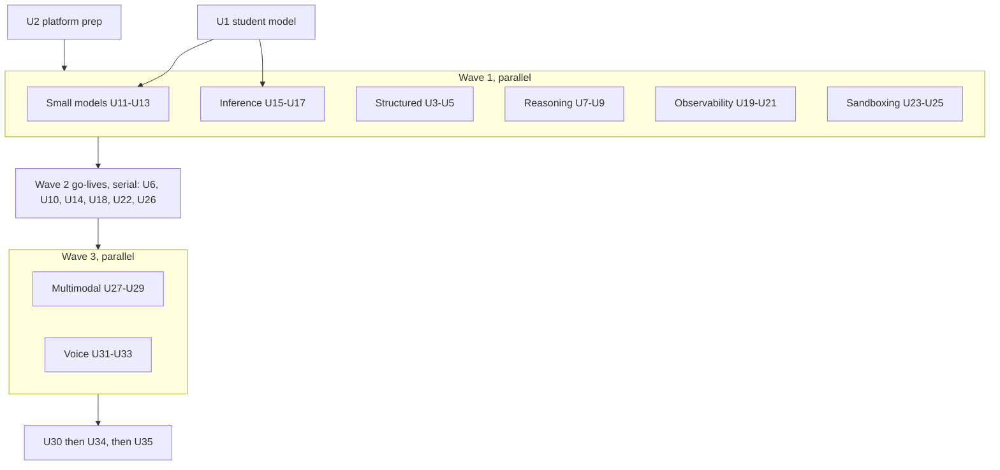
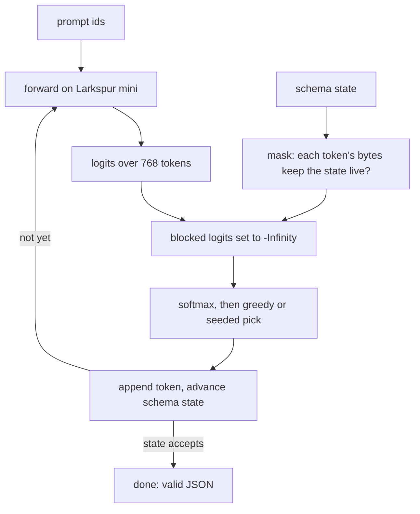
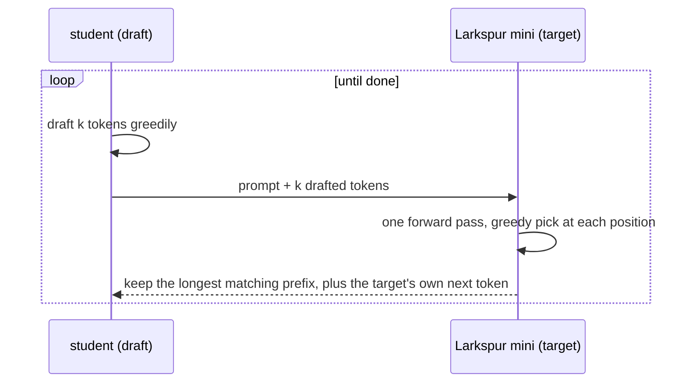

# Eight Roadmap Modules - Plan

## Goal Capsule

- **Objective:** Take the eight roadmap cards live as modules 10–17, in the roadmap's build order: Structured outputs, Reasoning, Small models, Inference engineering, Observability, Agent sandboxing, Multimodal, Voice agents. All of them continue the Larkspur Supply Co. story. After this, the roadmap is empty again.
- **Product authority:** Product Contract requirements (R-IDs) win on product behaviour. Key Technical Decisions (KTD-IDs) win on mechanism. Every edge set in the origin plan's R3 binds the matching module here. AGENTS.md decisions stay in force unless a KTD here changes one on purpose. Each go-live unit writes its changes back into AGENTS.md.
- **Open blockers:** None.
- **Execution profile:** Brownfield work on the Astro 7 + React islands site, run by subagents in waves (KTD13):
  - **Wave 0** (one agent, serial): the student model (U1) and the platform prep (U2), each its own PR.
  - **Wave 1** (six agents in parallel): Structured outputs, Reasoning, Small models, Inference, Observability and Sandboxing. Each runs in its own git worktree on its own branch and builds its engine, scene and chapters without touching the shared hotspots.
  - **Wave 2** (serial): the six go-live units, merged in the order Structured → Reasoning → Small models → Inference → Observability → Sandboxing. That order makes them modules 10–15.
  - **Wave 3** (two agents in parallel, then serial go-live): Multimodal, then Voice, as modules 16 and 17. Then U35.
  - Every PR leaves `pnpm check`, `pnpm test` and `pnpm test:e2e` green.
- **Stop conditions:**
  - Stop and ask if a chapter needs a backend, a live LLM, an API key, a live microphone, or training in the browser (R3).
  - Stop and ask if the distilled student agrees with Larkspur mini's greedy next token on less than 40% of held-out positions. Below that, the student fails both as a student and as a draft model (KTD1).
  - Stop and ask if no Structured outputs chapter prompt gives a constrained output the chapter can teach from (KTD4's readable bar).
  - Stop and ask if a change to an existing engine (`src/lib/rag/`, `tools/`, `agents/`, `evals/`, `guardrails/`, `tokens/`, `transformers/`, `context/`, `fine-tuning/`, `lm/`) would change any existing chapter's output, recordings, saved runs, goldens or share images (R15).
  - Stop and ask if a source checked for a `facts.json` contradicts a chapter's lesson, not just a wording or a date. The items under "Facts still to verify" (Appendix) must be confirmed against a primary source or dropped before they reach copy.
  - Stop and ask if Voice's committed audio passes the 800 KB budget, or if Kokoro's licence terms for the chosen voices need more than a README credit (KTD11).
  - A Wave 1 or Wave 3 agent stops and reports if it needs to edit a shared hotspot outside its go-live unit (KTD13).
- **Tail ownership:** One branch and PR per Wave 0 unit and per module, to `main`, with conventional commits, one logical change each (AGENTS.md "Commits").

---

## Product Contract

### Summary

The eight roadmap cards go live:

- **Structured outputs.** The reader makes Larkspur's assistant answer in valid JSON. They watch a schema mask the tokens Larkspur mini may pick, live, step by step, and learn that a valid answer can still be wrong.
- **Reasoning.** The reader turns a thinking-effort dial on Larkspur's harder questions. They read the recorded thinking, count what it costs, and find the questions where more thinking makes the answer worse.
- **Small models.** The reader watches a real student model learn from Larkspur mini. Then they route the assistant's easy questions to a small tier, with a fallback when it isn't sure, and gate the switch with Evals.
- **Inference engineering.** The reader runs Larkspur's model server: prefill and decode, the KV cache at scale, batching, quantized weights and speculative decoding with the student as the draft model. Quantization and speculation run live; server times are computed from counts.
- **Observability.** The reader works through a day of Larkspur's production traces. They find the first failure in each one, label it, group the labels into failure modes, and turn the worst into eval cases.
- **Agent sandboxing.** The reader decides where Larkspur's coding agent runs and what it can reach: files, network and secrets. Then they red-team the sandbox policy.
- **Multimodal.** The reader sees an invoice become a grid of image tokens, shrinks it until the small print goes, and pulls fields out of scans and part photos.
- **Voice agents.** The reader answers Larkspur's phone line: speech in and out, the latency budget, whose turn it is, being interrupted and mishearing an order number.

### Problem Frame

The origin plan put these eight on the roadmap because the 2026 conversation has moved to reasoning budgets, cheaper models, serving costs, production traces, sandboxed agents and models that see and speak, and none of the nine live modules covers them (see origin: `docs/plans/2026-10-21-1521-feat-ai-engineering-roadmap-plan.md`). Each module must build on what the live modules already teach, not repeat it. The origin's R3 names each edge.

### Requirements

**All eight modules**

- R1. `structured-outputs`, `reasoning`, `small-models`, `inference`, `observability`, `sandboxing`, `multimodal` and `voice` become live. Each has author Kondasamy Jayaraman, the Larkspur story, seven chapters (the last a workbench), a recall bank, an intro, a recap, share images and an e2e spec, and passes every check in `tests/unit/registry.test.ts`.
- R2. Each module keeps the origin plan's id, title, level and card line, with these prerequisites (origin R2):

  | Module | Level | Prerequisites |
  |---|---|---|
  | Structured outputs | Intermediate | `tool-calling`, `tokens` |
  | Reasoning | Intermediate | `evals` |
  | Small models | Advanced | `fine-tuning`, `evals` |
  | Inference engineering | Advanced | `transformers` |
  | Observability | Intermediate | `evals` |
  | Agent sandboxing | Advanced | `agents`, `guardrails` |
  | Multimodal | Intermediate | `tokens` |
  | Voice agents | Advanced | `tool-calling`, `multimodal` |

- R3. Nothing runs a live LLM, needs a backend or an API key, or uses a microphone. Live work is limited to the site's BPE tokenizer, Larkspur mini and the student model, image rasterising, and maths over data built ahead of time (KTD2). Every other model output a chapter control can reach is recorded, and a unit test proves it.
- R4. Every chapter follows the house loop and rules: an intro with context, predict → reveal, quizzes with a `why` per option and "I'm not sure", and terms defined on first use (`docs/writing-a-module.md`).
- R5. Every claim about real practice (provider APIs, limits, prices, paper results, timings) comes from `data/<module>/facts.json` with a source and an access date. Provider facts are re-checked when each module goes live.
- R6. Wherever a chapter shows numbers computed from the site's tokenizer, Larkspur mini, the student or a simulated server, the copy says so. They teach the mechanism; they are not any provider's numbers. Any curve, rate or frontier built from hand-written recordings (Reasoning's effort curve, Small models' tiers and frontier, Multimodal's readings, Voice's transcripts) says it illustrates a cited finding and was not measured, with the citation, as Context does.

**Structured outputs** (Intermediate)

- R7. Each chapter teaches one idea, in this order:
  1. Asking nicely: Larkspur mini is asked for an order's status as JSON and writes prose, live.
  2. A schema is a contract: Tool calling's schema checks run after the answer; a failed check means a retry and its cost.
  3. The mask: at each step the schema allows some tokens and blocks the rest, live over the whole vocabulary.
  4. Tokens are not characters: a token can carry a quote and a brace together, so the mask checks token bytes. Token healing gets one step.
  5. Choices from a list: an enum turns a free answer into a pick, and the model's preference among allowed values shows live.
  6. Valid isn't right: the mask forces a field the model doesn't know, and the answer is well-formed and wrong. Refusals and cut-off answers come from facts.
  7. Workbench: design Larkspur's order-status schema for a set of orders, then read validity and correctness.

**Reasoning** (Intermediate)

- R8. Each chapter teaches one idea, in this order:
  1. Answer now or think first: a multi-step Larkspur quote answered without and with thinking, the thinking shown.
  2. Thinking is tokens: thinking counted, billed as output, and added to the wait.
  3. The effort dial: effort levels over a question set, graded by Evals' graders; accuracy rises, then flattens.
  4. When more thinking hurts: questions where the highest effort answers worse.
  5. Effort is a hint, not a counter: what today's APIs take (effort levels, adaptive thinking), with dated facts.
  6. Measure, then pick: a sweep through Evals' release gate picks the lowest effort that passes per kind of question.
  7. Workbench: set an effort per kind of request, then read accuracy, cost and wait.

**Small models** (Advanced)

- R9. Each chapter teaches one idea, in this order:
  1. Big model, small model: Larkspur mini and the student side by side, live: size, work per token, top 5.
  2. Learning from a teacher: the student trained on Larkspur mini's whole distribution, not just its top pick. A recorded loss curve.
  3. How close is the student: agreement with the teacher over held-out text, computed live.
  4. Send it the easy ones: Larkspur's assistant answers through a small tier and a large tier, graded by Evals' graders.
  5. Fall back when unsure: a confidence threshold sends answers up a tier; the quality and cost frontier moves with it.
  6. Gate the switch: routed against all-large through Evals' release gate.
  7. Workbench: a routing policy per kind of question, scored on quality and cost.
- R10. Small models teaches teacher → student distillation and routing. It recaps Fine-tuning's style and LoRA chapters in one step at most, and links to them (origin R3).

**Inference engineering** (Advanced)

- R11. Each chapter teaches one idea, in this order:
  1. Prefill and decode: one request on Larkspur mini, live; time to first token against time per token, from counts.
  2. The KV cache at scale: one request's cache (Transformers chapter 6, recapped in one step) multiplied over a server's requests, with a real model's published shape.
  3. Batching: static against continuous batching on a simulated server.
  4. Smaller numbers: Larkspur mini quantized to int8 and int4, live; memory saved against held-out loss and changed top-5.
  5. Guess ahead: speculative decoding with the student as draft, live; acceptance rate and tokens per check, the same output proven.
  6. First token or throughput: a batch cap trades one against the other on the simulated server.
  7. Workbench: serve Larkspur's traffic within a wait target and a memory limit.

**Observability** (Intermediate)

- R12. Each chapter teaches one idea, in this order:
  1. What the assistant did: one trace of a Larkspur conversation, read span by span.
  2. The first failure: find the span where a bad trace went wrong.
  3. Open coding: a note per failed trace in the reader's own words or from suggestions.
  4. Axial coding: notes grouped into failure modes, counted.
  5. Which ones matter: frequency against harm picks the mode to fix first.
  6. From trace to test: failed traces become eval cases, run through Evals' graders against the fixed version.
  7. Workbench: a new day's traffic, triaged to one fix.
- R13. Observability starts from production traffic. It recaps Evals' offline suites in one step at most, and links to them (origin R3).

**Agent sandboxing** (Advanced)

- R14. Each chapter teaches one idea, in this order:
  1. Where the code runs: the same agent task on the host and in a sandbox.
  2. Files: what the sandbox mounts, read-only or writable, and what it hides.
  3. Network: egress off, then an allow-list through a proxy.
  4. Secrets: credentials stay outside; the proxy adds them on the way out.
  5. An allowed door can still leak: an allow-listed domain carries data out. Guardrails' lethal trifecta, recapped in one step.
  6. Fewer prompts, same safety: approval prompts against sandbox boundaries.
  7. Workbench: red-team the sandbox policy over attacks and ordinary tasks.

**Multimodal** (Intermediate)

- R16. Each chapter teaches one idea, in this order:
  1. A picture is tokens too: an invoice cut into patches, the token count live.
  2. Size and detail: shrinking the image lowers the count and loses the small print.
  3. Reading a scan: text from OCR against a vision model's reading, on a table and a handwritten note.
  4. Pulling fields out: invoice fields extracted and graded field by field. Links Structured outputs.
  5. Photos of parts: naming a part from a photo, and asking for another angle when it's ambiguous.
  6. When pictures mislead: a misread digit, and instructions written inside an image. Links Guardrails.
  7. Workbench: per kind of document, pick a method and a size for cost and accuracy.

**Voice agents** (Advanced)

- R17. Each chapter teaches one idea, in this order:
  1. Larkspur's phone line: a call through speech-to-text, the model and text-to-speech, each stage visible.
  2. The latency budget: stage times add up; streaming brings the first sound forward.
  3. Whose turn is it: a silence threshold ends the caller's turn, live over the call's audio; cut-offs against dead air.
  4. Being interrupted: the caller talks over the reply; the host stops speaking and keeps only what was said.
  5. Mishearing: a misheard order number, and reading it back to confirm.
  6. One model or three: chained pipelines against speech-to-speech models, from facts.
  7. Workbench: tune the line over a set of calls; read cut-offs, dead air, wait and errors.
- R18. Audio never plays on its own. Every clip has a caption, and every chapter can be played with the sound off.

**Existing modules**

- R15. RAG, Tool calling, Agents, Evals, Guardrails, Tokens, Transformers, Context and Fine-tuning and their saved progress do not change: no chapter id, step id, recording, golden or share image changes. The exceptions are the KTD13 shared hotspots and links that newly point at a live module.

### Scope Boundaries

- No live LLM, no live microphone, no speech recognition in the browser, no in-browser embedding of new text, and no training in the browser.
- Maths stays optional, in fold-away "the maths" notes.
- Structured outputs: JSON only, over a subset of JSON Schema (the one Tool calling already checks). No regex or general grammar chapter.
- Inference: server times are computed from a stated cost model, never measured. No GPU, hardware or kernel chapter.
- Sandboxing: no real code runs. No container, VM or OS-specific setup guide.
- Voice: no phone-network or telephony protocol content.
- No module names one vendor as the place to do the thing. Vendor facts are cited with dates.

### Deferred to Follow-Up Work

- A second language for Voice's clips.
- A "real model" attention or reasoning trace from a recorded open-weights run.
- A cross-module learning-path view on the home page (carried from the previous plan).

### Success Criteria

- After each module, a reader can say, in plain words, the edge the origin plan gave it. For example: "masking happens while the model writes, not after", "more thinking can make it worse", "a small model answers the easy ones and passes the rest up".
- `pnpm test` fails when any reachable recorded answer, reading, trace or turn is missing, when the student drifts from its goldens, when speculative decoding's output differs from plain greedy decoding, or when any new payload passes its budget.
- The home catalogue shows seventeen live modules under the correct levels and no roadmap cards, at 1280px and 390px. The hero wave still shows one live pill at a time.

### Key Decisions

- All eight in one plan, built in waves, with Multimodal and Voice last. (session-settled: user-approved — chosen over the first six only, or the first four only: one plan keeps hotspot rules and numbering in one place.) Governs R1 and the Execution profile.
- One distilled student serves as Small models' student and Inference's draft model. (session-settled: user-approved — chosen over two separate models: one training run, one set of goldens.) Governs R9, R11.
- Multimodal's images are drawn; Voice's speech is generated once by a local TTS script and committed. (session-settled: user-approved — chosen over drawn images with no audio, and over real photos and recordings: keeps the hand-drawn look and gives Voice real sound.) Governs R16, R17, R18.
- Sandboxing is a model of a sandbox with recorded agent turns. (session-settled: user-approved — chosen over running real code in a Web Worker: browser sandboxes don't match server sandboxes, and running untrusted code is harder to defend.) Governs R14.
- Every module continues the Larkspur story (origin Key Decisions). Governs R1.

**Product Contract preservation:** The origin plan's R1–R3 (ids, titles, levels, card lines, prerequisites, edges) are carried unchanged. Its R4 is R3 here; its R5 is fulfilled again by U35.

---

## Planning Contract

### Key Technical Decisions

- KTD1. **One student model, distilled once in Python from the committed `model.bin`.** (session-settled: user-approved — chosen over two separate models: one training run, one set of goldens.)
  - `scripts/train/train.py` gains a `--distill` mode, built like `finetune()`. It reads the committed base and trains a smaller model on the base's softened next-token distribution (temperature-scaled soft targets, plus a small weight on the true token) over the training split.
  - **Shape:** 1 layer, 2 heads, d_model 16, d_mlp 64, context 32, the same 768-token vocabulary, tied unembedding (about 16k parameters, about 32 KB). The tie needs the shared vocabulary. If agreement misses the 40% stop condition, try 2 layers at d_model 16 next (about 19.4k parameters, about 39 KB, still within budget). A wider student breaks the budget: the embedding alone at d_model 24 is about 37 KB.
  - `train.py`'s model classes read the global `CFG`. `--distill` makes them take a config, and the base run must stay byte-identical.
  - **Outputs:** `public/data/lm/student.bin` (Float16, budget ≤ 40 KB), `meta.json` `student` (its own `model` config, `tensors` layout, loss curve, held-out scores, agreement with the base) and `goldens.json` `student`. As with the fine-tunes, every other key is merged back unchanged. `model.bin`'s pinned sha256 guards the base.
  - **Browser:** `src/lib/lm/load.ts` gains `Weights = 'student'`. Parsing takes a layout and config from `meta.student`, not the top level. `forward()` already reads its shape from `model.config`.
  - The retrain recipe gains a third step: a base retrain means rerunning `--finetune` and `--distill`.
- KTD2. **What runs live and what is recorded, per module.**

  | Module | Live | Recorded |
  |---|---|---|
  | Structured outputs | Larkspur mini decoding under a schema mask | nothing |
  | Reasoning | token counts, grading, cost and wait | answers and thinking per question × effort |
  | Small models | the student vs base (agreement, top 5, work per token), grading, frontier | assistant answers per tier × question, confidence per answer |
  | Inference | quantized forward passes, speculative decoding, server simulator | nothing |
  | Observability | grading of the new eval cases, counts | traces, reference failures and modes, the fixed version's answers |
  | Sandboxing | the modelled sandbox's results, metrics | agent turns keyed by what the agent saw |
  | Multimodal | patch grid and token counts, rasterising, grading | readings per image × size × method |
  | Voice | end-of-turn detection over envelopes, latency sums | clips, envelopes, transcripts, assistant replies |

- KTD3. **Each module gets its own engine folder** (`src/lib/<module>/`, with `small-models` as `src/lib/small-models/`) on top of the existing engines. It reuses their exports and never changes their outputs (R15). A helper a new module needs from an existing engine lands in that module's go-live unit, as a shared-hotspot edit (KTD13).
- KTD4. **Structured outputs: a byte-level JSON automaton masks the vocabulary.**
  - `src/lib/structured-outputs/grammar.ts` compiles a schema from Tool calling's subset (`src/lib/tools/schema.ts`'s types: object with required properties and `additionalProperties: false`, string, integer, boolean, enum) into a state machine over bytes. It allows a fixed whitespace policy: none.
  - `mask.ts` allows a token when every byte of `pieceBytes(id)` keeps the machine in a live state. 768 tokens × a few bytes per step is cheap; no precomputed index is needed.
  - `decode.ts` runs greedy decoding (and a seeded sample for chapter 5) over `forward()`, with blocked logits set to `-Infinity` before `softmax`. Generation ends when the machine accepts. A cap on steps guards a loop.
  - **Everything fits in the window.** Every chapter's prompt plus its constrained output fits in Larkspur mini's 32 tokens, so the model always sees the question it answers. Prompts are a few tokens (an order id and a cue), and schemas have one or two short keys, mostly enums and integers. Each free-text string has a fixed maximum length; once it is reached, only the closing quote is allowed, so a string always closes. The copy names the length cap as part of the schema contract.
  - **The readable bar:** `data/structured-outputs/prompts.json` pins each chapter's prompt, schema and the constrained output the copy describes. A test reruns each and fails on drift. A retrain that breaks one means a new prompt, not new copy typed by hand.
  - Larkspur mini has never seen JSON. Unconstrained, it writes prose (chapter 1's point); constrained, it writes valid JSON whose free-text values are odd. The copy says so.
- KTD5. **Reasoning: recorded answers per effort level, graded live.**
  - Effort levels are a finite list: `none`, `low`, `medium`, `high`. They map to the current APIs' effort settings by name, not by token count. The copy uses "effort", with dated facts that fixed `budget_tokens` is deprecated (Appendix, Sources).
  - `data/reasoning/questions.json` holds new multi-step Larkspur questions (quotes with discounts, stock across warehouses, delivery dates) plus the overthinking cases. References for them live in `data/reasoning/references.json`, graded through `keyFactOf` in `src/lib/evals/graders.ts`. Evals' twelve questions and references are reused read-only.
  - `data/reasoning/answers.json` is keyed by question, then effort: `{thinking, answer, note}`. Thinking tokens are counted live with the site BPE.
  - Wait is computed from tokens at a stated illustrative rate in `data/reasoning/assumptions.json`, labelled as Larkspur's assumption, not a provider figure. Assumptions files are outside the facts source gate.
  - The overthinking answers illustrate Gema et al. (2025); they are not measured. Each carries a one-line `note`, and the reveal cites the fact.
- KTD6. **Small models: the student is real; the assistant's tiers are recorded.**
  - Chapters 1–3 run the base and the student live: top 5 side by side, agreement and KL over the held-out split (`data/fine-tuning/heldout.json`, reused read-only), and work per token from parameter counts.
  - Chapters 4–7 use two tiers of Larkspur's assistant: `small` and `large`. Answers are recorded in `data/small-models/answers.json`, keyed by tier and question, over Evals' twelve questions. They are graded live by Evals' code graders and gated by `decide`.
  - **Confidence is a fixture, not a model.** Each small-tier answer carries a hand-set confidence, as Guardrails' classifier scores do. The copy calls it a stand-in score set to show the trade-off. Thresholds come from a finite list.
  - Costs are relative units (large = 1), with the small/large price ratio taken from a dated vendor price pair in `facts.json`.
- KTD7. **Inference: real maths on Larkspur mini, server times from counts.**
  - **Quantization** is simulated: load the Float16 weights, round each matrix to int8 or int4 (per-row absmax), dequantize, run `forward()` unchanged. Memory is computed from parameter count × bits. Held-out loss and top-5 changes are computed live. No new weight files.
  - **Speculative decoding** is real: the student drafts k tokens, Larkspur mini checks them in one pass, and greedy acceptance keeps the longest matching prefix plus one. Every run is capped so the prompt, the output so far and the k drafted tokens fit in Larkspur mini's 32-token context: a checking pass is never cut short, so it sees exactly what plain greedy decoding saw. The run stops at the context limit, and the copy says so. A test proves the output equals plain greedy decoding for every chapter prompt. The acceptance rate is computed live.
  - **The server** (`src/lib/inference/server.ts`) is a discrete-time simulator over a fixed request trace. Prefill and decode costs come from counted work (`src/lib/transformers/costs.ts` and parameter counts) at stated unit costs in `data/inference/assumptions.json`, labelled as a cost model, never measured. Static and continuous batching, a batch cap, and KV memory per request are inputs. Each setting is a finite list.
  - Chapter 2's scale-up uses a real open model's published config (layers, heads, d_model) from `facts.json`.
- KTD8. **Observability: a hand-written day of traces.**
  - `data/observability/traces.json` holds about 40 traces of Larkspur's assistant. Each is a span tree (retrieval, model call, tool call, reply) shaped like OpenTelemetry's GenAI conventions. The copy says "shaped like", and attribute names are cited only once verified.
  - Each failed trace carries a reference first-failure span and a reference failure mode. The suggested notes and modes are finite lists.
  - The reader's free-text notes stay in progress in `localStorage` and are never graded. Mode grouping is checked against the reference: the puzzle accepts any grouping that puts each trace under its reference mode, whatever the reader names the group.
  - Chapter 6's eval cases are graded live by Evals' code graders. The fixed version's answers are recorded in `data/observability/fixed.json`.
  - A trace may reuse a recorded Tool calling or Agents run as its body. Those recordings are read, never edited.
- KTD9. **Sandboxing: a modelled sandbox with a guardrails-shaped loop.** (session-settled: user-approved — chosen over real code in a Web Worker.)
  - `src/lib/sandboxing/sandbox.ts` models a filesystem (mounts with read-only or writable modes, hidden paths), network egress (off, or an allow-list through a proxy) and secrets (in the sandbox's environment, or added by the proxy). A command's result is a pure function of the policy and the command.
  - `loop.ts` follows `src/lib/guardrails/loop.ts`: one agent, tools (`run`, `read_file`, `write_file`, `fetch`), and host stages. It reuses `combosOf`, `stepsOf`/`answerOf` and the `Bundle` shape. It forks the loop rather than widening `Bundle`'s `Order[]` handlers.
  - **The signature holds what the agent saw** (`turns.ts`): the case, the tools offered, and the history of outcomes (for example `fetch:blocked`, `read:denied`, `read:ok`). Policy changes reach the signature only through those outcomes. Host-only settings (the approval mode, the prompt count) stay out.
  - **One merged recording**, as Guardrails and Context do: `data/sandboxing/turns/<chapter>.json`. Two suites in `data/sandboxing/suite.json`: attacks (each with a goal check) and ordinary tasks. Metrics reuse Guardrails' attack success rate and false-block rate.
  - Chapter 7's puzzle accepts every minimal winning policy (`WINNERS`, computed over the domain).
- KTD10. **Multimodal: images drawn in code, rasterised live, readings recorded.** (session-settled: user-approved — chosen over real photos.)
  - `src/lib/multimodal/images.ts` draws each document (invoices, a packing slip with a table, a handwritten note) with `flat.ts` and each part photo with the iso engine. Each drawing is an SVG string at a fixed pixel size.
  - The browser rasterises it to a canvas at the chosen size and draws it back pixelated, so lost detail is visible. Share images use the SVG.
  - **Token counts are computed:** ⌈w/28⌉ × ⌈h/28⌉ per Anthropic's current vision docs, with the cap and downscale rule from `facts.json`. A second vendor's rule (OpenAI's 32 px patches) is shown once as a fact. Sizes are a finite list.
  - **Readings are recorded:** `data/multimodal/readings.json`, keyed by image, size and method (`ocr`, `vision`). Extracted fields are graded live by `keyFactOf` against `data/multimodal/references.json`.
  - A coverage test walks every image × size × method a chapter can reach.
- KTD11. **Voice: clips generated once by Kokoro, envelopes committed, turn detection live.** (session-settled: user-approved — chosen over no audio.)
  - `scripts/record-voice.mjs` (run by hand, like `pnpm record:tokens`) uses `kokoro-js` with `onnx-community/Kokoro-82M-v1.0-ONNX` (Apache-2.0). It writes each line in `data/voice/script.json` to WAV, converts to mono MP3 at 32 kbps with a locally installed `ffmpeg`, and computes a 20 ms energy envelope per clip into `data/voice/envelopes.json`.
  - Clips go to `public/data/voice/*.mp3`. A test caps the total at 800 KB. Output is not assumed byte-identical across runs: clips are committed and never regenerated in CI. `kokoro-js` is a devDependency and must pass `pnpm-workspace.yaml`'s minimum release age.
  - **Live:** the end-of-turn detector runs over envelopes (energy threshold × silence length, both finite lists). Cut-offs and dead air are counted per call. Latency sums use stage times from `data/voice/calls.json`, labelled illustrative unless a fact sources them.
  - **Recorded:** the speech-to-text transcripts (including the misheard order number) and the assistant's replies, keyed by call and by what the model heard.
  - **Playback:** one shared player. A play button per clip, never autoplay. Starting a clip stops any other, and playback stops when the step changes or the page unmounts. A caption under every clip. Chapters advance without sound. E2E never depends on audio output.
  - README credits Kokoro, and any dataset attribution its voices require.
- KTD12. **Every recorded module gets a coverage test**, copied from `tests/unit/context-coverage.test.ts`:
  - every chapter control has a finite domain (`DOMAINS`, `WORKBENCH_DOMAINS`), and every combination reaches a recorded output;
  - no key is recorded twice, and no recorded entry is unreachable;
  - every entry has a one-line `note`;
  - a budget on entry count per module (set in its engine unit).

  Live-only modules (Structured outputs, Inference) get a golden or pinned-output test instead.
- KTD13. **Subagent execution and the shared-hotspot rule** (as the previous plan's KTD12).
  - Wave 1 and Wave 3 agents build only inside their own folders: `src/lib/<m>/`, `src/content/<m>/`, `src/pages/<m>/`, `data/<m>/`, `public/data/<m>/`, `src/components/scenes/<scene>*.ts`, `src/dev/<m>.astro`, tests named for the module, and the module's own scripts. Voice may also create `src/components/story/ClipPlayer.tsx`. New files only.
  - **Shared hotspots**, touched only in the module's go-live unit after rebasing on `main` in merge order: `src/lib/modules.ts`, `src/pages/index.astro`, `heroScene.ts`, `src/dev/og.astro`, `tests/unit/modules.test.ts`, `tests/unit/new-module.test.ts`, `tests/e2e/catalogue.spec.ts`, `README.md`, `AGENTS.md`, `public/og/home.jpg`, `flat.ts`'s `Stamp` union, `package.json`/`pnpm-lock.yaml`, and any edit to an existing scene or engine.
  - **Scaffolding.** Agents scaffold by hand from `templates/module/`, not with `pnpm new-module`. The one allowed hotspot edit on a module branch is swapping its own `planned(...)` line for its import, so its pages build. The go-live unit redoes that swap on the rebased `main` and moves the entry to the end.
  - **Exceptions.** Voice's go-live adds `kokoro-js` to `package.json`. Voice records its clips on its branch with the dependency installed locally, and commits the lockfile change only in its go-live unit. Small models and Inference read U1's student; they never edit `src/lib/lm/`.
  - Red tests are allowed until go-live. Every PR opens only after its go-live unit, with all checks green.
- KTD14. **The home page scales to seventeen live plots** (U2).
  - The hero wave's keyframes become a fixed hop length per plot. Each plot's delay is `--i × 0.8s`. CSS keyframe percentages must be literal, so `index.astro`'s frontmatter computes the `hero-hop` and `hero-show` percentages from `LIVE.length` at build time and writes them into the page's style. A pill's visible span is then a fixed share of one 0.8 s slot, so one pill shows at a time at any count.
  - `tests/unit/modules.test.ts` asserts that the planned ids are a subsequence of the origin plan's list, in order, not the exact eight. `tests/e2e/catalogue.spec.ts` stops requiring at least one planned card, and checks the figcaption wording for both states (planned cards, or none). "Live modules keep their numbers" reads its expected numbers from a list each go-live unit extends.
  - Every live module must have a `DRAW` plot. A hero test fails if one is missing, instead of leaving an empty mint plot.
  - When the roadmap empties (U35), the planned-card code paths stay, as the previous plan's KTD14 kept them.
- KTD15. **CI shards the e2e run.** `.github/workflows/checks.yml` runs Playwright in four shards (a matrix over `--shard`), each building with `DEV_PAGES=1`. This keeps each job well inside `timeout-minutes: 30` as eight specs land. Unit tests and `pnpm check` stay one job.
- KTD16. **One scene per module, composed from existing pieces.** Words go in pills and captions only (AGENTS.md "Pictures"). Each scene gets a Picture tab and one precise view, a hero `DRAW` plot and a home `CARD`.

  | Module | Scene (file) | Precise view |
  |---|---|---|
  | Structured outputs | the stencil press: Tokens' press with a stencil plate over its belt that stops the tiles the schema blocks (`stencilScene.ts`) | the mask: the vocabulary as a tile grid, allowed lit, a focusable list of the top allowed tokens |
  | Reasoning | the scratchpad desk: the model with a growing pad of thinking papers, an effort dial and a clock (`thinkScene.ts`) | accuracy against effort chart, flat, one point per level |
  | Small models | the apprentice's bench: the big model, the student beside it, and a router switch with a fallback chute (`routerScene.ts`) | the quality and cost frontier chart |
  | Inference | the serving floor: a server with batch seats, a queue of request envelopes, a KV shelf filling, a draft runner (`serveScene.ts`) | the server timeline: lanes per request, prefill and decode blocks |
  | Observability | the control room: a wall of trace cards, sorting bins per failure mode, a tally board (`traceScene.ts`) | the trace waterfall: spans as lanes, the first failure stamped |
  | Sandboxing | the glass room: the agent's desk in a walled yard, a file door, a network door with a proxy gate, a safe outside (`sandboxScene.ts`) | the steps lanes, as Guardrails' sequence, with blocked calls stamped |
  | Multimodal | the scanning table: a document under a camera, a patch grid over it, tiles onto the model's belt (`scanScene.ts`) | the image at the chosen size with its patch grid and count |
  | Voice | the phone desk: a phone, an ear (speech-to-text), the model, a mouth (text-to-speech) on a belt of speech bubbles, a stopwatch (`phoneScene.ts`) | the call timeline: caller and assistant envelopes as lanes, the end-of-turn marks |

  The stage rules from the previous plan's KTD11 carry over: focusable precise views with arrow keys and a read-out line; native range inputs over finite lists; move up / move down for reordering; "one of N that work" on Show me; a fixed frame with a loading pill and Retry for anything fetched.
- KTD17. **Merge order is module order.** Structured outputs is module 10, through Voice at 17. Each go-live unit extends the catalogue's numbers list and AGENTS.md's module list. Links from live modules that pointed at a roadmap card (for example Tool calling's or Guardrails' mention of a topic) change in the go-live unit that takes the card live, and only as links.

### High-Level Technical Design

The waves and their dependencies:



Structured outputs' decode step (KTD4):



Speculative decoding (KTD7), greedy:



### Assumptions

- Larkspur mini's 32-token context is tight. Measured with the site's BPE, "What is the status of order 1042? Answer in JSON." is 28 tokens and `{"status":"shipped"}` is 16. Structured outputs therefore keeps every chapter's prompt plus output within 32 tokens (KTD4), and Inference caps its runs the same way (KTD7).
- A student at d_model 16 reaches the 40% agreement bar. If neither 1 nor 2 layers does, the stop condition fires.
- `kokoro-js` runs in Node 22 with the installed `@huggingface/transformers` (or brings its own compatible version) and passes the minimum release age. If not, the Python `kokoro` package run through `uv` is the fallback, with the same outputs.
- `ffmpeg` is installed on the machine that records the clips. CI never runs it.
- Eight more e2e specs fit within four shards and the 30-minute job limit.
- Hand-written recordings stay the norm. The coverage tests list what is missing; no drafting script is needed, except where a module's engine unit chooses one as `scripts/draft-answers.mjs` did.

### Phased Delivery

- **Wave 0:** U1, U2. Merged before any Wave 1 branch starts.
- **Wave 1:** U3–U5, U7–U9, U11–U13, U15–U17, U19–U21, U23–U25, in six worktrees.
- **Wave 2:** U6, U10, U14, U18, U22, U26, in that order, each rebased on the last.
- **Wave 3:** U27–U29 and U31–U33 in two worktrees, then U30, U34, U35.

### Risks

| Risk | Mitigation |
|---|---|
| E2E time doubles with eight specs | Sharding in U2 (KTD15); module specs reuse a `<m>-flow.ts` helper |
| Larkspur mini's constrained JSON is unreadable | Pinned prompts and outputs (KTD4); the copy owns the oddness as the lesson |
| The student is too weak to draft | 40% stop condition; 2-layer fallback within budget (KTD1) |
| Provider facts move (thinking APIs, image token rules changed in 2026) | Dated facts, re-checked at each go-live (R5); Appendix list of unverified items |
| Kokoro output varies between runs or machines | Clips committed once, never regenerated in CI (KTD11) |
| Audio payload grows | 800 KB budget test (KTD11) |
| Hero wave overlaps at 17 plots | Keyframes scaled per plot (KTD14) |
| Recording effort for Reasoning, Small models, Sandboxing, Multimodal, Voice | Entry budgets per module (KTD12); domains kept small |

---

## Output Structure

Per module (Structured outputs shown; every module has the same shape):

```text
src/lib/structured-outputs/            engine (grammar.ts, mask.ts, decode.ts)
src/content/structured-outputs/ module.ts, recall.ts, kit.tsx, 01-…07-*.tsx
src/pages/structured-outputs/  index.astro, [chapter].astro, recap.astro
src/components/scenes/         stencilScene.ts, maskGrid.ts
src/dev/structured-outputs.astro
data/structured-outputs/       facts.json, prompts.json
tests/unit/structured-*.test.ts
tests/e2e/structured-outputs.spec.ts, structured-flow.ts
```

New shared files: `public/data/lm/student.bin`, `scripts/record-voice.mjs`, `public/data/voice/*.mp3`.

---

## Implementation Units

| U-ID | Title | Key files | Depends on |
|---|---|---|---|
| U1 | Student model | `scripts/train/train.py`, `src/lib/lm/load.ts`, `public/data/lm/student.bin` | — |
| U2 | Platform prep for seventeen | `src/pages/index.astro`, `heroScene.ts`, `checks.yml`, catalogue/modules tests | — |
| U3 | Structured engine and facts | `src/lib/structured-outputs/` | U2 |
| U4 | Stencil press and kit | `stencilScene.ts`, `src/content/structured-outputs/kit.tsx` | U3 |
| U5 | Structured chapters | `src/content/structured-outputs/`, `src/pages/structured-outputs/` | U4 |
| U6 | Structured go-live | hotspots | U5 |
| U7 | Reasoning engine, data and facts | `src/lib/reasoning/`, `data/reasoning/` | U2 |
| U8 | Scratchpad desk and kit | `thinkScene.ts`, `kit.tsx` | U7 |
| U9 | Reasoning chapters | `src/content/reasoning/` | U8 |
| U10 | Reasoning go-live | hotspots | U6, U9 |
| U11 | Small models engine, data and facts | `src/lib/small-models/`, `data/small-models/` | U1, U2 |
| U12 | Apprentice's bench and kit | `routerScene.ts`, `kit.tsx` | U11 |
| U13 | Small models chapters | `src/content/small-models/` | U12 |
| U14 | Small models go-live | hotspots | U10, U13 |
| U15 | Inference engine and facts | `src/lib/inference/` | U1, U2 |
| U16 | Serving floor and kit | `serveScene.ts`, `serverTimeline.ts` | U15 |
| U17 | Inference chapters | `src/content/inference/` | U16 |
| U18 | Inference go-live | hotspots | U14, U17 |
| U19 | Observability engine, traces and facts | `src/lib/observability/`, `data/observability/` | U2 |
| U20 | Control room and kit | `traceScene.ts`, `traceWaterfall.ts` | U19 |
| U21 | Observability chapters | `src/content/observability/` | U20 |
| U22 | Observability go-live | hotspots | U18, U21 |
| U23 | Sandboxing engine, recordings and facts | `src/lib/sandboxing/`, `data/sandboxing/` | U2 |
| U24 | Glass room and kit | `sandboxScene.ts`, `sandboxSequence.ts` | U23 |
| U25 | Sandboxing chapters | `src/content/sandboxing/` | U24 |
| U26 | Sandboxing go-live | hotspots | U22, U25 |
| U27 | Multimodal engine, images, readings and facts | `src/lib/multimodal/`, `data/multimodal/` | U26 |
| U28 | Scanning table and kit | `scanScene.ts`, `patchGrid.ts` | U27 |
| U29 | Multimodal chapters | `src/content/multimodal/` | U28 |
| U30 | Multimodal go-live | hotspots | U29 |
| U31 | Voice clips, engine and facts | `scripts/record-voice.mjs`, `src/lib/voice/`, `data/voice/`, `public/data/voice/` | U26 |
| U32 | Phone desk and kit | `phoneScene.ts`, `callTimeline.ts` | U31 |
| U33 | Voice chapters | `src/content/voice/` | U32 |
| U34 | Voice go-live | hotspots | U30, U33 |
| U35 | Roadmap empty again | `AGENTS.md`, `README.md`, catalogue spec | U34 |

**Patterns every module unit follows.** Engine units copy their nearest engine (named per unit). Scene and kit units copy the scene and `kit.tsx` named per unit, and add a dev page `src/dev/<m>.astro`. Chapter units scaffold by hand from `templates/module/` (KTD13), write chapters by `docs/writing-a-module.md`, give each chapter an `intro` in `module.ts`, put recall items in `recall.ts` (one pinned), and write `tests/e2e/<m>.spec.ts` with a `<m>-flow.ts` helper. Every chapter is played by mouse and by keyboard only, with axe, reduced motion and 390px checks, as the template spec does.

**One workbench pattern for all eight chapter 7s.** Each dimension of the policy has one native control (a select per field or kind, a range input over a finite list, a toggle for on/off). Under it sits a result table with one row per case (order, question, request, attack, document or call), showing pass or fail and the reason. A live total gives the score against the best. "Show me" displays one winning policy, labelled "one of N that work".

Go-live units are listed once, in U6, and the others cite it.

### U1. Student model

- **Goal:** A distilled student of Larkspur mini, committed and loadable in the browser.
- **Requirements:** R9, R11; KTD1.
- **Dependencies:** none.
- **Files:** `scripts/train/train.py`, `scripts/train/README.md`, `src/lib/lm/load.ts`, `src/lib/lm/model.ts` (types only, if needed), `public/data/lm/student.bin`, `public/data/lm/meta.json`, `tests/fixtures/lm/goldens.json`, `tests/unit/lm-student.test.ts`, `AGENTS.md` (language-model kit section and retrain recipe).
- **Approach:**
  1. Add `--distill` beside `--finetune`, with its own config dict, soft-target temperature and steps. Copy `finetune()`'s load, round-to-Float16, `f16_blob` and merge-back steps.
  2. Write `meta.student` (config, tensors, loss curve, held-out scores, agreement with base) and `goldens.student`.
  3. Extend `load.ts` with `'student'`, parsing its layout and config from `meta.student`.
- **Patterns to follow:** `finetune()` in `train.py`; `tests/unit/fine-tuning-runs.test.ts`; `tests/unit/lm-model.test.ts`.
- **Test scenarios:**
  - The student's TS forward pass matches `goldens.student` (max |Δlogit| < 1e-4, same top 5, attention rows sum to 1).
  - `student.bin` is ≤ 40 KB, and its size matches `meta.student.bytes`.
  - Agreement with the base's greedy next token over the held-out split, computed live, equals `meta.student` agreement within 1e-6 and is ≥ 0.40.
  - `model.bin`'s sha256 is unchanged; `meta.finetune`, `meta.lora` and their goldens are unchanged.
  - `loadWeights('student')` resolves a model whose `config` is the student's shape; a failed fetch retries like the other weights.
- **Verification:** the train run is deterministic (a second run gives a byte-identical `student.bin`); the three repo checks are green.

### U2. Platform prep for seventeen

- **Goal:** The home page, its tests and CI hold up as eight modules go live one at a time.
- **Requirements:** R1, R15; KTD14, KTD15.
- **Dependencies:** none.
- **Files:** `src/pages/index.astro`, `src/components/scenes/heroScene.ts`, `astro.config.mjs`, `tests/unit/hero.test.ts`, `tests/unit/modules.test.ts`, `tests/e2e/catalogue.spec.ts`, `.github/workflows/checks.yml`, `playwright.config.ts`.
- **Approach:**
  1. Compute the hop and pill keyframe percentages in `index.astro`'s frontmatter from the live count (KTD14).
  2. Make the `devPages` integration in `astro.config.mjs` register every `src/dev/*.astro` file except `og.astro`, keeping the `/dev/warmup` and `/dev/og/[slug]` routes, so module branches never edit it.
  3. Relax the planned-list assertion to an in-order subsequence of the origin list. Make the catalogue spec's planned-card and figcaption checks hold for both states.
  4. Add a hero assertion that every live module has a `DRAW` entry.
  5. Shard Playwright in CI.
- **Patterns to follow:** existing `.hero-hop` CSS and `hop()`; the fixture-based planned path in `hero.test.ts`.
- **Test scenarios:**
  - Unit: with a fixture of 17 live modules, every plot sits on the board without overlap and has a `DRAW` plot.
  - Unit: removing any one planned id from the list still passes the modules test; reordering two fails it.
  - E2E: with the current registry, one hero pill is visible at a time over a full cycle (sampled at each plot's turn), and reduced motion shows every pill.
  - E2E: the catalogue spec passes against the current registry and against a fixture with no planned cards (the "Room for more" wording).
  - Build: a new `src/dev/<name>.astro` file is served at `/dev/<name>` with `DEV_PAGES=1` and absent from a production build.
- **Verification:** CI runs four e2e shards, all green; `/` looks unchanged at 1280px and 390px.

### U3. Structured outputs engine and facts

- **Goal:** Schema-masked decoding on Larkspur mini, with pinned chapter outputs.
- **Requirements:** R3, R5, R6, R7; KTD3, KTD4.
- **Dependencies:** U2.
- **Files:** `src/lib/structured-outputs/grammar.ts`, `mask.ts`, `decode.ts`, `data/structured-outputs/prompts.json`, `data/structured-outputs/facts.json`, `tests/unit/structured-grammar.test.ts`, `tests/unit/structured-decode.test.ts`.
- **Approach:** compile Tool calling's schema subset (KTD4) to a byte state machine. Mask by `pieceBytes`, decode over `forward()`, and expose per-step allowed ids and renormalised probabilities for the mask view. Facts cover both vendors' structured-output modes, their schema limits, refusal and cut-off behaviour, grammar engines (XGrammar, llguidance) and token healing.
- **Patterns to follow:** `src/lib/transformers/trace.ts` and `sample.ts`; `src/lib/tools/schema.ts`.
- **Test scenarios:**
  - Grammar: for a schema with an enum and an integer, valid documents are accepted byte by byte, and each invalid byte is rejected at the right position.
  - Mask: a token whose bytes are `"}` is allowed only where both the quote and the brace are legal.
  - Mask: at least one token is allowed at every non-accepting state of every chapter schema (no dead end).
  - Decode: each `prompts.json` entry reproduces its pinned output, and the output parses with `JSON.parse` and passes `schema.ts`'s check.
  - Decode: for every `prompts.json` entry, prompt plus output is at most 32 tokens and no forward pass returns `truncated: true`.
  - Grammar: a string at its maximum length allows only the closing quote.
  - Decode: the step cap ends a run that never accepts, with a `cut-off` status.
  - Unconstrained greedy decoding on chapter 1's prompt does not parse as JSON (the chapter's premise holds).
- **Verification:** unit tests green; the dev page shows the mask stepping through one prompt.

### U4. Stencil press and kit

- **Goal:** The Structured outputs stage: the stencil press and the mask view.
- **Requirements:** R7; KTD16.
- **Dependencies:** U3.
- **Files:** `src/components/scenes/stencilScene.ts`, `src/components/scenes/maskGrid.ts`, `src/content/structured-outputs/kit.tsx`, `src/dev/structured-outputs.astro`, `tests/unit/stencil-scene.test.ts`.
- **Approach:** compose `tokenScene.ts`'s press. The stencil plate lights the allowed tiles, and blocked tiles stop at the plate. `maskGrid.ts` draws 768 tiles flat with a focusable list of the top allowed tokens. `StructuredStage` holds Picture / Mask tabs and the loading frame.
- **Patterns to follow:** `tokenScene.ts`, `TokensStage` in `src/content/tokens/kit.tsx`, `attentionMap.ts` (focusable precise view).
- **Test scenarios:**
  - Scene: every string in the SVG passes through `esc()`; a token piece containing `<` renders as text.
  - Mask grid: arrow keys move through the allowed list and the read-out line names the token and its probability.
  - Stage: steps cannot advance while Larkspur mini loads; a failed load shows Retry.
- **Verification:** the dev page at 1280px and 390px.

### U5. Structured outputs chapters

- **Goal:** Seven chapters, intro, recap, recall and e2e for Structured outputs.
- **Requirements:** R1, R4, R6, R7; KTD13.
- **Dependencies:** U4.
- **Files:** `src/content/structured-outputs/module.ts`, `recall.ts`, `01-asking-nicely.tsx` … `07-workbench.tsx`, `src/pages/structured-outputs/index.astro`, `[chapter].astro`, `recap.astro`, `tests/e2e/structured-outputs.spec.ts`, `tests/e2e/structured-flow.ts`, `tests/unit/structured-workbench.test.ts`.
- **Approach:** chapters per R7. Chapter 7's workbench draws schemas from a finite set of field, type and enum choices, and the puzzle accepts every schema that gives valid and right outputs for every order (`WINNERS`).
- **Test scenarios:**
  - Unit: `WINNERS` is non-empty, and every member gives valid, correct output for every workbench order.
  - E2E: every chapter is played by mouse and by keyboard only. The mask step's predict locks before the reveal. Recap works with nothing done and after chapter 3.
  - E2E: at 390px no sideways scroll, and the mask view's list is reachable by Tab.
- **Verification:** `/structured-outputs/` and each chapter at desktop and 390px.

### U6. Structured outputs go-live

- **Goal:** Structured outputs is live as module 10.
- **Requirements:** R1, R2, R15; KTD13, KTD14, KTD17.
- **Dependencies:** U5 (and, for every later go-live, the previous go-live).
- **Files:** `src/lib/modules.ts`, `src/components/scenes/heroScene.ts` (its `DRAW` plot), `src/pages/index.astro` (its `CARD`), `src/dev/og.astro`, `tests/unit/modules.test.ts`, `tests/e2e/catalogue.spec.ts`, `public/og/*.jpg`, `README.md`, `AGENTS.md`.
- **Approach:** the go-live recipe every module's go-live unit follows:
  1. Rebase on `main`. Replace the `planned(...)` line with the module's import at the end of `MODULES`, with its R2 prerequisites.
  2. Add its hero `DRAW` plot, home `CARD` and `og.astro` cases (intro, every chapter, recap). Run `pnpm og` and commit the images that changed.
  3. Extend the catalogue's numbers list.
  4. Turn mentions in live modules into links where they name this topic (KTD17).
  5. Write the module's engine and scene section into AGENTS.md, update the module list and counts, and update README.
- **Test scenarios:**
  - Registry test passes for the module: pages, share images, credit, recall coverage with one pin, e2e spec.
  - E2E: the catalogue shows the card under its level with its number, and the hero wave still shows one pill at a time.
  - E2E smoke: every new page has its own share image.
- **Verification:** the three repo checks green; `/` at 1280px and 390px.

### U7. Reasoning engine, data and facts

- **Goal:** Recorded answers per effort level over Larkspur's questions, graded live.
- **Requirements:** R3, R5, R6, R8; KTD5, KTD12.
- **Dependencies:** U2.
- **Files:** `src/lib/reasoning/engine.ts`, `src/lib/reasoning/workbench.ts`, `data/reasoning/questions.json`, `references.json`, `answers.json`, `facts.json`, `assumptions.json`, `tests/unit/reasoning-engine.test.ts`, `tests/unit/reasoning-coverage.test.ts`.
- **Approach:** `run(question, effort)` returns the recorded thinking and answer, live token counts, cost in relative units and the computed wait. It grades through Evals' graders and `keyFactOf`. `sweep()` gives accuracy per effort, and `decide` gates. Entry budget: 120 answers.
- **Patterns to follow:** `src/lib/fine-tuning/engine.ts` (recorded versions graded by Evals); `tests/unit/evals-coverage.test.ts`.
- **Test scenarios:**
  - Coverage: every question × effort a chapter or the workbench reaches has an answer with a `note`, and every answer is reachable.
  - Accuracy over the chapter 3 set rises from `none` to `medium` and does not fall from `medium` to `high` (the copy's claim holds).
  - Every chapter 4 question is right at some lower effort and wrong at `high`.
  - Thinking tokens for `none` are 0; cost counts thinking as output.
  - Evals' recordings and references are unchanged (hash check).
- **Verification:** unit tests green.

### U8. Scratchpad desk and kit

- **Goal:** The Reasoning stage: the scratchpad desk and the accuracy-by-effort chart.
- **Requirements:** R8; KTD16.
- **Dependencies:** U7.
- **Files:** `src/components/scenes/thinkScene.ts`, `src/components/scenes/effortChart.ts`, `src/content/reasoning/kit.tsx`, `src/dev/reasoning.astro`, `tests/unit/think-scene.test.ts`.
- **Approach:** compose the LLM block from `miniPipeline`. The pad's height follows thinking tokens, the dial shows effort, and the clock pill shows the wait. Thinking text appears in a scrollable panel under the stage, never painted on the picture.
- **Patterns to follow:** `trainScene.ts`, `lossChart.ts` (flat chart with focusable points).
- **Test scenarios:**
  - Chart: arrow keys step through effort levels and the read-out names accuracy and cost.
  - Scene: with `none`, no pad is drawn and the clock shows the answer-only wait.
- **Verification:** the dev page at 1280px and 390px.

### U9. Reasoning chapters

- **Goal:** Seven chapters, intro, recap, recall and e2e for Reasoning.
- **Requirements:** R1, R4, R8.
- **Dependencies:** U8.
- **Files:** `src/content/reasoning/module.ts`, `recall.ts`, `01-…07-*.tsx`, `src/pages/reasoning/*`, `tests/e2e/reasoning.spec.ts`, `tests/e2e/reasoning-flow.ts`, `tests/unit/reasoning-workbench.test.ts`.
- **Approach:** chapters per R8. Chapter 6 runs `decide` per kind of question. Chapter 7's puzzle accepts every effort plan tied for the best score (`WINNERS`).
- **Test scenarios:**
  - Unit: `WINNERS` is non-empty and every member scores the maximum.
  - E2E: every chapter by mouse and keyboard. Chapter 4's predict ("will high effort help?") locks before the reveal.
- **Verification:** `/reasoning/` and each chapter at desktop and 390px.

### U10. Reasoning go-live

- **Goal:** Reasoning is live as module 11.
- **Requirements:** R1, R2, R15; KTD17.
- **Dependencies:** U6, U9.
- **Files:** as U6.
- **Approach:** U6's go-live recipe.
- **Test scenarios:** as U6, for Reasoning.
- **Verification:** as U6.

### U11. Small models engine, data and facts

- **Goal:** Student-against-teacher maths live, and two recorded assistant tiers with a confidence router.
- **Requirements:** R3, R5, R6, R9, R10; KTD1, KTD6, KTD12.
- **Dependencies:** U1, U2.
- **Files:** `src/lib/small-models/compare.ts`, `router.ts`, `workbench.ts`, `data/small-models/answers.json`, `facts.json`, `tests/unit/small-models-engine.test.ts`, `tests/unit/small-models-coverage.test.ts`.
- **Approach:** `compare.ts` computes top 5 side by side, agreement and KL over the held-out copy, and work per token from parameter counts. `router.ts` routes by kind and by confidence threshold, grades through Evals, and returns quality and relative cost per policy. Entry budget: 30 answers.
- **Patterns to follow:** `src/lib/fine-tuning/engine.ts`; `src/lib/guardrails/` thresholds and fixture scores.
- **Test scenarios:**
  - Agreement computed in `compare.ts` equals `meta.student` agreement.
  - Every threshold in the finite list gives a point on the frontier; quality never falls as the threshold rises (more goes to large).
  - Coverage: every tier × question a chapter reaches is recorded with a `note` and a confidence in [0, 1].
  - All-large passes Evals' gate; at least one routed policy also passes at lower cost (chapter 6's lesson).
- **Verification:** unit tests green.

### U12. Apprentice's bench and kit

- **Goal:** The Small models stage: the bench and the frontier chart.
- **Requirements:** R9; KTD16.
- **Dependencies:** U11.
- **Files:** `src/components/scenes/routerScene.ts`, `src/components/scenes/frontierChart.ts`, `src/content/small-models/kit.tsx`, `src/dev/small-models.astro`, `tests/unit/router-scene.test.ts`.
- **Approach:** compose `trainScene.ts`'s model block twice, at two sizes. The router switch sits on a belt with a fallback chute lit when an answer goes up. The stage loads base and student before steps advance.
- **Patterns to follow:** `trainScene.ts`, `FineTuneStage`.
- **Test scenarios:**
  - Chart: arrow keys step through thresholds; the read-out names quality and cost.
  - Stage: while either model loads, the frame holds and steps cannot advance.
- **Verification:** the dev page at 1280px and 390px.

### U13. Small models chapters

- **Goal:** Seven chapters, intro, recap, recall and e2e for Small models.
- **Requirements:** R1, R4, R9, R10.
- **Dependencies:** U12.
- **Files:** `src/content/small-models/module.ts`, `recall.ts`, `01-…07-*.tsx`, `src/pages/small-models/*`, `tests/e2e/small-models.spec.ts`, `tests/e2e/small-models-flow.ts`, `tests/unit/small-models-workbench.test.ts`.
- **Approach:** chapters per R9. Chapter 2 shows `meta.student`'s recorded loss curve. The intro links Fine-tuning for style and LoRA (R10).
- **Test scenarios:**
  - Unit: workbench `WINNERS` is non-empty and every member scores the best.
  - E2E: every chapter by mouse and keyboard, and offline after load (both weight files fetched).
- **Verification:** `/small-models/` at desktop and 390px.

### U14. Small models go-live

- **Goal:** Small models is live as module 12.
- **Requirements:** R1, R2, R15; KTD17.
- **Dependencies:** U10, U13.
- **Files:** as U6.
- **Approach:** U6's go-live recipe.
- **Test scenarios:** as U6.
- **Verification:** as U6.

### U15. Inference engine and facts

- **Goal:** Quantization and speculative decoding live on Larkspur mini, and a server simulator from counts.
- **Requirements:** R3, R5, R6, R11; KTD7.
- **Dependencies:** U1, U2.
- **Files:** `src/lib/inference/quantize.ts`, `speculate.ts`, `server.ts`, `workbench.ts`, `data/inference/requests.json`, `facts.json`, `assumptions.json`, `tests/unit/inference-quantize.test.ts`, `inference-speculate.test.ts`, `inference-server.test.ts`.
- **Approach:** per KTD7. `requests.json` is a fixed day of Larkspur requests (arrival step, prompt and reply lengths). Facts cover PagedAttention, continuous batching, AWQ, GPTQ, both speculative-decoding papers, prefill against decode, and one open model's config.
- **Patterns to follow:** `src/lib/transformers/costs.ts`, `sample.ts`.
- **Test scenarios:**
  - Quantize: int8 held-out loss is within 2% of Float16; int4 is worse than int8. Memory equals parameters × bits / 8.
  - Speculate: for every chapter prompt and every k in the list, output equals plain greedy decoding token for token.
  - Speculate: no checking pass in any chapter run returns `truncated: true`.
  - Speculate: the acceptance rate is in [0, 1]; k = 0 gives one target pass per token.
  - Server: continuous batching finishes the trace no later than static batching; raising the batch cap never lowers throughput, and raises the worst wait to first token at least once across the list (the trade-off holds).
  - Server: KV memory per request equals `costs()` × requests in flight; the memory limit queues requests rather than dropping them.
  - Workbench: `WINNERS` is non-empty.
- **Verification:** unit tests green.

### U16. Serving floor and kit

- **Goal:** The Inference stage: the serving floor and the server timeline.
- **Requirements:** R11; KTD16.
- **Dependencies:** U15.
- **Files:** `src/components/scenes/serveScene.ts`, `src/components/scenes/serverTimeline.ts`, `src/content/inference/kit.tsx`, `src/dev/inference.astro`, `tests/unit/serve-scene.test.ts`.
- **Approach:** compose `officeScene`'s belts for the queue and an envelope per request. Batch seats light per step, and the KV shelf fills by memory share. The timeline uses `flat.ts` lanes with prefill and decode blocks.
- **Patterns to follow:** `agentSequence.ts` lanes, `agentScene.ts` gauge prop.
- **Test scenarios:**
  - Timeline: arrow keys move through requests; the read-out names wait to first token and finish time.
  - Scene: at 390px only the server's pill shows; the caption carries the counts.
- **Verification:** the dev page at 1280px and 390px.

### U17. Inference chapters

- **Goal:** Seven chapters, intro, recap, recall and e2e for Inference.
- **Requirements:** R1, R4, R6, R11.
- **Dependencies:** U16.
- **Files:** `src/content/inference/module.ts`, `recall.ts`, `01-…07-*.tsx`, `src/pages/inference/*`, `tests/e2e/inference.spec.ts`, `tests/e2e/inference-flow.ts`.
- **Approach:** chapters per R11. Chapter 2 recaps Transformers chapter 6 in one step and links it.
- **Test scenarios:**
  - E2E: every chapter by mouse and keyboard; chapter 5's reveal shows the drafted and checked tokens and "same output".
- **Verification:** `/inference/` at desktop and 390px.

### U18. Inference go-live

- **Goal:** Inference is live as module 13.
- **Requirements:** R1, R2, R15; KTD17.
- **Dependencies:** U14, U17.
- **Files:** as U6.
- **Approach:** U6's go-live recipe.
- **Test scenarios:** as U6.
- **Verification:** as U6.

### U19. Observability engine, traces and facts

- **Goal:** A day of hand-written traces with reference failures, and the fixed version's answers.
- **Requirements:** R3, R5, R12, R13; KTD8, KTD12.
- **Dependencies:** U2.
- **Files:** `src/lib/observability/traces.ts`, `coding.ts`, `cases.ts`, `workbench.ts`, `data/observability/traces.json`, `day2.json`, `fixed.json`, `facts.json`, `tests/unit/observability-engine.test.ts`, `tests/unit/observability-coverage.test.ts`.
- **Approach:** `traces.ts` loads and validates span trees. `coding.ts` checks a grouping against reference modes and counts. `cases.ts` turns chosen traces into eval cases graded by Evals' graders against `fixed.json`. Facts cover error analysis (open and axial coding, the trace counts the sources give) and the OpenTelemetry GenAI conventions.
- **Patterns to follow:** `src/lib/evals/graders.ts` (labels, agreement); `data/evals/labels.json`.
- **Test scenarios:**
  - Every trace's spans form one tree; every failed trace's reference span exists in it.
  - A grouping that matches the reference modes under any group names passes; moving one trace to another mode fails.
  - Counts per mode sum to the failed traces.
  - Coverage: every eval case chapter 6 can make has a recorded fixed answer and a reference.
  - Workbench: `WINNERS` over day 2 is non-empty.
- **Verification:** unit tests green.

### U20. Control room and kit

- **Goal:** The Observability stage: the control room and the trace waterfall.
- **Requirements:** R12; KTD16.
- **Dependencies:** U19.
- **Files:** `src/components/scenes/traceScene.ts`, `src/components/scenes/traceWaterfall.ts`, `src/content/observability/kit.tsx`, `src/dev/observability.astro`, `tests/unit/trace-scene.test.ts`.
- **Approach:** trace cards on a wall and bins per mode, built from `evalScene.ts`'s card stacks. The waterfall is flat lanes with span durations and the first failure stamped. The sort is done with buttons ("move to …"), never drag only.
- **Patterns to follow:** `evalScene.ts`, `guardSequence.ts`.
- **Test scenarios:**
  - Waterfall: arrow keys move through spans; Enter picks the span for chapter 2's puzzle.
  - The reader's note text renders as text only (a note containing `<script>` shows literally).
- **Verification:** the dev page at 1280px and 390px.

### U21. Observability chapters

- **Goal:** Seven chapters, intro, recap, recall and e2e for Observability.
- **Requirements:** R1, R4, R12, R13.
- **Dependencies:** U20.
- **Files:** `src/content/observability/module.ts`, `recall.ts`, `01-…07-*.tsx`, `src/pages/observability/*`, `tests/e2e/observability.spec.ts`, `tests/e2e/observability-flow.ts`.
- **Approach:** chapters per R12. Notes persist in the module's progress and survive reload; Reset clears them with the run.
- **Test scenarios:**
  - E2E: every chapter by mouse and keyboard; chapter 3 notes survive a reload.
  - E2E: no request leaves the page while typing notes (network log has no new request).
- **Verification:** `/observability/` at desktop and 390px.

### U22. Observability go-live

- **Goal:** Observability is live as module 14.
- **Requirements:** R1, R2, R15; KTD17.
- **Dependencies:** U18, U21.
- **Files:** as U6.
- **Approach:** U6's go-live recipe.
- **Test scenarios:** as U6.
- **Verification:** as U6.

### U23. Sandboxing engine, recordings and facts

- **Goal:** A modelled sandbox, a guardrails-shaped loop and a merged recording.
- **Requirements:** R3, R5, R14; KTD9, KTD12.
- **Dependencies:** U2.
- **Files:** `src/lib/sandboxing/sandbox.ts`, `loop.ts`, `turns.ts`, `workbench.ts`, `data/sandboxing/server.json`, `suite.json`, `turns/01-…07-*.json`, `facts.json`, `tests/unit/sandboxing-sandbox.test.ts`, `tests/unit/sandboxing-coverage.test.ts`.
- **Approach:** per KTD9. Entry budget: 150 turns, at most 45 per file. Facts cover Anthropic's sandboxing post and docs (filesystem and network isolation, proxy and allow-list, the prompt-reduction figure), gVisor and Firecracker, and dated bypass cases once verified.
- **Patterns to follow:** `src/lib/guardrails/loop.ts`, `turns.ts`, `tests/unit/guard-coverage.test.ts`.
- **Test scenarios:**
  - Sandbox: a read of a hidden path is `denied`; a write to a read-only mount is `denied`; a fetch with egress off is `blocked`; a fetch to an allow-listed domain is `ok`.
  - Sandbox: a secret added by the proxy never appears in any result the agent sees.
  - Coverage: every chapter domain and the workbench reach `done` with no `norecord`; no signature is in two files; no turn is unreachable.
  - Metrics: the empty policy has attack success rate 1 on the exfiltration attack; the allow-list alone does not stop chapter 5's attack (the lesson holds).
  - `WINNERS` is non-empty and every member stops every attack with the fewest false blocks.
- **Verification:** unit tests green.

### U24. Glass room and kit

- **Goal:** The Sandboxing stage: the glass room and the steps lanes.
- **Requirements:** R14; KTD16.
- **Dependencies:** U23.
- **Files:** `src/components/scenes/sandboxScene.ts`, `src/components/scenes/sandboxSequence.ts`, `src/content/sandboxing/kit.tsx`, `src/dev/sandboxing.astro`, `tests/unit/sandbox-scene.test.ts`.
- **Approach:** compose `officeScene`'s desk inside a walled yard. The file door and network door are drawn open, shut or gated. The proxy gate uses `archAt`/`barrierAt`, and the safe sits outside the wall. The lanes copy `guardSequence.ts`, with blocked calls stamped REFUSED.
- **Patterns to follow:** `guardScene.ts`, `guardSequence.ts`.
- **Test scenarios:**
  - Scene: each policy flag changes exactly its door's drawing.
  - Lanes: a blocked fetch is a dashed card stamped REFUSED, as in Guardrails' sequence (no new stamp).
- **Verification:** the dev page at 1280px and 390px.

### U25. Sandboxing chapters

- **Goal:** Seven chapters, intro, recap, recall and e2e for Sandboxing.
- **Requirements:** R1, R4, R14.
- **Dependencies:** U24.
- **Files:** `src/content/sandboxing/module.ts`, `recall.ts`, `01-…07-*.tsx`, `src/pages/sandboxing/*`, `tests/e2e/sandboxing.spec.ts`, `tests/e2e/sandboxing-flow.ts`.
- **Approach:** chapters per R14. Chapter 5 links Guardrails' trifecta chapter.
- **Test scenarios:**
  - E2E: every chapter by mouse and keyboard; chapter 7's Show me displays "one of N that work".
- **Verification:** `/sandboxing/` at desktop and 390px.

### U26. Sandboxing go-live

- **Goal:** Sandboxing is live as module 15.
- **Requirements:** R1, R2, R15; KTD17.
- **Dependencies:** U22, U25.
- **Files:** as U6.
- **Approach:** U6's go-live recipe.
- **Test scenarios:** as U6.
- **Verification:** as U6.

### U27. Multimodal engine, images, readings and facts

- **Goal:** Drawn documents and part photos, live patch counts, and recorded readings.
- **Requirements:** R3, R5, R6, R16; KTD10, KTD12.
- **Dependencies:** U26.
- **Files:** `src/lib/multimodal/images.ts`, `patches.ts`, `readings.ts`, `workbench.ts`, `data/multimodal/readings.json`, `references.json`, `facts.json`, `tests/unit/multimodal-engine.test.ts`, `tests/unit/multimodal-coverage.test.ts`.
- **Approach:** per KTD10. Entry budget: 90 readings. Facts cover both vendors' image-token rules and limits, ViT patches and OCR against vision.
- **Patterns to follow:** `src/lib/iso/flat.ts`, `src/lib/fine-tuning/engine.ts` (grading through `keyFactOf`).
- **Test scenarios:**
  - Patches: 1000×1000 gives 1,296 tokens (the docs' worked example); a size past the cap is downscaled first.
  - Images: every drawing is deterministic (same SVG string twice) and escapes its text.
  - Coverage: every image × size × method a chapter reaches has a reading with a `note`.
  - Grading: the smallest size misreads at least one field the largest size reads right (chapter 2's lesson).
- **Verification:** unit tests green.

### U28. Scanning table and kit

- **Goal:** The Multimodal stage: the scanning table and the patch grid view.
- **Requirements:** R16; KTD16.
- **Dependencies:** U27.
- **Files:** `src/components/scenes/scanScene.ts`, `src/components/scenes/patchGrid.ts`, `src/content/multimodal/kit.tsx`, `src/dev/multimodal.astro`, `tests/unit/scan-scene.test.ts`.
- **Approach:** the scene composes the workshop board and Tokens' tile belt. The patch grid view rasterises the SVG to a canvas at the chosen size (`imageSmoothingEnabled = false` on the way back up). The canvas has a text alternative naming the size and token count.
- **Patterns to follow:** `tokenScene.ts`, `TokensStage`.
- **Test scenarios:**
  - Patch grid: the drawn grid has ⌈w/28⌉ × ⌈h/28⌉ cells.
  - The size range input steps over the finite list and announces the count.
- **Verification:** the dev page at 1280px and 390px.

### U29. Multimodal chapters

- **Goal:** Seven chapters, intro, recap, recall and e2e for Multimodal.
- **Requirements:** R1, R4, R16.
- **Dependencies:** U28.
- **Files:** `src/content/multimodal/module.ts`, `recall.ts`, `01-…07-*.tsx`, `src/pages/multimodal/*`, `tests/e2e/multimodal.spec.ts`, `tests/e2e/multimodal-flow.ts`.
- **Approach:** chapters per R16. Chapter 4 links Structured outputs; chapter 6 links Guardrails.
- **Test scenarios:**
  - E2E: every chapter by mouse and keyboard; chapter 2's predict ("which field goes first?") locks before the reveal.
- **Verification:** `/multimodal/` at desktop and 390px.

### U30. Multimodal go-live

- **Goal:** Multimodal is live as module 16.
- **Requirements:** R1, R2, R15; KTD17.
- **Dependencies:** U26, U29.
- **Files:** as U6.
- **Approach:** U6's go-live recipe.
- **Test scenarios:** as U6.
- **Verification:** as U6.

### U31. Voice clips, engine and facts

- **Goal:** Committed speech clips and envelopes, live turn detection, recorded transcripts and replies.
- **Requirements:** R3, R5, R6, R17, R18; KTD11, KTD12.
- **Dependencies:** U26.
- **Files:** `scripts/record-voice.mjs`, `data/voice/script.json`, `envelopes.json`, `calls.json`, `transcripts.json`, `facts.json`, `public/data/voice/*.mp3`, `src/lib/voice/turns.ts`, `latency.ts`, `audio.ts`, `workbench.ts`, `tests/unit/voice-engine.test.ts`, `tests/unit/voice-coverage.test.ts`.
- **Approach:**
  1. Write the call script (caller and assistant lines, two caller voices, one assistant voice).
  2. Record with the script (KTD11) and commit clips and envelopes.
  3. `turns.ts` detects end of turn over envelopes; `latency.ts` sums stage times with and without streaming; `audio.ts` fetches a clip on demand through the shared loader pattern.

  Facts cover OpenAI Realtime's turn detection, Gemini Live's audio formats and interruption, chained against speech-to-speech, and the human turn gap once verified.
- **Patterns to follow:** `scripts/record-tokenizers.mjs`; `src/lib/rag/load.ts` `fetchLoader`.
- **Test scenarios:**
  - Clips: every `script.json` line has a clip and an envelope; total MP3 bytes ≤ 800 KB.
  - Turns: a pause shorter than the silence setting never ends a turn; the shortest setting cuts off at least one caller mid-sentence, and the longest leaves dead air on at least one call (the trade-off holds).
  - Latency: streaming moves the first sound earlier and leaves the full reply's end unchanged.
  - Coverage: every call × detector setting the workbench reaches has a recorded transcript and reply.
- **Verification:** unit tests green; the clips play in a browser.

### U32. Phone desk and kit

- **Goal:** The Voice stage: the phone desk and the call timeline.
- **Requirements:** R17, R18; KTD16.
- **Dependencies:** U31.
- **Files:** `src/components/scenes/phoneScene.ts`, `src/components/scenes/callTimeline.ts`, `src/content/voice/kit.tsx`, `src/components/story/ClipPlayer.tsx`, `src/dev/voice.astro`, `tests/unit/phone-scene.test.ts`.
- **Approach:** compose `officeScene`'s belts. Speech bubbles ride from the ear to the model to the mouth, and the stopwatch pill shows the wait. The timeline draws both envelopes as lanes with end-of-turn marks. `ClipPlayer` is a button plus caption over one shared audio instance (KTD11), never autoplay. The button toggles Play and Stop (its label and `aria-pressed` change) and shows a loading state while a clip is fetched. It fails quietly to the caption if a clip can't load.
- **Patterns to follow:** `officeScene.ts`, `agentSequence.ts`.
- **Test scenarios:**
  - ClipPlayer: no audio element plays without a click; the caption is always in the DOM.
  - ClipPlayer: starting a second clip stops the first; changing the step or unmounting stops playback.
  - ClipPlayer: while a clip loads the button shows a loading state, then toggles Play and Stop with `aria-pressed`.
  - ClipPlayer: a failed fetch leaves the caption and a "sound unavailable" note; the step can still advance.
  - Timeline: arrow keys move through turns; the read-out names the gap in ms.
- **Verification:** the dev page at 1280px and 390px, with sound on and off.

### U33. Voice chapters

- **Goal:** Seven chapters, intro, recap, recall and e2e for Voice.
- **Requirements:** R1, R4, R17, R18.
- **Dependencies:** U32.
- **Files:** `src/content/voice/module.ts`, `recall.ts`, `01-…07-*.tsx`, `src/pages/voice/*`, `tests/e2e/voice.spec.ts`, `tests/e2e/voice-flow.ts`.
- **Approach:** chapters per R17. Chapter 1 recaps Tool calling's order lookup in one step.
- **Test scenarios:**
  - E2E: every chapter by mouse and keyboard with audio never started.
  - E2E: offline after load, a played clip still plays from cache or falls back to its caption.
- **Verification:** `/voice/` at desktop and 390px.

### U34. Voice go-live

- **Goal:** Voice is live as module 17.
- **Requirements:** R1, R2, R15, R18; KTD13, KTD17.
- **Dependencies:** U30, U33.
- **Files:** as U6, plus `package.json`, `pnpm-lock.yaml` (`kokoro-js` devDependency).
- **Approach:** U6's go-live recipe, plus Kokoro's credit in README.
- **Test scenarios:** as U6.
- **Verification:** as U6.

### U35. Roadmap empty again

- **Goal:** Docs and tests match a registry with no planned cards.
- **Requirements:** R1; KTD14.
- **Dependencies:** U34.
- **Files:** `AGENTS.md`, `README.md`, `tests/e2e/catalogue.spec.ts`, `public/og/home.jpg`.
- **Approach:** AGENTS.md drops the eight-planned list and names the seventeen modules and their levels. The hero bullet says there are no building sites. README says all seventeen are live and invites proposals. `planned()` stays (previous plan's KTD14). Regenerate the home share image.
- **Test scenarios:**
  - E2E: the catalogue shows seventeen live cards with numbers 1–17, no roadmap cards, and "Room for more" with the CONTRIBUTING link.
- **Verification:** the three repo checks green; `/` at 1280px and 390px.

---

## Verification Contract

| Gate | Command or check | When |
|---|---|---|
| Types | `pnpm check`: 0 errors, 0 warnings | every PR |
| Unit | `pnpm test`: registry, modules, hero, every module's engine and coverage suite, the student and base goldens | every PR |
| E2E | `pnpm test:e2e` (four shards in CI): every chapter by mouse and keyboard, axe, reduced motion, 390px, offline, share images | every PR |
| Payload | `student.bin` ≤ 40 KB; voice clips ≤ 800 KB total; `model.bin` sha256 unchanged | U1, U31, every PR after |
| Visual | the changed pages at desktop and 390px, by eye | every module PR |
| Facts | every new `facts.json` entry has a source URL and access date; Appendix items verified or dropped | each engine unit and go-live |

## Definition of Done

- U1–U35 landed in wave order. Seventeen modules are live, numbered 1–17, with no roadmap cards. The three repo checks are green on `main`.
- Every new module passes the registry test, and its recorded or pinned outputs are covered by a test that fails on a gap.
- No existing module's recordings, goldens, saved-run step ids or share images changed (R15).
- AGENTS.md describes each new engine and scene in the existing style; README credits Kokoro.
- No experimental or abandoned code left in any diff.

---

## Appendix

### Sources

External research ran while planning (2026-10-21). It shaped KTD4, KTD5, KTD7, KTD9, KTD10 and KTD11. Each module re-checks its facts at go-live.

- Anthropic structured outputs (GA; grammar-constrained sampling; schema limits; refusal and `max_tokens` caveats): https://platform.claude.com/docs/en/build-with-claude/structured-outputs
- OpenAI Structured Outputs: https://developers.openai.com/api/docs/guides/structured-outputs
- XGrammar: https://arxiv.org/abs/2411.15100 · llguidance: https://github.com/guidance-ai/llguidance · token healing: https://guidance.readthedocs.io/en/stable/example_notebooks/tutorials/token_healing.html
- Anthropic extended thinking (fixed `budget_tokens` deprecated; adaptive thinking): https://platform.claude.com/docs/en/build-with-claude/extended-thinking · effort: https://platform.claude.com/docs/en/build-with-claude/effort
- OpenAI reasoning effort: https://developers.openai.com/api/docs/guides/reasoning
- Snell et al. 2024, test-time compute: https://arxiv.org/abs/2408.03314 · Gema et al. 2025, inverse scaling in test-time compute: https://arxiv.org/abs/2507.14417
- Hinton et al. 2015: https://arxiv.org/abs/1503.02531 · FrugalGPT: https://arxiv.org/abs/2305.05176 · RouteLLM: https://arxiv.org/abs/2406.18665
- vLLM / PagedAttention: https://arxiv.org/abs/2309.06180 · Leviathan et al. 2023: https://arxiv.org/abs/2211.17192 · Chen et al. 2023: https://arxiv.org/abs/2302.01318 · AWQ: https://arxiv.org/abs/2306.00978
- Error analysis (Hamel Husain): https://hamel.dev/blog/posts/evals-faq/why-is-error-analysis-so-important-in-llm-evals-and-how-is-it-performed.html
- OpenTelemetry GenAI conventions: https://github.com/open-telemetry/semantic-conventions-genai
- Anthropic, Claude Code sandboxing: https://www.anthropic.com/engineering/claude-code-sandboxing · docs: https://code.claude.com/docs/en/sandboxing
- Anthropic vision (28 px patches): https://platform.claude.com/docs/en/build-with-claude/vision · OpenAI images: https://developers.openai.com/api/docs/guides/images-vision
- OpenAI Realtime turn detection: https://developers.openai.com/api/docs/guides/realtime-vad · Gemini Live: https://ai.google.dev/gemini-api/docs/live-api · Stivers et al. 2009: https://doi.org/10.1073/pnas.0903616106
- Kokoro-82M (Apache-2.0): https://huggingface.co/hexgrad/Kokoro-82M · kokoro-js: https://www.npmjs.com/package/kokoro-js

### Facts still to verify

These came from recall or a secondary source during planning. Each must be confirmed against a primary source before it reaches copy, or dropped:

- Orca (continuous batching), GPTQ, ViT ("16×16 words"), the Outlines paper.
- Shreya Shankar's error-analysis sources; the trace counts quoted for open coding.
- OpenTelemetry GenAI attribute names and their stability status.
- Sandbox bypass cases (CVE-2025-66479, the SOCKS5 wildcard bypass); Firecracker's boot time and overhead; E2B.
- The rest of Claude Code's sandboxing docs (limitations section).
- The ~200 ms human turn gap (Stivers et al. full text); voice-to-voice latency targets.
- Kokoro's per-voice terms and any dataset attribution its English voices need; whether its output is deterministic.
- A vendor small/large price pair for Small models' relative costs.
