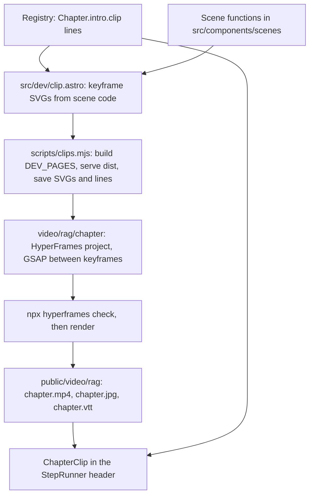

# RAG Pilot - Less Text, More Doing, Opener Clips - Plan

## Goal Capsule

- **Objective:** Make the RAG module's seven chapters read as pictures and actions first. Cut step narration hard, stop repeating finished narration, turn explaining steps into doing steps, and open each chapter with a short silent HyperFrames clip drawn from the site's own scenes.
- **Authority:** This plan's Product Contract, then `AGENTS.md` (credit, "every fact comes from the data", untrusted strings as text, ids never renamed), then the Key Technical Decisions.
- **Stop conditions:** Stop and ask if a RAG chapter can only meet the narration budget (R1) by dropping a fact the recall bank or a quiz depends on. Stop and ask if total clip weight would pass the R9 budget at acceptable quality. Stop and ask if HyperFrames cannot render SVG exported from the iso engine without visible loss.
- **Execution profile:** Shared pieces first (U1, U2, U3), then the clip pipeline (U4), then the RAG content passes (U5, U6), then the clips (U7), then docs (U8).
- **Tail ownership:** Normal repo flow: a branch, conventional commits, a PR to `main`, CI green.

---

## Product Contract

### Summary

Rework the RAG module (module 1, where most first visits land) as the pilot for the "too text-heavy" feedback. Each step gets a short narration with an optional "Why?" fold. The story-so-far log shows one-line labels instead of every past paragraph. Long explaining steps become actions on the stage. Each chapter opens on a 15–30 s silent, captioned clip that replaces the intro paragraphs in Pictures mode. The other 16 modules keep working unchanged; a later plan rolls the pattern out.

### Problem Frame

Readers report that every chapter is too text-heavy. The measured cause in RAG is threefold. First, step narration is long: chapter 6 runs about 800 words over 18 steps, with single steps up to 71 words, and chapter 5 runs about 480. Second, the story column repeats every finished step's full narration in the "story so far" log, so the reading load grows as the reader progresses. Third, the chapter header opens with a story paragraph, a goal, a "You will learn" list and a fixed "how" paragraph before step 1. Many steps explain a result in prose that the live stage could show. The module intros already solved the same problem with a Pictures / Words switch (`src/components/intro/ReadingMode.astro`); chapter pages never got it.

### Requirements

**Less text per step**

- R1. Every RAG step's `narration` is at most 30 words, counted after template values are filled.
- R2. A step may carry an optional longer explanation that sits folded under a "Why?" control. It is open in Words mode and folded in Pictures mode.
- R3. The "story so far" log shows a one-line label per finished step (at most 8 words), not the full narration. Steps without a label keep today's behaviour, so other modules are unchanged.
- R4. No fact, number or answer is lost. A fact that a quiz, a quiz option's `why` or a recall item depends on stays in narration, the stage caption or a pill, never only in the "Why?" fold. The fold holds background no quiz or recall item needs.

**More doing**

- R5. Each RAG step whose narration explains a result the stage can show becomes an action on the stage (a toggle, a drag, a scrub, a pick), using the existing canvas, knobs and quiz components.
- R6. Predict → reveal, quizzes with `why` per option, hints after 3 misses and "Show me" keep working as today.

**Opener clips**

- R7. Each of the 7 RAG chapters has one opener clip: silent, 15–30 s, with large on-screen lines of at most 10 words each, drawn in the Colorfigures style from the chapter's own scene.
- R8. The clip never autoplays. It shows a poster frame with a play button. It respects reduced motion (no autoplay ever, poster only until pressed). Its lines are also on the page as text, so the clip is optional.
- R9. Clips weigh at most 1 MB each and 6 MB for the module. A clip that fails to load (offline, blocked) falls back to its poster and its lines.
- R10. On a chapter that has a clip, in Pictures mode the chapter header shows the clip, the title and the one-line question. The story paragraph, "You will learn", "Words you'll meet" and the "how" paragraph fold into Words mode. The reading choice shares the `tinker-reading` key with the module intros.
- R11. Every number or name in a clip line comes from the data or the registry, the same as page copy.

**Keep what works**

- R12. Saved progress keeps working. Chapter ids never change. A changed step list restarts in-progress runs, as `AGENTS.md` already intends.
- R13. Keyboard, axe, phone (390px), reduced motion and offline e2e checks pass for RAG.

### Success Criteria

- RAG's total step narration drops by at least half, measured by the U2 word-count helper before and after.
- A reader can get through any RAG chapter in Pictures mode with only the clip lines, step narrations and controls, and still answer the chapter quiz.

### Scope Boundaries

- Only the RAG module's chapters change content. Shared components gain opt-in features; other modules render as before.
- No voice-over, no music, no live model, no change to engines, recorded data or the RAG index.
- No clip on module intros, recaps or the home page.
- Share images (`pnpm og`) do not change.

#### Deferred to Follow-Up Work

- Rolling the pattern out to modules 2–17 (one plan, after reader feedback on the pilot).
- A module trailer clip on intro pages.
- Clips after a reveal.

---

## Planning Contract

### Key Technical Decisions

- KTD1. **Short silent opener clips, one per chapter.** (session-settled: user-directed — chosen over a module trailer only, a clip per reveal, and live in-browser animation without rendered video: the user chose opener clips per chapter.) Governs R7, R8.
- KTD2. **Pilot on RAG only.** (session-settled: user-directed — chosen over all 17 modules or shared pieces plus 3 modules: prove the pattern on the first module readers meet.) Governs every R.
- KTD3. **Clip frames come from the site's own scene code, exported by a dev page and a script, as `pnpm og` does.** A dev-only page `src/dev/clip.astro` draws each chapter's keyframes with the existing scene functions and writes the clip's lines from the registry. `scripts/clips.mjs` builds with `DEV_PAGES=1`, serves `dist/`, saves each keyframe's SVG markup and the lines into the chapter's HyperFrames project, then runs the pinned `npx hyperframes render`. This keeps one drawing source and R11's data rule. Hand-drawn clip art would drift from the stage.
- KTD4. **HyperFrames projects live in `video/rag/<chapter>/`, outside `src/`.** Astro never builds them, as with `templates/`. Each project is GSAP motion between the exported keyframes: pills appear, the envelope rides, one part changes per beat, following HyperFrames' explainer guidance (one diagram that grows, one worked example). The CLI runs through `npx` at a pinned version, not as a package dependency.
- KTD5. **Rendered clips are committed; CI never renders.** Outputs land in `public/video/rag/<chapter>.mp4` (H.264), `<chapter>.jpg` (poster) and `<chapter>.vtt` (the lines as captions). This matches the voice clips and the Python model: one-time assets made by hand, size-checked by a unit test. Rendering needs FFmpeg and Chrome, which CI does not need otherwise.
- KTD6. **Clip lines live in the chapter's registry entry.** `Chapter.intro` gains an optional `clip` field holding the lines (built from data with template values). The dev page, the VTT and the on-page text all read it, so the three never disagree. A chapter without `clip` renders today's header.
- KTD7. **The chapter page reuses the module intro's Pictures / Words preference.** The chapter header is JSX inside the `StepRunner` React island, so `ReadingMode.astro` cannot render there; a small React switch in `StepRunner` keeps its behaviour: the `tinker-reading` key, `data-reading` on `<html>`, `aria-pressed`, storage in try/catch. `ReadingMode.astro` stays as it is for intros. The `:root[data-reading="visual"] .more` rule moves from `src/styles/page.css` to `src/styles/tokens.css`, which both page types load. Header text is marked `.more`; the "Why?" fold is not (see U1). The switch and the header marks appear only on chapters with `intro.clip`, so other modules render as today. A second, chapter-only key would split one reader preference in two.
- KTD8. **New `Step` fields are optional: `label` (log line) and `more` (Why? text).** `StepRunner` uses them when present and falls back to today's behaviour. Other modules need no edit, and saved runs are unaffected because step ids, not fields, sign a run.
- KTD9. **The clip element is a plain `<video>` with `controls`, `preload="none"`, `poster`, `muted` and a `<track kind="captions">`.** No player library. Never autoplay, matching the voice module's rule that nothing plays until pressed. An `error` event swaps in the poster and the lines.

### High-Level Technical Design

Clip pipeline, run by hand after changing a chapter's clip lines or its scene:

Chapter header by reading mode:

| Part | Pictures | Words |
|---|---|---|
| Clip (poster, play) | shown | shown |
| Clip lines (text under the clip) | shown | shown |
| Title, one-line question | shown | shown |
| Story paragraph, You will learn, Words you'll meet, "how" line | folded | shown |
| Step narration (≤ 30 words) | shown | shown |
| Step "Why?" text | folded, one press to open | open |
| Story-so-far log | labels | labels |

### Assumptions

- HyperFrames renders the iso engine's SVG markup faithfully when it is inlined in a composition. U4 proves this on one chapter before the rest.
- Keyframes exported from the same scene keep stable element ids, so GSAP can move one element (the envelope) between two keyframes. U4's smoke test proves this; if it fails, the fallback is a crossfade per beat.
- Exported markup keeps its look without page CSS. RAG's timeline, overflow window and track are React components styled by `canvas.css` and `scenes.css`, so the dev page captures their DOM with the rules they need inlined, and each keyframe gets its own `withFrame` id prefix so filters and gradients do not collide.
- 1280×720 at 30 fps, H.264, stays under 1 MB for a 30 s clip once the encoder's CRF is tuned. HyperFrames' default (`looks`, CRF 16, 1920×1080) will not; the paper grain costs extra. U4 sets the size and tunes the CRF.

### Risks

| Risk | Mitigation |
|---|---|
| A narration claim loses its backing check (`tests/unit/accuracy.test.ts` checks the data behind RAG's narration claims, not narration text) | U5 keeps each claim on the page per R4; the data tests stay unchanged. |
| Playwright's bundled Chromium lacks H.264, so the clip raises `error` in e2e | e2e asserts paused-on-load and then accepts playback or the fallback; real playback is checked by hand in desktop Chrome. |
| A changed step list restarts readers' in-progress RAG runs | Intended per `AGENTS.md`. Finished chapters stay finished. U6 merges or adds steps only where an action replaces prose. |
| Clip text and page text drift | KTD6: one source; U7's test compares each VTT with the registry lines. |
| 30-word cap makes steps cryptic | The "Why?" fold keeps the full explanation one press away; U5 reviews each chapter at 390px. |

### Sources

- `src/components/story/StepRunner.tsx`: header, log and card rendering.
- `src/components/story/steps.ts`: `Step` type.
- `src/components/intro/ReadingMode.astro`: Pictures / Words switch.
- `scripts/og.mjs` and `src/dev/og.astro`: the build-serve-capture pattern KTD3 copies.
- `src/components/story/ClipPlayer.tsx`, `src/lib/voice/audio.ts`: the never-autoplay rule and fallback to words.
- HyperFrames skill references: `explainer.md` (one diagram that grows, ≤ 10 words per line when not narrated), CLI `check` and `render`.

---

## Implementation Units

### U1. Optional step label and Why? fold

- **Goal:** Let a step show a short log label and a folded longer explanation.
- **Requirements:** R2, R3, R6, R12.
- **Dependencies:** none.
- **Files:** `src/components/story/steps.ts`, `src/components/story/StepRunner.tsx`, `src/layouts/ChapterLayout.astro` (log and fold styles in `:where(...)`), `tests/unit/steps.test.ts`, `tests/unit/step-runner.test.ts` (new, happy-dom with `createElement`, as `tests/unit/clip-player.test.ts` does; Vitest only collects `*.test.ts`).
- **Approach:**
  1. Add optional `label` and `more` to `Step` (KTD8).
  2. The log renders `label ?? narration`.
  3. The card renders `more` in a native `details` with a visible "Why?" summary. It is not marked `.more`, because that rule removes it in Pictures mode. `StepRunner` sets its `open` from the reading mode (U2) and updates it when the switch changes.
  4. `more` renders as a text node only.
- **Patterns to follow:** existing `details.terms` in the header; `AGENTS.md` CSS rule on `:where(...)`.
- **Test scenarios:**
  - A step with `label` shows the label in the log after it is finished, not its narration.
  - A step without `label` shows its narration in the log (other modules unchanged).
  - A step with `more` renders a "Why?" fold with that text; without `more`, no fold renders.
  - In Pictures mode the fold's summary is visible and closed; in Words mode it is open.
  - Adding `label` or `more` to a step does not change the run signature: a saved run on the same ids still restores.
  - `more` containing `<b>` renders as literal text.
- **Verification:** RAG and one other module's e2e flows still pass unchanged.

### U2. Reading mode on chapter pages and the folding header

- **Goal:** Chapters with a clip get the Pictures / Words switch; in Pictures mode their header folds to clip, title and question.
- **Requirements:** R10, R2.
- **Dependencies:** U1.
- **Files:** `src/styles/page.css` and `src/styles/tokens.css` (move the `.more` rule, KTD7), `src/components/story/StepRunner.tsx` (the React switch), `src/layouts/ChapterLayout.astro`, `tests/unit/narration-budget.test.ts` (new: word-count helper used by U5), `tests/e2e/layout.spec.ts`.
- **Approach:**
  1. Place the switch in the story column's header, not the chapter bar, so the bar keeps its two fixed rows.
  2. Render the switch and mark the story paragraph, learn list, terms and "how" line `.more` only when the chapter has `intro.clip` (KTD7).
  3. Same `tinker-reading` key and default (Pictures) as module intros.
  4. Add a word-count helper (words after template fill) for R1 and the success measure; record RAG's before count in the test file's comment.
- **Patterns to follow:** `ReadingMode.astro` script; module intro `.cap` / `.more` split.
- **Test scenarios:**
  - A non-RAG chapter in Pictures mode shows its full header and no switch.
  - Pictures mode on a RAG chapter hides the story paragraph and learn list; Words shows them.
  - Choosing Words on a module intro carries to its chapters, and back.
  - With storage blocked, the chapter page shows everything (no script error).
  - Chapter bar height is the same on every RAG chapter in both modes (existing layout check).
  - In Words mode a step's "Why?" fold is open; in Pictures it is closed and one press opens it.
- **Verification:** desktop and 390px screenshots of a RAG chapter in both modes look right.

### U3. ChapterClip component

- **Goal:** Show a chapter's clip in the header with a poster, never autoplaying, with its lines as text.
- **Requirements:** R8, R9, R10, R13.
- **Dependencies:** U2.
- **Files:** `src/lib/modules.ts` (optional `clip` on `Chapter.intro`, KTD6), `src/components/story/ChapterClip.tsx` (new), `src/components/story/StepRunner.tsx`, `tests/unit/chapter-clip.test.ts` (new, happy-dom with `createElement`).
- **Approach:**
  1. Render a plain `video` per KTD9 with `src`, `poster` and the VTT from `public/video/<module>/<chapter>.*`.
  2. The lines render under it as a short list, visible in both modes (they are the clip's words).
  3. On `error`, hide the video and keep the poster image and lines.
  4. A chapter without `clip` renders no clip. No RAG chapter gets a `clip` entry in this unit: an entry lands only in the same change that commits its files under `public/video/rag/` (U4, U7).
- **Patterns to follow:** `ClipPlayer.tsx` (fallback to words, nothing plays unasked).
- **Test scenarios:**
  - A chapter with `clip` renders a video with `preload="none"`, a poster and no `autoplay` attribute.
  - A chapter without `clip` renders today's header.
  - A video `error` event leaves the poster image and every line visible.
- **Verification:** unit tests pass; e2e coverage of the clip lands with the first real clip in U4.

### U4. Clip pipeline and the first clip

- **Goal:** Produce one real clip end to end and prove quality and size.
- **Requirements:** R7, R9, R11.
- **Dependencies:** U3.
- **Files:** `src/dev/clip.astro` (new, scoped styles), `scripts/clips.mjs` (new), `package.json` (`clips` script), `video/rag/03-what-is-rag/` (new HyperFrames project: `index.html`, `compositions/`), `video/README.md` (new: how to render, pinned CLI version, CRF, FFmpeg), `src/content/rag/module.ts` (chapter 3's `clip` lines), `public/video/rag/03-what-is-rag.{mp4,jpg,vtt}`, `tests/e2e/ch3-4.spec.ts`.
- **Approach:**
  1. The dev page renders, per chapter, an ordered set of keyframes from the chapter's scene code, plus the clip lines from the registry.
  2. The script mirrors `scripts/og.mjs`: build with `DEV_PAGES=1`, serve `dist/`, save each keyframe's SVG and a lines JSON into `video/rag/<chapter>/assets/`, and write the VTT.
  3. It then runs `npx hyperframes@<version> check` and `render` at `--fps 30` with a fixed CRF. The version is the current CLI release when U4 starts, pinned in the script and `video/README.md`.
  4. It extracts the poster from the MP4's first frame with ffmpeg as a JPEG at quality 88 (the OG setting), and copies the MP4, poster and VTT into `public/video/rag/`.
  5. Each composition is `data-width="1280" data-height="720"` and animates between keyframes (KTD4) on the warm paper, with lines inside the title-safe box.
  6. Start with chapter 3 (what RAG is): its pipeline scene is the module's core picture.
- **Execution note:** Smoke-first. First move the envelope between two exported keyframes (Assumptions). Then render the draft, look at decoded frames and `ffprobe` duration, and tune the CRF to the size cap before writing the other six.
- **Patterns to follow:** `scripts/og.mjs`, `src/dev/og.astro`, the HyperFrames contract (`class="clip"`, `data-start`, `data-duration`, seeded timelines).
- **Test scenarios:**
  - `npx hyperframes check --json` reports no errors for the project.
  - The rendered MP4's duration is 15–30 s and its size is ≤ 1 MB.
  - e2e: on load the clip is paused with `preload="none"` and no `autoplay`; after pressing play it either plays or shows the poster-and-lines fallback (Playwright's Chromium has no H.264).
  - e2e offline: after going offline, chapter 3 still plays through its steps and the clip area shows the poster and lines.
  - e2e reduced motion: the clip stays paused until pressed.
  - axe passes on the header with the clip.
  - Test expectation for the script itself: none -- a hand-run build tool, checked by its outputs (U7's test).
- **Verification:** the clip plays on RAG chapter 3, frames match the stage's drawing style, and the lines match the registry.

### U5. RAG narration pass

- **Goal:** Bring every RAG step to ≤ 30 words with labels and Why? folds, losing no fact.
- **Requirements:** R1, R3, R4, R6.
- **Dependencies:** U1, U2.
- **Files:** `src/content/rag/01-history.tsx` through `src/content/rag/07-sandbox.tsx`, `src/content/rag/module.ts` (shorter `story` and `goal` where needed), `tests/unit/narration-budget.test.ts`, `tests/unit/accuracy.test.ts` and any other RAG test that asserts narration text.
- **Approach:**
  1. Per step: keep the instruction and the one new idea in narration; move background, caveats and sources to `more`; move numbers the stage can show into the stage caption or a pill. Facts a quiz or recall item needs stay out of `more` (R4).
  2. Give every step a `label`.
  3. Keep step ids unchanged in this unit, so in-progress runs survive it.
  4. Order of work: chapter 6, then 5, then 4 (the longest), then the rest.
- **Patterns to follow:** `AGENTS.md` story rules (plain words, one idea per step, define a term the first time); numbers imported, never typed.
- **Test scenarios:**
  - Every RAG step's narration is ≤ 30 words after template values are filled.
  - Every RAG step has a `label` of ≤ 8 words.
  - Total RAG narration is at most half the recorded before count.
  - Each quiz's and recall item's source fact appears in narration, the stage caption or a pill; a fact found only in `more` fails.
- **Verification:** each chapter read once in Pictures mode at 390px reads as a sequence of short instructions over a changing picture.

### U6. RAG steps that become actions

- **Goal:** Replace explaining steps with doing steps on the stage.
- **Requirements:** R5, R6, R12.
- **Dependencies:** U5.
- **Files:** RAG chapter files touched by the conversions (expected mostly `src/content/rag/02-why-not-stuff-it.tsx`, `05-accuracy.tsx`, `06-types.tsx`), `src/components/canvas/` only where a knob or toggle is missing, `tests/e2e/flow.ts` and `tests/e2e/ch*.spec.ts`, `tests/unit/steps.test.ts` where a step list changes.
- **Approach:**
  1. List each RAG step whose `more` (from U5) still explains a result the stage could show. Record the list in the PR description.
  2. For each, prefer an existing control (a knob, a canvas mode, a `Predict`, a toggle between two states) whose predicate advances the step once the reader has seen the result.
  3. Change step ids only where a step is added or merged; accept the restart of in-progress runs (R12).
  4. Every converted step keeps a hint and, for puzzles, a "Show me".
- **Execution note:** Convert one step, play it through by keyboard and at 390px, then continue.
- **Patterns to follow:** existing canvas knobs (`src/components/canvas/Knobs`), `Predict`/`Outcome`, chapter 2's overflowing-window scene.
- **Test scenarios:**
  - Each converted step advances only after the reader performs its action (e2e flow).
  - Each converted step is reachable and completable by keyboard only.
  - A converted step's hint shows after 3 misses; "Show me" applies the solution where it is a puzzle.
  - A run saved before a changed step list restarts the chapter and keeps `done`.
- **Verification:** RAG e2e flows pass; at least one action replaces prose in each of chapters 2, 5 and 6.

### U7. The six remaining clips and their guard test

- **Goal:** Clips for every RAG chapter, with a test that keeps them honest.
- **Requirements:** R7, R9, R11.
- **Dependencies:** U4, U5 (lines settle after the narration pass).
- **Files:** `video/rag/<chapter>/` for the other six chapters, `src/content/rag/module.ts` (`clip` lines per chapter), `public/video/rag/*`, `tests/unit/clips.test.ts` (new).
- **Approach:** Same pipeline as U4, one project per chapter, each built around the chapter's own picture: the timeline for chapter 1, the overflowing window for chapter 2, the track for chapters 3–7.
- **Test scenarios:**
  - Every RAG chapter with `clip` has an MP4, a poster JPG and a VTT in `public/video/rag/`.
  - Every MP4 is ≤ 1 MB, and the module's total (MP4s and posters) is ≤ 6 MB.
  - Each VTT's cue texts equal that chapter's registry clip lines, in order.
  - Every clip line is ≤ 10 words.
  - No file in `public/video/rag/` belongs to a chapter id the registry doesn't have.
- **Verification:** all seven clips play on their chapters; the guard test passes.

### U8. Docs

- **Goal:** Record the pattern so the roll-out plan and other contributors follow it.
- **Requirements:** all, for future modules.
- **Dependencies:** U1–U7.
- **Files:** `AGENTS.md` (chapter layout: reading mode, labels, Why? folds, the 30-word budget; a "Clips" section: pipeline, committed outputs, CI never renders, size budget, never autoplay), `docs/writing-a-module.md`, `video/README.md`.
- **Approach:** State each rule once, in `AGENTS.md`'s existing voice; `docs/writing-a-module.md` cites it.
- **Test expectation:** none -- documentation only.
- **Verification:** a reader of `AGENTS.md` can render a new clip and knows the narration budget.

---

## Verification Contract

| Gate | Command | Applies to |
|---|---|---|
| Types | `pnpm check` (0 errors, 0 warnings) | every unit |
| Lint and format | `pnpm lint` | every unit |
| Unit tests | `pnpm test` (incl. `narration-budget`, `clips`, `chapter-clip`) | U1–U7 |
| End to end | `pnpm test:e2e` (RAG flows, a11y, keyboard, reduced motion, phone, offline) | U1, U2, U4–U7 |
| Clip project | `npx hyperframes check --json` per project, then decoded-frame look and `ffprobe` duration | U4, U7 |
| Manual look | RAG chapters at desktop and 390px, both reading modes | U2, U5, U6, U7 |

## Definition of Done

- Every R in the Product Contract holds for all seven RAG chapters.
- Other modules' e2e flows pass with no content edits.
- The RAG narration total is at most half the before count, and the count is recorded in the test.
- Seven clips are committed under `public/video/rag/` within budget, with matching VTTs.
- `AGENTS.md` and `docs/writing-a-module.md` describe the pattern.
- No abandoned experiment code (spare compositions, unused dev pages, dead step fields) remains in the diff.
