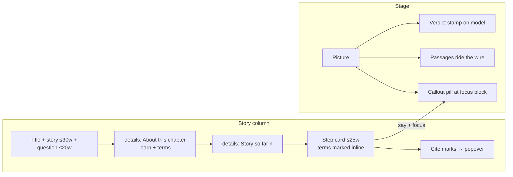

# Picture-First Chapters - Plan

## Goal Capsule

- **Objective:** make chapters read picture-first. Readers should see a short opening, short steps, a picture that tells them what happened, and sources tucked out of the way. RAG is the pilot, and the pattern becomes the template for every module.
- **Authority:** this plan's Product Contract, then `AGENTS.md`. Where they disagree, this plan wins only for the rules it names in KTD2 through KTD7, and U6 rewrites `AGENTS.md` to match.
- **Stop conditions:** stop and ask if a budget in R5 can't be met without cutting a step or changing a step id. Stop and ask if a shared change breaks a non-RAG module's e2e walk in a way that needs that module's copy rewritten.
- **Execution profile:** shared components first (U1–U4), then the RAG copy pass (U5), then the template (U6). Work locally on a branch first, and open no PR until the author has looked at the result. Everything then ships as one PR (user-directed, chosen over a pilot PR followed by a template PR).

---

## Product Contract

### Summary

Testers called Tinker too text-heavy. A RAG chapter's first screen shows about 250 words before the reader does anything, while the picture shows a nearly empty board. This plan does four things:

- shortens the chapter opening, which is shared by every module;
- defines terms where they appear instead of in a list up front;
- folds away the story-so-far log and the source links;
- puts a word budget on copy, enforced by a test.

It also makes RAG's picture say what happened: a verdict stamp, passages riding the wire, and a short callout on the block in focus. Then it rewrites RAG's copy within the budget. Video was considered and rejected.

### Problem Frame

Evidence, from loading RAG chapters 1, 3 and 5 and the RAG intro page at 1440px and 390px:

- **Too much text before the first action.** About 230–280 words of visible text sit above the first control: story, "This chapter", three "You will learn" bullets, the "Words you'll meet" toggle, a "the picture on the left is live" note, and the step itself. On phones, the step card is two screens down.
- **The picture states things in text.** "Nothing reaches the model…" and "Answer: MADE UP…" are text lines under the drawing (`summary()` in `src/components/panels/logic.ts`). The drawing's only verdict cue is the colour of the LLM block's screen.
- **Steps run long.** Across RAG, the median step is 30 words and the 90th percentile is 51. Chapter 6 reaches 71. Chapters 5 and 6 have 18 steps each.
- **The text keeps growing.** "Story so far" repeats every finished step's narration in full.
- **Sources are everywhere.** Each module's `Fact` writes "claim · Source: host (checked date)" inline. There are 16 copies of `Fact` and 174 uses. RAG chapters 1 and 2 do the same through `Source`.

### Requirements

- **R1.** A chapter opens with its story in at most 30 words and its question in at most 20 words. "You will learn" and "Words you'll meet" are folded by default. The "picture on the left is live" note is removed. Context still comes before step 1.
- **R2.** A chapter term is defined where it first appears in that chapter's narration, with a tap- and keyboard-reachable definition. Terms that never appear in the narration stay reachable through the folded list.
- **R3.** "Story so far" is folded by default and shows how many steps came before. Expanding it shows the full narration, as today.
- **R4.** A sourced fact shows its claim with a small source mark. The source title, link and checked date open from the mark. The claim's source and access date are still shown, so the facts-from-data rule holds. Inline "Source: …" text is gone.
- **R5.** Copy budgets are checked by a unit test: step narration at most 25 words, intro story at most 30, question (`intro.goal`) at most 20, "learn" at most 3 items, a step callout at most 5 words, each quiz `why` one sentence, and story + question + step 1 narration together at most 70 words, which leaves room for the fixed labels inside the 80-word first screen. The 25-word step cap sits just under today's median of 30: it forces the longest steps (the 90th percentile is 51) to hand their "what happened" to the picture, while ordinary steps lose only a clause. The test fails for RAG. Other modules sit on a named pending list until their copy pass.
- **R6.** In RAG chapters 3–7, the picture shows each answer's verdict on the model. When an answer runs, passages visibly travel the wire from the retriever to the model. A step may name a short callout (at most 5 words) that the picture pins to a block. Chapters 1 and 2 (the timeline and the overflowing window) also get callouts wherever a step points at something in their scene, such as an era or the spilling window (user-directed). The board in chapters 3–7 draws placeholder outlines only for blocks the current chapter adds. Outlines for later chapters are hidden, so the first screen reads as a deliberate scene rather than an empty grid, and each new block arrives as a reveal (user-directed, chosen over keeping the "coming in chapter N" preview).
- **R7.** All 7 RAG chapters and the RAG intro page meet the budgets. Quizzes keep a `why` for every option and the "I'm not sure" option, with each `why` trimmed to one sentence.
- **R8.** `AGENTS.md`, `docs/writing-a-module.md` and `templates/module/` describe the picture-first chapter, so new modules start within budget.
- **R9.** Every page change holds up with reduced motion, keyboard only, on phones (390px) and under axe. Text in pictures stays in label pills.

### Success Criteria

- On a RAG chapter's first screen, the story column has at most 80 words from the title down to step 1's first control, counting every visible word including the eyebrow, title, labels and step 1's narration. Today that count is about 250. An e2e check enforces this. The step card is visible without scrolling at 1440×900.
- After the PR ships, re-run the same informal test with the same kind of users on RAG. They should no longer name "too much text" as the first complaint. This is qualitative, and the author runs it.

### Scope Boundaries

- No video, recorded clips or animation files. Motion is CSS and SVG over live state (KTD1).
- No change to engines, recorded data, step ids or step counts. Saved runs keep resuming.
- No new modules, and no changes to other modules' pictures.

### Deferred to Follow-Up Work

- **Copy passes for the other 16 modules,** one PR per module. Each removes its id from the pending list in U1. The shared changes (U2, U3) already reach them in this PR.
- **Shorter chapters.** Cutting steps in RAG chapters 5 and 6 changes step ids, which restarts in-progress runs.
- **Callouts and stamps for the other modules' stages.** `StageProps` gains the callout in U4, and each stage can opt in later.

### Assumptions

These are defaults for calls made at scoping that weren't answered explicitly:

- The shared changes land for every module at once, with no opt-in flag. They fold text and add two small controls (term buttons, source marks). Textual content is unchanged, so `toContainText` assertions hold, and every module's e2e walk runs in CI to catch the rest.
- Sources become a mark that opens a popover. There is no end-of-chapter list, so no numbering state is needed.
- Long chapters get word cuts only. Step cuts are deferred, as above.

### Sources

- Screenshots and word counts from the dev server, plus the narration length survey of `src/content/rag/*.tsx`, both taken while planning.

---

## Planning Contract

### Key Technical Decisions

- **KTD1. No video; animate the scenes already drawn** (session-settled: user-directed, chosen over a rendered clip per chapter: about 120 clips to remake on every copy or data change, numbers baked in against the facts-from-data rule, and passive viewing against predict → reveal). The `video/` folder stays out of the repo.
- **KTD2. The opening is folded, not removed.** `StepRunner` renders the story, the question and a closed "About this chapter" `
` holding "You will learn" and "Words you'll meet". This keeps `AGENTS.md`'s "never drop a reader straight into a step" while dropping the text wall. U6 rewrites the rule on purpose.
- **KTD3. Terms are marked at render, not by hand.** A pure helper reads the whole chapter's narration in step order and finds the first occurrence of each of the chapter's `intro.terms`: case-insensitive, on word boundaries, with an optional plural "s". Each term is marked only in the step holding its first occurrence, as a small button that opens the definition. Copy authors write nothing new, so the change scales to every module for free. The story log stays plain text.
- **KTD4. One shared `Cite` component.** It shows a small mark, a button with an accessible name like "Source for this fact". The mark opens a popover with the title, the link (`target="_blank" rel="noopener"`) and the checked date. The date is required wherever the data has one. RAG's timeline entries have none today, as now. `Cite` renders phrasing content only (``, using the native `popover` attribute), so it sits inside the existing `
` and `<li>` parents without breaking hydration. RAG's `Source` and all 16 module-kit `Fact` functions render through it, keeping their own data lookup. Each `Fact` keeps rendering its claim. Only the source line changes, so the 174 call sites are untouched.
- **KTD5. Budgets live in a unit test, with a pending list.** `tests/unit/copy-budget.test.ts` walks every live module's chapter `intro` and each chapter's exported `STEPS` (as `inference-chapters.test.ts` already does). A module on `PENDING` gets a report but not a failure. RAG is never on it. The budgets are in R5. They're word counts, not characters, because the copy is prose.
- **KTD6. The picture carries the outcome.** The verdict goes in the LLM block's own name pill as its stat (`statOf('llm')` gives "LLM · MADE UP", coloured by `LLM_STATE`). Reusing the existing pill means no second pill and no collision with the block-name row. On a new run, small passage cards ride the live wires. They carry no text, only the card shape in the retriever's colour, and are animated with CSS `offset-path` along the wire's path. They are drawn only while the canvas's `.run` class is on (the same toggle as `wire-flow`) and never under reduced motion. The caption splits in two: a visually hidden `aria-live` element keeps the full `summary()` text and `data-testid="announce"`, and a separate `aria-hidden` visible line shows the verdict and count.
- **KTD7. A step callout is an optional `say: { block, text }` on `Step`, separate from `focus`.** In RAG, `focus` names controls in most steps, so the callout needs its own block target. That way a step can highlight its control and pin a callout to a block at once. `StepRunner` passes `say` in `StageProps`. A stage that doesn't read it ignores it, so the other modules are unaffected. RAG's canvas draws the callout as a pill on its own offset above the block-name pill row. On phones it uses the larger `scale` and is dropped if it would overflow the stage, since the narration already names the block.

### High-Level Technical Design

What changes on a chapter page:

### Sequencing

The order is U1 → U2 → U3 → U4 → U5 → U6, then a local review by the author before any PR. U1 lands first so U5 has a red test to turn green. U2–U4 are independent of each other, though U2 and U4 both touch `StepRunner.tsx`, so land them one after the other. U5 depends on all of them.

---

## Implementation Units

### U1. Copy budget test

**Goal:** a failing check that defines "short enough".
**Requirements:** R5.
**Dependencies:** none.
**Files:** `tests/unit/copy-budget.test.ts` (new).
**Approach:**
1. Load every chapter file with `import.meta.glob('../../src/content/*/[0-9]*.tsx', { eager: true })` and match each to `MODULES` by module and chapter id. Fail when a live module's chapter has no `STEPS` export, so new modules can't slip past.
2. Count words by whitespace split and check every budget in R5. Quiz `why` texts are reached through the chapter's exported quiz constants where a chapter exports them; implementation decides the export shape.
3. Report any chapter term that `markTerms` never matches in that chapter's narration.
4. `PENDING` lists all modules except RAG. Pending modules log their overruns. RAG fails on any overrun or unmatched term, naming the chapter, step id and count.
5. Fail if a pending id isn't a live module, so the list can't rot.

**Test scenarios:**
- RAG today fails, naming `06-types` steps over 25 words.
- A pending module with overruns passes and logs them.
- An unknown id on `PENDING` fails.
- A step narration written as a template literal is counted the same as a quoted one.
- A RAG chapter whose story, question and step 1 narration add up to more than 70 words fails, even though each is within its own cap.
- A `say` callout of 6 words fails for RAG.

**Verification:** the test runs red on `main` for RAG only.

### U2. Shorter chapter opening, inline terms, folded log

**Goal:** the shared story column carries less text up front.
**Requirements:** R1, R2, R3, R9. Governed by KTD2 and KTD3.
**Dependencies:** none.
**Files:** `src/components/story/StepRunner.tsx`, `src/components/story/terms.ts` (new), `src/layouts/ChapterLayout.astro` (styles), `tests/unit/terms.test.ts` (new), `tests/e2e/layout.spec.ts`.
**Approach:**
1. Replace the intro's "You will learn", terms and "how" note with one closed `
`. Keep the eyebrow, title, story, goal and the resume chip.
2. Add `markTerms(narrations, terms)`. It takes the chapter's narrations in step order and returns, per step, text segments and term segments. `StepRunner` renders term segments inline as a `<button className="term" aria-expanded aria-controls>` with a dotted underline. Use no `dangerouslySetInnerHTML`.
3. Render an opened definition outside the narration's `aria-live` div, as a sibling after it, with its own polite status. Pressing a term inside the atomic region must not re-announce the whole step. One definition is open at a time. It closes on a second press, on Escape, or when the step changes.
4. Wrap the `ol.log` in `
` with the summary "Story so far (n)", where n is the finished steps of the current run, including a resumed one. The "About this chapter" and log `
` keep their open state while the reader stays in the chapter, and start closed on each visit.
5. Put layout styles in `:where(...)`, per the CSS rule.

**Patterns to follow:** the existing `details.terms` markup, and `Drawer.tsx` for focus handling.
**Test scenarios:**
- `markTerms` wraps only the first occurrence. It matches "context window" inside "the context window's size". It matches a plural ("LLMs") but never the inside of another word ("RAG" in "fragment").
- Overlapping terms ("Context window" and "Context"): the longer term wins.
- No terms, or narration with no matches, returns the text unchanged.
- e2e: on `/rag/03-what-is-rag/` at 1440×900, the first step card is in view without scrolling, and "About this chapter" is closed.
- e2e: a term button opens with Enter and its definition is announced. The layout spec runs at 390px too.
- `markTerms`: a term first used in step 2 is marked in step 2 and not in step 5.
- e2e: the story log is closed after two steps and shows "(2)". Once opened, it stays open after the next step.
- e2e: pressing a term doesn't change the narration's live region text.
- e2e: on each RAG chapter at 1440×900, the visible words from the title down to step 1's first control are at most 80.

**Verification:** every module's existing e2e walk still passes. axe is clean.

### U3. Shared `Cite`

**Goal:** sources are one tap away instead of inline.
**Requirements:** R4, R9. Governed by KTD4.
**Dependencies:** none.
**Files:** `src/components/story/Cite.tsx` (new), `src/components/scenes/Source.tsx`, the `Fact` function in each of the 16 `src/content/*/kit.tsx` files that define one, `src/components/scenes/scenes.css`, `tests/e2e/ch1-2.spec.ts`, `tests/e2e/tokens.spec.ts` (it asserts the visible "checked" date).
**Approach:**
1. `Cite` takes a title, an href and the checked date (KTD4). It renders a mark button with a hit area of at least 44px and a popover. Escape or an outside tap closes the popover, and focus returns to the mark. On phones the popover spans the card's width instead of floating.
2. `Source` renders `Cite` instead.
3. Each kit `Fact` keeps its claim text and swaps the source line for `Cite`.
4. Fix the RAG ch1–2 e2e assertions that look for "Source:" text, and the tokens "checked" date assertion, so they open the mark instead.

**Test scenarios:**
- e2e: in RAG chapter 2, a fact shows no "Source:" text. Pressing its mark shows the link to the same URL, opening in a new tab.
- e2e: Escape closes the popover and focus returns to the mark.
- e2e: one non-RAG module (tool calling chapter 5, which is fact-heavy) shows marks and its walk passes.

**Verification:** a grep for `Source:` in the rendered RAG pages finds nothing. axe is clean.

### U4. Picture speaks: stamp, travelling passages, step callout

**Goal:** the RAG canvas shows what happened without the caption.
**Requirements:** R6, R9. Governed by KTD6 and KTD7.
**Dependencies:** none.
**Files:** `src/components/story/steps.ts` (`say?: { block, text }`), `src/components/story/StepRunner.tsx` (pass `say`), `src/components/canvas/Canvas.tsx`, `src/components/canvas/canvas.css`, `src/components/panels/rag.tsx`, `src/components/panels/logic.ts`, `tests/unit/steps.test.ts`, `tests/e2e/canvas.spec.ts`.
**Approach:**
1. Give `statOf('llm')` the verdict whenever `out.answer` exists (KTD6).
2. Add text-free passage cards on live wires, emitted only while `.run` is on and reduced motion is off, and animated with `offset-path` (KTD6).
3. `RagStage` forwards `say`. The canvas draws it as a pill above the block-name row at `say.block` (`pointer-events="none"`, escaped with `esc()`).
4. Draw the dashed placeholder pads (`track.pads` in `Canvas.tsx`, each carrying its `chapter`) only when the pad's chapter is the current chapter. The canvas learns the current chapter number from `RagStage`. Chapter 7's sandbox, where every block is unlocked, is unchanged.
5. Give the chapter 1 and 2 scenes (`src/content/rag/01-history.tsx`, `02-why-not-stuff-it.tsx` and their scene files under `src/components/scenes/`) the same `say` callout, drawn as a `tag()` pill at the named era or window.
6. Split the caption into a hidden `aria-live` element with the full `summary()` text (keeps `data-testid="announce"`) and an `aria-hidden` visible line with the verdict and count.

**Patterns to follow:** label pills via `tag()` with `even` and `scale`, and `LLM_STATE` for verdict colours.
**Test scenarios:**
- e2e: after the chapter 3 "retriever" step, the LLM's pill reads CORRECT. Before it, MADE UP.
- e2e: with reduced motion, no passage elements exist, and the verdict still shows.
- e2e: a step whose `say.block` is on the board renders the callout pill. A step whose block isn't placed yet renders none.
- e2e: a step that focuses a control and has a `say` callout highlights the control and shows the callout.
- unit: `Step` accepts `say`, and the runner passes it unchanged (extend `steps.test.ts`).
- e2e: the callout pill's box overlaps no block-name pill or zoom button, at 1440px and 390px.
- e2e: `announce` still contains "Answer:" (the a11y spec relies on it).
- e2e: chapter 3's board shows outlines for Docs and Retriever only, with no "CHAPTER 4" text in the SVG. Chapter 4's board shows its own four and none of chapter 5's.
- e2e: a chapter 1 step with a `say` callout shows its pill on the timeline scene.

**Verification:** RAG chapters 3–7 e2e pass, and the `announce` test id still carries the verdict text.

### U5. RAG copy pass

**Goal:** all of RAG meets the budget and uses the new picture cues.
**Requirements:** R6, R7, R1, R2.
**Dependencies:** U1, U2, U3, U4.
**Files:** `src/content/rag/module.ts`, `src/content/rag/01-history.tsx` through `07-sandbox.tsx`, `src/content/rag/types-data.ts` if its copy shows, `src/pages/rag/index.astro`, `tests/e2e/ch1-2.spec.ts`, `ch3-4.spec.ts`, `ch5.spec.ts`, `ch6.spec.ts`, `ch7.spec.ts`.
**Approach:**
1. Rewrite each step to one action and one idea within 25 words. Move what the picture now shows (the verdict, which block lit up) out of the narration.
2. Add a `say` callout where the step points at a block.
3. Make sure each chapter's terms appear in its narration, so they get marked inline.
4. Trim each quiz `why` and each drawer explanation to one sentence.
5. Mark any remaining longer prose on the intro page `.more`.
6. Keep every step id and every recorded number imported, not typed.
7. Update e2e text assertions to the new copy.

**Execution note:** run U1's test as the to-do list, one chapter per commit.
**Test scenarios:**
- U1's budget test is green for RAG.
- Every RAG e2e walk passes end to end with the new copy, plus keyboard-only, reduced-motion, phone and offline variants.
- A saved run from before the change resumes at the same step, because the ids are unchanged. Covered by the existing restore e2e.

**Verification:** at 1440×900, each RAG chapter has at most 80 words above the first control (manual check on all 7). Phones checked at 390px.

### U6. Template and house rules

**Goal:** new and follow-up modules start picture-first.
**Requirements:** R8.
**Dependencies:** U5.
**Files:** `AGENTS.md`, `docs/writing-a-module.md`, `templates/module/` (its chapter and module entry), `tests/unit/registry.test.ts` if the template is checked there.
**Approach:**
1. In `AGENTS.md`, rewrite "The story column opens with context" to describe the folded opening, inline terms and the folded log.
2. Add a "Copy budget" rule naming the test and `PENDING`.
3. Add a sources rule: `Cite` marks, not inline links.
4. Add "a step may carry a `say` callout" to the Pictures section.
5. Mirror these in the module-writing guide's checklist.
6. Make the template chapter's sample copy fit the budget.

**Test scenarios:** `pnpm new-module` output passes the budget test without edits. A scratch scaffold is checked and then deleted.
**Verification:** `pnpm lint` and `pnpm check` are clean.

---

## Verification Contract

- `pnpm check`: 0 errors, 0 warnings.
- `pnpm lint`: 0 diagnostics.
- `pnpm test`: includes `copy-budget.test.ts` (RAG strict) and `terms.test.ts`.
- `pnpm test:e2e`: every module's walk, axe, keyboard-only, reduced motion, phone and offline.
- `pnpm og` after U5, then commit the regenerated RAG chapter JPEGs. Chapter share images and meta descriptions read `intro.goal` (`chapterMeta` in `src/lib/pages.ts`), so all 7 change. Other modules' images must not change.
- A manual look at all 7 RAG chapters at 1440px and 390px, and at one chapter each of tool calling and voice to confirm the shared changes.

## Definition of Done

- R1–R9 are met. RAG is absent from `PENDING`, and the other 16 modules are on it.
- No step id changed. No recorded data or engine file changed.
- `AGENTS.md` and the guide describe the new rules, with no leftover text describing the old opening.
- Abandoned experiments are removed from the diff. `video/` is not committed.
