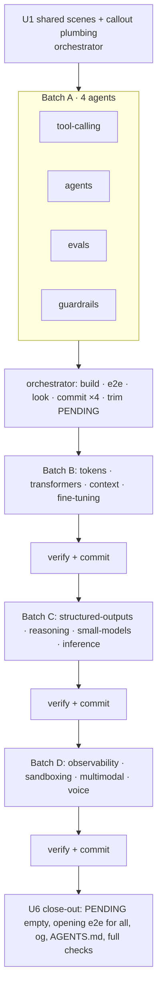

# Picture-First Pass for the Other 16 Modules - Plan

## Goal Capsule

- **Objective:** bring the 16 modules on `PENDING` up to the RAG pilot's standard, so testers never meet a text wall again:
  - copy within the budgets;
  - every instruction in its own highlighted line (`act`);
  - step callouts pinned on each module's picture;
  - every cited fact re-checked against its live source, with misleading framing fixed in the copy and the pictures.
- **Authority:** this plan, then `AGENTS.md`. The pilot's plan (`docs/plans/2026-10-24-1115-feat-picture-first-chapters-plan.md`) defines the budgets, `act`, `say` and `Cite`. This plan applies them and doesn't redesign them.
- **Stop conditions:**
  - **A cut loses a taught point.** Stop and ask when a cut removes a point that a recall item, a quiz option or a later step depends on, and no drawer panel or callout can hold it.
  - **A source is wrong.** Stop and ask if a fact's source now contradicts a lesson's point, not just a number in it. The fix would then change what a chapter teaches.
  - **Recordings or engine inputs involved.** Stop and ask if fixing a fact would change recorded data (turns, answers, readings) or an engine. That includes the `value` of any fact an engine reads, which changes puzzle answers and charts:
    - tool-calling `mcp-version`;
    - context's cache multipliers (`src/lib/context/cache.ts`);
    - multimodal `patches`, `high-res-tier`, `standard-tier`, `openai-32`;
    - small-models `price-pair`;
    - inference `opt-13b`.
- **Execution profile:**
  - Stay on branch `feat/picture-first-chapters` and ship it all as one PR with the RAG pilot (user-directed).
  - Agents work in parallel, one per module, in batches of four (user-directed). The orchestrator verifies and commits each module.
  - Nothing is pushed until the author has looked at the result.

---

## Product Contract

### Summary

RAG now opens short, splits "what to do" from the step text, pins callouts on its picture, and cites facts behind a mark. The other 16 modules already have the shared parts: the folded opening, the inline terms, `Cite` and the `act` line. They still carry their old copy, though. 375 of their roughly 500 steps are over 25 words, step averages run 31–59 words, the longest step is 134 words, and first screens are up to 180 words against a limit of 62. Their scenes don't draw callouts, and their 223 cited facts haven't been re-checked since they went live.

### Problem Frame

- **Text.** Every pending module fails every copy budget (survey of `STEPS` and `intro` per module while planning; see Sources).
- **Instructions blend in.** Their narrations end in the instruction ("Run it.", "Switch to Agentic."), which the pilot showed readers can't pick out. The `act` field exists but no other module uses it.
- **Pictures don't speak.** `StageProps.say` reaches every stage, but none of the 16 kits or their 17 scene builders read it.
- **Facts drift.** Fact files carry claims dated October 2026, about prices, windows, limits, specs and papers. The pilot found a correct number framed as typical when it was one model's record. Other modules can have the same problem.

### Requirements

- **R1.** Every chapter of the 16 modules meets the budgets in `tests/unit/copy-budget.test.ts`:
  - narration plus `act` at most 25 words;
  - story at most 30 words, question at most 20;
  - "learn" at most 3 items;
  - a callout at most 5 words;
  - each quiz `why` one sentence;
  - opening at most 62 words;
  - every term used in the narration or the `act`.

  Each module's id comes off `PENDING`, and the list ends empty.
- **R2.** Every step that asks the reader to do something carries that instruction in `act`, not at the end of the narration. Steps that only orient have no `act`.
- **R3.** Every module's picture draws a step's `say` callout on the part the step is about, wherever a step points at something in the scene (user-directed, chosen over a text-and-facts-only pass). Callouts appear only on the picture view, never on the second tab. Each new callout is at most 16 characters, so it shows on phones too (session-settled: user-directed — chosen over the pilot's rule of hiding longer callouts on phones). The copy-budget test enforces this for the 16 modules.
- **R4.** Every entry in the 16 `data/<module>/facts.json` files gets a framing review wherever it shows (KTD6). Every date-sensitive entry (a price, a limit, an availability, a preview) is also re-fetched from its live source. The rest were checked on 20–21 October 2026 and are re-fetched only when the framing review casts doubt on them (session-settled: user-directed — chosen over re-fetching all 223: the pilot's catch was framing, not staleness). For each entry checked:
  - the claim, every number in it, and the date;
  - each checked entry gets its own `accessed` date. Today each file has one date for the whole file; the per-entry date overrides it, and `Cite` shows the entry's date;
  - a wrong claim is corrected;
  - a correct claim framed misleadingly is reworded wherever it shows: fact text, narration, picture pills and share images (user-directed: fix copy and pictures, not report only);
  - a source that can't be reached is flagged with its fact, not dropped silently.
- **R5.** Factual statements in the copy the pass touches, and any number typed into a module's `src/content/<m>/` files (found by a digit search), are checked too. Each one is either tied to a fact or reworded so it makes no unsourced claim, and it's listed in the ledger.
- **R6.** Step ids, step counts, recorded data and engines are unchanged, so saved runs keep resuming.
- **R7.** Every changed page holds up under keyboard only, reduced motion, phones at 390px, offline and axe. Text in pictures stays in label pills.

### Success Criteria

- `PENDING` is empty and the copy-budget test passes for all 17 modules.
- The opening e2e word check is extended from RAG to every module: at most 80 words above the first control at 1440×900.
- A written fact-check ledger in each module's commit body lists the number of facts checked and every fix or flag.

### Scope Boundaries

- No step cuts, no new steps, no renamed ids.
- No changes to recordings, fixtures written as fiction (stories, inboxes, traces, calls) or engines. Those aren't facts to check.
- Module intro pages (`src/pages/<module>/index.astro`) aren't rewritten. They already have the Pictures/Words switch. Only a fact fix that shows there touches them.
- RAG is done. It's only touched if a shared scene change reaches it.
- Voice clip captions are speech, not copy. They sit outside R1's budgets and stay as recorded.

### Deferred to Follow-Up Work

- **Intro-page copy budgets.** The intro pages aren't measured by any test yet.
- **A verdict stamp or travelling cards on the other modules' pictures,** beyond callouts.
- **Shorter chapters** with fewer steps. That needs new step ids and restarts saved runs.

### Assumptions

- A callout's target is a named part a scene already draws and labels (a station, desk, block or tile row). No scene gains new art just to have a callout target.
- A fact whose source can't be fetched (a 403, or a paywall) gets no per-entry date, so it keeps showing the file's old date. It's listed as unverified in the ledger unless another primary source confirms it.
- Chapters whose picture isn't a scene builder carry no callouts: Tokens chapters 5–6 (the map), Fine-tuning and Small models chapter 2 (the loss chart), and Evals chapter 5 (Tool calling's stage) only if its scene lacks the part. Each chapter declares this through its exported parts list (KTD1).

### Sources

- Per-module survey taken while planning: steps over 25 words, average, longest step and longest opening. Examples: tool-calling 31 of 43 steps over, longest opening 97; agents 34 of 44, average 59, longest step 134, longest opening 180; voice 19 of 26, longest opening 107.
- Fact counts from the `"source"`/`"sourceUrl"` fields in `data/*/facts.json`: 223 across 16 files.

---

## Planning Contract

### Key Technical Decisions

- **KTD1. A callout targets a part the scene already labels.** Each scene builder takes an optional `say` and draws the pilot's `sayTag` (`src/lib/iso/blocks.ts`) above the named part's label pill. An unknown `block` draws nothing. Each scene exports the list of parts it accepts. Each chapter file exports `PARTS`, the list for the scene its picture uses, which is empty when its picture isn't a scene builder. A unit test checks every step's `say.block` against its chapter's `PARTS`, so a `say` on an empty list fails. Callout positions come from where the scene already places its label pills, so there's no new geometry to maintain.
- **KTD2. Shared scenes are done once, before the module agents start.**
  - `officeScene` is composed by tool-calling, agents, guardrails and sandboxing.
  - RAG's LLM block and `miniPipeline` are composed by evals, fine-tuning, reasoning, small models, multimodal and voice.

  Doing the scene work centrally (U1) keeps the module agents on disjoint files, so they never edit the same scene at once.
- **KTD3. Agents share one checkout and edit only their own module, never shared files** (session-settled: user-directed — chosen over isolated worktrees, to avoid merging four branches per batch). When an agent finds a misleading pill or label in a shared scene, it reports the fix, and the orchestrator applies it in that batch. Their files are `src/content/<module>/*`, `data/<module>/facts.json`, the module's e2e spec and flow, and its own scene if not shared. `PENDING`, `AGENTS.md`, the opening e2e list and the share images are edited only by the orchestrator (session-settled: user-directed, parallel agents chosen over doing it sequentially).
- **KTD4. Agents don't commit, build or run e2e.** Several agents building in one checkout would overwrite each other's `dist/`. Each agent checks only its own work:
  - Biome on its own paths;
  - `tsc` output, read only for lines in its own files;
  - the module's unit tests;
  - the copy-budget test with `STRICT=<m>`, which makes one pending module strict and prints its overruns without editing the test file. After each batch, the orchestrator builds once, runs that batch's e2e specs, looks at screenshots, and makes one commit per module. The commit body carries that module's fact-check findings.
- **KTD5. A fact is re-fetched, not judged from memory, whenever R4 calls for a re-fetch.** The agent reads the cited page for each entry, quotes the confirming line in its report, and only then changes the claim or the `accessed` date. Copy that quotes a fact keeps importing it. Numbers are never retyped (the facts-from-data rule).
- **KTD6. "Misleading" has a test.** Reword a claim when a reader could take one model's or one vendor's figure as typical. Also reword when a date-sensitive figure (a price, a limit, an availability) is stated without its date, or when a preview or "claims" figure is stated as shipped. The 10M window is the worked example.
- **KTD7. Copy is cut, not split.** Within 25 words the narration says what the picture showed and what it means, and `act` says what to do. Detail that doesn't fit moves to an existing drawer panel or a callout. Each module's quiz `why`s are trimmed to one sentence. Agents follow the pilot's chapters as examples (`src/content/rag/0*.tsx`).

### High-Level Technical Design



Each module pass inside a batch runs the same three steps:

```
fact-check  →  copy pass (narration ≤25 incl. act, opening ≤62, why 1 sentence, terms used)  →  callouts (say on steps)
   │ fixes in facts.json first, so copy imports corrected facts
```

### Sequencing

U1 comes first. Then U2 → U3 → U4 → U5, one batch at a time, so a pattern problem found in batch A is fixed before twelve more modules repeat it. U6 comes last.

---

## Implementation Units

### U1. Callouts reach every module's scene

**Goal:** every scene builder can draw a `say` callout, and every kit's stage passes it through.
**Requirements:** R3, R7.
**Dependencies:** none.
**Files:**
- `src/components/scenes/*Scene.ts` (all 17 builders, all but `heroScene`)
- `src/content/<module>/kit.tsx` (16 stage components)
- the `stage={...}` render in every chapter file: pass `say` only, with no copy changes
- `src/lib/iso/blocks.ts` if `sayTag` needs a size variant
- new `tests/unit/say-targets.test.ts`

**Approach:**
1. Each scene's options gain `say?: Say`.
2. The scene looks up the named part where it already places that part's label pill, and draws `sayTag` one row above it.
3. Export the accepted part names per scene. A module that composes another scene inherits its parts.
4. Kit stages pass `say` to the scene only on the picture tab.
5. Callouts are capped at 16 characters (R3), so phones show them all. The pilot's phone-drop rule stays as a guard.

**Also in U1:**
- `tests/unit/copy-budget.test.ts` reads a `STRICT` env var: the module named there is strict and prints its lines.
- The fact loaders and `Cite` accept a per-entry `accessed`, falling back to the file's date.

**Patterns to follow:** RAG's canvas callout (`calloutTag`, `src/components/canvas/Canvas.tsx`), `Timeline` and `ContextOverflow` (`say` prop).
**Test scenarios:**
- A scene given a known part and text draws exactly one callout group containing that text.
- A scene given an unknown part draws no callout and doesn't throw.
- A composed scene (agents over the office) accepts the office's parts and its own.
- The say-targets test fails when a step's `say.block` isn't in its chapter scene's parts. Prove it with a fixture.
- In e2e for one module per scene family, the callout shows on the picture tab and is absent on the second tab.

**Verification:** with no step setting `say` yet, every module's pictures are pixel-identical to before. Check the share images: `pnpm og` produces no diff.

### U2. Batch A: tool-calling, agents, evals, guardrails

**Goal:** these four modules come off `PENDING`.
**Requirements:** R1, R2, R3, R4, R5, R6.
**Dependencies:** U1.
**Files (per module `<m>`):**
- `src/content/<m>/module.ts`, `src/content/<m>/0*.tsx`, `src/content/<m>/recall.ts` (kept in line with what the chapters still teach)
- `data/<m>/facts.json`
- `tests/e2e/<m>.spec.ts` and `tests/e2e/<m>-flow.ts`, only where they assert old text

**Approach (one agent per module, run by the orchestrator):**
1. Check the facts first (KTD5, KTD6), then fix the claims.
2. Copy pass per chapter (KTD7): move instructions to `act`, cut to budget, make sure the terms are used.
3. Add `say` where a step points at a scene part.
4. Report back with a findings list (fact, verdict, quote, fix), steps changed, and anything that hit a stop condition.
5. The orchestrator then:
   - applies any reported shared-scene fixes;
   - builds;
   - runs the four e2e specs plus the shared ones (opening, a11y, mobile), updating any shared spec that asserts this batch's old copy;
   - screenshots one chapter per module at 1440px and 390px;
   - runs `pnpm og` and keeps the changed share images with each module's commit;
   - removes the four ids from `PENDING` and commits one module at a time.

**Execution note:** the agent's to-do list is `STRICT=<m>` on the copy-budget test (KTD4). The agent never edits the test file.
**Test scenarios:**
- The copy-budget test passes with the four ids removed from `PENDING`.
- The say-targets test passes for every new callout.
- Each module's e2e walk passes, along with axe, keyboard only and phone (`a11y.spec.ts`, `mobile.spec.ts`).
- No step id changed: a diff of every exported `STEPS` id list against `main` is empty.
- Every recall item's answer is still taught by a step, drawer or quiz in its chapter. The agent checks this and the orchestrator spot-reads it.
- No file under `data/<m>/` other than `facts.json` changed, and no engine file changed.

**Verification:** every fact in the four files has a framing verdict in the ledger. Every date-sensitive fact has a fresh per-entry `accessed` date or an "unverified" line.

### U3. Batch B: tokens, transformers, context, fine-tuning

Same goal, files, approach, tests and verification as U2, for these four modules. **Dependencies:** U2, so batch A's lessons are folded into the agent brief first. `tests/e2e/tokens.spec.ts` asserts the most text (16 assertions) and will need the most updates.

### U4. Batch C: structured-outputs, reasoning, small-models, inference

Same as U2, for these four modules. **Dependencies:** U3. Structured outputs' flow file is `tests/e2e/structured-flow.ts`. Inference's e2e uses exact names where a term collides with a control (as in the pilot), so keep the "…, define" labels working.

### U5. Batch D: observability, sandboxing, multimodal, voice

Same as U2, for these four modules. **Dependencies:** U4. Voice's clip captions are speech, not copy: they're out of the budget and stay as recorded.

### U6. Close-out

**Goal:** the template holds for all 17 modules, and the share images and house rules match.
**Requirements:** R1, R3, R7.
**Dependencies:** U5.
**Files:** `tests/unit/copy-budget.test.ts`, `tests/e2e/opening.spec.ts`, `AGENTS.md`, `docs/writing-a-module.md`, `public/og/*.jpg`.
**Approach:**
1. Delete the empty `PENDING` and the code that reads it, so budgets are strict for every module.
2. Extend the opening e2e word check to chapter 1 of every module.
3. In `AGENTS.md`, drop the "other modules move theirs in their copy pass" wording, and state that every scene draws `say`.
4. Run `pnpm og` a last time. The batches already committed their images, so only shared changes show up here.

**Test scenarios:**
- The copy-budget test fails if any module goes over budget. Prove it by temporarily lengthening one step.
- The opening e2e passes for chapter 1 of all 17 modules.

**Verification:** the full Verification Contract is green.

---

## Verification Contract

- `pnpm exec tsc --noEmit -p .`: 0 errors. `pnpm check` is broken on `main` by TypeScript 7 (pre-existing) and isn't a gate here.
- `pnpm lint`: 0 diagnostics on repo code. The untracked `video/` folder is excluded.
- `pnpm test`, including copy-budget (strict for all), say-targets and terms.
- `pnpm test:e2e`, the full suite, once after U6. Per batch, run that batch's module specs plus `a11y`, `mobile` and `opening`.
- Screenshots of one chapter per module at 1440px and 390px, looked at by the orchestrator. The author does a final look before any PR.

## Definition of Done

- R1–R7 are met, and `PENDING` is gone.
- Every fact in the 16 files has a framing review, and every date-sensitive one is re-fetched. The per-module ledger is in the commit bodies. The PR description is drafted from them when the author asks to push.
- No step id, recording or engine changed. `video/` is not committed.
- Everything is committed locally on `feat/picture-first-chapters`. Nothing is pushed until the author asks.
