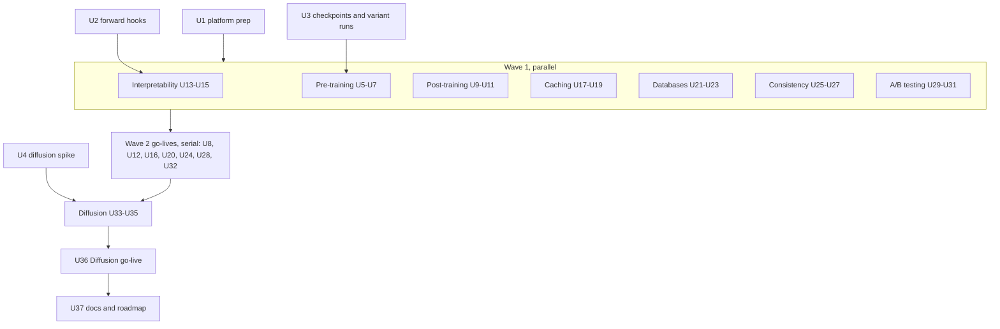
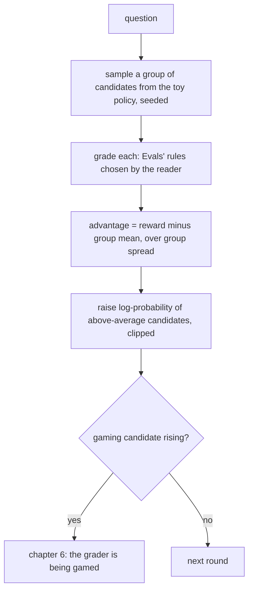
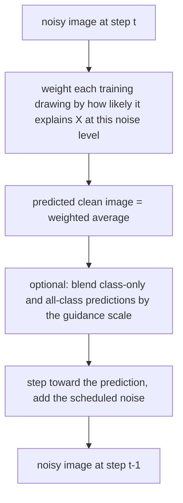

# Eight New Modules - Plan

## Goal Capsule

- **Objective:** Take eight new modules live as modules 18–25. The AI modules are Pre-training, Post-training, Interpretability and Diffusion models. The classic-tech modules are Caching & CDNs, Databases & indexes, Replication & consistency and A/B testing. Add seven planned roadmap cards. Re-frame the home page from "how AI works" to "how tech works". Every module continues the Larkspur Supply Co. story.
- **Product authority:**
  - Product Contract requirements (R-IDs) win on product behaviour.
  - Key Technical Decisions (KTD-IDs) win on mechanism.
  - AGENTS.md decisions stay in force unless a KTD here changes one on purpose.
  - Each go-live unit writes its module's engine and scene section into AGENTS.md.
  - The candidate list and each idea's basis come from `docs/ideation/2026-10-24-new-module-topics-ideation.html`.
- **Open blockers:** None.
- **Execution profile:** Brownfield work on the Astro 7 + React islands site, run in waves as the previous module plan did (KTD13):
  - **Wave 0** (serial, one PR each): platform prep (U1), forward-pass hooks (U2), training checkpoints and data runs (U3), and the diffusion spike (U4). U4 may run in parallel with U1–U3.
  - **Wave 1** (seven worktrees in parallel): Pre-training, Post-training, Interpretability, Caching, Databases, Consistency and A/B testing. Each builds its engine, scene and chapters inside its own folders.
  - **Wave 2** (serial): the seven go-live units, merged in module order, which becomes modules 18–24.
  - **Wave 3:** Diffusion models (U33–U35), then its go-live as module 25 (U36), then U37.
  - Every PR leaves `pnpm check`, `pnpm lint`, `pnpm test` and `pnpm test:e2e` green.
- **Stop conditions:**
  - Stop and ask if a chapter needs a backend, a live LLM, an API key, or training in the browser (R3).
  - Stop and ask if U3's final checkpoint is not byte-identical to the committed `model.bin`, or if the checkpoints pass the 1 MB budget (KTD3).
  - Stop and ask if ablating the word-start head (layer 0, head 0) changes the word-start prediction too little to teach. The bar is that the expected next token leaves the top 5 for at least half of `data/interpretability/prompts.json` (KTD5).
  - Stop and ask if an Interpretability chapter 3–6 effect misses its pinned bar in `data/interpretability/prompts.json`. For the logit lens, the expected token must be in the top 5 after block 1 but not after the embedding, for at least half the prompts. Steering and neuron chapters each pin a bar the same way. A chapter that misses its bar is re-scoped before it is built.
  - Stop and ask if U4's learned 2-D denoiser cannot draw a recognisable shape within 60 KB of weights. The fallback is to drop chapter 3's learned half and keep the ideal denoiser (KTD8).
  - Stop and ask if a change to an existing engine (`src/lib/lm/`, `evals/`, `fine-tuning/`, `transformers/`, `multimodal/`, `context/`, `inference/`) would change any existing chapter's output, recordings, goldens, saved runs or share images (R15).
  - Stop and ask if the hero headline, both buttons and the "Free · No sign-up" line leave the first screen at 1280×800 or 390×844 once the board holds 32 plots.
  - Stop and ask if a source checked for a `facts.json` contradicts a chapter's lesson. The Appendix's "Facts still to verify" are confirmed against a primary source or dropped before they reach copy.
  - A Wave 1 or Wave 3 agent stops and reports if it needs to edit a shared hotspot outside its go-live unit (KTD13).
- **Tail ownership:** One branch and PR per Wave 0 unit and per module, to `main`, with conventional commits (AGENTS.md "Commits").

---

## Product Contract

### Summary

Eight modules go live, four on how AI models are made and work, and four on classic tech:

- **Pre-training.** The reader scrubs through Larkspur mini's real training run, checkpoint by checkpoint. One prompt turns from noise into Larkspur facts, and held-out loss splits from training loss. Real variant runs show what duplicated and leaked data do.
- **Post-training.** The reader turns a base model into an assistant. They pick preferences, write the grader, and watch a toy policy shift under DPO and group-graded RL, computed live. Then they write a grader that the policy games.
- **Interpretability.** The reader opens the real Larkspur mini. They pull a head, read the guess forming layer by layer, patch a fact in from another prompt, and steer the model with a direction.
- **Diffusion models.** The reader turns noise into a Larkspur part drawing step by step. They compare a denoiser that copies its training drawings with a learned one that makes new shapes, and steer the result with a label.
- **Caching & CDNs.** Larkspur's depot and regional warehouses are an origin and edge caches. The reader sets freshness, takes stale prices back, and survives a flash sale.
- **Databases & indexes.** The reader finds order 1042 in a million rows by full scan, then by index. They pay for the index on every write and watch the planner skip it.
- **Replication & consistency.** The reader runs three warehouses' stock counts, sells the last hinge twice, cuts the link between warehouses, and chooses per product between staying open and staying right.
- **A/B testing.** The reader tests a new checkout button on simulated visitors. They see luck pass for a win, pay for peeking and twenty colours, and decide what ships.

The other seven survivors of the ideation become planned roadmap cards. The home page now presents Tinker as "how tech works".

### Problem Frame

Every one of Tinker's 17 modules starts from a model that already exists. None shows where a model comes from, how it is shaped after pre-training, or what is inside it beyond attention. That is the gap readers meet most in 2026 launch posts ("trained with RL", "mixture of experts", "1,000 tok/s"). Post-training was excluded from Fine-tuning on purpose: "no RLHF/RL chapter (DPO gets one term at most)" (`docs/plans/2026-10-21-0755-feat-four-roadmap-modules-plan.md:124`). Every generator on the site writes left to right, so diffusion has never been shown.

The site's headline already says "See how tech works", but its description says "how AI works" (`src/lib/pages.ts:26`). The author chose to include classic tech. Larkspur Supply Co. is a hardware company with warehouses, orders, a web shop and a checkout. Caching, databases, consistency and experiments map straight onto its business, and they need no model at all.

### Requirements

**All eight modules**

- R1. `pre-training`, `post-training`, `interpretability`, `diffusion`, `caching`, `databases`, `consistency` and `ab-testing` become live. Each has author Kondasamy Jayaraman, the Larkspur story, seven chapters (the last a workbench), a recall bank whose pinned item tests the module's one-line edge (Success Criteria), an intro, a recap, share images and an e2e spec. Each passes every check in `tests/unit/registry.test.ts`.
- R2. Each module has this title, level and prerequisites:

  | Module id | Title | Level | Prerequisites |
  |---|---|---|---|
  | `pre-training` | Pre-training | Intermediate | `tokens` |
  | `post-training` | Post-training | Advanced | `fine-tuning`, `evals` |
  | `interpretability` | Interpretability | Advanced | `transformers` |
  | `caching` | Caching & CDNs | Beginner | none |
  | `databases` | Databases & indexes | Beginner | none |
  | `consistency` | Replication & consistency | Advanced | `databases` |
  | `ab-testing` | A/B testing | Beginner | none |
  | `diffusion` | Diffusion models | Intermediate | `multimodal` |

- R3. Nothing runs a live LLM, needs a backend or an API key, or trains in the browser. Live work is limited to:
  - Larkspur mini and its committed checkpoints;
  - the toy policies' update maths;
  - the 2-D denoiser and the ideal denoiser;
  - the simulators.

  Every other output a chapter control can reach is recorded or committed, and a unit test proves it.
- R4. Every chapter follows the house loop and rules (`docs/writing-a-module.md`):
  - an intro with context;
  - predict → reveal;
  - quizzes with a `why` per option and "I'm not sure";
  - `act` lines;
  - `say` callouts on the scene's exported parts;
  - terms defined on first use;
  - the copy budgets.
- R5. Every claim about real practice (papers, RFCs, provider behaviour, published figures) comes from `data/<module>/facts.json`, with a source and an access date, rendered through `Cite`.
- R6. Wherever a chapter shows numbers from Larkspur mini, a toy policy, a toy denoiser or a simulator, the copy says so. They teach the mechanism; they are not any provider's or system's numbers.

**Pre-training** (Intermediate)

- R7. Each chapter teaches one idea, in this order:
  1. Before training: the step-0 checkpoint babbles on a Larkspur prompt.
  2. Watch it learn: scrub checkpoints; the same prompt improves as the loss falls.
  3. Held out: the gap between training and held-out loss widens as the model starts memorising.
  4. Data is the curriculum: a run with one document repeated ten times parrots it.
  5. A leaked test: a run that saw the test questions scores higher on them while held-out quality stays flat.
  6. Bigger or longer: the published scaling fits (Kaplan, Chinchilla) on their own chart. Beside it, a separate labelled panel shows Larkspur mini's own trade-off from its full and `half` runs. Their losses are in different units, so Larkspur mini is never placed on the published curve.
  7. Workbench: choose a data mix and a stopping checkpoint for the best held-out score.

**Post-training** (Advanced)

- R8. Each chapter teaches one idea, in this order:
  1. Base or assistant: one Larkspur question as a base-style continuation and as an assistant answer. Fine-tuning's real style fine-tune is recapped in one step and linked.
  2. Which is better: the reader picks preferences between answer pairs.
  3. DPO: the toy policy moves toward the preferred answers. A strength setting keeps it near the reference.
  4. Grade, don't judge: a checkable grader scores a group of drafts. Each draft is graded against its group's average (GRPO), and the policy shifts.
  5. Only what you can check: questions with no checkable answer (tone) don't improve under the grader.
  6. You get what you check: a weak grader is gamed, and the policy learns the gaming answer.
  7. Workbench: assemble a grader from rules so the policy improves on every question without gaming.
- R9. Post-training starts where Fine-tuning ends. It recaps supervised fine-tuning in one step at most and links to `/fine-tuning/`.

**Interpretability** (Advanced)

- R10. Each chapter teaches one idea, in this order:
  1. Why did it say that: the top 5 for a prompt. Attention maps describe, they don't prove (Transformers recapped in one step).
  2. Pull a fuse: ablate the word-start head; predictions change.
  3. The guess forming: the logit lens reads the guess after the embedding, after block 1, and at the output.
  4. Patching: copy one activation in from another prompt and find where the answer changes.
  5. Steering: add a direction made from two sets of prompts; the model drifts.
  6. One neuron, many meanings: MLP neurons fire on unrelated tokens, which is why researchers look for features (facts on sparse autoencoders and attribution graphs).
  7. Workbench: find the smallest set of parts that keeps a behaviour.

**Diffusion models** (Intermediate)

- R11. Each chapter teaches one idea, in this order:
  1. Noise to picture: a part drawing noised step by step, then denoised back.
  2. Step by step: fewer steps are cheaper and rougher.
  3. A learned denoiser: on 2-D points, a small network learns to point each dot toward the shape.
  4. Copy or create: on the same 2-D points, the ideal denoiser returns its training points; the learned one makes new ones.
  5. Steer with a label: class conditioning and the guidance scale.
  6. Why it costs what it costs: steps and image size, latent diffusion and few-step models, from facts.
  7. Workbench: steps and guidance per use (thumbnail, catalogue image) for quality against cost.

**Caching & CDNs** (Beginner)

- R12. Each chapter teaches one idea, in this order:
  1. Far is slow: every request goes to the central depot.
  2. Keep a copy nearby: an edge cache; hits and misses.
  3. How long is it fresh: TTL, and a stale price.
  4. Take it back: purge, and versioned names.
  5. Everyone at once: a flash sale stampedes the depot; request coalescing and stale-while-revalidate.
  6. The same trick everywhere: prompt caching and the KV cache, linking `/context/` and `/inference/`.
  7. Workbench: a cache policy per kind of content within a staleness limit.

**Databases & indexes** (Beginner)

- R13. Each chapter teaches one idea, in this order:
  1. Find one order: a full scan reads every row.
  2. The index: a B-tree lookup reads a few pages.
  3. Every write pays: inserts update the index too.
  4. Column order matters: a two-column index serves one query and not another.
  5. When the planner skips your index: an unselective query scans instead.
  6. Joining tables: nested loop against an index join.
  7. Workbench: indexes for a workload within a write budget.

**Replication & consistency** (Advanced)

- R14. Each chapter teaches one idea, in this order:
  1. One count, three copies: replicas of the stock count.
  2. Two buyers, one hinge: concurrent writes oversell.
  3. The link goes down: during a partition, stay open or stay right (CAP).
  4. Quorums: N, R and W.
  5. Who wins: last-writer-wins loses an update; reservations don't.
  6. Eventually: replication lag, and reading your own write.
  7. Workbench: a setting per product (cheap hinge, one-off drill press).

**A/B testing** (Beginner)

- R16. Each chapter teaches one idea, in this order:
  1. Did it work: two checkouts, visitors split at random.
  2. Luck: an A/A test shows differences from noise alone.
  3. How many visitors: sample size and power.
  4. Peeking: stopping on a good day inflates false wins.
  5. Twenty colours: multiple comparisons.
  6. The metric moved, the business didn't: guardrail metrics.
  7. Workbench: ship, keep testing or stop, for a set of experiments.

**Platform**

- R17. Seven planned roadmap cards join the registry with no pages, in this order:

  | Card | Level |
  |---|---|
  | `diffusion-llms` | Advanced |
  | `computer-use` | Advanced |
  | `calibration` | Intermediate |
  | `search` | Beginner |
  | `web-requests` | Beginner |
  | `payments` | Beginner |
  | `git` | Beginner |

- R18. The home description says Tinker explains how tech works. It names AI and classic topics in under 160 characters.
- R15. The 17 existing modules and their saved progress do not change: no chapter id, step id, recording, golden or share image changes. The exceptions are the KTD13 shared hotspots and mentions that newly link to a live module.

### Scope Boundaries

- No live LLM, no backend, no API key and no training in the browser. Every network-shaped thing is simulated.
- No retrain of Larkspur mini's base, fine-tunes or student. Checkpoints and variant runs are new outputs beside them.
- Maths stays optional, in fold-away "the maths" notes. A/B testing shows no formulas in the narration.
- Caching: no vendor-specific CDN setup or configuration guide.
- Databases: no SQL tutorial. Queries are shown as plain requests ("orders for customer 1042"), with SQL in a fold-away.
- Consistency: no consensus-protocol internals (Raft, Paxos) beyond one fact.
- Diffusion: no text-to-image prompting guide. No diffusion language models; that is a planned card.
- No module names one vendor as the place to do the thing.

### Deferred to Follow-Up Work

- Splitting the home catalogue into AI and classic-tech sections (Open Questions).
- Building any of the seven planned cards.
- A "real model" interpretability trace from an open-weights run.

### Success Criteria

- After each module, a reader can say its edge in plain words. For example:
  - "post-training trains on a grade, and a bad grade gets gamed";
  - "an index is a sorted shortcut every write pays for";
  - "peeking turns noise into wins".
- `pnpm test` fails in each of these cases:
  - a checkpoint, variant run, candidate answer or pinned output is missing or drifts;
  - the final checkpoint differs from `model.bin`;
  - any new payload passes its budget.
- At 1280px and 390px, the home catalogue shows 25 live modules under the correct levels and seven roadmap cards. The hero wave still shows one live pill at a time.

### Key Decisions

- The batch is the top four AI and top four classic-tech ideas. (session-settled: user-directed — chosen over all 15 ideas, roadmap cards plus two modules, and AI only: keeps the plan the size of the last eight-module plan.) Governs R1, R2.
- Tinker covers classic tech, not only AI. (session-settled: user-directed — chosen over keeping the site AI-only, the gap the ideation left open on purpose: the headline already says "how tech works".) Governs R2, R12–R14, R16, R18.
- The seven remaining ideas become planned cards. (session-settled: user-approved — chosen over leaving them off the roadmap: they keep the ideation's ranking visible on the home page.) Governs R17.
- The classic modules continue the Larkspur story. (session-settled: user-approved — chosen over a new story per module: one world across 25 modules, and the hardware business maps onto each topic.) Governs R1, R12–R14, R16.

---

## Planning Contract

### Key Technical Decisions

- KTD1. **Module numbers follow merge order: 18 Pre-training, 19 Post-training, 20 Interpretability, 21 Caching, 22 Databases, 23 Consistency, 24 A/B testing, 25 Diffusion.** AI modules that reuse the language-model kit land first, then the classic modules. Diffusion lands last because it carries the most build risk (U4). Each go-live extends the catalogue's numbers list and AGENTS.md's module list.
- KTD2. **What runs live and what is computed offline, per module.**

  | Module | Live in the browser | Computed offline and committed |
  |---|---|---|
  | Pre-training | checkpoint forward passes, held-out scores | checkpoints of the base run; variant runs' curves, scores and greedy samples |
  | Post-training | toy policy updates (DPO, GRPO), grading | candidate answers per question, each with a note |
  | Interpretability | ablation, logit lens, patching, steering, neuron top tokens | nothing beyond `model.bin` |
  | Diffusion | forward noising, ideal denoiser sampling, learned 2-D denoiser sampling | 2-D denoiser weights; part drawings are SVG |
  | Caching, Databases, Consistency, A/B testing | the simulator | hand-written traces and workloads |

- KTD3. **Pre-training: real checkpoints from a deterministic rerun.** (session-settled: user-approved — chosen over fewer checkpoints or compressed deltas inside the old budget: the reader scrubs real weights, and a 1 MB cap with lazy loading keeps first load small.)
  - `train.py` gains `--checkpoints`, which reruns the full 3000-step base run with the same seed and settings. It takes snapshots inside that run, never by running shorter runs, because the cosine schedule spans the whole run.
  - Snapshots come from a hook inside the existing training loop (`scripts/train/train.py`, the base-run loop), not a copied loop. Inside the loop, the hook only copies each snapshot's Float16 state dict. Building a model draws from the global RNG that dropout uses, so nothing that builds a model runs inside the loop. After the last step, a separate pass builds the float64 models and computes each checkpoint's train and held-out loss.
  - It saves Float16 weights at steps 0, 100, 250, 500, 1000, 1500, 2000 and 3000 to `public/data/pre-training/ckpt-<step>.bin` (about 800 KB). Step 0 is the initial weights, saved before the first update and committed. Copying it draws no randomness.
  - `--checkpoints` never writes `model.bin`, the base `meta.json` or `goldens.json`.
  - Each checkpoint's held-out loss is computed in float64 from its Float16-rounded weights, as the goldens are. It is stored in `public/data/pre-training/meta.json`, together with the torch version and platform.
  - The last checkpoint must be byte-identical to `public/data/lm/model.bin`. A test checks this, and failing it is a stop condition. The rerun happens on the same platform as the shipped `model.bin`, so a mismatch reads as drift.
  - Each checkpoint is fetched on demand through `src/lib/lm/load.ts` (a new `Weights` kind keyed by step). It is never bundled, so the intro page loads only what it shows.
  - A test caps the total at 1 MB, beside the existing per-file caps.
  - Train loss is recorded per checkpoint on the training split (eval mode), beside held-out, computed after the run (above).
  - `--variants` runs real alternative trainings (`duplicated`, `leaked`, `half`). For each, it writes the loss curve, held-out scores, score on the leaked questions and greedy samples for the chapter prompts to `data/pre-training/runs.json`. No variant weights ship.
  - `model.bin`, the fine-tunes, the student and their goldens are untouched. The sha256 pin in `tests/unit/fine-tuning-runs.test.ts` guards this.
- KTD4. **Post-training: recorded candidate answers, live toy-policy maths.** (session-settled: user-approved — chosen over real preference and RL fine-tunes of Larkspur mini trained offline: cheaper, and the update maths still runs live.)
  - `data/post-training/candidates.json` holds 4–6 hand-written answers per Larkspur question (Evals' questions plus new tone and gaming cases), each with a one-line `note`.
  - The policy is a categorical distribution over a question's candidates. The copy calls it a toy policy: a choice among written answers, not a language model.
  - DPO: a Bradley–Terry reward is fitted live to the reader's chosen and rejected pairs. The policy shown is the KL-regularised optimum that DPO targets: π(y) ∝ π_ref(y)·exp(r(y)/β), with β from a finite list. Iterating the DPO loss on a table-shaped policy with firm preferences ignores β, so the closed form is what makes chapter 3's lesson true. The maths fold-away names the DPO loss and says why. GRPO: the reward from the grader, the advantage (r − group mean) / group std, and a clipped policy-gradient step. A group with zero reward spread gets zero advantage, and so no update. Both are computed live in `src/lib/post-training/policy.ts`, seeded with `mulberry32`.
  - Graders are Evals' `keyFactOf` and `exactMatchOf` against `data/post-training/references.json`. `exactMatchOf(reference, text)` is added to `src/lib/evals/graders.ts` in U1, and `exactMatch` calls it, as `keyFact` calls `keyFactOf`. Evals' grading is unchanged. Reward-hacking candidates satisfy a weak rule (a number present, a sign-off present) and fail the key fact.
  - Chapter 7's grader is a set of rules from a finite list. `WINNERS` holds every rule set under which every question's best candidate wins and no gaming candidate does.
- KTD5. **Interpretability: optional hooks in `forward()`.**
  - `src/lib/lm/model.ts` `forward(model, prompt, hooks?)` gains an optional third argument:
    - `ablate`: head (layer, head) pairs whose output is zeroed;
    - `residuals`: return the residual stream after each block;
    - `patch`: replace one position's residual at one layer;
    - `steer`: add a vector at one layer.
  - With no hooks the pass is unchanged. The existing goldens (`tests/unit/lm-model.test.ts`) must still pass at their tolerance, and a new test proves output equality with hooks absent. Every caller passes two arguments today, so the optional third argument breaks none.
  - Hooks are looked up once per layer or head, never inside the inner loops. `evaluate()`, decoding, quantization and speculative decoding run whole held-out passes through `forward()`.
  - Ablation zeroes a head's contribution before the output projection. The projection's bias still applies.
  - `attention` keeps reporting the head's pattern, because it is computed before the zeroing. The chapter copy says the head was silenced, not that its pattern vanished.
  - Patching aligns positions after the 32-token truncation.
  - The logit lens applies `lnf` and the tied unembedding to each layer's residual. Larkspur mini has two layers, so the grid shows three readings: after the embedding, after block 1, and after block 2 (the output).
  - Neuron top tokens (chapter 6) are computed over the training split in U2, by a write mode of its recompute test that reads the weights through `diskModel.ts`. They are committed to `data/interpretability/neurons.json`, and the test recomputes them on every run.
  - Chapter prompts live in `data/interpretability/prompts.json`, each pinned with the effect the copy describes (top-5 change, layer where the answer appears). A test reruns them and fails on drift.
- KTD6. **Classic modules are discrete-time simulators over hand-written Larkspur data**, after `src/lib/inference/server.ts`.
  - Each has finite setting lists, a fixed trace or workload in `data/<module>/`, and stated unit costs in `data/<module>/assumptions.json`, labelled as Larkspur's assumptions, not measurements.
  - Randomness comes from `mulberry32` (`src/lib/transformers/sample.ts`) with fixed seeds, so e2e is deterministic.
- KTD7. **Databases: a real B-tree over a generated table, scaled by formula.**
  - The orders table is generated from a seed: 10,000 rows live, each with id, customer, date and status.
  - `src/lib/databases/btree.ts` is a real B+tree with a fixed fan-out. Pages read are counted for scans, lookups, inserts and joins.
  - Chapter 1's "a million rows" scales the counts by formula (scan is linear, lookup grows with log fan-out). The copy says the million is computed, not stored.
  - The planner (chapter 5) is a stated cost rule over estimated rows. It is not any database's planner, and a fact cites PostgreSQL's `EXPLAIN` docs for the real thing.
- KTD8. **Diffusion: an exact ideal denoiser for pictures, a learned denoiser for points.** (session-settled: user-approved — chosen over recorded trajectories only: keeps something real running in the browser.)
  - **Conflict call-out:** you approved "recorded denoising trajectories plus a live 2-D toy". Research found a better source for the picture trajectories. For a small set of drawings, the best possible denoiser has a closed form: a noise-weighted average of the training drawings. It runs live on 32×32 part drawings with no trained model. The plan uses it live in place of recordings. Recorded frames remain the fallback if it is too slow on phones.
  - Each part drawing is an exact 32×32 bitmap, defined in code or filled by pure TypeScript with no canvas. The denoisers, unit tests and pinned outputs all read those pixels, so results are the same in Node and in every browser. The browser canvas only displays them.
  - Chapter 4's copy-or-create comparison runs both denoisers on the same 2-D training points. The ideal denoiser collapses onto the points; the learned one fills the outline.
  - The 2-D learned denoiser is a small MLP trained once in Python (`scripts/train/train_diffusion.py`). It trains on points sampled from a Larkspur hinge outline, with Float16 weights under 60 KB in `public/data/diffusion/points.bin`. Sampling runs live in TypeScript with a seeded noise draw.
  - Guidance: the ideal denoiser restricts its average to one class (hinge, drill, bracket). Classifier-free guidance mixes conditional and unconditional predictions by a scale from a finite list.
  - Quality for chapter 7 is computed: class correctness and distance to the nearest training drawing, against cost in denoiser steps.
- KTD9. **Caching: an edge-cache simulator.** One origin (the depot) and three edges (regional warehouses) serve a hand-written day of requests. Each request carries a content kind: a price, a photo or a stock count.
  - Settings: TTL per kind, purge on change, versioned names, coalescing on or off, stale-while-revalidate on or off.
  - Outputs: hit rate, origin load per tick, stale reads served, and latency from stated distances.
  - The model follows RFC 9111 freshness, and RFC 5861 for stale-while-revalidate, cited in facts.
- KTD10. **Consistency: a replica simulator with partitions and quorums.**
  - Three replicas of each product's stock count, a scripted day of orders, and partition windows the reader can toggle.
  - Settings: N = 3 with R and W from finite lists; conflict rule (last-writer-wins, or reservations decremented at a primary).
  - Outputs: oversells, refused orders, stale reads.
  - Chapter 7's `WINNERS` is every per-product setting with zero oversells on the one-off item and the fewest refused orders overall.
- KTD11. **A/B testing: a seeded visitor simulator with exact repeat counts.**
  - Visitors convert with a true rate per variant, drawn by `mulberry32`. A test is run many times (a fixed seed list) to count false wins live, which shows peeking and multiple comparisons as rates, not formulas.
  - Sample size uses the standard two-proportion approximation, in a maths fold-away.
  - Chapter 7's experiments each have seeded data and a hidden true effect. `WINNERS` is every set of decisions that follows the module's own rule on the data:
    - ship when the pre-registered test, with no peeking, is significant and the guardrail metric holds;
    - keep testing when it is underpowered;
    - stop otherwise.

    The true effect is revealed afterwards, in a separate read-out.
- KTD12. **Coverage and pinned-output tests.** Each module has a test that fails on drift:
  - Post-training: every question has a passing candidate and every gaming case is reachable. A budget caps candidates.
  - Pre-training: the checkpoints, runs and pinned samples.
  - Interpretability and Diffusion: pinned effects.
  - Classic modules: every chapter control's finite domain runs without error, and pinned outputs match the copy.
- KTD13. **Subagent execution and the shared-hotspot rule** (as the previous plan's KTD13).
  - Wave 1 and Wave 3 agents create files only in their own folders: `src/lib/<m>/`, `src/content/<m>/`, `src/pages/<m>/`, `data/<m>/`, `public/data/<m>/`, `src/components/scenes/<scene>*.ts`, `src/dev/<m>.astro`, and tests named for the module.
  - **Shared hotspots** are edited only in the module's go-live unit, after rebasing on `main` in merge order. They are:
    - `src/lib/modules.ts`
    - `src/pages/index.astro`
    - `heroScene.ts`
    - `src/dev/og.astro`
    - `tests/unit/modules.test.ts`
    - `tests/e2e/catalogue.spec.ts`
    - `README.md`, `AGENTS.md`
    - `public/og/home.jpg`
    - `flat.ts`'s `Stamp` union
    - any edit to an existing scene or engine
  - Agents scaffold by hand from `templates/module/`. The one hotspot edit allowed on a module branch is swapping its own `planned(...)` line for its import, so its pages build.
  - The module branch's swap exists only so the branch's own pages build. It is never merged as is: the go-live unit rebases on `main`, redoes the swap, removes the planned line and places the import after the last live module, as `scripts/new-module.mjs` does. Numbers come from position among live modules, so a module's number is fixed by merge order (KTD1), never by its planned line's place.
  - Share images: `scripts/og.mjs` takes a slug filter (U1). A go-live commits only its module's images and `public/og/home.jpg`, so parallel PRs never conflict on the other JPEGs.
  - `src/lib/lm/` changes only in U2 and U3. Module branches read them.
- KTD14. **The home page holds 25 live plots and 7 building sites** (U1).
  - The wave keyframes already scale with the live count (previous KTD14).
  - `slotXY` moves from two slots per row to four after the first column, and `heroBoard` widens to fit the extra columns.
  - At two per row, 30 slots make the board about 920 deep against about 520 today. The hero is capped at 780px wide, and the share image fits the same board into 1200×630, so every plot and pill would shrink about 1.8×.
  - Three per row would still reach about 720 deep (1.38×), and a third column on today's 340-wide board either runs off it or meets RAG's model block.
  - Four per row puts 25 slots in 7 rows after the column of 5: the last row sits at about y = 592, and the board is about 620 deep (1.19×).
  - Rows level with RAG's pipeline keep only the columns clear of it.
  - The pill `lift` rule moves from "every other slot" to "the left-most slot of each row".
  - U1 sets the exact column positions and board width. They must pass the depth test and the pill-overlap test with every pill shown.
  - `hero.test.ts` checks the slot floor at 30 slots (32 plots, because RAG and Tool calling are drawn in place). The pill-overlap test already runs on the real registry with every pill shown.
  - The hero caption returns to "The empty plots are open: build one", linking `#request`. That fits: reader requests still decide what is built next.
  - `tests/unit/modules.test.ts` `ROADMAP` lists the fifteen planned ids: the eight module lines, then the seven R17 cards (U1 step 1).
  - The HOME description changes (R18).
- KTD15. **One scene per module, composed from existing pieces.** Words go in pills and captions only. Each scene exports its `*_PARTS`, a hero `*Plot` and a home `CARD`.

  | Module | Scene (file) | Precise view |
  |---|---|---|
  | Pre-training | the foundry: crates of corpus documents feed a furnace (the training run); the model block grows beside a shelf of checkpoints, the current one lit (`forgeScene.ts`) | loss chart: Fine-tuning's `lossChart.ts`, train and held-out, checkpoints focusable |
  | Post-training | the exam hall: the model at a desk, a group of answer cards, Evals' grader desk with its stamp, a curve board (`examScene.ts`) | policy bars: each candidate's probability before and after, with its reward |
  | Interpretability | the fuse box: Transformers' engine room (`engineScene.ts`) with a fuse panel, one fuse per head and layer, pulled fuses dark (`fuseScene.ts`) | logit-lens grid: layers by top tokens, the probed position focusable |
  | Diffusion | the darkroom: a developing tray where a noisy print clears, a step dial and a label card (`darkroomScene.ts`) | the strip: the drawing at each step, or the 2-D point cloud |
  | Caching | the depot and three regional warehouses on a map board, trucks for misses, shelves for cached copies, a stale tag (`depotScene.ts`) | cache timeline: a lane per edge, hits, misses and stale reads |
  | Databases | the filing room: an order cabinet of drawers (pages) and a card index (the B-tree), drawers opened lit (`archiveScene.ts`) | the tree: pages read on the path, with a rows-read counter |
  | Consistency | three warehouses with stock boards, a phone line between them that can be cut (`stockScene.ts`) | replica timeline: a lane per replica, writes and reads, conflicts stamped |
  | A/B testing | the shop floor: a turnstile splitting visitors to two checkouts, a scoreboard (`splitScene.ts`) | result chart: the difference over time with its interval, the stop line |

  The stage rules carry over:
  - focusable precise views with arrow keys and a read-out line;
  - native range inputs over finite lists;
  - "one of N that work" on Show me;
  - a fixed frame with a loading pill and Retry for anything fetched;
  - on phones, readout pills drop or shorten to names, and the caption carries the numbers.

### High-Level Technical Design

Waves and dependencies:



Post-training's group-graded update (KTD4), one round:



The ideal denoiser (KTD8), one reverse step:



### Assumptions

- Eight checkpoints of Larkspur mini at about 100 KB each fit the 1 MB cap (KTD3 names the steps).
- Larkspur mini's held-out gap is wide enough to read (train 3.26 against held-out 4.04 at step 3000, `public/data/lm/meta.json`).
- A `duplicated` variant run makes Larkspur mini repeat the duplicated document on its chapter prompt. If not, the chapter uses the closest prompt that does, pinned in `runs.json`.
- The ideal denoiser at 32×32 grayscale over about twelve drawings runs 50 steps in well under a second on a phone.
- Seven Wave 1 specs plus Diffusion fit within the four e2e shards and the 30-minute job limit. If not, U1 raises the shard count.

### System-Wide Impact

- **Language-model kit.** `forward()` gains an optional argument (U2), and `load.ts` gains a checkpoint kind (U3). Every existing caller passes two arguments and keeps its output. The goldens, the `model.bin` sha256 pin and the meta-key pins in `tests/unit/lm-student.test.ts` guard the shipped weights.
- **Training script.** `--checkpoints` and `--variants` share the base run's loop, so a future base retrain must rerun them too. The retrain recipe in AGENTS.md gains both steps.
- **Home page and registry.** Planned lines appear in U1 and stay until each go-live. Everything that builds pages, numbers, progress, recall or the sitemap filters on live status, so planned lines create no pages. The hero caption, the catalogue spec and `home.jpg` change in U1.
- **Saved progress.** The eight new ids add new `<id>-progress-v1` keys. No existing key changes, and none of the eight ids exists today.
- **Share images and CI.** About 72 new share images join the 154 today (about 16 MB total). E2E work grows by about half, and U1 sets the shard count from measured time.
- **Payload.** Checkpoints are fetched one at a time as shown, never bundled. The page bundles stay their current size.

### Phased Delivery

- **Wave 0:** U1, U2, U3, then U4 (U4 may run alongside). All merged before Wave 1 starts, except U4, which gates only Wave 3.
- **Wave 1:** U5–U7, U9–U11, U13–U15, U17–U19, U21–U23, U25–U27, U29–U31, in seven worktrees.
- **Wave 2:** U8, U12, U16, U20, U24, U28, U32, in that order, each rebased on the last.
- **Wave 3:** U33–U35, then U36, then U37.

### Risks

| Risk | Mitigation |
|---|---|
| Ablation on a two-layer model moves too little to teach | Stop condition on the word-start head; pinned effects (KTD5) |
| The checkpoint rerun drifts from `model.bin` | Byte-identity test; stop condition (KTD3) |
| A toy policy reads as a real model | Copy names it a toy every time (R6, KTD4) |
| The learned 2-D denoiser is weak | U4 spike first; fallback keeps the ideal denoiser only (KTD8) |
| The hero board grows past the first screen at 32 plots | Three slots per row; depth test; stop condition (KTD14) |
| A module's number changes when an earlier module merges later | Go-live appends after the last live module, in KTD1 order (KTD13) |
| Parallel go-lives conflict on regenerated share images | `og.mjs` slug filter; each go-live commits its own images and `home.jpg` only (KTD13) |
| Classic simulators read as real systems | Assumptions files labelled; facts cite RFCs and docs (KTD6) |
| E2E time grows with eight specs | Shard count raised in U1 if needed |
| Statistics in A/B testing breaks "maths optional" | Rates shown from repeated runs, formulas in fold-aways (KTD11) |

---

## Output Structure

Per module (Caching shown; every module has the same shape):

```text
src/lib/caching/                 engine (sim.ts)
src/content/caching/             module.ts, recall.ts, kit.tsx, 01-…07-*.tsx
src/pages/caching/               index.astro, [chapter].astro, recap.astro
src/components/scenes/           depotScene.ts, cacheTimeline.ts
src/dev/caching.astro
data/caching/                    facts.json, assumptions.json, trace.json
tests/unit/caching-*.test.ts
tests/e2e/caching.spec.ts, caching-flow.ts
```

New shared files: `public/data/pre-training/ckpt-*.bin`, `data/pre-training/runs.json`, `scripts/train/train_diffusion.py`, `public/data/diffusion/points.bin`.

---

## Implementation Units

| U-ID | Title | Key files | Depends on |
|---|---|---|---|
| U1 | Platform prep for twenty-five | `index.astro`, `heroScene.ts`, `pages.ts`, `modules.ts`, hero/modules/catalogue tests | — |
| U2 | Forward-pass hooks | `src/lib/lm/model.ts` | — |
| U3 | Checkpoints and variant runs | `scripts/train/train.py`, `src/lib/lm/load.ts`, `public/data/pre-training/` | — |
| U4 | Diffusion spike and 2-D denoiser | `scripts/train/train_diffusion.py`, `public/data/diffusion/` | — |
| U5 | Pre-training engine, runs and facts | `src/lib/pre-training/`, `data/pre-training/` | U1, U3 |
| U6 | Foundry and kit | `forgeScene.ts`, `kit.tsx` | U5 |
| U7 | Pre-training chapters | `src/content/pre-training/`, `src/pages/pre-training/` | U6 |
| U8 | Pre-training go-live | hotspots | U7 |
| U9 | Post-training engine, candidates and facts | `src/lib/post-training/`, `data/post-training/` | U1 |
| U10 | Exam hall and kit | `examScene.ts`, `policyBars.ts` | U9 |
| U11 | Post-training chapters | `src/content/post-training/` | U10 |
| U12 | Post-training go-live | hotspots | U8, U11 |
| U13 | Interpretability engine and facts | `src/lib/interpretability/`, `data/interpretability/` | U1, U2 |
| U14 | Fuse box and kit | `fuseScene.ts`, `lensGrid.ts` | U13 |
| U15 | Interpretability chapters | `src/content/interpretability/` | U14 |
| U16 | Interpretability go-live | hotspots | U12, U15 |
| U17 | Caching simulator and facts | `src/lib/caching/`, `data/caching/` | U1 |
| U18 | Depot and kit | `depotScene.ts`, `cacheTimeline.ts` | U17 |
| U19 | Caching chapters | `src/content/caching/` | U18 |
| U20 | Caching go-live | hotspots | U16, U19 |
| U21 | Databases engine and facts | `src/lib/databases/`, `data/databases/` | U1 |
| U22 | Filing room and kit | `archiveScene.ts`, `treeView.ts` | U21 |
| U23 | Databases chapters | `src/content/databases/` | U22 |
| U24 | Databases go-live | hotspots | U20, U23 |
| U25 | Consistency simulator and facts | `src/lib/consistency/`, `data/consistency/` | U1 |
| U26 | Warehouses and kit | `stockScene.ts`, `replicaTimeline.ts` | U25 |
| U27 | Consistency chapters | `src/content/consistency/` | U26 |
| U28 | Consistency go-live | hotspots | U24, U27 |
| U29 | A/B testing simulator and facts | `src/lib/ab-testing/`, `data/ab-testing/` | U1 |
| U30 | Shop floor and kit | `splitScene.ts`, `resultChart.ts` | U29 |
| U31 | A/B testing chapters | `src/content/ab-testing/` | U30 |
| U32 | A/B testing go-live | hotspots | U28, U31 |
| U33 | Diffusion engine and facts | `src/lib/diffusion/`, `data/diffusion/` | U4, U32 |
| U34 | Darkroom and kit | `darkroomScene.ts`, `denoiseStrip.ts` | U33 |
| U35 | Diffusion chapters | `src/content/diffusion/` | U34 |
| U36 | Diffusion go-live | hotspots | U35 |
| U37 | Docs and roadmap | `AGENTS.md`, `README.md`, catalogue spec | U36 |

**Patterns every module follows.**
- **Engine units** copy their nearest engine (named per unit) and add a dev page `src/dev/<m>.astro`.
- **Scene and kit units** copy the scene and `kit.tsx` named per unit, and export `PARTS`, the hero plot and the card picture.
- **Chapter units** scaffold by hand from `templates/module/` (KTD13) and follow `docs/writing-a-module.md`. Each chapter gets an `intro` in `module.ts`. Recall items go in `recall.ts`, with one pinned. Each unit writes `tests/e2e/<m>.spec.ts` with a `<m>-flow.ts` helper. Every chapter is played by mouse and by keyboard only, with axe, reduced motion and 390px checks.
- **One workbench pattern** serves all chapter 7s, as the previous plan's: one native control per policy dimension, a result table with one row per case, a live total against the best, and "Show me" showing one of `WINNERS`, labelled "one of N that work".

Go-live units follow the recipe in U8. The others cite it.

### U1. Platform prep for twenty-five

- **Goal:** The home page, registry tests and CI hold 25 live modules and seven planned cards, framed as "how tech works".
- **Requirements:** R17, R15; KTD4, KTD14.
- **Dependencies:** none.
- **Files:** `src/lib/modules.ts`, `src/lib/pages.ts`, `src/pages/index.astro`, `src/components/scenes/heroScene.ts`, `scripts/og.mjs`, `tests/unit/hero.test.ts`, `tests/unit/modules.test.ts`, `tests/e2e/catalogue.spec.ts`, `.github/workflows/checks.yml`, `public/og/home.jpg`.
- **Approach:**
  1. Add the eight new modules' planned lines in KTD1 order, then the seven R17 cards, so module branches can swap their own line (KTD13). Replace `ROADMAP` with these fifteen ids.
  2. Add `exactMatchOf(reference, text)` to `src/lib/evals/graders.ts`, with `exactMatch` calling it (KTD4). Evals' outputs are unchanged.
  3. Change `slotXY` to four slots per row on a wider board (KTD14), update the `lift` rule, and raise `hero.test.ts`'s slot floor to 30.
  4. Rewrite the catalogue spec for the planned state. Today it asserts zero roadmap cards, zero `.hero-soon` pills and the "Room for more" caption, so it fails on the first planned line.
  5. Give `scripts/og.mjs` a slug filter, and regenerate `home.jpg`.
  6. Measure the e2e time per shard on `main` now, and set the shard count for 25 modules here, not later.
- **Patterns to follow:** U2 of `docs/plans/2026-10-21-1551-feat-eight-roadmap-modules-plan.md`; `planned()` in `src/lib/modules.ts`.
- **Test scenarios:**
  - Unit: with a fixture of 25 live and 7 planned modules, every plot sits on the board, no two overlap, and no two pills overlap with every pill shown.
  - Unit: the planned ids are an in-order subsequence of `ROADMAP`, and each card's level matches.
  - Unit: with four slots per row, the board for 30 slots is no deeper than 1.2× today's board, and no slot overlaps RAG's pipeline.
  - Unit: `og.mjs` with a slug filter shoots only the matching slugs.
  - E2E: with planned cards present, the hero caption reads "The empty plots are open: build one" and links `#request`. The `.hero-soon` pills are hidden in the animated home and shown with reduced motion.
  - Unit: `exactMatchOf` with Evals' own reference returns what `exactMatch` returned before, for every Evals question.
  - E2E: the catalogue shows 17 live cards and 15 roadmap cards under their levels, at 1280px and 390px.
  - E2E: the hero headline, both buttons and the "Free · No sign-up" line are visible in the first screen at 1280×800 and 390×844.
- **Verification:** the four repo checks green; `/` and `home.jpg` looked at by eye at both widths, with pills readable.

### U2. Forward-pass hooks

- **Goal:** `forward()` can ablate heads, return residuals, patch and steer, with no change when unused.
- **Requirements:** R10, R15; KTD5.
- **Dependencies:** none.
- **Files:** `src/lib/lm/model.ts`, `tests/unit/lm-hooks.test.ts`, `tests/unit/interpretability-neurons.test.ts`, `data/interpretability/neurons.json`, `AGENTS.md` (language-model kit section).
- **Approach:** add the optional `hooks` argument (KTD5). Each hook has its place in the layer loop:
  - ablate: skip the head's contribution before the projection;
  - residuals: read the residual stream after the embedding and after each block;
  - patch and steer: change the residual at the top of the chosen layer.

  Adapters (`adapted()`) keep working with hooks.
- **Patterns to follow:** the `adapter` path in `model.ts`; `tests/unit/lm-model.test.ts`.
- **Test scenarios:**
  - `forward(m, p)` deep-equals `forward(m, p, {})`, and the goldens still pass at their tolerance.
  - Ablating every head of layer 0 makes layer 0's attention block output equal its projection bias, and changes the logits. The returned `attention` matrices are unchanged.
  - `residuals` returns one entry per layer plus the embedding, and the last entry through `lnf` and the unembedding reproduces the logits within 1e-9.
  - Patching a position with its own residual changes nothing; patching from another prompt changes the logits.
  - A zero steering vector changes nothing.
  - `neurons.json` matches a recomputation over the training split. With its write flag set, the same test regenerates the file.
  - The LoRA adapter with an ablation still runs, and the adapter's goldens hold with no hooks.
- **Verification:** unit tests green; existing lm, transformers, structured-outputs and inference tests unchanged.

### U3. Checkpoints and variant runs

- **Goal:** Real checkpoints of the base run and real variant runs, committed and loadable.
- **Requirements:** R7, R3, R15; KTD3.
- **Dependencies:** none.
- **Files:** `scripts/train/train.py`, `scripts/train/README.md`, `src/lib/lm/load.ts`, `public/data/pre-training/ckpt-*.bin`, `public/data/pre-training/meta.json`, `data/pre-training/runs.json`, `tests/unit/pre-training-runs.test.ts`, `AGENTS.md` (language-model kit and retrain recipe).
- **Approach:**
  1. Add `--checkpoints` with the KTD3 step list. It reruns the base settings and writes each step's Float16 weights with `f16_blob()`. The layout and steps go to `public/data/pre-training/meta.json`, never the base `meta.json`.
  2. Add `--variants`: `duplicated` (one policy document repeated ten times), `leaked` (the leaked questions added to training), `half` (every other document). Each writes its curve, held-out scores, leaked-question score and greedy samples for the pinned prompts to `runs.json`.
  3. Extend `load.ts` with a checkpoint kind keyed by step, fetched on demand with the existing loading and retry behaviour.
  4. Add both runs to the retrain recipe.
  5. Record which variant run, if any, has a held-out minimum before its last step. Chapter 7's stopping choice uses that run; if none has one, chapter 7 chooses the data mix only.
- **Patterns to follow:** `distill()` and `finetune()` in `train.py` (load, round, merge-back); `parseStudent` in `load.ts`.
- **Test scenarios:**
  - The last checkpoint's bytes equal `public/data/lm/model.bin`'s.
  - Total checkpoint bytes are ≤ 1,000,000, and each file's size matches its meta entry.
  - For the first, a middle and the last checkpoint, the TS held-out loss matches the float64 value in `public/data/pre-training/meta.json` within 1e-4. Every other checkpoint is pinned by sha256, which keeps Vitest time flat.
  - `--checkpoints` leaves `model.bin`, the base `meta.json` and `goldens.json` byte-unchanged.
  - `model.bin`'s sha256 is unchanged, and the base, fine-tune and student meta keys and goldens are unchanged.
  - `runs.json` has every variant in the domain, each with a curve, scores and a sample per pinned prompt.
  - Loading a checkpoint step that does not exist rejects with an error the stage turns into Retry.
- **Verification:** a second `--checkpoints` run gives byte-identical files; the four repo checks green.

### U4. Diffusion spike and 2-D denoiser

- **Goal:** Prove the ideal denoiser and a learned 2-D denoiser are fast and readable in the browser, and commit the 2-D weights.
- **Requirements:** R11, R3; KTD8.
- **Dependencies:** none.
- **Files:** `scripts/train/train_diffusion.py`, `scripts/train/requirements.txt`, `public/data/diffusion/points.bin`, `public/data/diffusion/meta.json`, `src/lib/diffusion/ideal.ts`, `src/lib/diffusion/points.ts`, `tests/unit/diffusion-spike.test.ts`.
- **Approach:**
  1. Train a small MLP (sinusoidal time embedding) on points from a hinge outline, seeded and deterministic. Write Float16 weights, layout, loss curve and goldens.
  2. Implement the ideal denoiser over exact 32×32 bitmaps of the part drawings (KTD8), and time 50 steps on a phone-class CPU profile.
  3. Pin chapter 2's roughness measure, one that changes with the step count: the learned 2-D denoiser's mean distance to the outline, or the residual noise in the final sample. The ideal denoiser's prediction snaps to a training drawing at any step count, so its distance to the nearest drawing cannot show it.
  4. Record the go or no-go against the stop conditions in the unit's PR.
- **Patterns to follow:** `train.py` seeding, Float16 export and goldens; `src/lib/lm/model.ts` for plain-TS inference.
- **Test scenarios:**
  - The TS 2-D denoiser matches the Python goldens for fixed inputs within 1e-4.
  - `points.bin` is ≤ 60,000 bytes.
  - With a fixed seed, sampled points lie within a set distance of the outline at a pinned share (the share is set in the spike and pinned).
  - The ideal denoiser at step 0 noise returns the nearest training drawing exactly, and its 50-step sample from a fixed seed ends within a small distance of one training drawing.
  - Class-restricted sampling with label "drill" ends nearest a drill drawing.
- **Verification:** timings recorded in the PR; the four repo checks green.

### U5. Pre-training engine, runs and facts

- **Goal:** The chapter engine over checkpoints and variant runs, with facts.
- **Requirements:** R7, R5, R6; KTD2, KTD3, KTD12.
- **Dependencies:** U1, U3.
- **Files:** `src/lib/pre-training/engine.ts`, `src/lib/pre-training/scaling.ts`, `src/lib/pre-training/workbench.ts`, `data/pre-training/facts.json`, `data/pre-training/prompts.json`, `tests/unit/pre-training-engine.test.ts`.
- **Approach:**
  - `engine.ts` reads a checkpoint's top 5 and greedy continuation per prompt, and its held-out score.
  - `scaling.ts` evaluates the published Kaplan and Chinchilla fits from facts (labelled as their fits).
  - `workbench.ts` scores each data mix × stopping step from `runs.json`. `WINNERS` holds every plan with the best held-out score.
- **Patterns to follow:** `src/lib/fine-tuning/engine.ts`; `src/lib/small-models/compare.ts`.
- **Test scenarios:**
  - Each pinned prompt's greedy continuation at each checkpoint equals `prompts.json`.
  - Held-out loss falls from the first to the last checkpoint, and the train–held-out gap widens over the last third.
  - If U3 recorded a variant with a held-out minimum, its best step is before its last, and `WINNERS` stops there.
  - The `leaked` run scores better than `clean` on the leaked questions and no better on held-out.
  - `WINNERS` is non-empty, and every member beats the step-3000 clean run on held-out score or ties it.
  - The scaling fit returns the cited value for the cited example within rounding.
- **Verification:** unit tests green; the dev page scrubs checkpoints.

### U6. Foundry and kit

- **Goal:** The Pre-training stage: the foundry and the loss chart.
- **Requirements:** R7; KTD15.
- **Dependencies:** U5.
- **Files:** `src/components/scenes/forgeScene.ts`, `src/content/pre-training/kit.tsx`, `src/dev/pre-training.astro`, `tests/unit/forge-scene.test.ts`.
- **Approach:** compose iso blocks for the furnace, corpus crates and checkpoint shelf. Reuse Fine-tuning's `lossChart.ts` with checkpoint markers. `PreTrainingStage` holds the Picture and Loss tabs, and the loading frame for checkpoint fetches.
- **Patterns to follow:** `trainScene.ts`, `FineTuneStage` in `src/content/fine-tuning/kit.tsx`.
- **Test scenarios:**
  - Every name in `FORGE_PARTS` is drawn.
  - The lit shelf slot matches the chosen checkpoint, and labels are escaped.
  - On phones only the lit checkpoint keeps its pill.
  - While a checkpoint loads, the loading pill holds the frame size. A failed fetch shows an error card with Retry.
- **Verification:** dev page at 1280px and 390px.

### U7. Pre-training chapters

- **Goal:** Seven chapters, recall, intro and recap.
- **Requirements:** R1, R4, R7.
- **Dependencies:** U6.
- **Files:** `src/content/pre-training/module.ts`, `recall.ts`, `01-…07-*.tsx`, `src/pages/pre-training/index.astro`, `[chapter].astro`, `recap.astro`, `tests/e2e/pre-training.spec.ts`, `tests/e2e/pre-training-flow.ts`, `tests/unit/pre-training-workbench.test.ts`.
- **Approach:** chapters in R7's order. Chapter 7 uses the workbench pattern over `WINNERS`.
- **Test scenarios:**
  - E2E: every chapter plays to the end by mouse and by keyboard only, with axe clean, reduced motion and 390px.
  - E2E: chapter 2 shows a different greedy continuation at the first and last checkpoint.
  - Unit: chapter 7's Show me plan is in `WINNERS`, and a losing plan's result row says why.
  - E2E: a checkpoint fetch failure shows Retry, and Retry recovers.
- **Verification:** copy-budget, say-target and registry tests pass for the module.

### U8. Pre-training go-live

- **Goal:** Pre-training is live as module 18.
- **Requirements:** R1, R2, R15; KTD1, KTD13.
- **Dependencies:** U7 (every later go-live also depends on the previous go-live).
- **Files:** `src/lib/modules.ts`, `src/components/scenes/heroScene.ts`, `src/pages/index.astro`, `src/dev/og.astro`, `tests/unit/modules.test.ts`, `tests/e2e/catalogue.spec.ts`, `public/og/*.jpg`, `README.md`, `AGENTS.md`.
- **Approach:** the go-live recipe every go-live unit follows:
  1. Rebase on `main`. Replace the module's `planned(...)` line with its import at the end of the live modules, with its R2 prerequisites.
  2. Add its hero `DRAW` plot, home `CARD` and `og.astro` cases (intro, every chapter, recap). Run `pnpm og` and commit the images that changed.
  3. Extend the catalogue's numbers list.
  4. Turn mentions in live modules into links where they name this topic.
  5. Write the module's engine and scene section into AGENTS.md, update the module list and counts, and update README.
- **Test scenarios:**
  - The registry test passes for the module: pages, share images, credit, recall coverage with one pin, and the e2e spec.
  - E2E: the catalogue shows the card under its level with its number, and the hero wave still shows one pill at a time.
  - E2E: every new page has its own share image.
- **Verification:** the four repo checks green; `/` at 1280px and 390px.

### U9. Post-training engine, candidates and facts

- **Goal:** Toy-policy DPO and GRPO over recorded candidates, graded by Evals' graders.
- **Requirements:** R8, R9, R3, R5, R6; KTD4, KTD12.
- **Dependencies:** U1.
- **Files:** `src/lib/post-training/policy.ts`, `src/lib/post-training/graders.ts`, `src/lib/post-training/workbench.ts`, `data/post-training/candidates.json`, `data/post-training/references.json`, `data/post-training/facts.json`, `tests/unit/post-training-policy.test.ts`, `tests/unit/post-training-coverage.test.ts`.
- **Approach:**
  - `policy.ts` holds the categorical policy, the DPO loss and step, and the GRPO group sample, advantage and clipped step, all seeded.
  - `graders.ts` builds rule sets from Evals' `keyFactOf` and `exactMatch` plus the weak rules (KTD4).
  - Facts cover InstructGPT, DPO, GRPO (DeepSeekMath), RLVR (Tülu 3), DeepSeek-R1, reward-model overoptimisation and specification gaming.
- **Patterns to follow:** `src/lib/small-models/router.ts` (recorded answers graded live); `src/lib/evals/graders.ts`; `src/lib/fine-tuning/workbench.ts`.
- **Test scenarios:**
  - DPO: after the reader prefers one candidate, its probability under the regularised policy rises above the reference, and the rejected one's falls.
  - Over the finite β list, the KL from the reference falls strictly as β rises.
  - GRPO: with every reward equal, the step changes nothing. With one high reward, that candidate's probability rises.
  - The same seed gives the same group and the same update.
  - A tone question gives every candidate in a group the same reward, so the advantage is zero and the policy is unchanged.
  - Under the weak grader, the gaming candidate's probability rises over rounds. Under the full grader it falls.
  - Coverage: every question has a candidate passing the full grader, every candidate has a note, and the candidate count is within budget.
  - `WINNERS` is non-empty, and no winner lets a gaming candidate win any question.
- **Verification:** unit tests green; the dev page runs rounds.

### U10. Exam hall and kit

- **Goal:** The Post-training stage: the exam hall and the policy bars.
- **Requirements:** R8; KTD15.
- **Dependencies:** U9.
- **Files:** `src/components/scenes/examScene.ts`, `src/components/scenes/policyBars.ts`, `src/content/post-training/kit.tsx`, `src/dev/post-training.astro`, `tests/unit/exam-scene.test.ts`.
- **Approach:** compose `evalScene.ts`'s grader desk and stamp with the model block and a fan of answer cards. A card's height follows its probability, and its stamp shows its reward. `policyBars.ts` is a flat chart of before and after probabilities with focusable bars.
- **Patterns to follow:** `evalScene.ts`, `EvalStage`; `effortChart.ts` (focusable flat chart).
- **Test scenarios:**
  - Every name in `EXAM_PARTS` is drawn.
  - On phones, readout pills drop or shorten to names, and the caption carries the numbers.
  - Bar heights sum to the policy's total.
  - The gaming card carries its stamp when it passes the weak grader.
- **Verification:** dev page at 1280px and 390px.

### U11. Post-training chapters

- **Goal:** Seven chapters, recall, intro and recap.
- **Requirements:** R1, R4, R8, R9.
- **Dependencies:** U10.
- **Files:** `src/content/post-training/module.ts`, `recall.ts`, `01-…07-*.tsx`, `src/pages/post-training/*`, `tests/e2e/post-training.spec.ts`, `tests/e2e/post-training-flow.ts`, `tests/unit/post-training-workbench.test.ts`.
- **Approach:** chapters in R8's order. Chapter 1 shows Fine-tuning's real style reply (`replyOf` on `finetuned.bin`) and links `/fine-tuning/`. Chapter 2 keeps the reader's picks in the step state, and chapter 3 trains on them.
- **Test scenarios:**
  - E2E: every chapter by mouse and keyboard, axe, reduced motion and 390px.
  - E2E: picks made in chapter 2 change chapter 3's result.
  - Unit: chapter 6's weak-grader run shows the gaming candidate winning by the last round.
  - Unit: chapter 7's Show me is in `WINNERS`.
- **Verification:** module checks pass.

### U12. Post-training go-live

- **Goal:** Post-training is live as module 19.
- **Requirements:** R1, R2, R9, R15; KTD1.
- **Dependencies:** U8, U11.
- **Files:** as U8.
- **Approach:** the U8 recipe. Fine-tuning's mention of DPO and RLHF links to `/post-training/` (a link only, no copy change). Reasoning's mention of training thinking links to `/post-training/`, the same way.
- **Test scenarios:** as U8, plus: the Fine-tuning link resolves, and Fine-tuning's step ids are unchanged.
- **Verification:** as U8.

### U13. Interpretability engine and facts

- **Goal:** Ablation, logit lens, patching, steering and neuron top tokens, with pinned effects.
- **Requirements:** R10, R5, R6; KTD5, KTD12.
- **Dependencies:** U1, U2.
- **Files:** `src/lib/interpretability/probe.ts`, `src/lib/interpretability/workbench.ts`, `data/interpretability/prompts.json`, `data/interpretability/facts.json`, `tests/unit/interpretability-engine.test.ts`.
- **Approach:**
  - `probe.ts` wraps the U2 hooks into chapter-shaped reads.
  - It reads `data/interpretability/neurons.json`, which is committed in U2.
  - Steering directions are the difference of mean residuals between two prompt sets in `prompts.json`.
  - `workbench.ts` enumerates part subsets. `WINNERS` holds every smallest subset that keeps the behaviour's expected token top 1.
  - Facts cover the logit lens, ROME causal tracing, activation addition, Scaling Monosemanticity and the 2025 attribution-graph papers.
- **Patterns to follow:** `src/lib/transformers/trace.ts`; `data/transformers/prompts.json` (the readable bar).
- **Test scenarios:**
  - Ablating layer 0 head 0 drops the expected word-start token out of the top 5 for at least half of the pinned prompts (the stop-condition bar).
  - The logit lens's last layer equals the model's top 5.
  - Each pinned patch moves the answer, as `prompts.json` records.
  - The steering direction at the pinned scale makes the pinned target token rise into the top 5.
  - Every neuron in `neurons.json` has top tokens, and the chapter 6 neurons named in `prompts.json` exist there.
  - `WINNERS` is non-empty, and every winner is minimal (removing any part breaks it).
- **Verification:** unit tests green; the dev page shows each probe.

### U14. Fuse box and kit

- **Goal:** The Interpretability stage: the fuse box and the lens grid.
- **Requirements:** R10; KTD15.
- **Dependencies:** U13.
- **Files:** `src/components/scenes/fuseScene.ts`, `src/components/scenes/lensGrid.ts`, `src/content/interpretability/kit.tsx`, `src/dev/interpretability.astro`, `tests/unit/fuse-scene.test.ts`.
- **Approach:** compose `engineScene.ts` and add a fuse panel with one fuse per head and per MLP; pulled fuses are dark and their desks unlit. `lensGrid.ts` draws layers × top tokens flat, focusable by position. The Lens tab stays off until the model has loaded, with the loading pill and Retry as other stages.
- **Patterns to follow:** `engineScene.ts`, `TransformersStage`, `attentionMap.ts`.
- **Test scenarios:**
  - Every name in `FUSE_PARTS` (plus `ENGINE_PARTS`) is drawn.
  - On phones, readout pills drop or shorten to names, and the caption carries the numbers.
  - The Lens tab stays off while the model loads; a failed load shows Retry.
  - A pulled fuse renders dark, and its head's desk is unlit.
  - The lens grid's arrow keys move the read-out.
- **Verification:** dev page at both widths.

### U15. Interpretability chapters

- **Goal:** Seven chapters, recall, intro and recap.
- **Requirements:** R1, R4, R10.
- **Dependencies:** U14.
- **Files:** `src/content/interpretability/*`, `src/pages/interpretability/*`, `tests/e2e/interpretability.spec.ts`, `tests/e2e/interpretability-flow.ts`, `tests/unit/interpretability-workbench.test.ts`.
- **Approach:** chapters in R10's order. Chapter 1 recaps Transformers' attention in one step and links `/transformers/`. The model loads through `ModelGate`.
- **Test scenarios:**
  - E2E: every chapter by mouse and keyboard, axe, reduced motion and 390px.
  - E2E: pulling the word-start fuse changes the shown top 5.
  - Unit: chapter 7's Show me is in `WINNERS`.
- **Verification:** module checks pass.

### U16. Interpretability go-live

- **Goal:** Interpretability is live as module 20.
- **Requirements:** R1, R2, R15; KTD1.
- **Dependencies:** U12, U15.
- **Files:** as U8.
- **Approach:** the U8 recipe. Transformers' intro links Interpretability as a next module; its chapter copy is unchanged.
- **Test scenarios:** as U8.
- **Verification:** as U8.

### U17. Caching simulator and facts

- **Goal:** The edge-cache simulator over a hand-written day.
- **Requirements:** R12, R5, R6; KTD6, KTD9, KTD12.
- **Dependencies:** U1.
- **Files:** `src/lib/caching/sim.ts`, `src/lib/caching/workbench.ts`, `data/caching/trace.json`, `data/caching/assumptions.json`, `data/caching/facts.json`, `tests/unit/caching-sim.test.ts`.
- **Approach:**
  - `sim.ts` steps the trace and returns per-edge hits, misses, stale reads, origin load per tick and latency.
  - The settings are finite lists (KTD9).
  - The workbench scores each per-kind policy for hit rate within the staleness limit. `WINNERS` holds every best policy.
  - Facts cover RFC 9111, RFC 5861, request coalescing, and Context's and Inference's caches.
- **Patterns to follow:** `src/lib/inference/server.ts`; `src/lib/context/cache.ts`.
- **Test scenarios:**
  - With caching off, every request reaches the origin.
  - With a TTL past the price change, stale price reads are counted. A purge at the change brings them to zero.
  - A versioned name serves fresh after a change, with no purge.
  - During the flash sale, coalescing sends one origin request per key per tick, against many without it.
  - Stale-while-revalidate serves stale within its window and revalidates once.
  - `WINNERS` is non-empty, and every winner meets the staleness limit.
- **Verification:** unit tests green; dev page.

### U18. Depot and kit

- **Goal:** The Caching stage: the depot map and the cache timeline.
- **Requirements:** R12; KTD15.
- **Dependencies:** U17.
- **Files:** `src/components/scenes/depotScene.ts`, `src/components/scenes/cacheTimeline.ts`, `src/content/caching/kit.tsx`, `src/dev/caching.astro`, `tests/unit/depot-scene.test.ts`.
- **Approach:** a map board with the depot and three warehouses. Shelves hold cached copies, a truck rides for a miss, and a tomato tag marks stale stock. The timeline is flat lanes per edge, built with `flat.ts`.
- **Patterns to follow:** `serveScene.ts`; `serverTimeline.ts`.
- **Test scenarios:**
  - Every name in `DEPOT_PARTS` is drawn.
  - On phones, readout pills drop or shorten to names, and the caption carries the numbers.
  - The stale tag shows only on an edge with a stale read at the current tick.
  - Timeline arrow keys read each tick.
- **Verification:** dev page at both widths.

### U19. Caching chapters

- **Goal:** Seven chapters, recall, intro and recap.
- **Requirements:** R1, R4, R12.
- **Dependencies:** U18.
- **Files:** `src/content/caching/*`, `src/pages/caching/*`, `tests/e2e/caching.spec.ts`, `tests/e2e/caching-flow.ts`, `tests/unit/caching-workbench.test.ts`.
- **Approach:** chapters in R12's order. Chapter 6 links `/context/` and `/inference/`.
- **Test scenarios:**
  - E2E: every chapter by mouse and keyboard, axe, reduced motion and 390px.
  - E2E: chapter 5 shows the origin overloaded without coalescing and calm with it.
  - Unit: chapter 7's Show me is in `WINNERS`.
- **Verification:** module checks pass.

### U20. Caching go-live

- **Goal:** Caching is live as module 21, the first classic-tech module.
- **Requirements:** R1, R2, R15; KTD1.
- **Dependencies:** U16, U19.
- **Files:** as U8.
- **Approach:** the U8 recipe. Context's caching chapter and Inference's KV-cache chapter mention caching in general; those mentions link `/caching/`. This first classic go-live also rewrites `HOME.description` (R18), under 160 characters, and regenerates `home.jpg`.
- **Test scenarios (adds to U8's):** `HOME.description` is under 160 characters and contains "tech".
- **Test scenarios:** as U8.
- **Verification:** as U8.

### U21. Databases engine and facts

- **Goal:** A real B+tree over a generated orders table, with counted pages.
- **Requirements:** R13, R5, R6; KTD6, KTD7, KTD12.
- **Dependencies:** U1.
- **Files:** `src/lib/databases/table.ts`, `src/lib/databases/btree.ts`, `src/lib/databases/planner.ts`, `src/lib/databases/workbench.ts`, `data/databases/workload.json`, `data/databases/assumptions.json`, `data/databases/facts.json`, `tests/unit/databases-btree.test.ts`.
- **Approach:**
  - `table.ts` generates rows from a seed.
  - `btree.ts` handles insert, lookup and range scan, with a pages-read counter. The 10,000-row table is bulk-loaded into full pages.
  - `planner.ts` picks a scan or an index from estimated rows by a stated rule.
  - Joins come in two kinds: nested loop over a scan, and over an index.
  - The workbench picks indexes for `workload.json`'s reads and writes within a write budget. `WINNERS` holds the best sets.
  - Facts cover Bayer & McCreight, Use The Index, Luke and PostgreSQL `EXPLAIN`.
- **Patterns to follow:** `src/lib/inference/server.ts` (finite settings, assumptions file).
- **Test scenarios:**
  - A lookup for order 1042 returns the right row and reads the tree's height in pages, ⌈log_fanout(⌈rows / rowsPerLeaf⌉)⌉ + 1. A scan reads every page.
  - After 1,000 inserts (no page-count assertion), the tree stays balanced (all leaves at one depth) and lookups still succeed.
  - Each insert with an index costs more pages than without.
  - A (customer, date) index serves "customer 1042's orders this month" and not "all orders this month".
  - The planner picks a scan when the estimated rows pass the stated share.
  - The million-row scaling formula matches the measured counts at 10,000 rows.
  - `WINNERS` is non-empty and within the write budget.
- **Verification:** unit tests green; dev page.

### U22. Filing room and kit

- **Goal:** The Databases stage: the filing room and the tree view.
- **Requirements:** R13; KTD15.
- **Dependencies:** U21.
- **Files:** `src/components/scenes/archiveScene.ts`, `src/components/scenes/treeView.ts`, `src/content/databases/kit.tsx`, `src/dev/databases.astro`, `tests/unit/archive-scene.test.ts`.
- **Approach:** a cabinet of drawers (pages) and a card index (the tree), with opened drawers lit and a rows-read counter pill. `treeView.ts` is a flat tree of the lookup path, focusable by level.
- **Patterns to follow:** `traceScene.ts` (rows of cards); `traceWaterfall.ts` (focusable flat view).
- **Test scenarios:**
  - Every name in `ARCHIVE_PARTS` is drawn.
  - On phones, readout pills drop or shorten to names, and the caption carries the numbers.
  - The lit drawer count equals pages read.
  - Tree arrow keys walk the path.
- **Verification:** dev page at both widths.

### U23. Databases chapters

- **Goal:** Seven chapters, recall, intro and recap.
- **Requirements:** R1, R4, R13.
- **Dependencies:** U22.
- **Files:** `src/content/databases/*`, `src/pages/databases/*`, `tests/e2e/databases.spec.ts`, `tests/e2e/databases-flow.ts`, `tests/unit/databases-workbench.test.ts`.
- **Approach:** chapters in R13's order. SQL appears only in fold-aways.
- **Test scenarios:**
  - E2E: every chapter by mouse and keyboard, axe, reduced motion and 390px.
  - E2E: chapter 2's pages read are far fewer than chapter 1's.
  - Unit: chapter 7's Show me is in `WINNERS`.
- **Verification:** module checks pass.

### U24. Databases go-live

- **Goal:** Databases is live as module 22.
- **Requirements:** R1, R2, R15; KTD1.
- **Dependencies:** U20, U23.
- **Files:** as U8.
- **Approach:** the U8 recipe. RAG's mention of an index in its chunking chapter keeps its meaning and gains no link: a search index is a different index.
- **Test scenarios:** as U8.
- **Verification:** as U8.

### U25. Consistency simulator and facts

- **Goal:** The replica simulator with partitions, quorums and conflict rules.
- **Requirements:** R14, R5, R6; KTD6, KTD10, KTD12.
- **Dependencies:** U1.
- **Files:** `src/lib/consistency/sim.ts`, `src/lib/consistency/workbench.ts`, `data/consistency/day.json`, `data/consistency/assumptions.json`, `data/consistency/facts.json`, `tests/unit/consistency-sim.test.ts`.
- **Approach:**
  - `sim.ts` steps a day of orders over three replicas with message delays and partition windows.
  - It applies R/W quorums and the chosen conflict rule, and counts oversells, refused orders and stale reads.
  - Facts cover Gilbert & Lynch on CAP, Dynamo's quorums and Jepsen's consistency models.
- **Patterns to follow:** `src/lib/inference/server.ts`.
- **Test scenarios:**
  - With no partition and R + W > N, there are no stale reads and no oversell.
  - During a partition with W = 1, the last hinge sells twice. With W = 2 on the minority side, the order is refused.
  - Last-writer-wins loses one of two concurrent decrements. Reservations at a primary lose none.
  - Read-your-writes holds when reading from the written replica and fails during lag otherwise.
  - `WINNERS` has zero oversells on the one-off item.
- **Verification:** unit tests green; dev page.

### U26. Warehouses and kit

- **Goal:** The Consistency stage: three warehouses and the replica timeline.
- **Requirements:** R14; KTD15.
- **Dependencies:** U25.
- **Files:** `src/components/scenes/stockScene.ts`, `src/components/scenes/replicaTimeline.ts`, `src/content/consistency/kit.tsx`, `src/dev/consistency.astro`, `tests/unit/stock-scene.test.ts`.
- **Approach:** draw the warehouse blocks in this scene. Each warehouse gets a stock board and a phone line that draws cut during a partition. The timeline has a lane per replica. In this unit, conflicts are drawn as an unstamped marker; U28 adds the conflict stamp.
- **Patterns to follow:** `sandboxScene.ts` (doors that close); `sandboxSequence.ts` (stamped lanes).
- **Test scenarios:**
  - Every name in `STOCK_PARTS` is drawn.
  - On phones, readout pills drop or shorten to names, and the caption carries the numbers.
  - The cut line shows only inside a partition window.
  - The board numbers match the simulator's at the tick.
- **Verification:** dev page at both widths.

### U27. Consistency chapters

- **Goal:** Seven chapters, recall, intro and recap.
- **Requirements:** R1, R4, R14.
- **Dependencies:** U26.
- **Files:** `src/content/consistency/*`, `src/pages/consistency/*`, `tests/e2e/consistency.spec.ts`, `tests/e2e/consistency-flow.ts`, `tests/unit/consistency-workbench.test.ts`.
- **Approach:** chapters in R14's order. Chapter 1 links `/databases/` as the prerequisite.
- **Test scenarios:**
  - E2E: every chapter by mouse and keyboard, axe, reduced motion and 390px.
  - E2E: chapter 2 shows two receipts for one hinge.
  - Unit: chapter 7's Show me is in `WINNERS`.
- **Verification:** module checks pass.

### U28. Consistency go-live

- **Goal:** Consistency is live as module 23.
- **Requirements:** R1, R2, R15; KTD1.
- **Dependencies:** U24, U27.
- **Files:** as U8.
- **Approach:** the U8 recipe, including the conflict stamp in `flat.ts`'s `Stamp` union.
- **Test scenarios:** as U8.
- **Verification:** as U8.

### U29. A/B testing simulator and facts

- **Goal:** The seeded visitor simulator, with false-win rates from repeated runs.
- **Requirements:** R16, R5, R6; KTD6, KTD11, KTD12.
- **Dependencies:** U1.
- **Files:** `src/lib/ab-testing/sim.ts`, `src/lib/ab-testing/stats.ts`, `src/lib/ab-testing/workbench.ts`, `data/ab-testing/experiments.json`, `data/ab-testing/facts.json`, `tests/unit/ab-testing-sim.test.ts`.
- **Approach:**
  - `sim.ts` draws visitors per day per variant.
  - `stats.ts` holds the two-proportion test, the interval, the sample-size approximation and a Bonferroni-style correction.
  - Repeated runs over a fixed seed list give false-win rates for fixed-horizon, peeking and multiple-variant tests.
  - Facts cover Johari et al. on peeking, Kohavi et al. and Benjamini & Hochberg.
- **Patterns to follow:** `src/lib/transformers/sample.ts` (`mulberry32`); `src/lib/reasoning/engine.ts` (grading over a finite set).
- **Test scenarios:**
  - An A/A test's false-win rate over the seed list is near the significance level (within a set tolerance).
  - Peeking daily and stopping at the first win raises that rate above the fixed-horizon rate.
  - Twenty variants with no true effect produce at least one false win far more often than one. The correction brings it back near the level.
  - The sample-size formula returns the cited example's value within rounding.
  - The same seed gives the same result.
  - `WINNERS` follows the decision rule on each experiment's data. An underpowered real win is marked "keep testing", not "ship".
- **Verification:** unit tests green; dev page.

### U30. Shop floor and kit

- **Goal:** The A/B testing stage: the shop floor and the result chart.
- **Requirements:** R16; KTD15.
- **Dependencies:** U29.
- **Files:** `src/components/scenes/splitScene.ts`, `src/components/scenes/resultChart.ts`, `src/content/ab-testing/kit.tsx`, `src/dev/ab-testing.astro`, `tests/unit/split-scene.test.ts`.
- **Approach:** a turnstile splits visitor tokens to two checkout counters under a scoreboard pill. `resultChart.ts` is a flat chart of the difference by day with its interval and the planned stop line, with days focusable.
- **Patterns to follow:** `routerScene.ts` (a switch sending to two belts); `frontierChart.ts`.
- **Test scenarios:**
  - Every name in `SPLIT_PARTS` is drawn.
  - On phones, readout pills drop or shorten to names, and the caption carries the numbers.
  - The scoreboard matches the simulator.
  - Chart arrow keys read each day.
- **Verification:** dev page at both widths.

### U31. A/B testing chapters

- **Goal:** Seven chapters, recall, intro and recap.
- **Requirements:** R1, R4, R16.
- **Dependencies:** U30.
- **Files:** `src/content/ab-testing/*`, `src/pages/ab-testing/*`, `tests/e2e/ab-testing.spec.ts`, `tests/e2e/ab-testing-flow.ts`, `tests/unit/ab-testing-workbench.test.ts`.
- **Approach:** chapters in R16's order. Formulas only in fold-aways. Chapter 1 links `/evals/` as the AI version of "is B better?".
- **Test scenarios:**
  - E2E: every chapter by mouse and keyboard, axe, reduced motion and 390px.
  - E2E: chapter 4's peeking run shows a declared win that the full run does not keep.
  - Unit: chapter 7's Show me is in `WINNERS`.
- **Verification:** module checks pass.

### U32. A/B testing go-live

- **Goal:** A/B testing is live as module 24.
- **Requirements:** R1, R2, R15; KTD1.
- **Dependencies:** U28, U31.
- **Files:** as U8.
- **Approach:** the U8 recipe.
- **Test scenarios:** as U8.
- **Verification:** as U8.

### U33. Diffusion engine and facts

- **Goal:** Forward noising, the ideal and learned denoisers, guidance and the workbench.
- **Requirements:** R11, R5, R6; KTD8, KTD12.
- **Dependencies:** U4, U32.
- **Files:**
  - `src/lib/diffusion/schedule.ts`, `drawings.ts`, `ideal.ts`, `points.ts`, `workbench.ts`
  - `data/diffusion/facts.json`, `data/diffusion/pinned.json`
  - `tests/unit/diffusion-engine.test.ts`
- **Approach:**
  - `drawings.ts` holds about twelve part drawings in three classes, as exact 32×32 bitmaps (KTD8). SVG versions are used for display and share images only.
  - `schedule.ts` holds the noise schedule and step lists.
  - Guidance comes from KTD8.
  - The workbench scores steps × guidance per use for class correctness and distance to the nearest drawing, against step cost. `WINNERS` holds the best.
  - Facts cover DDPM, score-based SDEs, classifier-free guidance, latent diffusion, flow matching, and few-step distilled samplers.
- **Patterns to follow:** `src/lib/multimodal/images.ts` for the drawings' look; `src/content/multimodal/kit.tsx`'s pixelated canvas for display only.
- **Test scenarios:**
  - Forward noising at the last step gives near-zero correlation with the drawing. At step 0 it gives the drawing.
  - Each pinned seed's sample matches `pinned.json` (class and nearest drawing).
  - Fewer steps give a higher value of U4's pinned roughness measure on the pinned seeds.
  - At guidance 0 the class is not fixed. At the highest guidance the label's class wins on every pinned seed.
  - The learned 2-D samples land on the outline at the pinned share, and the ideal denoiser over the 2-D training points returns training points only.
  - `WINNERS` is non-empty.
- **Verification:** unit tests green; dev page.

### U34. Darkroom and kit

- **Goal:** The Diffusion stage: the darkroom and the denoise strip.
- **Requirements:** R11; KTD15.
- **Dependencies:** U33.
- **Files:** `src/components/scenes/darkroomScene.ts`, `src/components/scenes/denoiseStrip.ts`, `src/content/diffusion/kit.tsx`, `src/dev/diffusion.astro`, `tests/unit/darkroom-scene.test.ts`.
- **Approach:**
  - A developing tray holds the current sample, drawn pixelated as Multimodal's canvas does. The scene also has a step dial and a label card.
  - `denoiseStrip.ts` shows the sample at chosen steps, or the 2-D point cloud, focusable by step.
  - Sampling runs in small batches, so the page stays responsive.
- **Patterns to follow:** `scanScene.ts`, `MultimodalStage`.
- **Test scenarios:**
  - Every name in `DARKROOM_PARTS` is drawn.
  - On phones, readout pills drop or shorten to names, and the caption carries the numbers.
  - The dial's pointer matches the step count.
  - The strip's arrow keys read each step.
  - With reduced motion, the sample appears without animation.
- **Verification:** dev page at both widths, timed on a 390px emulated phone.

### U35. Diffusion chapters

- **Goal:** Seven chapters, recall, intro and recap.
- **Requirements:** R1, R4, R11.
- **Dependencies:** U34.
- **Files:** `src/content/diffusion/*`, `src/pages/diffusion/*`, `tests/e2e/diffusion.spec.ts`, `tests/e2e/diffusion-flow.ts`, `tests/unit/diffusion-workbench.test.ts`.
- **Approach:** chapters in R11's order. Chapter 1 contrasts with token-by-token writing and links `/transformers/`.
- **Test scenarios:**
  - E2E: every chapter by mouse and keyboard, axe, reduced motion and 390px.
  - E2E: chapter 4 shows the ideal denoiser's 2-D samples on training points and the learned denoiser's samples between them.
  - Unit: chapter 7's Show me is in `WINNERS`.
- **Verification:** module checks pass.

### U36. Diffusion go-live

- **Goal:** Diffusion is live as module 25.
- **Requirements:** R1, R2, R15; KTD1.
- **Dependencies:** U35.
- **Files:** as U8.
- **Approach:** the U8 recipe. Multimodal's intro links Diffusion as the way pictures come out, not in.
- **Test scenarios:** as U8.
- **Verification:** as U8.

### U37. Docs and roadmap

- **Goal:** Docs and tests describe 25 live modules, seven planned cards and the "how tech works" scope.
- **Requirements:** R1, R17, R18.
- **Dependencies:** U36.
- **Files:** `AGENTS.md`, `README.md`, `docs/writing-a-module.md`, `tests/e2e/catalogue.spec.ts`, `public/og/home.jpg`, `docs/images/home.png`.
- **Approach:**
  - AGENTS.md "What this is" names classic tech, lists the 25 modules and their levels, and lists the seven planned cards. The hero bullet notes the building sites.
  - `docs/writing-a-module.md` drops wording that assumes an AI topic.
  - README lists the new modules and cards.
  - Regenerate the home share image and screenshot.
- **Test scenarios:**
  - E2E: the catalogue shows 25 live cards numbered 1–25 and seven roadmap cards.
- **Verification:** the four repo checks green; `/` at both widths.

---

## Verification Contract

| Gate | Command or check | When |
|---|---|---|
| Types | `pnpm check`: 0 errors, 0 warnings | every PR |
| Lint | `pnpm lint`: 0 diagnostics | every PR |
| Unit | `pnpm test`: registry, modules, hero, copy budget, say targets, lm goldens and hooks, every module's engine and coverage suite | every PR |
| E2E | `pnpm test:e2e` (sharded in CI): every chapter by mouse and keyboard, axe, reduced motion, 390px, offline, share images | every PR |
| Payload | checkpoints ≤ 1 MB total; `points.bin` ≤ 60 KB; `model.bin`, `finetuned.bin`, `lora.bin`, `student.bin` and their meta keys unchanged | U3, U4, every PR after |
| Visual | changed pages at 1280px and 390px, by eye; `/` first screen at 1280×800 and 390×844 | every module PR, U1, U37 |
| Facts | every new `facts.json` entry has a source URL and access date; Appendix items verified or dropped | each engine unit and go-live |

## Definition of Done

- U1–U37 landed in wave order. Twenty-five modules are live, numbered 1–25, with seven roadmap cards. The four repo checks are green on `main`.
- Every new module's pinned recall item tests its one-line edge.
- Every new module passes the registry test. Its recorded, committed or pinned outputs are covered by a test that fails on a gap or drift.
- No existing module's recordings, goldens, saved-run step ids or share images changed (R15), apart from link additions and the home image.
- AGENTS.md describes each new engine and scene in the existing style. The language-model kit section covers hooks, checkpoints, variant runs and the diffusion training script.
- No experimental or abandoned code is left in any diff, including spike code from U4 that the engine did not keep.

---

## Open Questions

- **Deferred:** Should the home catalogue split AI from classic tech, or keep one list grouped by level? This plan keeps one list by level. A split is a product change for a later plan.
- **Deferred:** If U4's timing shows the ideal denoiser too slow on phones, chapters 1, 2, 4 and 5 fall back to frames computed at build time by the same code (KTD8). The copy then says the frames were computed ahead.

---

## Appendix

### Sources

Research ran while planning (2026-10-24). It shaped KTD3, KTD4, KTD5, KTD8, KTD9, KTD10 and KTD11. Each module re-checks its facts at go-live.

- Ideation and candidate bases: `docs/ideation/2026-10-24-new-module-topics-ideation.html`
- Precedent plan: `docs/plans/2026-10-21-1551-feat-eight-roadmap-modules-plan.md`
- Ho et al. 2020, DDPM: https://arxiv.org/abs/2006.11239 · Song et al. 2021, score SDEs: https://arxiv.org/abs/2011.13456 · Ho & Salimans 2022, classifier-free guidance: https://arxiv.org/abs/2207.12598 · Rombach et al. 2022, latent diffusion: https://arxiv.org/abs/2112.10752 · Lipman et al. 2023, flow matching: https://arxiv.org/abs/2210.02747
- tiny-diffusion (2-D reference implementation): https://github.com/tanelp/tiny-diffusion
- Ouyang et al. 2022, InstructGPT: https://arxiv.org/abs/2203.02155 · Rafailov et al. 2023, DPO: https://arxiv.org/abs/2305.18290 · Shao et al. 2024, DeepSeekMath (GRPO): https://arxiv.org/abs/2402.03300 · Lambert et al., Tülu 3 (RLVR): https://arxiv.org/abs/2411.15124 · DeepSeek-R1: https://arxiv.org/abs/2501.12948 · Gao et al. 2022, reward-model overoptimisation: https://arxiv.org/abs/2210.10760
- Kaplan et al. 2020: https://arxiv.org/abs/2001.08361 · Hoffmann et al. 2022 (Chinchilla): https://arxiv.org/abs/2203.15556 · Lee et al. 2021, deduplication: https://arxiv.org/abs/2107.06499 · Magar & Schwartz 2022, contamination: https://arxiv.org/abs/2203.08242
- Logit lens (nostalgebraist 2020): https://www.lesswrong.com/posts/AcKRB8wDpdaN6v6ru/interpreting-gpt-the-logit-lens · Meng et al. 2022, ROME: https://arxiv.org/abs/2202.05262 · Turner et al. 2023, activation addition: https://arxiv.org/abs/2308.10248 · Scaling Monosemanticity: https://transformer-circuits.pub/2024/scaling-monosemanticity/
- Gilbert & Lynch 2002, CAP: https://dl.acm.org/doi/10.1145/564585.564601 · DeCandia et al. 2007, Dynamo: https://www.allthingsdistributed.com/files/amazon-dynamo-sosp2007.pdf · Jepsen consistency models: https://jepsen.io/consistency
- RFC 9111, HTTP caching: https://www.rfc-editor.org/rfc/rfc9111 · RFC 5861, stale content extensions: https://www.rfc-editor.org/rfc/rfc5861
- Bayer & McCreight 1972: https://doi.org/10.1007/BF00288683 · Use The Index, Luke: https://use-the-index-luke.com/ · PostgreSQL, Using EXPLAIN: https://www.postgresql.org/docs/current/using-explain.html
- Johari et al. 2017, peeking: https://dl.acm.org/doi/10.1145/3097983.3097992 · Kohavi, Tang & Xu 2020: https://experimentguide.com/

### Facts still to verify

These came from recall or a secondary source while planning. Each must be confirmed against a primary source before it reaches copy, or be dropped:

- tiny-diffusion's licence (believed MIT; the README states none). Any code borrowed needs a confirmed licence and a README credit.
- The Anthropic attribution-graph URLs (Circuit Tracing; On the Biology of a Large Language Model; "Tracing the thoughts", March 2025).
- DeepMind's specification-gaming post URL and its examples list.
- A CDN's request-coalescing doc to cite for chapter 5 of Caching.
- The benchmark-contamination survey's arXiv id (Xu et al. 2024) and the "Always Valid Inference" arXiv id.
- Benjamini & Hochberg 1995's DOI.
- Chinchilla's "about 20 tokens per parameter" as the paper states it, framed with the source and date.
