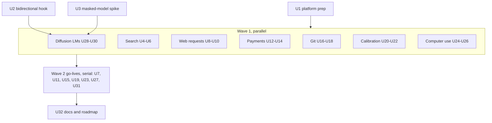
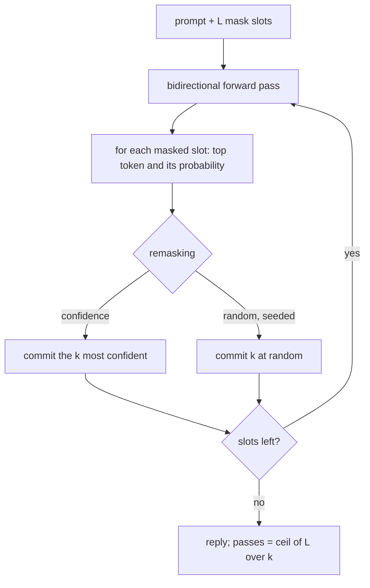
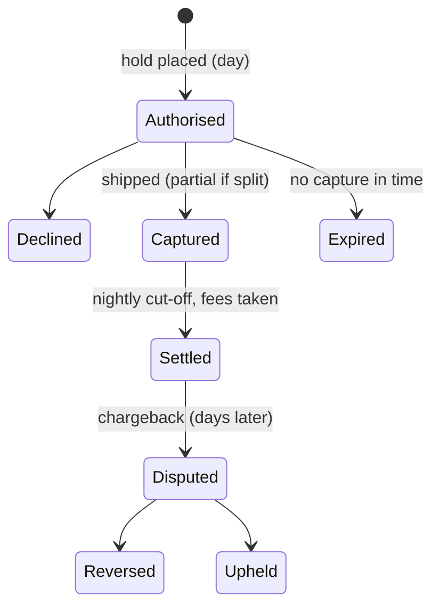

# Seven Roadmap Modules - Plan

## Goal Capsule

- **Objective:** Take the seven planned roadmap cards live as modules 26–32 (KTD1):
  - 26 Search before AI
  - 27 Opening a web page
  - 28 Card payments
  - 29 Git
  - 30 Calibration
  - 31 Computer use
  - 32 Diffusion language models

  Each module gets a new kind of picture (R14). Seven new planned cards replace them on the roadmap (R16). Every module continues the Larkspur Supply Co. story.
- **Product authority:**
  - Product Contract requirements (R-IDs) win on product behaviour.
  - Key Technical Decisions (KTD-IDs) win on mechanism.
  - AGENTS.md decisions stay in force unless a KTD here changes one on purpose.
  - Each go-live unit writes its module's engine and scene section into AGENTS.md.
  - The previous module plan is the precedent for shape and process: `docs/plans/2026-10-24-1806-feat-eight-new-modules-plan.md`.
- **Open blockers:** None.
- **Execution profile:** brownfield work on the Astro 7 + React islands site, in waves (KTD13):
  - **Wave 0**, one PR each: platform prep (U1) and a bidirectional forward pass (U2), in parallel. The masked-model spike (U3) runs alongside them.
  - **Wave 1**, seven worktrees in parallel: Search, Web requests, Payments, Git, Calibration, Computer use and Diffusion LMs. Each builds its engine, scene and chapters inside its own folders. Diffusion LMs starts once U2 and U3 have merged.
  - **Wave 2**, serial: the seven go-lives, merged in KTD1 order.
  - **Wave 3**: docs and roadmap (U32).
  - Every PR leaves `pnpm check`, `pnpm lint`, `pnpm test` and `pnpm test:e2e` green.
- **Stop conditions:**
  - Stop and ask if a chapter needs a backend, a live LLM, an API key, real network traffic or training in the browser (R3).
  - Stop and ask if U3's masked model misses its readable bar within 150 KB of Float16 weights. The bar: for at least half of `data/diffusion-llms/prompts.json`, the expected token is in the top 5 for its masked slot. The fallback is d_model 40, about 70k parameters (about 140 KB), never a recorded fill (KTD3).
  - Stop and ask if U3's spike shows reply quality (KTD11) failing to fall from k = 1 to the largest k on the pinned prompts. Chapter 4's lesson rests on that drop.
  - Stop and ask if any reliability bin Calibration shows holds fewer than its pinned minimum of held-out positions, even after merging to equal-count bins (KTD8). U20 checks this before U21 starts.
  - Stop and ask if U2 changes any existing forward pass. The lm goldens, the hooks test and every sha256 pin must hold (R15).
  - Stop and ask if Calibration's measured effect on Larkspur mini misses its pinned bar (KTD8). The fine-tuned weights must be less calibrated than the base, measured by ECE over held-out positions, or chapter 3 is re-scoped onto the hand-set assistant set before it is built.
  - Stop and ask if the hero headline, both buttons or the "Free · No sign-up" line leave the first screen at 1280×800 or 390×844 once the board holds 39 plots (KTD14).
  - Stop and ask if a source checked for a `facts.json` contradicts a chapter's lesson. The Appendix's "Moving facts" are re-checked on the access date.
  - Stop and ask if a scene's new mechanic cannot be done with a keyboard, or cannot meet reduced motion (R14).
  - A Wave 1 agent stops and reports if it needs to edit a shared hotspot outside its go-live unit (KTD13).
- **Tail ownership:** `ce-work` or the executor owns branches, PRs and CI. Go-lives merge in KTD1 order.

---

## Product Contract

### Summary

Tinker gains seven modules. Four are classic tech: how keyword search finds a page, what happens when a page opens, where a card payment's money goes, and how Git stores history. Three are AI: whether a model's confidence can be trusted, an agent that works a screen by clicking, and language models that write in any order.

Each module is told through Larkspur and drawn as a new picture that does something the site's pictures don't do yet:
- a word-filing cabinet the reader fills;
- a little town with lost post;
- pneumatic tubes that run by day and pay out overnight;
- crates whose names change as you type;
- jars of marbles;
- a screen the reader clicks on;
- a type frame that fills itself in like a crossword.

Seven new roadmap cards keep the home board's building sites open.

### Problem Frame

The roadmap has promised these seven cards since the last plan. Four of them are the cheapest Classic-tech builds the ideation found: Search reuses RAG's BM25, and the others are browser simulators like Caching's. Three are the AI topics ranked just below the batch that shipped.

The site's pictures have settled into one pattern: an isometric diorama with belts, pills and lit parts. It works, but each new module risks looking like the last. "More creative visuals" means each new picture adds a mechanic the reader hasn't seen: dragging, typing, clicking into the picture, time of day, or a frame that fills in any order. It also has to keep the rules that make the pictures readable.

### Requirements

**Platform**

- R1. The seven modules go live as modules 26–32 in KTD1 order. Each has an intro, seven chapters, a recap, a recall bank with one pin, share images, a home card, a hero plot and an e2e spec.
- R2. Levels, tracks and prerequisites:

  | Module | Id | Level | Track | Prerequisites |
  |---|---|---|---|---|
  | Search before AI | `search` | Beginner | Classic tech | none |
  | Opening a web page | `web-requests` | Beginner | Classic tech | none |
  | Card payments | `payments` | Beginner | Classic tech | none |
  | Git | `git` | Beginner | Classic tech | none |
  | Calibration | `calibration` | Intermediate | AI | `evals` |
  | Computer use | `computer-use` | Advanced | AI | `agents`, `multimodal` |
  | Diffusion language models | `diffusion-llms` | Advanced | AI | `diffusion`, `transformers` |

- R3. There is no backend, no API key and no live LLM. Nothing touches a real network or a real payment, and nothing trains in the browser. The one new model, the masked language model, is trained once offline in Python and committed, as Larkspur mini was.
- R4. Every module is picture-first from its first commit:
  - the copy budgets hold;
  - every instruction is in `act`;
  - callouts (`say`) name parts the scene exports;
  - sources open through `Cite`;
  - chapter terms are marked where they are first used.
- R5. Every fact comes from `data/<id>/facts.json`, with its source and access date. Facts that move (the OSWorld scores, the EU's PSD3 timeline, Git's SHA-256 default, vendor speed claims) say whose figure it is and when (Appendix, Moving facts).
- R6. Every stand-in is labelled as one wherever it shows. That covers hand-set confidences, recorded agent actions, hand-written traffic and orders, planning-number latencies and fee schedules.
- R15. The 25 live modules and their saved progress do not change: no chapter id, step id, recording, golden, pinned output or share image changes. The exceptions are the KTD13 shared hotspots and mentions that newly link to a live module.

**Modules.** Each module's chapters are listed in order, chapter 7 being its workbench.

- R7. **Search before AI.** Larkspur's shop search box, before RAG. The edge: "an index is a list of pages per word, and words aren't meaning".
  1. Reading every page.
  2. The index, word to pages.
  3. Rare words count more.
  4. Long pages and repeats (BM25's saturation and length).
  5. "Hinge" and "hinges": cleaning words.
  6. Words versus meaning: embeddings win on meaning, and an exact part number still wins on keywords.
  7. Workbench: tune the search box against a labelled query set.
- R8. **Opening a web page.** A customer in another city opens `larkspur.example`. The edge: "every handshake costs a round trip, and distance multiplies it".
  1. A name to a number (DNS).
  2. The remembered answer (TTL).
  3. Hello, hello, ready (TCP).
  4. Lost in the post (loss and resend).
  5. The sealed envelope: TLS, resuming a session, and what HTTPS proves and doesn't.
  6. One line, many files: HTTP/1.1, 2 and 3.
  7. Workbench: make the page fast for every customer.
- R9. **Card payments.** A customer buys a drill press by card. The edge: "a payment is a hold, a promise and a later transfer, and every party takes a fee".
  1. Four parties and a network.
  2. A hold, not a payment (authorise, then capture).
  3. Overnight: settlement, and where the fee goes.
  4. Pressed Pay twice (timeouts and idempotency).
  5. Prove it's you (3-D Secure and strong customer authentication).
  6. The money comes back (chargebacks).
  7. Workbench: a checkout policy per kind of order.
- R10. **Git.** Two Larkspur developers edit the shop's price page. The edge: "a commit is a snapshot named by its contents, and a branch is just a label".
  1. Named by its contents.
  2. A chain of snapshots.
  3. A branch is a label.
  4. Three-way merge.
  5. Both changed it (conflicts).
  6. Rewriting history (rebase).
  7. Workbench: bring three branches in safely.
- R11. **Calibration.** The support team asks when to trust Larkspur's assistant. The edge: "a confidence is only useful if 70% means right seven times in ten".
  1. What 70% should mean.
  2. Honest jars (a reliability diagram on Larkspur mini's real guesses).
  3. After the polish: Larkspur's style fine-tune, scored on text it was not tuned for, becomes less calibrated. RLHF's calibration loss in large models is cited apart, as a separate finding.
  4. One dial (temperature scaling).
  5. Keeping score (ECE and the Brier score).
  6. When to hand over (abstention, coverage against accuracy).
  7. Workbench: an abstain threshold and temperature per kind of question.
- R12. **Computer use.** An agent re-orders stock on a supplier's old web portal with no API. The edge: "it sees a picture and clicks a point, so anything on screen can steer it".
  1. Look, then click (the loop).
  2. The wrong button (coordinates and scaling).
  3. Too quick (a stale screenshot).
  4. The page that gives orders (on-screen injection).
  5. Ask before you pay (confirmation).
  6. Every look costs (screenshot tokens).
  7. Workbench: a policy against a suite of tasks and attacks.
- R13. **Diffusion language models.** A vendor promises 1,000 tokens a second, and Larkspur wants to know what that buys. The edge: "fill the sure words first, and fewer passes means worse words".
  1. One word at a time (Larkspur mini, left to right).
  2. Fill the blanks.
  3. Sure words first (confidence remasking).
  4. Faster and worse (tokens per pass).
  5. The length is fixed.
  6. Reading a speed claim.
  7. Workbench: steps and remasking per kind of reply.

**Pictures**

- R14. Each module's scene adds at least one mechanic no earlier scene has. It keeps the house rules: Colorfigures style, label pills, one figure per stage, a precise tab, `say` callouts, text escaped, reduced motion and phones. The mechanic is never the only way to act: every one has a keyboard path and a reduced-motion form (KTD15).

  | Module | Scene | New mechanic |
  |---|---|---|
  | Search | The index cabinet: a drawer per word, document cards filed into drawers, a ranking podium | The reader files words into drawers (drag, or pick and place by keyboard) |
  | Web requests | The post town: the customer's house, the directory offices (root, `.example`, Larkspur's), the seal office (certificate authority), the shop, carts on roads | Distance is real map distance, and lost carts tip into a ditch and are sent again |
  | Payments | The tube exchange: wallet, till, acquirer, network tower, issuer, joined by pneumatic tubes | Day and night, set by the run's clock: capsules run by day, the coin convoy and fee jars at night |
  | Git | The crate yard: sealed crates stamped with their hash, chained on rails, flagpole branches, a HEAD lantern | Typing in a small editor re-stamps the crate's real Git hash live |
  | Calibration | The forecaster's booth: ten jars by stated confidence filling with right and wrong marbles, a painted mark at each jar's stated level | Marbles drop into jars, and a temperature dial re-sorts them |
  | Computer use | The puppet desk: a monitor showing the drawn screen, a camera on a stalk, a mouse hand, a film strip of screenshots | The reader clicks the screenshot to predict the agent's click |
  | Diffusion LMs | The type frame: a row of 32 slots, blank slugs stamped in per pass, beside Larkspur mini's typewriter | The frame fills in any order, with a confidence glow per slot |

**Roadmap**

- R16. Seven new planned cards follow the live modules, in this order (KTD16):

  | Id | Title | Level | Track |
  |---|---|---|---|
  | `mixture-of-experts` | Mixture of experts | Advanced | AI |
  | `coding-agents` | Coding agents | Intermediate | AI |
  | `synthetic-data` | Synthetic data | Intermediate | AI |
  | `queues` | Queues and background jobs | Beginner | Classic tech |
  | `encryption` | Locks and keys | Beginner | Classic tech |
  | `compression` | Compression | Beginner | Classic tech |
  | `load-balancing` | Load balancing | Intermediate | Classic tech |

- R17. The four Classic-tech modules continue the Larkspur story. Every name they show (customers, cities, products, people) is read from data, never typed into copy.
- R18. Larkspur sells under EU rules (the IFR caps, PSD2's strong customer authentication); Payments covers no other jurisdiction. (session-settled: user-directed — chosen over keeping the US debit-fee rule as a dated fact: no chapter uses it, and it is under appeal.) Payments shows no real card number, issuer or merchant ID; cards are masked fixtures. Web requests uses only `.example` names (RFC 2606) and documentation IP ranges (RFC 5737, RFC 3849). No module names one vendor as the place to do the thing.

### Scope Boundaries

- The existing modules' pictures, share images and saved progress stay as they are. The new visuals are only in the new modules.
- No retrain of Larkspur mini, its fine-tunes, its student or its checkpoints. The masked model is a new output beside them.
- Maths stays optional, in fold-away "the maths" notes: BM25, ECE, the Brier score, temperature scaling, round-trip arithmetic and the three-way merge.
- Search: no search-engine product guide; RAG's index is read, never rebuilt.
- Web requests: no networking-stack tutorial (no IP routing, no congestion-control internals beyond one fact).
- Payments: no merchant-setup guide, no fee quotes for any provider, and no crypto-currency.
- Git: no command tutorial. Commands appear only in fold-aways; the lesson is the object model.
- Computer use: no real desktop and no real browser automation. Screens are drawn.
- Diffusion LMs: no claim that the tiny masked model matches a production one. The copy says it is Larkspur's toy.

### Deferred to Follow-Up Work

- Building any of the seven new planned cards.
- Splitting the home catalogue into AI and classic sections (kept from the last plan's open question).
- Refreshing earlier modules' pictures with the new mechanics.

### Success Criteria

- After each module a reader can say its edge in plain words, as R7–R13 phrase it.
- `pnpm test` fails in each of these cases:
  - a pinned output drifts: a Git hash, a merge result, a masked fill, a calibration score, a recorded action;
  - a workbench's `WINNERS` drifts from its pin;
  - a new payload passes its budget.
- At 1280px and 390px:
  - the catalogue shows 32 live modules under their levels and seven roadmap cards;
  - the hero wave still shows one live pill at a time;
  - the first screen holds.

### Key Decisions

- All seven planned cards go live in one plan. (session-settled: user-directed — chosen over only the four classic cards or only the three AI cards: it matches the last plan's size.) Governs R1, R2.
- New visuals are confined to the new modules. (session-settled: user-directed — chosen over also refreshing the home hero or earlier modules: it keeps R15 intact and the plan bounded.) Governs R14, R15.
- Diffusion LMs runs a tiny masked model trained offline. (session-settled: user-directed — chosen over recorded fills: the fills are real and run live, as Larkspur mini's predictions do.) Governs R3, R13.
- New planned cards replace the seven. (session-settled: user-directed — chosen over an empty roadmap: the home board keeps its "build one" plots.) Governs R16.

---

## Planning Contract

### Key Technical Decisions

- KTD1. **Module numbers follow merge order:**
  - 26 Search
  - 27 Web requests
  - 28 Payments
  - 29 Git
  - 30 Calibration
  - 31 Computer use
  - 32 Diffusion LMs

  The cheapest classic builds come first, so the board fills early. Diffusion LMs lands last because it carries the training risk (U3), as Diffusion did last time. Each go-live extends the catalogue's numbers list and AGENTS.md's module list.
- KTD2. **What runs live and what is computed offline, per module.**

  | Module | Live in the browser | Computed offline and committed |
  |---|---|---|
  | Search | BM25 over the corpus, the stemmer, precision and recall | relevance labels per query; the queries' vectors; RAG's chunk vectors (read only) |
  | Web requests | the round-trip simulator, seeded loss | a hand-written set of customers and the page's file list |
  | Payments | the payment simulator over a day | a hand-written day of orders; fee schedule (labelled) |
  | Git | real Git object hashing, the commit graph, line diff and three-way merge | fixture branches and identities |
  | Calibration | Larkspur mini's next-token probabilities on held-out text (base and fine-tuned); temperature fitting; ECE, Brier, coverage | a hand-set assistant answer set with confidences |
  | Computer use | screen rasterising, coordinate scaling, the action loop's host stages, token counts | recorded agent actions keyed by what it saw |
  | Diffusion LMs | masked decoding (steps, tokens per pass, remasking); Larkspur mini's greedy baseline | the masked model's weights and goldens |

- KTD3. **The masked model is trained once in Python, like the 2-D denoiser.**
  - `scripts/train/train_mlm.py` is standalone: seeded, CPU, one thread, byte-identical on rerun.
  - It trains a bidirectional model the same shape as Larkspur mini: 2 layers, 2 heads, d_model 32, context 32. That is about 50k parameters, about 100 KB. The fallback, d_model 40, is about 70k parameters, about 140 KB.
  - Its vocabulary is 769: the site's BPE plus one `[MASK]` id, 768.
  - It trains on the same training split, with a random mask rate per example (the MDLM / LLaDA objective: predict every masked token).
  - Output goes to `public/data/diffusion-llms/mlm.bin` (Float16, ≤ 150 KB) and `meta.json` (layout, loss curve, held-out masked accuracy, goldens).
  - The base `public/data/lm/` files, `ids.json` splits and every sha256 pin are untouched. If it needs new encoded ids, they go under a new `diffusionLlms` key in `ids.json` via `pnpm encode:lm`.
  - A spike (U3) proves the readable bar before any chapter is built.
- KTD4. **Bidirectional attention is a hook, not a fork** (U2). `forward()` gains an optional `bidirectional` hook that drops the causal mask. With no hook, every pass is unchanged, and the goldens and `lm-hooks.test.ts` prove it. `load.ts` gains a `'mlm'` weights kind that reads the new folder, with `vocab` from its meta. One kit means one forward pass to trust, which is the lesson of the shared-helper review (9855ea5).
- KTD5. **Search reuses RAG's BM25 through a widened entry point; RAG's results never change.**
  - `buildBm25` in `src/lib/rag/bm25.ts` hard-codes its tokenizer and returns only `score()`. U1 gives it an optional tokenizer argument and a postings accessor, defaulting to today's behaviour, with a test that RAG's scores are unchanged (as the last plan added `exactMatchOf`).
  - Search's documents are RAG's default chunks, the unit RAG's vectors already use, so keyword and vector scores rank the same things.
  - Search's own queries have no committed vectors. A one-off offline script, using `scripts/build-index.mjs`'s embedding model, embeds them into `data/search/vectors.bin`, with a test that fails when `queries.json` changes without re-embedding. RAG's index is never rebuilt. Chunk vectors are read through Tokens' `neighbours.ts` for chapter 6.
  - The stemmer is new and module-local: a small suffix-stripper (`shortcut:` comment, a Porter stemmer if the query set needs it), labelled "a simple stemmer".
  - Relevance labels (`data/search/queries.json`) are hand-written, about 20 queries with their right documents. Precision@5 and recall are computed live.
  - Chapter 6's exact part numbers come from the corpus.
- KTD6. **Web requests is a round-trip simulator** (`src/lib/web-requests/sim.ts`).
  - Each step is DNS (per level, unless cached within its TTL), the TCP handshake, the TLS 1.3 handshake (1 RTT, 0-RTT on resumption), then HTTP requests. HTTP/1.1 runs a few parallel connections, HTTP/2 multiplexes one, and HTTP/3 folds transport and TLS into one round trip.
  - A round trip's length comes from map distance at Larkspur's planning rate. The planning numbers live in `data/web-requests/assumptions.json` and are labelled as such: Caching's 2 ms per 100 km plus a fixed hop.
  - Loss is seeded (`mulberry32`). A lost packet waits one retransmission timeout and resends. Under HTTP/2, a loss stalls every stream on the connection (TCP head-of-line blocking). Under HTTP/3, only its own stream stalls.
  - The waterfall view follows `traceWaterfall.ts`'s shape.
  - The copy never states a measured time.
- KTD7. **Payments is a day simulator** over `data/payments/day.json`, in Consistency's shape (`policyOf`, `runOf`, counted outcomes).
  - **Authorisation** places a hold on the customer's available balance. **Capture** happens at shipment, partial for a split order. Holds expire after an assumed number of days.
  - **Settlement** runs at a nightly cut-off.
  - **Fees:** interchange uses the EU IFR caps for consumer cards (fact). Scheme and acquirer fees are Larkspur's labelled assumptions.
  - **Retries:** a timeout without an idempotency key charges twice; with a key it charges once.
  - **3-D Secure:** a challenge adds friction, so some customers abandon (assumed rate). Liability for fraud then shifts to the issuer (fact).
  - **Chargebacks** arrive days later with an assumed fee.
  - Every rate is in `assumptions.json`, and every outcome is counted, never typed.
- KTD8. **Calibration measures a real model first, then a stand-in.**
  - Chapters 2–5 use Larkspur mini's real next-token probabilities over Fine-tuning's held-out copy (read only). Each position gives a confidence (its top-1 probability) and an outcome (was top-1 right). This is a measured fact about a real model, and the copy says it is the tiny model's own.
  - The held-out copy is small: 1,503 scored positions at a top-1 accuracy near 23%, so the high-confidence bins will be sparse. The jars are equal-count bins, or equal-width bins merged until each holds the pinned minimum. U20 measures the bin counts for both weights before any scene is built.
  - Chapter 3 compares the base and fine-tuned weights (both live). The fine-tune is a style fine-tune, so the chapter says what was measured: the fine-tune, scored on text it was not tuned for, became less calibrated. It cites RLHF's calibration loss (GPT-4 report) only as a separate, labelled finding about large models. Its claim is pinned in `data/calibration/pinned.json` and gated by the stop condition.
  - Temperature scaling fits T over a finite list (`TEMPERATURES`) on one half of the held-out copy (about 750 positions) by negative log-likelihood, and scores the other half.
  - Chapters 1, 6 and 7 use `data/calibration/answers.json`: about 60 support answers by Larkspur's assistant, each graded by Evals' `keyFactOf`, each with a hand-set confidence labelled as a stand-in (as Small models' confidences are). They are written to show Guo et al.'s overconfidence pattern. (session-settled: user-directed — chosen over abstaining on Larkspur mini's measured guesses: keeps the support-desk story.)
- KTD9. **Computer use forks Sandboxing's loop** (`loop.ts`, `turns.ts`), not a wider tools bundle.
  - **Screens** are drawn as SVG at fixed sizes (`screens.ts`, in Multimodal's `images.ts` style). Each drawable element has a box, and the host resolves a click to the element under it.
  - **The agent's actions** (click x,y; type; scroll; wait; screenshot) are recorded per signature. The signature is what the agent saw: the case, the screen at its screenshot size (so the wait rule, which decides whether the screen is stale, shows up through the screen), and the history of outcomes. Clicks are recorded in the screenshot's own coordinates, so a small screenshot can make the agent miss a small target. The actions live in one merged recording across chapter files, with `DOMAINS` and a coverage test that walks every size and wait setting.
  - **Host-only stages** stay out of the signature: whether the host scales a click back to the real screen, the confirmation rule and the domain allow-list.
  - **Scaling is live geometry.** Chapter 2's wrong button comes from a host that forgets to scale a click back from the resized screenshot.
  - **Screenshot cost** comes from Multimodal's `patches.ts`, computed.
  - **Attacks** follow Guardrails' suite shape (`asr`, `fbr`).
- KTD10. **Git hashes are real Git object IDs.**
  - `src/lib/git/objects.ts` hashes blobs, trees and commits in Git's exact format (`"<type> <len>\0<content>"`) with SHA-1 through Web Crypto, which works in browsers and Node 22.
  - A test pins `hello\n` to `ce013625030ba8dba906f756967f9e9ca394464a`, and fixture commits to hashes produced by the real `git` CLI. The CLI is run once, by hand, and its output is committed.
  - Commits use fixed identities and timestamps from `data/git/repo.json`, so hashes never drift.
  - The diff is a line LCS. The three-way merge is diff3-style against the merge base (`shortcut:` comment: no rename detection, no recursive merge base).
  - SHA-256 appears as a dated fact, never as the default.
- KTD11. **Diffusion LMs decodes live from the masked model.**
  - A reply is a fixed length L in the 32-token window. Each pass predicts every masked slot and commits k of them: the most confident (confidence remasking) or random ones, seeded. Steps = ⌈L / k⌉. `[MASK]` (id 768) is never a token the decoder commits.
  - Larkspur mini's left-to-right greedy pass is the baseline, counted in passes.
  - **Reply quality** is the share of a decoded reply's tokens that match the pinned prompt's held-out reference continuation, computed live. The readable bar (one masked slot) only gates the model in U3. U3's spike measures reply quality at every k, and a stop condition guards the drop. Nothing is graded by hand.
  - Chapter 6 reads a speed claim as tokens per pass × passes per second. The vendor figure is dated and labelled as the vendor's.
- KTD12. **Pinned outputs and `WINNERS`.**
  - Every effect a chapter teaches is pinned in `data/<id>/pinned.json` (or `prompts.json`), and a unit test reruns it and fails on drift. That covers a hash, a merge, a fill, an ECE value, a round-trip total, a day's fees and a recorded run.
  - Every workbench pins its `WINNERS` and recomputes them in a test, rather than solving at import (ec9d87b).
- KTD13. **Waves and shared hotspots** follow the last plan's KTD13.
  - **Module branches** touch only their own folders: `src/lib/<id>/`, `src/content/<id>/`, `src/pages/<id>/`, `data/<id>/`, their scene files, `src/dev/<id>.astro` and their tests.
  - **Shared hotspots** change only in a go-live unit:
    - `src/lib/modules.ts`
    - `tests/unit/modules.test.ts`
    - `src/pages/index.astro` (`CARD` with `topics` and `iso`)
    - `heroScene.ts` (`DRAW`)
    - `src/dev/og.astro`
    - `tests/e2e/catalogue.spec.ts`
    - `README.md`
    - `AGENTS.md`
    - `public/og/home.jpg`
    - `flat.ts`'s `Stamp` union
  - **Order:** go-lives rebase and merge in KTD1 order. Module branches scaffold by hand from `templates/module/`; only the go-live swaps the planned line.
- KTD14. **The hero board grows to five slots per front row.**
  - 32 live modules plus 7 planned make 39 plots, which is 37 slots. At four per row the board is 1.34× today's depth and fails the hero depth test.
  - Adding a fifth column (`COLS` gains 428) and three slots beside RAG keeps the depth at today's and widens the board by about 19%.
  - U1 updates the `lift` rule, the slot and pill tests (37 and 39), and the 17-module fixture. It also checks by eye that the topmost pill clears the note at 390px (9e246f5).
- KTD15. **New mechanics live in the module's kit, with a keyboard path and a reduced-motion form.**

  The stage's SVG is injected and its pills ignore clicks, so every control lives in real elements, beside or over the stage, never in the drawing.

  | Mechanic | Control (keyboard, touch, pointer) | Reduced motion |
  |---|---|---|
  | Search's filing | Beside the stage: the cards as one listbox, the drawers as a second. Pick, then place, by Enter or by tap. Dragging onto the picture is an extra on top, with `touch-action` set so it never steals the page's scroll. | cards appear in place |
  | Git's typing | A native `textarea` in a panel under the stage, as Reasoning's thinking panel is, with a capped length. The hash read-out sits outside any live region and is announced once typing pauses. | the hash changes without the stamp animation |
  | Computer use's click-to-predict | Focusable targets over the screen view, read by arrow keys, each at least 44 px on phones (small neighbours merge). A pick locks like `Predict`. Prediction steps keep the tab in the step state, so the screen view shows while the reader predicts. | no motion needed |
  | Payments' day and night | No reader control: the run's clock sets it, and the palette swaps at the cut-off. The night palette's colours are named tokens in `tokens.css` and `PALS`, and pill contrast passes in both palettes. | no fade |
  | Web requests' tipping carts | no input needed | a ditch mark and a REsent pill instead |
  | Calibration's marbles and dial | A native range input in the story column over `TEMPERATURES`. The scene's dial only mirrors it, as the darkroom's step dial does. | marbles shown settled |
  | Diffusion LMs' fill | The fill strip's slots are focusable, read by arrow keys, each slot's piece and probability in the read-out | each pass shows only its end |

  Every scene caps what it draws, as earlier scenes do:
  - **Search:** the query's words plus at most six other drawers, with a count pill for the rest.
  - **Calibration:** each jar holds at most 20 marbles in proportion, its exact count in the pill and the read-out.
  - **Web requests:** road length is compressed past a fixed maximum, with the real distance in the pill.

  Nothing is promoted to a shared component unless two modules use it.
- KTD16. **The new planned cards** are three AI and four classic:
  - **Mixture of experts:** the ideation's "inside the model" axis.
  - **Coding agents:** the "AI in practice" axis, and a sequel to Computer use.
  - **Synthetic data:** the "how models are made" axis.
  - **Queues and background jobs:** Larkspur's order processing.
  - **Locks and keys:** public-key encryption, the sequel to Web requests' chapter 5.
  - **Compression.**
  - **Load balancing:** Inference's and Caching's neighbour.

  Each card gets a one-line description in the house register. The user may swap topics before U1 merges (Open Questions).

### High-Level Technical Design

Waves and dependencies:



Masked decoding, one reply (KTD11):



Opening a page, one customer (KTD6):

```mermaid
sequenceDiagram
  participant C as Customer
  participant R as Directory offices (DNS)
  participant S as Larkspur shop
  C->>R: where is larkspur.example? (skipped while the TTL holds)
  R-->>C: 192.0.2.10
  C->>S: SYN
  S-->>C: SYN-ACK
  C->>S: ACK + TLS ClientHello
  S-->>C: ServerHello + certificate
  C->>S: Finished + GET /
  S-->>C: page, then its files (1.1: a few lines; 2: one line; 3: one line, no shared stall)
```

A payment's life (KTD7):



### Assumptions

- About 20 labelled queries are enough for precision and recall to separate the chapter 7 settings. If not, U4 adds queries before chapter 7 is built.
- Larkspur mini's held-out copy, 1,503 scored positions, fills enough bins for a reliability diagram once bins are equal-count or merged (KTD8). U20 measures this first, and a stop condition guards it.
- A 2-layer bidirectional model at d_model 32 learns to fill corpus phrases readably. U3 proves it or stops.
- Seven new specs fit within the shard count U1 sets from measured time.
- Web Crypto's SHA-1 is available in every supported browser and in Node 22, where Vitest runs.

### System-Wide Impact

- **Language-model kit.** `forward()` gains a `bidirectional` hook (U2), and `load.ts` gains an `'mlm'` kind. Every existing caller keeps its output: the goldens and the sha256 pins guard it.
- **Training scripts.** `train_mlm.py` is standalone and does not start from `model.bin`, so a base retrain does not require rerunning it. AGENTS.md's retrain recipe says so.
- **Home page and registry.** The seven new planned lines arrive in U1, after the current seven. Each go-live swaps its own line, and the caption stays "The empty plots are open: build one". The finder's planned count and status chips read the registry.
- **Saved progress.** Seven new `<id>-progress-v1` keys. No existing key changes.
- **Share images and CI.** About 63 new share images join today's. E2E grows by about 28%, and U1 sets the shard count.
- **Payload.** `mlm.bin` is at most 150 KB, fetched by Diffusion LMs pages only. Screens and the Git editor bundle no fonts beyond the site's own.
- **Cross-links.** Live modules newly link to new modules where they name the topic: RAG to Search, Caching to Web requests, Consistency to Payments, Sandboxing and Guardrails to Computer use, Diffusion to Diffusion LMs. Only link text changes, never a step id.

### Phased Delivery

- **Wave 0:** U1, U2 and U3 in parallel. U2 and U3 gate only Diffusion LMs.
- **Wave 1:**

  | Module | Engine | Scene and kit | Chapters |
  |---|---|---|---|
  | Search | U4 | U5 | U6 |
  | Web requests | U8 | U9 | U10 |
  | Payments | U12 | U13 | U14 |
  | Git | U16 | U17 | U18 |
  | Calibration | U20 | U21 | U22 |
  | Computer use | U24 | U25 | U26 |
  | Diffusion LMs | U28 | U29 | U30 |

- **Wave 2:** U7, U11, U15, U19, U23, U27, U31, in that order, each rebased on the last.
- **Wave 3:** U32.

### Risks

| Risk | Mitigation |
|---|---|
| The masked model fills badly at this size | U3 spike with a readable bar and a d_model 48 fallback; stop condition (KTD3) |
| Fine-tuning does not hurt Larkspur mini's calibration | Pinned bar; chapter 3 re-scoped onto the assistant set before it is built (KTD8) |
| New mechanics break accessibility | Keyboard and reduced-motion forms per mechanic (KTD15); axe and keyboard-only e2e on every chapter |
| Payments copy reads as financial advice or a fee quote | Fees are labelled assumptions apart from the dated EU caps; no provider named (R6, R18) |
| OSWorld scores move | Shown as dated, with whose board (Appendix) |
| The Git hash pin drifts from the real Git | Fixture hashes produced once by the real `git` and committed; test pins them (KTD10) |
| The hero board grows past the first screen | Five slots per row; depth test; stop condition (KTD14) |
| Long module names wrap on share images | OG title check for "Diffusion language models" and "Opening a web page" (be59f16) |
| A workbench solves too slowly at import | Pinned `WINNERS` recomputed in tests (KTD12) |

---

## Output Structure

Per module (Git shown; every module has the same shape):

```text
src/lib/git/                     objects.ts, graph.ts, merge.ts, workbench.ts
src/content/git/                 module.ts, recall.ts, kit.tsx, 01-…07-*.tsx
src/pages/git/                   index.astro, [chapter].astro, recap.astro
src/components/scenes/           crateScene.ts, commitGraph.ts
src/dev/git.astro
data/git/                        facts.json, repo.json, pinned.json
tests/unit/git-*.test.ts, crate-scene.test.ts
tests/e2e/git.spec.ts, git-flow.ts
```

New shared files: `scripts/train/train_mlm.py`, `public/data/diffusion-llms/mlm.bin`, `public/data/diffusion-llms/meta.json`.

---

## Implementation Units

| U-ID | Title | Key files | Depends on |
|---|---|---|---|
| U1 | Platform prep for thirty-two | `modules.ts`, `heroScene.ts`, `index.astro`, hero/modules/catalogue tests, `checks.yml` | — |
| U2 | Bidirectional hook and mlm loader | `src/lib/lm/model.ts`, `src/lib/lm/load.ts` | — |
| U3 | Masked-model spike and training | `scripts/train/train_mlm.py`, `public/data/diffusion-llms/` | — |
| U4 | Search engine, queries and facts | `src/lib/search/`, `data/search/` | U1 |
| U5 | Index cabinet and kit | `cabinetScene.ts`, `postingsView.ts`, `kit.tsx` | U4 |
| U6 | Search chapters | `src/content/search/`, `src/pages/search/` | U5 |
| U7 | Search go-live | hotspots | U6 |
| U8 | Web requests simulator and facts | `src/lib/web-requests/`, `data/web-requests/` | U1 |
| U9 | Post town and kit | `townScene.ts`, `requestWaterfall.ts` | U8 |
| U10 | Web requests chapters | `src/content/web-requests/` | U9 |
| U11 | Web requests go-live | hotspots | U7, U10 |
| U12 | Payments simulator and facts | `src/lib/payments/`, `data/payments/` | U1 |
| U13 | Tube exchange and kit | `tubeScene.ts`, `ledgerView.ts` | U12 |
| U14 | Payments chapters | `src/content/payments/` | U13 |
| U15 | Payments go-live | hotspots | U11, U14 |
| U16 | Git engine and facts | `src/lib/git/`, `data/git/` | U1 |
| U17 | Crate yard and kit | `crateScene.ts`, `commitGraph.ts` | U16 |
| U18 | Git chapters | `src/content/git/` | U17 |
| U19 | Git go-live | hotspots | U15, U18 |
| U20 | Calibration engine and facts | `src/lib/calibration/`, `data/calibration/` | U1 |
| U21 | Forecaster's booth and kit | `jarScene.ts`, `reliabilityChart.ts` | U20 |
| U22 | Calibration chapters | `src/content/calibration/` | U21 |
| U23 | Calibration go-live | hotspots | U19, U22 |
| U24 | Computer use engine, screens and recordings | `src/lib/computer-use/`, `data/computer-use/` | U1 |
| U25 | Puppet desk and kit | `puppetScene.ts`, `screenView.tsx` | U24 |
| U26 | Computer use chapters | `src/content/computer-use/` | U25 |
| U27 | Computer use go-live | hotspots | U23, U26 |
| U28 | Diffusion LMs engine and facts | `src/lib/diffusion-llms/`, `data/diffusion-llms/` | U1, U2, U3 |
| U29 | Type frame and kit | `typeFrameScene.ts`, `fillStrip.ts` | U28 |
| U30 | Diffusion LMs chapters | `src/content/diffusion-llms/` | U29 |
| U31 | Diffusion LMs go-live | hotspots | U27, U30 |
| U32 | Docs and roadmap | `AGENTS.md`, `README.md`, catalogue spec | U31 |

**Patterns every module follows** (the last plan's, unchanged):
- **Engine units** copy their nearest engine, named per unit, and add a dev page `src/dev/<id>.astro`. Each engine unit writes its `facts.json` with source and access date, and verifies the Appendix items it uses.
- **Scene and kit units** copy the nearest scene and `kit.tsx`. They export `PARTS`, the hero plot (`*Plot`), the reader (`*At`) and the card picture, and build the R14 mechanic with KTD15's keyboard and reduced-motion forms. The scene must fit the home card frame (6791deb), and pills must clear tall props (4fce9ec).
- **Chapter units** scaffold by hand from `templates/module/` and follow `docs/writing-a-module.md`. They add an `intro` per chapter in `module.ts` and recall items with one pin, and write `tests/e2e/<id>.spec.ts` with a `<id>-flow.ts` helper.
- **E2E standard:** every chapter is played by mouse and by keyboard only, with axe, reduced motion and 390px checks.
- **One workbench pattern** serves every chapter 7:
  - one native control per policy dimension;
  - a result table with one row per case;
  - a live total against the best;
  - "Show me" shows one of `WINNERS`, labelled "one of N that work".

Go-live units follow the recipe in U7. The others cite it.

### U1. Platform prep for thirty-two

- **Goal:** The home page, registry tests and CI hold 32 live modules and seven new planned cards.
- **Requirements:** R16, R15; KTD13, KTD14, KTD16.
- **Dependencies:** none.
- **Files:** `src/lib/modules.ts`, `src/lib/rag/bm25.ts`, `src/components/scenes/heroScene.ts`, `tests/unit/hero.test.ts`, `tests/unit/modules.test.ts`, `tests/unit/rag-bm25.test.ts`, `tests/e2e/catalogue.spec.ts`, `.github/workflows/checks.yml`, `public/og/home.jpg`.
- **Approach:**
  0. Give `buildBm25` an optional tokenizer argument and a postings accessor (KTD5), defaulting to today's behaviour.
  1. Append the seven R16 `planned()` lines after the current seven, each with its track. Extend `ROADMAP` in both test files to fourteen ids. Rewrite the "keeps the seven roadmap cards" test so the old seven may be replaced in order by live modules.
  2. Add the fifth front-row column and three slots beside RAG (KTD14). Update `lift` and raise the hero tests to 37 slots and 39 plots, plus the 17-module fixture.
  3. Replace the hard-coded counts in the catalogue spec (the `32` total, "25 live… seven roadmap") with counts read from the registry, so each go-live needs no count edit.
  4. Measure e2e time per shard on `main` and set the shard count for 32 modules.
  5. Regenerate `home.jpg`.
- **Patterns to follow:** U1 of `docs/plans/2026-10-24-1806-feat-eight-new-modules-plan.md`; `planned()` in `src/lib/modules.ts`.
- **Test scenarios:**
  - Unit: with no tokenizer argument, `buildBm25` gives RAG's exact scores for every RAG question. A custom tokenizer changes the postings it reports.
  - Unit: with a fixture of 32 live and 7 planned modules, every plot sits on the board, no two overlap, and no two pills overlap with every pill shown.
  - Unit: the board for 37 slots is no deeper than 1.2× 520, and no slot overlaps RAG's pipeline or the back office.
  - Unit: the planned ids are an in-order subsequence of `ROADMAP`, each card's level and track match R16, and planned cards keep `prereqs: []`.
  - E2E: the finder's count reads the registry's live and planned counts; the caption still reads "The empty plots are open: build one".
  - E2E: at 1280×800 and 390×844 the h1, both buttons and the note stay in view, and the topmost hero pill sits below the note.
- **Verification:** the four repo checks green; `/` at both widths by eye with reduced motion (every pill shown).

### U2. Bidirectional hook and mlm loader

- **Goal:** The language-model kit can run a masked model with no change to any existing pass.
- **Requirements:** R3, R15; KTD4.
- **Dependencies:** none.
- **Files:** `src/lib/lm/model.ts`, `src/lib/lm/load.ts`, `tests/unit/lm-hooks.test.ts`, `tests/unit/lm-mlm-load.test.ts`.
- **Approach:**
  - Add `bidirectional?: boolean` to `Hooks`, looked up once per layer: attention runs over every position, with no mask.
  - `load.ts` adds `'mlm'` to `Weights`. It reads `public/data/diffusion-llms/meta.json` for config and vocabulary, uses the same decode path and a retry on failure.
- **Patterns to follow:** KTD5's hooks in `src/lib/lm/model.ts`; `ckpt-<step>` loading in `load.ts`.
- **Test scenarios:**
  - With no hooks, every golden in `tests/fixtures/lm/goldens.json` holds within tolerance, and the student and fine-tune goldens hold too.
  - Without `bidirectional`, a toy two-token model's first attention row has length 1 (causal rows are ragged). With it, the row has length 2 and a weight above 0 on the second position.
  - Attention rows sum to 1 in both modes.
  - The `'mlm'` loader rejects a missing file into the retry path, and decodes a fixture of the meta's layout.
  - The sha256 pins in `pre-training-runs.test.ts` are unchanged.
- **Verification:** `pnpm test` green with no pin edits.

### U3. Masked-model spike and training

- **Goal:** A committed masked model that fills Larkspur phrases readably.
- **Requirements:** R3, R13; KTD3.
- **Dependencies:** none (U2 is needed only to check it in TypeScript).
- **Files:** `scripts/train/train_mlm.py`, `scripts/train/README.md`, `scripts/encode-for-training.mjs` (only if new ids are needed), `public/data/diffusion-llms/mlm.bin`, `public/data/diffusion-llms/meta.json`, `data/diffusion-llms/prompts.json`, `tests/unit/diffusion-llms-model.test.ts`.
- **Approach:**
  1. Reuse `train.py`'s `Mini` and `Block` with the `tril` mask dropped, and its `f16_blob` and `golden_prompts`, so the layout is one `src/lib/lm/model.ts` already reads. Take only the standalone scaffolding from `train_diffusion.py`: seed, one thread, Float16 rounding, goldens from the rounded weights.
  2. Train on masked training-split windows.
  3. Measure held-out masked accuracy and pin the readable-bar prompts in `prompts.json`, each with its held-out reference continuation.
  4. Measure reply quality (KTD11) at every k in `KS` for both remasking rules.
  5. Rerun once to prove the output is byte-identical.
- **Execution note:** Spike first: try the model at d_model 32 against the readable bar and the reply-quality drop before writing any chapter. Stop condition on a miss.
- **Patterns to follow:** `scripts/train/train.py` (`Mini`, `Block`, `f16_blob`, `golden_prompts`); `scripts/train/train_diffusion.py` (standalone scaffolding); `tests/unit/diffusion-learned.test.ts`.
- **Test scenarios:**
  - `mlm.bin` is no more than 150 KB, and its size matches the meta's layout.
  - The TS forward pass with `bidirectional` matches the meta's goldens: max |Δlogit| under 1e-4 and the same top 5.
  - For at least half the pinned prompts, the expected token is in the top 5 for its masked slot.
  - Reply quality at the largest k is below reply quality at k = 1 on the pinned prompts (pinned in `prompts.json`).
  - The base `model.bin`, `meta.json` and goldens are byte-unchanged.
- **Verification:** the rerun is byte-identical; the tests are green.

### U4. Search engine, queries and facts

- **Goal:** Keyword search over the corpus, scored against labelled queries.
- **Requirements:** R7, R5, R6; KTD5, KTD12.
- **Dependencies:** U1.
- **Files:** `src/lib/search/engine.ts`, `src/lib/search/stem.ts`, `src/lib/search/workbench.ts`, `scripts/embed-search-queries.mjs`, `data/search/queries.json`, `data/search/vectors.bin`, `data/search/facts.json`, `data/search/pinned.json`, `tests/unit/search-engine.test.ts`, `tests/unit/search-workbench.test.ts`.
- **Approach:**
  - `engine.ts` calls `buildBm25` with its own tokenizer, over RAG's default chunks (KTD5). It adds a scan baseline (pages read), a tf-idf scorer, and per-query precision@5 and recall.
  - It applies word cleaning (lowercase, stop words, stemmer) as options from finite lists.
  - `embed-search-queries.mjs` embeds the queries once offline (KTD5).
  - The workbench domain is cleaning options × k1 and b from finite lists × keyword or hybrid weight. Hybrid reads RAG's committed chunk vectors through Tokens' `neighbours.ts` against the queries' committed vectors.
  - The controls are labelled in plain words, for example "how much a repeat helps" and "how much a long page counts against it". k1 and b are named only in the fold-away.
  - Facts: Manning et al. (the inverted index, tf-idf, precision and recall), Robertson & Zaragoza (BM25), and BEIR (BM25 as a zero-shot baseline).
- **Patterns to follow:** `src/lib/rag/bm25.ts`; `src/lib/tokens/neighbours.ts`; `src/lib/databases/workbench.ts`.
- **Test scenarios:**
  - The postings for a word list exactly the corpus documents containing it.
  - A word in every document scores lower than a rare word in one (idf).
  - Under BM25, doubling a term's count raises the score by less than double (saturation).
  - With stemming on, "hinges" finds the "hinge" documents.
  - A part-number query ranks its document first by keywords and not first by vectors (pinned).
  - Every query in `queries.json` names at least one existing document.
  - Every query in `queries.json` has a vector in `vectors.bin`, which fails when a query is edited without re-embedding.
  - `WINNERS` is non-empty and equals the pin.
- **Verification:** unit tests green; the dev page runs queries.

### U5. Index cabinet and kit

- **Goal:** The Search stage: the index cabinet and the postings view.
- **Requirements:** R7, R14; KTD15.
- **Dependencies:** U4.
- **Files:** `src/components/scenes/cabinetScene.ts`, `src/components/scenes/postingsView.ts`, `src/content/search/kit.tsx`, `src/dev/search.astro`, `tests/unit/cabinet-scene.test.ts`.
- **Approach:**
  - The scene: a drawer per word (the query's words lit), document cards in drawers, a clerk reading every page for the scan, and a ranking podium whose step heights follow the scores.
  - The filing mechanic follows KTD15.
  - The precise tab is the postings view: words, their pages, each term's weight.
- **Patterns to follow:** `archiveScene.ts` (drawers, lit reads); `DbStage`.
- **Test scenarios:**
  - Every name in `CABINET_PARTS` is drawn.
  - The podium order equals the engine's ranking.
  - Labels are escaped.
  - Keyboard filing places the chosen card in the chosen drawer, and a wrong drawer is refused with a hint after three tries.
  - Under reduced motion there is no card animation.
- **Verification:** the dev page at 1280px and 390px; filing by mouse, touch emulation and keyboard.

### U6. Search chapters

- **Goal:** Seven chapters, recall, intro and recap.
- **Requirements:** R1, R4, R7.
- **Dependencies:** U5.
- **Files:** `src/content/search/module.ts`, `recall.ts`, `01-…07-*.tsx`, `src/pages/search/index.astro`, `[chapter].astro`, `recap.astro`, `tests/e2e/search.spec.ts`, `tests/e2e/search-flow.ts`.
- **Approach:** chapters in R7's order. Chapter 2 is the filing chapter. Chapter 6 links `/rag/`. Chapter 7 uses the workbench pattern.
- **Test scenarios:**
  - E2E: every chapter plays by mouse and by keyboard only, with axe clean, reduced motion and 390px.
  - E2E: chapter 1's pages-read count is the corpus size; chapter 2's index answers with one drawer.
  - Unit: chapter 7's Show me plan is in `WINNERS`, and a losing plan's row says why.
- **Verification:** copy-budget, say-target and registry tests pass for the module.

### U7. Search go-live

- **Goal:** Search is live as module 26.
- **Requirements:** R1, R2, R15; KTD1, KTD13.
- **Dependencies:** U6. Every later go-live also depends on the previous go-live.
- **Files:** `src/lib/modules.ts`, `src/components/scenes/heroScene.ts`, `src/pages/index.astro`, `src/dev/og.astro`, `tests/unit/modules.test.ts`, `tests/e2e/catalogue.spec.ts`, `public/og/*.jpg`, `README.md`, `AGENTS.md`.
- **Approach:** the go-live recipe every go-live unit follows:
  1. Rebase on `main`. Replace the module's `planned(...)` line with its import at the end of the live modules, with its R2 prerequisites.
  2. Add its hero `DRAW` plot and its home `CARD`: name, `iso` picture and the `topics` the finder searches.
  3. Add `og.astro` cases for the intro, every chapter and the recap. Run `pnpm og <id> home` and commit the images that changed. Check that long titles stay on one line (be59f16).
  4. Extend the catalogue's numbers list and the per-module "numbered N" test.
  5. Turn mentions in live modules into links where they name this topic (System-Wide Impact, Cross-links).
  6. Write the module's engine and scene sections into AGENTS.md, update the module list, levels, tracks, the hero bullet and the OG bullet, and update the README.
- **Test scenarios:**
  - The registry test passes for the module: pages, share images, credit, recall coverage with one pin, and the e2e spec.
  - E2E: the catalogue shows the card under its level and track with its number; the finder finds it by a topic.
  - E2E: the hero wave still shows one pill at a time, and every new page has its own share image.
- **Verification:** the four repo checks green; `/` at 1280px and 390px.

### U8. Web requests simulator and facts

- **Goal:** A seeded round-trip simulator for one page load per customer.
- **Requirements:** R8, R5, R6, R18; KTD6, KTD12.
- **Dependencies:** U1.
- **Files:** `src/lib/web-requests/sim.ts`, `src/lib/web-requests/workbench.ts`, `data/web-requests/customers.json`, `data/web-requests/page.json`, `data/web-requests/assumptions.json`, `data/web-requests/facts.json`, `data/web-requests/pinned.json`, `tests/unit/web-requests-sim.test.ts`, `tests/unit/web-requests-workbench.test.ts`.
- **Approach:**
  - `sim.ts` returns a timeline of phases (DNS levels, TCP, TLS, each request) per customer and setting.
  - The workbench domain is DNS TTL × HTTP version × TLS resumption (0-RTT allowed only for GETs). Each lever is taught in chapters 2, 6 and 5. An edge copy near the customer stays a `/caching/` link in chapter 7's closing note.
  - Owner's rule: every customer's page is complete within the budget in `workbench.json`.
  - Facts: RFCs 1034/1035, 9293, 6298, 8446, 9110, 9113, 9000 and 9114, and RFC 5280 or 9162 for certificates.
- **Patterns to follow:** `src/lib/caching/sim.ts`; `src/lib/caching/workbench.ts`.
- **Test scenarios:**
  - A cold load costs DNS levels + 1 RTT (TCP) + 1 RTT (TLS 1.3) + requests. A warm DNS cache within its TTL skips DNS.
  - Doubling distance doubles the handshake time.
  - Under HTTP/3 the handshake costs one round trip fewer than TCP + TLS 1.3.
  - 0-RTT resumption saves a round trip, and the engine refuses it for a non-GET.
  - With one seeded loss on a shared connection, HTTP/2 stalls every stream and HTTP/3 stalls one.
  - The same seed gives the same timeline.
  - Every name and address in the data uses `.example` and documentation ranges.
  - `WINNERS` equals the pin.
- **Verification:** unit tests green; the dev page draws a waterfall.

### U9. Post town and kit

- **Goal:** The Web requests stage: the post town and the waterfall.
- **Requirements:** R8, R14; KTD15.
- **Dependencies:** U8.
- **Files:** `src/components/scenes/townScene.ts`, `src/components/scenes/requestWaterfall.ts`, `src/content/web-requests/kit.tsx`, `src/dev/web-requests.astro`, `tests/unit/town-scene.test.ts`.
- **Approach:**
  - The scene: the customer's house at the front; the directory offices (root, `.example`, Larkspur's nameserver) along one road; the seal office (certificate authority); Larkspur's shop at the far end.
  - Road length follows each customer's distance. Carts ride the road per round trip, and an envelope wears a wax seal once TLS is up.
  - A lost cart tips into a ditch and a new one goes (KTD15). A stopwatch pill shows the total.
  - The waterfall view is a lane per phase and per request, with arrow keys reading each lane.
- **Patterns to follow:** `depotScene.ts` (roads, trucks); `traceWaterfall.ts`.
- **Test scenarios:**
  - Every name in `TOWN_PARTS` is drawn.
  - With a cached DNS answer, the directory offices stay unlit.
  - The ditch mark appears exactly where the run lost a packet.
  - The waterfall total equals the simulator's.
  - On phones the pills keep only names.
- **Verification:** the dev page at both widths, with reduced motion.

### U10. Web requests chapters

- **Goal:** Seven chapters, recall, intro and recap.
- **Requirements:** R1, R4, R8.
- **Dependencies:** U9.
- **Files:** `src/content/web-requests/module.ts`, `recall.ts`, `01-…07-*.tsx`, `src/pages/web-requests/*`, `tests/e2e/web-requests.spec.ts`, `tests/e2e/web-requests-flow.ts`.
- **Approach:** chapters in R8's order. Chapter 5 says what the padlock proves (the line is private and the name matches the certificate) and what it does not (the shop is honest). Chapter 7 uses the workbench pattern.
- **Test scenarios:**
  - E2E: every chapter plays by mouse and keyboard only, with axe, reduced motion and 390px.
  - E2E: chapter 4's customer far away with loss takes longer than the one nearby, read off the waterfall.
  - Unit: chapter 7's Show me plan is in `WINNERS`.
- **Verification:** the module passes copy-budget, say-target and registry tests.

### U11. Web requests go-live

- **Goal:** Web requests is live as module 27.
- **Requirements:** R1, R2, R15; KTD1, KTD13.
- **Dependencies:** U7, U10.
- **Approach:** the U7 recipe. Caching's chapter 1 gains a link where it names a round trip.
- **Test scenarios:** as U7.
- **Verification:** as U7.

### U12. Payments simulator and facts

- **Goal:** A day of card payments, counted.
- **Requirements:** R9, R5, R6, R18; KTD7, KTD12.
- **Dependencies:** U1.
- **Files:** `src/lib/payments/sim.ts`, `src/lib/payments/workbench.ts`, `data/payments/day.json`, `data/payments/assumptions.json`, `data/payments/facts.json`, `data/payments/pinned.json`, `tests/unit/payments-sim.test.ts`, `tests/unit/payments-workbench.test.ts`.
- **Approach:**
  - `sim.ts` runs each order through authorise, capture, settle and dispute under a policy. It counts:
    - holds and expiries;
    - double charges;
    - abandoned checkouts;
    - fraud losses by who bears them;
    - fees by party;
    - chargebacks.
  - Money is integer cents throughout.
  - The workbench domain is, per kind of order: 3-D Secure (always, risk-based, never) × capture (at order, at shipment) × retry key (on or off).
  - Owner's rule: no double charge, and fraud loss within a limit. The score is net revenue. `WINNERS` holds the best ties.
  - Facts: EU IFR 2015/751 caps; PSD2 Art. 97 and RTS 2018/389; EMVCo 3-D Secure; Visa's and Mastercard's dispute rules (reason-code groups); and PCI DSS v4.0.1. Larkspur sells under EU rules, so the US debit-fee rule is left out.
- **Patterns to follow:** `src/lib/consistency/sim.ts`; `src/lib/consistency/workbench.ts`.
- **Test scenarios:**
  - Every order ends in exactly one final state.
  - Money is conserved: customer debits = merchant credits + every fee, to the cent.
  - A consumer debit card's interchange never exceeds 0.2% of the amount, and credit never exceeds 0.3%.
  - A timeout retry without a key charges twice; with a key it charges once.
  - An uncaptured hold expires on the assumed day and the money returns.
  - A partial shipment captures only the shipped amount.
  - Under "never" 3-D Secure, the fraud loss falls on Larkspur; under a successful challenge it falls on the issuer.
  - No card in the data has an unmasked number.
  - `WINNERS` equals the pin.
- **Verification:** unit tests green; the dev page plays the day.

### U13. Tube exchange and kit

- **Goal:** The Payments stage: the tube exchange and the ledger.
- **Requirements:** R9, R14; KTD15.
- **Dependencies:** U12.
- **Files:** `src/components/scenes/tubeScene.ts`, `src/components/scenes/ledgerView.ts`, `src/content/payments/kit.tsx`, `src/dev/payments.astro`, `tests/unit/tube-scene.test.ts`.
- **Approach:**
  - The scene: five buildings (wallet, Larkspur's till, acquirer, network tower, issuer) joined by pneumatic tubes.
  - By day, capsules carry messages: authorisation requests, approvals, declines, challenges.
  - At night the palette swaps, a coin convoy carries settlement, and each fee drops into its party's jar.
  - Chargebacks ride back as tomato capsules.
  - The precise tab is a ledger: each party's debits and credits per order, keyboard-readable.
- **Patterns to follow:** `officeScene.ts` (`beltAt`, `archAt`, `barrierAt`); `replicaTimeline.ts`.
- **Test scenarios:**
  - Every name in `TUBE_PARTS` is drawn.
  - The night palette shows exactly when the run's clock is past the cut-off; there is no reader toggle.
  - The jars' heights follow the fee totals in order.
  - The ledger rows sum to zero per order.
  - Under reduced motion the swap has no fade, and the scene stays readable in both palettes (axe contrast on pills).
- **Verification:** the dev page at both widths, by day and by night.

### U14. Payments chapters

- **Goal:** Seven chapters, recall, intro and recap.
- **Requirements:** R1, R4, R9.
- **Dependencies:** U13.
- **Files:** `src/content/payments/module.ts`, `recall.ts`, `01-…07-*.tsx`, `src/pages/payments/*`, `tests/e2e/payments.spec.ts`, `tests/e2e/payments-flow.ts`.
- **Approach:** chapters in R9's order. Chapter 4 links `/consistency/`. Chapter 7 uses the workbench pattern.
- **Test scenarios:**
  - E2E: every chapter plays by mouse and keyboard only, with axe, reduced motion and 390px.
  - E2E: chapter 4 shows two charges without the key and one with it.
  - Unit: chapter 7's Show me plan is in `WINNERS`.
- **Verification:** the module passes copy-budget, say-target and registry tests.

### U15. Payments go-live

- **Goal:** Payments is live as module 28.
- **Requirements:** R1, R2, R15; KTD1, KTD13.
- **Dependencies:** U11, U14.
- **Approach:** the U7 recipe.
- **Test scenarios:** as U7.
- **Verification:** as U7.

### U16. Git engine and facts

- **Goal:** Real Git objects, a commit graph, and merges.
- **Requirements:** R10, R5; KTD10, KTD12.
- **Dependencies:** U1.
- **Files:** `src/lib/git/objects.ts`, `src/lib/git/graph.ts`, `src/lib/git/merge.ts`, `src/lib/git/workbench.ts`, `data/git/repo.json`, `data/git/facts.json`, `data/git/pinned.json`, `tests/unit/git-objects.test.ts`, `tests/unit/git-merge.test.ts`, `tests/unit/git-workbench.test.ts`.
- **Approach:**
  - `objects.ts` hashes blobs, trees and commits in Git's format.
  - `graph.ts` handles branches as refs, HEAD, the merge base (the nearest common ancestor), and rebase as new commits with new hashes.
  - `merge.ts` does the line diff and the three-way merge with conflict hunks.
  - The workbench domain is, per branch: merge or rebase × the order of the three branches.
  - Owner's rule: never rewrite a commit others have. The score is the fewest conflicts, then the shortest history. `WINNERS` is pinned.
  - Facts: Pro Git §§3.2, 3.6 and 10.2–10.4; the hash-function transition doc (dated); SHAttered.
- **Execution note:** Produce the fixture hashes once with the real `git` CLI from `repo.json`'s identities and timestamps, commit them to `pinned.json`, then write the engine test-first against them.
- **Patterns to follow:** `src/lib/databases/table.ts` (seeded fixtures); `src/lib/consistency/sim.ts` (counted outcomes).
- **Test scenarios:**
  - The blob hash of `hello\n` is `ce013625030ba8dba906f756967f9e9ca394464a`.
  - Every fixture commit's hash equals the pinned real-Git hash.
  - Changing one byte of a file changes its blob, its tree and every commit after it.
  - Identical content in two files gives one blob.
  - The merge base of two branches is their nearest shared commit.
  - Changes on different lines merge cleanly. The same line changed both ways yields one conflict hunk holding both sides and the base.
  - A rebase gives commits with new hashes and the same file contents.
  - `WINNERS` equals the pin, and no winner rebases a shared branch.
- **Verification:** unit tests green, in Node and in the dev page.

### U17. Crate yard and kit

- **Goal:** The Git stage: the crate yard and the commit graph.
- **Requirements:** R10, R14; KTD15.
- **Dependencies:** U16.
- **Files:** `src/components/scenes/crateScene.ts`, `src/components/scenes/commitGraph.ts`, `src/content/git/kit.tsx`, `src/dev/git.astro`, `tests/unit/crate-scene.test.ts`.
- **Approach:**
  - The scene: commits as sealed crates stamped with a 7-character hash, chained by rails to their parents; branches as flagpoles on crates; HEAD as a lantern.
  - A merge crate sits on two rails. A conflict crate carries a tomato tag and opens to show both sides.
  - The editor mechanic follows KTD15: a `textarea` whose content re-stamps a blob crate with its real hash as the reader types (debounced, escaped).
  - The precise tab is a flat commit graph with focusable commits.
- **Patterns to follow:** `stockScene.ts` (lines between sites); `replicaTimeline.ts` (conflict diamond).
- **Test scenarios:**
  - Every name in `CRATE_PARTS` is drawn.
  - The crate stamp equals `objects.ts`'s hash for the typed text.
  - Typed text containing `<script>` renders as text.
  - The graph's parent edges match the engine's.
  - On phones the pills keep only hashes and branch names.
- **Verification:** the dev page at both widths; typing by keyboard.

### U18. Git chapters

- **Goal:** Seven chapters, recall, intro and recap.
- **Requirements:** R1, R4, R10.
- **Dependencies:** U17.
- **Files:** `src/content/git/module.ts`, `recall.ts`, `01-…07-*.tsx`, `src/pages/git/*`, `tests/e2e/git.spec.ts`, `tests/e2e/git-flow.ts`.
- **Approach:** chapters in R10's order. Commands sit only in fold-aways. Chapter 7 uses the workbench pattern.
- **Test scenarios:**
  - E2E: every chapter plays by mouse and keyboard only, with axe, reduced motion and 390px.
  - E2E: chapter 1's hash changes when the reader edits a word, and returns when the edit is undone.
  - E2E: chapter 5's puzzle resolves a conflict by choosing a side.
  - Unit: chapter 7's Show me plan is in `WINNERS`.
- **Verification:** the module passes copy-budget, say-target and registry tests.

### U19. Git go-live

- **Goal:** Git is live as module 29.
- **Requirements:** R1, R2, R15; KTD1, KTD13.
- **Dependencies:** U15, U18.
- **Approach:** the U7 recipe.
- **Test scenarios:** as U7.
- **Verification:** as U7.

### U20. Calibration engine and facts

- **Goal:** Measured calibration of Larkspur mini, and abstention on a stand-in answer set.
- **Requirements:** R11, R5, R6; KTD8, KTD12.
- **Dependencies:** U1.
- **Files:** `src/lib/calibration/measure.ts`, `src/lib/calibration/score.ts`, `src/lib/calibration/workbench.ts`, `data/calibration/answers.json`, `data/calibration/facts.json`, `data/calibration/pinned.json`, `tests/unit/calibration-measure.test.ts`, `tests/unit/calibration-workbench.test.ts`.
- **Approach:**
  - `measure.ts` reads the confidence and correctness per held-out position for any weights, run in slices so the page responds.
  - `score.ts` computes the reliability bins, ECE, the Brier score, the temperature fit over `TEMPERATURES`, and the coverage–accuracy curve over thresholds.
  - `answers.json` holds about 60 answers graded by Evals' `keyFactOf` against Evals' references and a module reference file, each with a hand-set confidence.
  - The workbench domain is, per kind of question: a threshold × a temperature. Owner's rule: a wrong-answer rate within its limit, and handovers within the desk's capacity. `WINNERS` is pinned.
  - Facts: Guo et al. 2017, Kadavath et al. 2022, GPT-4 report Fig. 8 (labelled as OpenAI's), Brier 1950, Geifman & El-Yaniv 2017.
- **Patterns to follow:** `src/lib/small-models/router.ts`; `src/lib/fine-tuning/engine.ts` (`heldoutScore`).
- **Test scenarios:**
  - A perfectly calibrated synthetic set has ECE 0, and an always-90%-but-half-right set has ECE 0.4.
  - Brier is 0 for perfect confident answers and 0.25 for always-50%.
  - T = 1 leaves the probabilities unchanged. The fitted T on the fit half lowers the test half's negative log-likelihood or ties it.
  - The fine-tuned weights' ECE exceeds the base's (pinned; stop condition).
  - Coverage falls and accuracy rises as the threshold rises.
  - Every bin the chapters show holds at least the pinned minimum of positions, for both weights and both temperature halves.
  - Every answer has a confidence in [0, 1] and a note.
  - `WINNERS` equals the pin.
- **Verification:** unit tests green; the dev page shows both models' bins.

### U21. Forecaster's booth and kit

- **Goal:** The Calibration stage: the jars and the reliability chart.
- **Requirements:** R11, R14; KTD15.
- **Dependencies:** U20.
- **Files:** `src/components/scenes/jarScene.ts`, `src/components/scenes/reliabilityChart.ts`, `src/content/calibration/kit.tsx`, `src/dev/calibration.astro`, `tests/unit/jar-scene.test.ts`.
- **Approach:**
  - The scene: ten glass jars on a bench by stated confidence. Each jar's mint and tomato marble layers give its right and wrong share, against a painted mark at its stated level.
  - A temperature dial re-sorts the marbles between jars. A "hand to a person" door takes answers below the threshold to a help desk.
  - The marble drop follows KTD15.
  - The precise tab is a reliability diagram (dataviz rules: one accent, a diagonal reference, focusable bins with a read-out line).
- **Patterns to follow:** `examScene.ts` (stacks by probability); `effortChart.ts`.
- **Test scenarios:**
  - Every name in `JAR_PARTS` is drawn.
  - Each jar's layer heights equal its bin's counts.
  - A dial change moves marbles between jars and never changes the total.
  - The diagram's bins equal the score's bins.
  - On phones the pills keep only percentages.
- **Verification:** the dev page at both widths.

### U22. Calibration chapters

- **Goal:** Seven chapters, recall, intro and recap.
- **Requirements:** R1, R4, R11.
- **Dependencies:** U21.
- **Files:** `src/content/calibration/module.ts`, `recall.ts`, `01-…07-*.tsx`, `src/pages/calibration/*`, `tests/e2e/calibration.spec.ts`, `tests/e2e/calibration-flow.ts`.
- **Approach:** chapters in R11's order. Chapters 2–4 load weights through Fine-tuning's gate (a loading pill, an error card with Retry). Chapter 6 links `/small-models/`. Chapter 7 uses the workbench pattern.
- **Test scenarios:**
  - E2E: every chapter plays by mouse and keyboard only, with axe, reduced motion and 390px, and offline after load.
  - E2E: a weights fetch failure shows Retry, and Retry recovers.
  - Unit: chapter 7's Show me plan is in `WINNERS`.
- **Verification:** the module passes copy-budget, say-target and registry tests.

### U23. Calibration go-live

- **Goal:** Calibration is live as module 30.
- **Requirements:** R1, R2, R15; KTD1, KTD13.
- **Dependencies:** U19, U22.
- **Approach:** the U7 recipe.
- **Test scenarios:** as U7.
- **Verification:** as U7.

### U24. Computer use engine, screens and recordings

- **Goal:** A screenshot-and-click agent loop over drawn screens, with host stages.
- **Requirements:** R12, R5, R6; KTD9, KTD12.
- **Dependencies:** U1.
- **Files:**
  - `src/lib/computer-use/screens.ts`, `loop.ts`, `turns.ts`, `workbench.ts`
  - `data/computer-use/screens.json`, `server.json`, `suite.json`, `facts.json`, `turns/<chapter>.json`
  - `tests/unit/computer-use-engine.test.ts`, `computer-use-coverage.test.ts`, `computer-use-workbench.test.ts`
- **Approach:**
  - `screens.ts` draws the supplier portal's screens as SVG with element boxes: login, search, product, basket and pay. It also draws the attack screens: a banner with planted instructions, and a look-alike Pay button.
  - `loop.ts` forks Sandboxing's loop and applies the host stages:
    - scaling the screenshot and the click back;
    - waiting for the page to settle;
    - the domain allow-list;
    - confirmation before a payment or terms.
  - The recorded actions are keyed by the KTD9 signature.
  - The suite: re-order tasks and attacks, each with a goal checked against the run's ledger.
  - The workbench domain: screen size × wait rule × allow-list × confirmation.
  - Facts: Anthropic's computer-use tool docs (loop, sizes, scaling, safety), OSWorld (Xie et al., with the human baseline; current scores dated and attributed), OpenAI's CUA post (historical).
- **Patterns to follow:** `src/lib/sandboxing/loop.ts` and `turns.ts`; `src/lib/multimodal/images.ts` and `patches.ts`; `data/guardrails/suite.json`.
- **Test scenarios:**
  - A click at a screenshot point lands on the element under the scaled-back screen point. With scaling forgotten, the pinned case lands on the wrong button.
  - At the smallest screen size, the pinned small-target case misses. At a larger size it hits, at a higher token cost.
  - Without the wait rule, the pinned case acts on a stale screen. With it, the right one.
  - The banner attack reaches its goal with no allow-list and no confirmation, and is stopped by each.
  - The token cost per screenshot equals `patches.ts` for the screen size.
  - Coverage: every reachable signature has a recorded action, no signature is in two files, and no recorded action is unreachable.
  - `WINNERS` equals the pin and stops every attack.
- **Verification:** unit tests green; the dev page steps a run.

### U25. Puppet desk and kit

- **Goal:** The Computer use stage: the puppet desk and the screen view.
- **Requirements:** R12, R14; KTD15.
- **Dependencies:** U24.
- **Files:** `src/components/scenes/puppetScene.ts`, `src/content/computer-use/screenView.tsx`, `src/content/computer-use/kit.tsx`, `src/dev/computer-use.astro`, `tests/unit/puppet-scene.test.ts`.
- **Approach:**
  - The scene: a monitor showing the current screen, a camera on a stalk that flashes on each screenshot, a mouse hand over a crosshair at the click, and a film strip of past screenshots behind. A stopped action wears a REFUSED stamp.
  - The precise tab shows the screenshot rasterised at the agent's size (Multimodal's rasteriser) with the click marked.
  - Click-to-predict follows KTD15: the reader clicks, or picks from focusable targets, before the reveal.
- **Patterns to follow:** `sandboxScene.ts`; `MultimodalStage` in `src/content/multimodal/kit.tsx`; `Predict`.
- **Test scenarios:**
  - Every name in `PUPPET_PARTS` is drawn.
  - The crosshair sits at the recorded click, mapped through the current scale.
  - A prediction by keyboard locks like a mouse click and stays beside the outcome.
  - Planted text renders as text.
  - On phones the film strip shows its last three frames.
- **Verification:** the dev page at both widths; prediction by mouse and keyboard.

### U26. Computer use chapters

- **Goal:** Seven chapters, recall, intro and recap.
- **Requirements:** R1, R4, R12.
- **Dependencies:** U25.
- **Files:** `src/content/computer-use/module.ts`, `recall.ts`, `01-…07-*.tsx`, `src/pages/computer-use/*`, `tests/e2e/computer-use.spec.ts`, `tests/e2e/computer-use-flow.ts`.
- **Approach:** chapters in R12's order. Chapter 4 links `/guardrails/`, and chapter 5 links `/sandboxing/`. Chapter 7 uses the workbench pattern.
- **Test scenarios:**
  - E2E: every chapter plays by mouse and keyboard only, with axe, reduced motion and 390px.
  - E2E: chapter 2's wrong button is visible on both the picture and the screen view.
  - Unit: chapter 7's Show me plan is in `WINNERS`.
- **Verification:** the module passes copy-budget, say-target and registry tests.

### U27. Computer use go-live

- **Goal:** Computer use is live as module 31.
- **Requirements:** R1, R2, R15; KTD1, KTD13.
- **Dependencies:** U23, U26.
- **Approach:** the U7 recipe. Sandboxing and Guardrails gain links where they name agents acting on screens.
- **Test scenarios:** as U7.
- **Verification:** as U7.

### U28. Diffusion LMs engine and facts

- **Goal:** Live masked decoding and its left-to-right baseline.
- **Requirements:** R13, R3, R5; KTD11, KTD12.
- **Dependencies:** U1, U2, U3.
- **Files:** `src/lib/diffusion-llms/decode.ts`, `src/lib/diffusion-llms/workbench.ts`, `data/diffusion-llms/facts.json`, `data/diffusion-llms/pinned.json`, `data/diffusion-llms/workbench.json`, `tests/unit/diffusion-llms-decode.test.ts`, `tests/unit/diffusion-llms-workbench.test.ts`.
- **Approach:**
  - `decode.ts` takes a prompt, a length, k and a remasking rule, and returns each pass's committed slots and probabilities (seeded). The baseline reuses Inference's `greedy`.
  - The workbench domain is, per kind of reply (a fixed-shape order status, a free note): steps × remasking. A plan passes when its pinned replies reach the reply-quality bar per kind in `workbench.json`; the fewest total passes wins.
  - Facts:
    - LLaDA, MDLM and SEDD;
    - Fast-dLLM (tokens per step against quality, and the approximate KV cache);
    - Gemini Diffusion (experimental, May 2025);
    - Mercury 2's speed claim, labelled vendor-only with its date.
- **Patterns to follow:** `src/lib/structured-outputs/decode.ts`; `src/lib/diffusion/workbench.ts`.
- **Test scenarios:**
  - With k = L, decoding takes one pass. With k = 1 it takes L passes. Steps always equal ⌈L / k⌉.
  - Committed slots are never re-masked, and every slot is filled at the end.
  - Confidence remasking commits the k highest-probability slots of each pass.
  - The same seed gives the same random-remasking fill.
  - On the pinned prompts, confidence remasking's reply quality is at least random's at each k (pinned), and reply quality falls as k rises (pinned).
  - No decoded reply contains `[MASK]`.
  - The baseline's passes equal its tokens.
  - `WINNERS` equals the pin.
- **Verification:** unit tests green; the dev page fills a frame step by step.

### U29. Type frame and kit

- **Goal:** The Diffusion LMs stage: the type frame and the fill strip.
- **Requirements:** R13, R14; KTD15.
- **Dependencies:** U28.
- **Files:** `src/components/scenes/typeFrameScene.ts`, `src/components/scenes/fillStrip.ts`, `src/content/diffusion-llms/kit.tsx`, `src/dev/diffusion-llms.astro`, `tests/unit/type-frame-scene.test.ts`.
- **Approach:**
  - The scene: a printer's frame of slots. Blank slugs are mask tiles; each pass a press stamps its committed tiles, lit mint, each with a glow sized to its probability.
  - Beside it stands Larkspur mini's typewriter at the same pass count, for contrast. A pass counter dial borrows `dialAngle`.
  - The fill strip shows the reply after each pass, with focusable frames read by arrow keys.
  - A stage that needs weights holds its frame with a loading pill, or an error card with Retry.
- **Patterns to follow:** `darkroomScene.ts`; `denoiseStrip.ts`; Fine-tuning's `ModelGate`.
- **Test scenarios:**
  - Every name in `FRAME_PARTS` is drawn.
  - The lit tiles equal the pass's committed slots, and the glow orders by probability.
  - Pieces render escaped.
  - Under reduced motion only the end of each pass shows.
  - On phones the pills keep only slot numbers.
- **Verification:** the dev page at both widths.

### U30. Diffusion LMs chapters

- **Goal:** Seven chapters, recall, intro and recap.
- **Requirements:** R1, R4, R13.
- **Dependencies:** U29.
- **Files:** `src/content/diffusion-llms/module.ts`, `recall.ts`, `01-…07-*.tsx`, `src/pages/diffusion-llms/*`, `tests/e2e/diffusion-llms.spec.ts`, `tests/e2e/diffusion-llms-flow.ts`.
- **Approach:** chapters in R13's order. Chapter 5 links `/structured-outputs/`. Chapter 6 shows the speed claim as the vendor's, dated. The copy calls the model Larkspur's toy masked model every time. Chapter 7 uses the workbench pattern.
- **Test scenarios:**
  - E2E: every chapter plays by mouse and keyboard only, with axe, reduced motion, 390px and offline after load.
  - E2E: chapter 4 shows a different reply at the largest k than at k = 1.
  - E2E: a weights fetch failure shows Retry.
  - Unit: chapter 7's Show me plan is in `WINNERS`.
- **Verification:** the module passes copy-budget, say-target and registry tests.

### U31. Diffusion LMs go-live

- **Goal:** Diffusion LMs is live as module 32.
- **Requirements:** R1, R2, R15; KTD1, KTD13.
- **Dependencies:** U27, U30.
- **Approach:** the U7 recipe. Diffusion's scope note ("no diffusion language models") becomes a link.
- **Test scenarios:** as U7, plus the OG title for "Diffusion language models" fitting one line.
- **Verification:** as U7.

### U32. Docs and roadmap

- **Goal:** Docs and tests describe 32 live modules and the seven new planned cards.
- **Requirements:** R1, R16.
- **Dependencies:** U31.
- **Files:** `AGENTS.md`, `README.md`, `scripts/train/README.md`, `public/og/home.jpg`, `docs/images/home.png`.
- **Approach:**
  - AGENTS.md lists the 32 modules, their levels, prerequisites and tracks, and the new planned cards.
  - It updates the hero bullet (five per row, 39 plots), the language-model kit section (the bidirectional hook and `train_mlm.py`) and the dev pages list.
  - It regenerates the home share image and screenshot.
- **Test scenarios:** E2E: the catalogue shows 32 live cards numbered 1–32 and seven roadmap cards.
- **Verification:** the four repo checks green; `/` at both widths.

---

## Verification Contract

| Gate | Command or check | When |
|---|---|---|
| Types | `pnpm check`: 0 errors, 0 warnings | every PR |
| Lint | `pnpm lint`: 0 diagnostics | every PR |
| Unit | `pnpm test`: registry, modules, hero, copy budget, say targets, lm goldens and hooks, every module's engine, coverage and workbench suites | every PR |
| E2E | `pnpm test:e2e` (sharded in CI): every chapter by mouse and keyboard, axe, reduced motion, 390px, offline, share images | every PR |
| Payload | `mlm.bin` ≤ 150 KB; every existing weight file and meta key unchanged (sha256 pins) | U2, U3, every PR after |
| Visual | changed pages at 1280px and 390px, by eye; `/` first screen at 1280×800 and 390×844 with every pill shown | every module PR, U1, U32 |
| Facts | every new `facts.json` entry has a source URL and access date; moving facts re-checked at go-live | each engine unit and go-live |

## Definition of Done

- U1–U32 landed in wave order. Thirty-two modules are live, numbered 1–32, with seven new roadmap cards. The four repo checks are green on `main`.
- Each new scene ships its R14 mechanic with its keyboard path and reduced-motion form.
- Every new module's pinned recall item tests its one-line edge.
- Every new module passes the registry test. Its pinned outputs and `WINNERS` are covered by a test that fails on drift.
- No existing module's recordings, goldens, saved-run step ids or share images changed (R15), apart from link additions and the home image.
- AGENTS.md describes each new engine and scene in the existing style.
- No experimental or abandoned code is left in any diff, including spike code from U3 that the training script did not keep.

---

## Open Questions

- **Deferred:** The seven new planned topics (KTD16) are this plan's picks. The user may swap any before U1 merges; a swap changes only `planned()` lines and the `ROADMAP` tests.
- **Deferred:** If Search's labelled queries cannot separate the workbench settings, does chapter 7 drop hybrid weight from its domain? Decided in U4 from measurement.
- **Deferred:** If the masked model meets the bar only with block-wise (semi-autoregressive) filling, chapter 3 teaches blocks as LLaDA does. Decided after U3.

---

## Appendix

### Sources

Research ran while planning (2026-10-25). It shaped KTD3, KTD6–KTD11 and R5. Each module re-checks its facts at go-live.

- Precedent plan: `docs/plans/2026-10-24-1806-feat-eight-new-modules-plan.md`
- Ideation and card bases: `docs/ideation/2026-10-24-new-module-topics-ideation.html`
- **Search**
  - Manning, Raghavan & Schütze, *Introduction to Information Retrieval*: https://nlp.stanford.edu/IR-book/
  - Robertson & Zaragoza 2009, BM25: https://doi.org/10.1561/1500000019
  - BEIR: https://arxiv.org/abs/2104.08663
- **Web requests**
  - RFCs 1034, 1035, 9293, 6298, 8446, 9110, 9112, 9113, 9000, 9001, 9002, 9114, 5280, 9162: https://www.rfc-editor.org/rfc/rfcNNNN
  - RFC 2606, RFC 5737 and RFC 3849 for example names and addresses
- **Payments**
  - Regulation (EU) 2015/751: https://eur-lex.europa.eu/eli/reg/2015/751/oj
  - Directive (EU) 2015/2366 and Delegated Regulation (EU) 2018/389
  - EMVCo 3-D Secure: https://www.emvco.com/emv-technologies/3-d-secure/
  - PCI SSC document library
  - Visa Core Rules and Dispute Management Guidelines; Mastercard Chargeback Guide
- **Git**
  - Pro Git, Git Internals: https://git-scm.com/book/en/v2/Git-Internals-Git-Objects
  - Hash function transition: https://git-scm.com/docs/hash-function-transition
  - SHAttered: https://shattered.io
- **Calibration**
  - Guo et al. 2017: https://arxiv.org/abs/1706.04599
  - Kadavath et al. 2022: https://arxiv.org/abs/2207.05221
  - GPT-4 Technical Report: https://arxiv.org/abs/2303.08774
  - Brier 1950, Monthly Weather Review 78(1)
  - Geifman & El-Yaniv 2017: https://arxiv.org/abs/1705.08500
- **Computer use**
  - Anthropic computer-use tool docs: https://platform.claude.com/docs/en/agents-and-tools/tool-use/computer-use-tool
  - OSWorld: https://arxiv.org/abs/2404.07972, https://osworld-v1.xlang.ai
  - OpenAI CUA: https://openai.com/index/computer-using-agent/
- **Diffusion LMs**
  - LLaDA: https://arxiv.org/abs/2502.09992
  - MDLM: https://arxiv.org/abs/2406.07524
  - SEDD: https://arxiv.org/abs/2310.16834
  - Fast-dLLM: https://arxiv.org/abs/2505.22618
  - Gemini Diffusion: https://blog.google/technology/google-deepmind/gemini-diffusion/
  - Mercury 2 announcement (vendor): https://www.businesswire.com/news/home/20260224034496/en

### Moving facts (re-check on the access date)

- **OSWorld leader:** third-party boards disagree (about 86–90% as of August–October 2026). Cite the official board, or say "agents now pass the 72.36% human baseline" with a date.
- **PSD3 and PSR:** provisionally agreed November 2025, per vendor guides. Confirm with EU sources or drop.
- **Git 3.0's SHA-256 default:** planned, not shipped as of mid-2026.
- **Mercury 2 and 2.5 speeds:** vendor-only; quote them as Inception's claim with its date.
- **Calibration and IR facts:** cited from memory while planning; verify each against the paper before it reaches copy.
- **Existing explainers to position against:** Learn Git Branching, Illustrated TLS 1.3, howhttps.works. No copy names them; this is a note for the writer.
