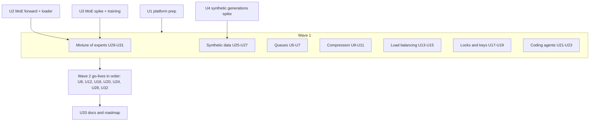
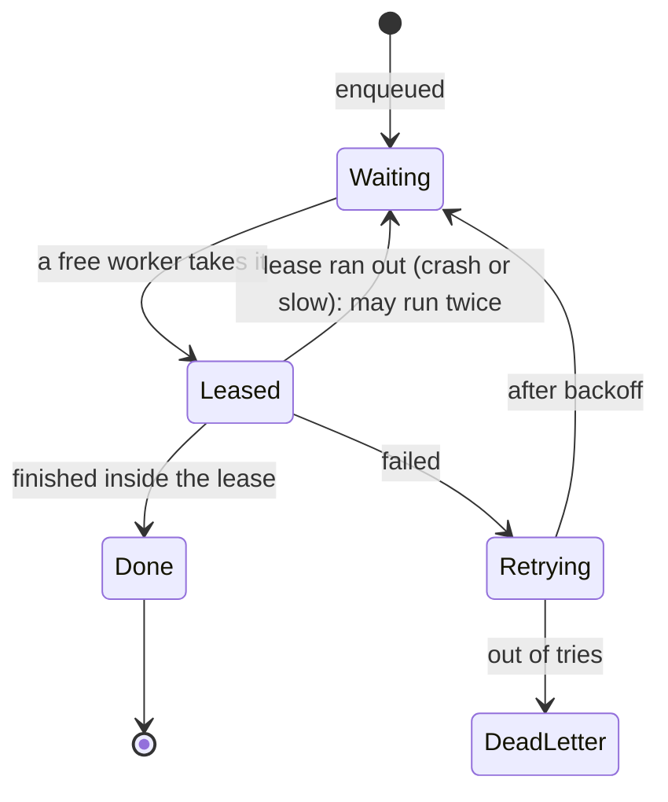
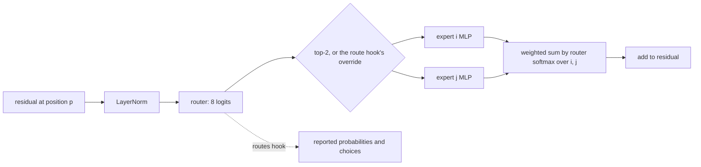
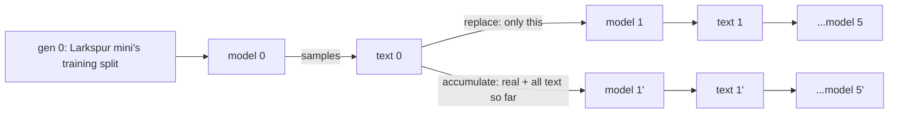

# The Last Seven Roadmap Modules - Plan

## Goal Capsule

- **Objective:** Take the seven planned roadmap cards live as modules 33–39 (KTD1):
  - 33 Queues and background jobs
  - 34 Compression
  - 35 Load balancing
  - 36 Locks and keys
  - 37 Coding agents
  - 38 Synthetic data
  - 39 Mixture of experts

  Each module adds a picture mechanic no earlier scene has (R14). Seven new planned cards replace them (R16). Every module continues the Larkspur Supply Co. story.
- **Product authority:**
  - Product Contract requirements (R-IDs) win on product behaviour. Key Technical Decisions (KTD-IDs) win on mechanism.
  - AGENTS.md stays in force unless a KTD here changes it on purpose.
  - Shape and process follow the previous plan, `docs/plans/2026-10-25-1206-feat-seven-roadmap-modules-plan.md`; where this plan is silent, that plan's patterns apply.
- **Open blockers:** None.
- **Execution profile:** brownfield work on the Astro + React islands site.
  - Run in waves (KTD13), but on **one local branch with one PR at the end**, as the user asked for the last build.
  - **Wave 0:** platform prep (U1), the MoE forward pass and loader (U2), the MoE training spike (U3) and the synthetic-data generations spike (U4).
  - **Wave 1:** the seven modules' engines, scenes and chapters, each inside its own folders.
  - **Wave 2:** the go-lives, in KTD1 order.
  - **Wave 3:** docs and roadmap (U33).
  - Every wave leaves `pnpm check`, `pnpm lint`, `pnpm test` and `pnpm test:e2e` green.
- **Stop conditions:**
  - Stop and ask if a chapter needs a backend, a live LLM, an API key, real network traffic or training in the browser (R3).
  - Stop and ask if the MoE model (U3) misses its bar within 150 KB of Float16 weights: no expert in any layer under 3% of held-out routes, held-out top-5 within 5 points of the base, and held-out top-5 at least the active-matched dense model's (chapter 6's lesson). The fallback is a larger load-balancing loss at the same shape, never a recorded route (KTD3).
  - Stop and ask if U4's generations fail to lose their tails: the rare-token share of generation 5's samples must fall below 60% of generation 0's under "replace", and stay above 80% under "accumulate"; under both arms generation 5's repeat rate stays under the pinned ceiling, so a pass is tail loss, not breakdown (KTD9). The fallback is a bigram model's generations, labelled as such, before chapters 5–6 are built.
  - Stop and ask if U2 changes any existing forward pass. The lm goldens, `lm-hooks.test.ts` and every sha256 pin must hold (R15).
  - Stop and ask if the hero headline, both buttons or the "Free · No sign-up" line leave the first screen at 1280×800 or 390×844 once the board holds 46 plots (KTD14).
  - Stop and ask if a source checked for a `facts.json` contradicts a chapter's lesson. The Appendix's "Moving facts" are re-checked on the access date.
  - Stop and ask if a new mechanic cannot be done with a keyboard, or has no reduced-motion form (R14).
  - Stop and ask if a Coding agents version file's source differs from the diff it is shown as (KTD8).
- **Tail ownership:** `ce-work` or the executor owns the branch, the PR and CI.

---

## Product Contract

### Summary

Tinker gains its last seven roadmap modules. Four are classic tech:
- how Larkspur's orders wait in a queue;
- how a file gets smaller;
- how traffic is spread over servers;
- how strangers share a secret.

Three are AI:
- an agent that edits code and runs the tests;
- training data written by a model;
- a model that wakes only a few of its experts for each word.

Each is drawn as a picture that does something new:
- a ticket rail whose workers the reader can knock over mid-job;
- piles the reader merges into a code tree;
- a latency board that fills as requests land;
- paint pots that mix into a shared colour;
- a code page whose changes the reader accepts or rejects;
- a photocopier whose copies of copies fade;
- a sorting office where the reader overrides the doorman.

Seven new roadmap cards keep the home board's building sites open.

### Problem Frame

These seven cards have been on the roadmap since the last plan. The earlier ideation turned five of them down, and each reason now has an answer:
- **Mixture of experts:** "a calculator, not something to play". It now has its own trained model.
- **Synthetic data:** "unproven that a 51k model shows tail loss". A spike with a stop bar now proves it first.
- **Compression:** "better as a chapter of Tokens".
- **Load balancing and queues:** "Inference already teaches queues".

Compression, load balancing and queues are module-sized once each one teaches what its neighbour doesn't (R17).

### Requirements

**Platform**

- R1. The seven modules go live as modules 33–39 in KTD1 order. Each has an intro, seven chapters, a recap, a recall bank with one pin, share images, a home card, a hero plot and an e2e spec.
- R2. Levels, tracks and prerequisites:

  | Module | Id | Level | Track | Prerequisites |
  |---|---|---|---|---|
  | Queues and background jobs | `queues` | Beginner | Classic tech | none |
  | Compression | `compression` | Beginner | Classic tech | none |
  | Load balancing | `load-balancing` | Intermediate | Classic tech | none |
  | Locks and keys | `encryption` | Beginner | Classic tech | none |
  | Coding agents | `coding-agents` | Intermediate | AI | `agents` |
  | Synthetic data | `synthetic-data` | Intermediate | AI | `fine-tuning` |
  | Mixture of experts | `mixture-of-experts` | Advanced | AI | `transformers` |

  The ids are the planned cards' ids, which `pnpm new-module` matches on once U1 fixes it (it misses multi-line `planned(` calls and inserts after the roadmap cards). "Locks and keys" keeps the id `encryption`.
- R3. There is no backend, no API key and no live LLM, and nothing trains in the browser. Nothing touches a real network, and no reader code runs. The MoE model and the synthetic-data generations are trained once offline in Python and committed, as Larkspur mini was.
- R4. Every module is picture-first from its first commit:
  - the copy budgets hold;
  - every instruction is in `act`;
  - callouts (`say`) name parts the scene exports;
  - sources open through `Cite`;
  - chapter terms are marked where they are first used.
- R5. Every fact comes from `data/<id>/facts.json`, with its source and access date. Moving facts (MoE model cards, coding-benchmark scores, key-size deprecation dates, compression format support) say whose figure it is and when (Appendix).
- R6. Every stand-in is labelled wherever it shows: hand-written orders and traffic, planning-number service times, recorded agent actions, toy key sizes and demo keys.
- R15. The 32 live modules and their saved progress do not change: no chapter id, step id, recording, golden, pinned output or share image changes. The exceptions are the KTD13 shared hotspots and mentions that newly link to a live module.

**Modules.** Chapters in order; chapter 7 is each module's workbench.

- R7. **Queues and background jobs.** A sale floods Larkspur with orders. The edge: "a queue keeps work safe while it waits, and any job may run twice".
  1. Waiting at the till: the work done inside the request.
  2. A ticket and a worker: the queue.
  3. When the line grows: arrivals against service, and more workers.
  4. Try again later: retries, backoff and jitter.
  5. Ran twice: a worker dies mid-job, its lease runs out, and the job is delivered again (at-least-once; idempotent jobs).
  6. The job that never works: the most tries, then the dead-letter shelf.
  7. Workbench: workers, retries and lease length for the sale day.
- R8. **Compression.** Larkspur's catalogue and pictures are too big to send. The edge: "compression replaces repeats, so repeated text shrinks and random bytes can't".
  1. Counting the bytes.
  2. Point back: repeats become pointers (LZ77).
  3. Short codes for common letters (Huffman).
  4. Both at once: the DEFLATE shape, and real gzip beside ours.
  5. Already squeezed: random and compressed files won't shrink (the pigeonhole).
  6. Throwing some away: lossy pictures.
  7. Workbench: a setting per site file against a size and quality budget.
- R9. **Load balancing.** Larkspur's shop now runs on several servers. The edge: "a balancer only knows what it measures: a health check passes a slow server that still answers, and only rules that count waiting requests steer around it". Each rule's per-server share is pinned.
  1. One server's ceiling.
  2. Take turns (round robin).
  3. The least busy, and the power of two choices.
  4. Is it alive? Health checks, and the server that is slow but answers.
  5. Same customer, same server: sticky sessions, and the cart lost when one dies.
  6. The slow tail: p99, one slow server, and hedged retries.
  7. Workbench: route the sale.
- R10. **Locks and keys.** Larkspur orders from a new supplier it has never met. The edge: "anyone can close your padlock, only your key opens it, and a signature runs the other way".
  1. A shared secret, and how to get the key there.
  2. Mixing paint (Diffie–Hellman).
  3. The open padlock: public-key encryption.
  4. Sealed with your key: signatures, and tampering caught.
  5. A fingerprint: hashes (Git's crates, revisited).
  6. Who owns this padlock? Certificates and the chain (Opening a web page's envelope, revisited).
  7. Workbench: lock, sign or both, per supplier message, against a set of attackers.
- R11. **Coding agents.** A ticket says the bulk discount is wrong. The edge: "the agent is only as right as the tests it runs, so 'done' means what the tests check".
  1. Read, edit, run: the loop.
  2. Finding the file: search, and the reading budget.
  3. A patch, not a rewrite: the diff, hunk by hunk.
  4. Red to green: the tests run.
  5. Green by cheating: it weakens a test, and the host protects test files.
  6. What it may run: allowed, ask first, never.
  7. Workbench: rules for a queue of tickets.
- R12. **Synthetic data.** Larkspur's support set has too few examples of rare requests. The edge: "a model can only teach what it knows, and each copy of a copy loses the rare parts".
  1. Too few examples: rare requests, counted.
  2. Ask the model to write: temperature and repeats.
  3. The sieve: dedupe and a fact filter.
  4. The teacher's mistakes are copied.
  5. Copies of copies: each generation trained on the last one's text.
  6. Keep the real data: replace versus accumulate.
  7. Workbench: a data recipe.
- R13. **Mixture of experts.** A vendor's model card says "47B total, 13B active", and Larkspur wants to know what that means. The edge: "the model holds many experts but pays for a few per word, and a router picks them".
  1. One big kitchen: in a dense model every weight works on every word.
  2. Rooms and a doorman: experts and the router (top-2).
  3. What the experts learned: measured specialisation (by kind of token, not by topic).
  4. Send it elsewhere: the reader overrides the router and watches the guess change.
  5. The busy room: load balance, capacity and dropped tokens.
  6. Total versus active: memory against compute.
  7. Workbench: pick a model shape for Larkspur's server.

**Pictures and story**

- R14. Each module's scene adds at least one mechanic no earlier scene has (KTD15). It keeps the house rules: Colorfigures style, label pills, one figure per stage, a precise tab, `say` callouts, escaped text, reduced motion and phones. The mechanic is never the only way to act: each has a keyboard path and a reduced-motion form.
- R16. Seven new planned cards follow the live modules (KTD16).
- R17. Each module teaches what its live neighbour doesn't, and links to it where they meet:
  - **Queues:** durability and delivery. Inference teaches GPU batching.
  - **Load balancing:** routing and tails. Inference teaches throughput per server.
  - **Compression:** lossless coding and loss. Tokens teaches BPE as a vocabulary.
  - **Locks and keys:** the cryptography. Opening a web page teaches its round-trip cost.
  - **Coding agents:** tests as the judge. Post-training teaches reward hacking during training.
  - **Synthetic data:** a model writing its own training data. Pre-training teaches data mixes.
- R18. Every name shown (customers, suppliers, products, people) is read from data. Locks and keys uses toy numbers for the maths and fixed, labelled demo keys for the real algorithms, never a real key, and says once "never build your own". No module names a vendor as the place to do the thing; model cards and benchmarks are cited as dated facts.

### Scope Boundaries

- Earlier modules' pictures, share images and saved progress stay as they are.
- No retrain of Larkspur mini, its fine-tunes, its student, its checkpoints or the masked model. The MoE model is a new file beside them.
- Maths stays optional, in fold-away "the maths" notes: Little's law, entropy, the Huffman bound, percentiles, modular exponentiation and the router's softmax.
- **Queues:** no message-broker product guide.
- **Compression:** no codec internals beyond the LZ77 + Huffman shape. Lossy is shown on a pixel grid, with JPEG named in a fold-away.
- **Load balancing:** no autoscaling and no DNS-level balancing beyond one fact.
- **Locks and keys:** no implementation advice and no post-quantum maths; one dated fact names the migration.
- **Coding agents:** no real repository and no code execution. The code is Larkspur's own fixture, and each version the agent can write is a real module run by real tests (KTD8).
- **Synthetic data:** no claim that the toy's collapse matches a large model's. The copy says it is Larkspur's toy and cites the large-model finding separately.
- **Mixture of experts:** no claim the toy's experts behave like a production model's. Specialisation is what this toy measured.

### Deferred to Follow-Up Work

- Building any of the seven new planned cards.
- Splitting the home catalogue into AI and classic sections.
- Refreshing earlier modules' pictures with the new mechanics.

### Success Criteria

- After each module a reader can say its edge in plain words, as R7–R13 phrase it.
- `pnpm test` fails when:
  - a pinned output drifts (a compressed size, a percentile, a toy key, a route, a generation's tail share, a recorded action);
  - a workbench's `WINNERS` drifts from its pin;
  - a new payload passes its budget.
- At 1280px and 390px, the catalogue shows 39 live modules under their levels and seven roadmap cards. The hero wave shows one live pill at a time, and the first screen holds.

### Key Decisions

- All seven remaining planned cards go live in one plan, as last time. Governs R1, R2.
- Mixture of experts runs a tiny MoE trained offline (session-settled: user-directed — chosen over slicing Larkspur mini's MLP or recorded routes: the experts and routes are real and run live). Governs R3, R13.
- Synthetic data generates live and measures collapse over offline-trained generations (session-settled: user-directed — chosen over live generation with stand-in training effects: the collapse is measured, not asserted). Governs R3, R12.
- Seven new planned cards replace these seven (session-settled: user-directed — chosen over an empty roadmap: the home board keeps its "build one" plots). Governs R16.

---

## Planning Contract

### Key Technical Decisions

- KTD1. **Module numbers follow merge order:**
  - 33 Queues
  - 34 Compression
  - 35 Load balancing
  - 36 Locks and keys
  - 37 Coding agents
  - 38 Synthetic data
  - 39 Mixture of experts

  The cheap classic simulators come first. The two trained AI modules land last, behind their spikes (U3, U4).
- KTD2. **What runs live and what is computed offline:**

  | Module | Live in the browser | Computed offline and committed |
  |---|---|---|
  | Queues | the queue simulator, seeded crashes and failures | a hand-written sale day of orders; service times (labelled) |
  | Compression | our LZ77, Huffman and the DEFLATE-shaped pair; real gzip via `CompressionStream`; pixel quantisation | the site files (text from the corpus, seeded random bytes, a small picture) |
  | Load balancing | a per-request simulator, the balancing rules, percentiles | hand-written traffic; server speeds (labelled) |
  | Locks and keys | toy DH and RSA in `BigInt`; SHA-256; real AES-GCM and ECDSA verify via Web Crypto with demo keys | demo key pairs and their signatures |
  | Coding agents | the agent loop's host stages, real tests over real code versions, the diff | recorded agent turns keyed by what it saw |
  | Synthetic data | Larkspur mini sampling; dedupe; the fact filter; counts | generation runs: curves, tail shares, samples as ids |
  | Mixture of experts | the MoE forward pass, routes, router overrides, load per expert | the MoE weights, goldens and an active-matched dense model's scores |

- KTD3. **The MoE model is trained once in Python, like the masked model.**
  - `scripts/train/train_moe.py` is standalone: seeded, CPU, one thread, byte-identical on rerun. It imports `train.py`'s `CFG`, `Block`, `Mini` and `f16_blob`, as `train_mlm.py` does.
  - **Shape:** Larkspur mini with each MLP replaced by **8 experts of d_mlp 32, top-2**:
    - the router is a linear layer to 8 logits, softmax over the chosen two;
    - training adds Switch's load-balancing loss, and runs on the same training split and vocabulary (768);
    - about 68k parameters in total and about 43k active per token, about 136 KB in Float16.
  - **Outputs:**
    - `public/data/mixture-of-experts/moe.bin` (≤ 150 KB);
    - `meta.json`: layout, loss curve, held-out scores, per-expert route shares, each expert's top tokens, goldens;
    - the held-out scores of an **active-matched dense model** (dense MLP d_mlp 64), trained and scored but not shipped.
  - It never starts from `model.bin`, so a base retrain does not require rerunning it. Every existing weight file's sha256 stays pinned.
- KTD4. **Experts are a model shape in `forward()`, plus two hooks** (U2).
  - When the model's config has `experts`, each block's MLP becomes router → top-k → weighted sum of expert MLPs. Without `experts`, the pass runs exactly the code it runs today.
  - Two new hooks, read once per layer like the others:
    - `routes` reports each position's router probabilities and chosen experts;
    - `route` forces a position's experts in a layer.
  - `load.ts` gains a `'moe'` weights kind reading `public/data/mixture-of-experts/`.
  - Capacity and dropped tokens (chapter 5) are decided over the reported routes. The `route` hook accepts an empty expert list, which skips that position's MLP, so a dropped token's changed guess is real.
- KTD5. **Queues is a tick simulator in Consistency's shape** (`policyOf`, `simulate`, `runOf`, counted outcomes) over `data/queues/day.json`.
  - A job is enqueued, then leased by a free worker for its service time. A lease that runs out (worker crash, or a job slower than the lease) makes the job visible again. That is at-least-once delivery, counted as `ranTwice`.
  - Failures are seeded per job (web-requests' `lostOn` pattern). Retries wait base × 2^attempt, with optional seeded jitter. Every delivery (each lease taken) counts as a try, as a queue's receive count does. After the most tries, a job goes to the dead-letter shelf.
  - An idempotent job marks its order done, so a second run changes nothing. This is the same idea as Payments' idempotency key, and the chapter links to it.
  - Every rate is in `data/queues/assumptions.json` (the `note` / `words` pattern).
  - The reader's crash (KTD15) is an event inserted into the seeded run, so the replay stays deterministic.
- KTD6. **Compression runs our own lossless coders and checks them against the real thing.**
  - `src/lib/compression/` has LZ77 (fixed window, greedy longest match), Huffman (ties broken by symbol, so trees are deterministic) and their pair. A round-trip test proves every site file decodes byte-exact.
  - Our sizes are pinned. The real gzip size comes from `CompressionStream('gzip')` (browsers and Node 22). It is shown as "real gzip, measured here", and tested within a tolerance, never pinned exactly (zlib builds differ).
  - Chapter 5's random file is seeded bytes. Chapter 6's lossy pictures quantise colours and block size on a small pixel picture, scored by a pixel-difference measure. The copy says JPEG works on the same idea in a cleverer way.
  - Entropy (bits per byte) is computed live, in a fold-away.
  - Tokens' BPE is cited in chapter 3, as "a vocabulary built the same way", not reused.
- KTD7. **Load balancing is a per-request event simulator** (`src/lib/load-balancing/sim.ts`).
  - Requests arrive from seeded traffic in `data/load-balancing/traffic.json`. Each server serves one request at a time per slot, with its own speed. One server can be slow, dead or "slow but answering" (gray failure).
  - The rules: round robin, least outstanding, power of two choices, and weighted. Health checks probe on an interval and pull a server after N misses. Sticky sessions pin a customer's cart. Hedged retries fire after a set wait.
  - Percentiles are a module-local helper (nearest-rank), with a test. The latency board is a pure layout over the run.
  - Service times and check intervals are in `assumptions.json`, labelled.
- KTD8. **Coding agents runs real tests over real code; only the agent's choices are recorded.**
  - **Code:** Larkspur's fixture repository is `data/coding-agents/repo/` (a few small TypeScript files: pricing, discounts, their tests). Every version the agent can produce lives in `src/lib/coding-agents/versions/` as a real module.
  - **Proof:** a test applies each recorded patch to the base text (the diff from `src/lib/git/merge.ts`). It fails unless the result equals the version file's source (`?raw`). What the reader sees is what runs.
  - **Tests:** plain TS functions over a version's exports, run live. Pass and fail are computed, never recorded.
  - **Hunk review:** at most three hunks per patch, so every accepted subset is a version with its own file. The coverage test walks every subset.
  - **Independent hunks:** no hunk declares, imports or removes anything another hunk relies on, so every subset type-checks and lints.
  - **Loop:** forks Computer use's fork of Sandboxing's loop (`loop.ts`, `turns.ts`). The signature is `case|hist|rules`; the host-only stages (protected test files, the run allow-list, ask-first) stay out of it. There is one merged recording, `DOMAINS` per chapter and the coverage test, all as Computer use has them.
  - **Search:** chapter 2's search runs live over the repo's files. Its read cost uses `BYTES_PER_TOKEN`.
- KTD9. **Synthetic data measures collapse over offline generations; nothing ships but scores and samples.**
  - **Live:** `sample()` from `src/lib/transformers/sample.ts` writes support replies from Larkspur mini at a chosen temperature (seeded).
    - Dedupe is exact plus 4-gram overlap.
    - The fact filter checks for a product name's id sequence, read from `ids.json` `syntheticData`.
    - Grading uses Evals' `keyFactOf`.
  - **Offline:** `scripts/train/train_synth.py` trains generation n+1 from scratch on generation n's samples, five generations.
    - It runs two arms: **replace** (generated text only) and **accumulate** (real plus every generation).
    - It also runs the workbench grid (KTD12): temperature {0.7, 1.0, 1.3} × sieve {off, dedupe, dedupe + facts} × real share {0, 50%}, 18 runs.
    - In the grid, real share 0 is the replace arm and 50% is a fixed real-plus-generated mix; the arms above are the chapter 5–6 runs.
    - Results go to `data/synthetic-data/runs.json`: per run, held-out loss on real text, the rare-token share and repeat rate of samples, a **rare-request score** (`keyFactOf` pass rate over a pinned held-out set of rare support prompts), and greedy samples as ids. No generation weights ship.
    - The workbench's `WINNERS` trade the rare-request score against held-out loss.
  - **The tail measure:** the share of sampled tokens drawn from the corpus's rarest half of tokens, by training-split count.
  - **Gate:** U4 proves the stop bar before chapters 5–7 are built.
  - **Large-model findings** (Shumailov 2024; Gerstgrasser 2024) are cited as separate, labelled facts.
- KTD10. **Locks and keys shows toy maths, then the real algorithm doing the same job.**
  - **Toy maths:** Diffie–Hellman and RSA in `BigInt` with small primes from `data/encryption/toy.json`. Every number is shown and pinned, and labelled "toy size".
  - **Real algorithms:** run in Web Crypto with fixed demo keys (`data/encryption/demo-keys.json`, labelled demo, never used elsewhere):
    - AES-GCM uses a fixed demo IV, labelled "never reuse an IV", so the ciphertext is pinned;
    - an ECDSA P-256 signature is pinned as committed and verified live, with any one-byte change shown failing.
  - **SHA-256** is pure and synchronous, like Git's SHA-1. A test checks it against `crypto.subtle`.
  - **Chapter 6's certificate chain** is drawn from fixture certificates (names from data, `.example` domains). The checks are computed: the issuer's signature verifies, the name matches, and the date is in range.
  - **Real key sizes** and the post-quantum migration are dated facts.
- KTD11. **The MoE workbench chooses among dated model cards.** The cards are published total and active parameter counts and expert shapes, from `facts.json`, against Larkspur's memory and per-token-compute budget (planning numbers). The toy's own measured numbers sit beside them as "Larkspur's toy". Inference's `memory()` gives the byte maths.
- KTD12. **Pinned outputs and `WINNERS`.**
  - Every effect a chapter teaches is pinned in `data/<id>/pinned.json` and rerun by a unit test.
  - Every workbench pins its `WINNERS` and recomputes them in a test, never solving at import.
  - The Synthetic data workbench's grid is finite and offline, so its `WINNERS` are read from `runs.json` and recomputed from it.
- KTD13. **Waves and shared hotspots** follow the last plan's KTD13, on one branch.
  - **Module work** touches only the module's own paths:
    - `src/lib/<id>/`, `src/content/<id>/`, `src/pages/<id>/` and `data/<id>/`;
    - its scene files and `src/dev/<id>.astro`;
    - its tests.
  - **Shared hotspots** change only in a go-live unit:
    - `src/lib/modules.ts` and `tests/unit/modules.test.ts`;
    - `src/pages/index.astro` (`CARD`) and `heroScene.ts` (`DRAW`);
    - `src/dev/og.astro` and `tests/e2e/catalogue.spec.ts`;
    - `README.md`, `AGENTS.md` and `public/og/home.jpg`;
    - `flat.ts`'s `Stamp` union.
  - Module work scaffolds by hand from `templates/module/`. Only the go-live runs the planned-line swap.
- KTD14. **The hero board grows to six slots per front row.**
  - 39 live and 7 planned make 46 plots. RAG and tool calling have fixed plots, so the grid needs 44 slots. At five per row the board passes the depth test only up to 38 slots.
  - The fix is a sixth column (`COLS` gains 502) and a fourth slot beside RAG. That keeps the depth near today's and widens the board by about 16%.
  - U1 makes these changes:
    - the `lift` rule for the new column;
    - the depth test set to 44 slots;
    - the overlap test;
    - the pill test's live ceiling, 32 → 39;
    - `FUTURE` extended with KTD16's cards.
  - U1 also checks by eye that the topmost pill clears the note at 390px.
- KTD15. **New mechanics live in the module's kit, with a keyboard path and a reduced-motion form.** Every control is a real element beside or over the stage, never in the drawing.

  | Mechanic | Control (keyboard, touch, pointer) | Reduced motion |
  |---|---|---|
  | Queues: knock a worker over mid-job | Play, Pause and Step controls; focusable worker buttons over the rail, Enter to crash at the current tick, arrow keys between workers; only busy workers can be picked, and with none busy the buttons are disabled with a text reason. Chapter 5 starts with jobs in flight, and Show me crashes one | the worker shows fallen; its ticket returns without the slide |
  | Compression: merge piles into a code tree | the piles as a listbox; pick two, then "Merge". Any two piles of the lowest weights are accepted, ties included; a wrong pick says why (Huffman's rule) | the tree redraws without the join animation |
  | Load balancing: a latency board that fills | beside the stage: a rule radio group, a per-server state control (fine, slow, dead, slow-but-answering), a health-check miss count, a sticky switch and a hedge wait. Each run starts with a predict-then-reveal pick, then the board fills and a p99 marker moves; Replay reruns it. The read-out gives the percentiles as text | the board shows its final state |
  | Locks and keys: mixing paint | one native radio group for the reader's secret colour; the mix is computed | the mixed pots show without pouring |
  | Coding agents: accept or reject hunks | a checkbox per hunk in the code panel, then "Run tests" | no motion needed |
  | Synthetic data: flip through copies | a native range input over generations 0–5, and a two-option radio (replace, accumulate) that is chapter 6's prediction; the copier stack and a text read-out of the tail share mirror both | the stack shows the chosen copy without the flip |
  | Mixture of experts: override the doorman | for the selected token, eight checkboxes in one fieldset, at most two checked (a third pick unchecks the oldest, announced in one line); the override applies to every layer for that token; "Use router" clears it. The guess reruns live. On phones only the selected token's override shows, picked from a token strip, targets ≥ 44 px in a 4×2 grid | rooms light without the walk |

  Each scene caps what it draws:
  - Queues: at most 12 tickets, with a count pill for the backlog.
  - Load balancing: at most 6 servers.
  - Compression: the merge puzzle's text uses at most 8 symbols, with no "others" pile. Larger files show a read-only tree whose eighth pile is "others".
  - Mixture of experts: the prompt's last 8 tokens.

  Nothing is promoted to a shared component unless two modules use it.
- KTD16. **The new planned cards**, three AI and four classic:
  - **What a model remembers** (AI, Intermediate): memorisation, extraction and private data.
  - **Video and world models** (AI, Advanced): the "other ways to generate" axis.
  - **Recommendations** (AI, Intermediate): why the shop shows you this drill.
  - **Logins and passwords** (Classic, Beginner): hashing, salts, sessions and sign-in with another site.
  - **How email arrives** (Classic, Beginner): mail servers, SPF and DKIM, and spam.
  - **Dependencies** (Classic, Intermediate): package managers, versions and the lockfile.
  - **Shipping a release** (Classic, Intermediate): CI, canaries, feature flags and rollback.

  Each card gets a one-line description in the house register. They can be swapped before U1 is committed.

### High-Level Technical Design

Waves and dependencies:



A job's life (KTD5):



One block of the MoE forward pass (KTD4):



Synthetic-data generations (KTD9):



### Assumptions

- A 68k-parameter MoE trained like Larkspur mini routes without dead experts once it has a load-balancing loss. U3 proves it or stops.
- A 51k model trained from scratch on its predecessor's samples loses rare tokens within five generations under "replace". U4 proves it or falls back (stop condition).
- `CompressionStream` and `crypto.subtle` (AES-GCM, ECDSA P-256, SHA-256) exist in every supported browser and in Node 22, where Vitest runs.
- At most three hunks per patch keeps Coding agents' version files few: about 8 per patch, about 40 in all.
- Seven new e2e specs fit in eight shards. U1 measures them and raises the count if any shard runs past 12 minutes.

### System-Wide Impact

- **Language-model kit:** `forward()` gains an experts path and the `routes` / `route` hooks, and `load.ts` gains `'moe'`. Every existing caller keeps its output, guarded by the goldens and sha256 pins.
- **Training scripts:** `train_moe.py` and `train_synth.py` are standalone and never start from `model.bin`. `docs/lm-kit.md`'s retrain recipe says so. `pnpm encode:lm` gains a `syntheticData` key in `ids.json`; existing keys don't change.
- **Home page and registry:**
  - The seven new planned lines arrive in U1.
  - Each go-live swaps its own line.
  - The finder's counts and status options read the registry.
- **Saved progress:** seven new `<id>-progress-v1` keys. No existing key changes.
- **Share images and CI:** about 63 new share images, and e2e about 22% longer.
- **Payload:** `moe.bin` is at most 150 KB, fetched only by Mixture of experts pages. `runs.json` stays under 200 KB (samples as ids, a test checks the size).
- **Cross-links (R17):**
  - Inference → Queues and Load balancing;
  - Tokens and Multimodal → Compression;
  - Web requests and Git → Locks and keys;
  - Payments → Queues;
  - Post-training and Sandboxing → Coding agents;
  - Pre-training → Synthetic data;
  - Transformers and Inference → Mixture of experts.

  Only the link text changes, never a step id.

### Risks

| Risk | Mitigation |
|---|---|
| The MoE collapses onto a few experts | Load-balancing loss; U3's bar and stop condition; a larger balancing-loss retry (KTD3) |
| The toy's experts show no readable specialisation | Chapter 3 reports what was measured; Mixtral's finding (routing by token kind, not topic) is the cited frame, so either outcome teaches |
| Synthetic generations show memorisation, not tail loss | U4 measures the tail share in both arms before chapters 5–7 exist; bigram fallback (KTD9) |
| Coding agents' shown diff and the code that runs drift | The patch-equals-version-file test (KTD8) |
| Locks and keys reads as crypto advice | Toy sizes labelled; "never build your own" once; demo keys labelled; no library named (R18) |
| Real gzip sizes differ between browsers and Node | Ours pinned; real gzip shown as measured with a tolerance test (KTD6) |
| The hero board passes the first screen | Six per row; depth test; stop condition (KTD14) |
| Overlap with Inference and Tokens | R17 splits; each chapter names its neighbour in one line |
| Model cards and benchmark scores move | Dated, with whose figure (Appendix) |

---

## Output Structure

Per module (Coding agents shown; every module has this shape):

```text
src/lib/coding-agents/          loop.ts, turns.ts, tests.ts, workbench.ts, versions/
src/content/coding-agents/      module.ts, recall.ts, kit.tsx, 01-…07-*.tsx
src/pages/coding-agents/        index.astro, [chapter].astro, recap.astro
src/components/scenes/          deskScene.ts (name per scene), codePanel.ts
src/dev/coding-agents.astro
data/coding-agents/             facts.json, repo/, turns/, pinned.json
tests/unit/coding-agents-*.test.ts
tests/e2e/coding-agents.spec.ts, coding-agents-flow.ts
```

New shared files:
- `scripts/train/train_moe.py` and `scripts/train/train_synth.py`;
- `public/data/mixture-of-experts/moe.bin` and `public/data/mixture-of-experts/meta.json`;
- `data/synthetic-data/runs.json`.

---

## Implementation Units

| U-ID | Title | Key files | Depends on |
|---|---|---|---|
| U1 | Platform prep for thirty-nine | `modules.ts`, `heroScene.ts`, hero/modules/catalogue tests, `checks.yml` | — |
| U2 | Experts path, hooks and moe loader | `src/lib/lm/model.ts`, `src/lib/lm/load.ts` | — |
| U3 | MoE spike and training | `scripts/train/train_moe.py`, `public/data/mixture-of-experts/` | U2 |
| U4 | Synthetic generations spike | `scripts/train/train_synth.py`, `data/synthetic-data/runs.json` | — |
| U5 | Queues simulator and facts | `src/lib/queues/`, `data/queues/` | U1 |
| U6 | Ticket rail and kit | `railScene.ts`, `kit.tsx` | U5 |
| U7 | Queues chapters | `src/content/queues/`, `src/pages/queues/` | U6 |
| U8 | Queues go-live | hotspots | U7 |
| U9 | Compression coders and facts | `src/lib/compression/`, `data/compression/` | U1 |
| U10 | Sorting table and kit | `pileScene.ts`, `kit.tsx` | U9 |
| U11 | Compression chapters | `src/content/compression/` | U10 |
| U12 | Compression go-live | hotspots | U8, U11 |
| U13 | Load-balancing simulator and facts | `src/lib/load-balancing/`, `data/load-balancing/` | U1 |
| U14 | Switchyard and latency board | `yardScene.ts`, `latencyBoard.ts`, `kit.tsx` | U13 |
| U15 | Load balancing chapters | `src/content/load-balancing/` | U14 |
| U16 | Load balancing go-live | hotspots | U12, U15 |
| U17 | Locks and keys engine and facts | `src/lib/encryption/`, `data/encryption/` | U1 |
| U18 | Paint shop and kit | `paintScene.ts`, `kit.tsx` | U17 |
| U19 | Locks and keys chapters | `src/content/encryption/` | U18 |
| U20 | Locks and keys go-live | hotspots | U16, U19 |
| U21 | Coding agents engine, repo and recordings | `src/lib/coding-agents/`, `data/coding-agents/` | U1 |
| U22 | Agent's desk and code panel | `deskScene.ts`, `codePanel.ts`, `kit.tsx` | U21 |
| U23 | Coding agents chapters | `src/content/coding-agents/` | U22 |
| U24 | Coding agents go-live | hotspots | U20, U23 |
| U25 | Synthetic data engine and facts | `src/lib/synthetic-data/`, `data/synthetic-data/` | U1, U4 |
| U26 | Copier room and kit | `copierScene.ts`, `kit.tsx` | U25 |
| U27 | Synthetic data chapters | `src/content/synthetic-data/` | U26 |
| U28 | Synthetic data go-live | hotspots | U24, U27 |
| U29 | MoE engine and facts | `src/lib/mixture-of-experts/`, `data/mixture-of-experts/` | U1, U2, U3 |
| U30 | Sorting office and kit | `officeRoomsScene.ts`, `kit.tsx` | U29 |
| U31 | Mixture of experts chapters | `src/content/mixture-of-experts/` | U30 |
| U32 | Mixture of experts go-live | hotspots | U28, U31 |
| U33 | Docs and roadmap | `AGENTS.md`, `README.md`, `docs/modules/*.md`, `docs/lm-kit.md` | U32 |

**Patterns every module follows** (the last plan's, unchanged):
- **Engine units:**
  - copy the nearest engine named in the unit;
  - add a dev page `src/dev/<id>.astro`;
  - write `facts.json` with source and access date, verifying the Appendix items they use;
  - write `pinned.json` (KTD12).
- **Scene and kit units:**
  - copy the nearest scene and `kit.tsx`;
  - export `PARTS`, the hero plot (`*Plot`), the reader (`*At`) and the card picture;
  - build the R14 mechanic with KTD15's keyboard and reduced-motion forms;
  - fit the home card frame and keep pills clear of tall props.
- **Chapter units:**
  - scaffold by hand from `templates/module/` and follow `docs/writing-a-module.md`;
  - add an `intro` per chapter, and recall items with one pin;
  - write `tests/e2e/<id>.spec.ts` with a `<id>-flow.ts` helper.
- **E2E standard:** every chapter is played by mouse and by keyboard only, with axe, reduced motion and 390px checks.
- **One workbench pattern for every chapter 7:**
  - one native control per policy dimension;
  - a result table, one row per case;
  - a live total against the best;
  - "Show me" shows one of `WINNERS`, labelled "one of N that work".
- **Go-live units** follow the recipe in U8. The others cite it.

### U1. Platform prep for thirty-nine

- **Goal:** The home page, registry tests and CI hold 39 live modules and seven new planned cards.
- **Requirements:** R16, R15; KTD13, KTD14, KTD16.
- **Dependencies:** none.
- **Files:** `src/lib/modules.ts`, `src/components/scenes/heroScene.ts`, `tests/unit/hero.test.ts`, `tests/unit/modules.test.ts`, `tests/e2e/catalogue.spec.ts`, `.github/workflows/checks.yml`, `public/og/home.jpg`, `scripts/new-module.mjs`, `tests/unit/new-module.test.ts`, `tests/unit/step-ids.test.ts`.
- **Approach:**
  1. Append KTD16's seven `planned()` lines after `load-balancing`, with house-register descriptions.
  2. Fix `scripts/new-module.mjs`: match a multi-line `planned(` call, and insert the live constant after the last live entry, with a unit test over today's `modules.ts`.
  3. Add the sixth column and the fourth front slot beside RAG (KTD14). Update `lift`.
  4. Hero tests:
     - the depth test runs at 44 slots;
     - the overlap test runs to the registry count;
     - the pill loop's ceiling rises to 39;
     - `FUTURE` gains the seven new ids.
  5. Add `tests/unit/step-ids.test.ts`: it pins every live module's chapter ids and ordered step ids, so later go-lives can only append (R15).
  6. Measure the e2e shard times with the new specs stubbed, and raise the shard count only if a shard passes 12 minutes.
  7. Regenerate `home.jpg`.
- **Patterns to follow:** the last plan's U1 (five-column change, commit 9e246f5).
- **Test scenarios:**
  - `heroBoard(44)`'s depth is at most 624 (1.2 × 520).
  - No two pills overlap for every board size from 9 to 44 slots (46 plots).
  - With 39 live modules, the planned cards are `FUTURE.slice(-7)` in order.
  - `new-module` run against today's `modules.ts` for `queues` removes its multi-line card and inserts `QUEUES_MODULE` after `DIFFUSION_LLMS_MODULE`, before any roadmap card.
  - Changing or removing any pinned step id fails `step-ids.test.ts`; appending a new module does not.
  - The catalogue e2e counts "32 live · 14 planned" before any go-live.
  - At 390×844 and 1280×800, the headline, both buttons and the note are in the first screen.
- **Verification:** Home shows 14 roadmap cards and a 46-plot board within the first-screen rule; every check is green.

### U2. Experts path, hooks and moe loader

- **Goal:** `forward()` runs a mixture-of-experts model and reports and overrides routes, with every existing pass unchanged.
- **Requirements:** R3, R15; KTD4.
- **Dependencies:** none. U3 supplies real weights; tests use a tiny random fixture first.
- **Files:** `src/lib/lm/model.ts`, `src/lib/lm/load.ts`, `tests/unit/lm-hooks.test.ts`, `tests/unit/lm-moe.test.ts`, `tests/fixtures/lm/moe-fixture.json`.
- **Approach:**
  - The config's `experts` and `top_k` switch the MLP path per block; the router weights are `mlp.router.weight` and the experts `mlp.experts.<e>.fc/proj`.
  - The `routes` and `route` hooks are read once per layer.
  - Add `'moe'` to `Weights`; the loader reads `mixture-of-experts/`.
- **Execution note:** Write the fixture test first: a hand-built 2-expert model whose output is computed by hand.
- **Patterns to follow:** the `bidirectional` hook and the `'mlm'` loader branch.
- **Test scenarios:**
  - With no hooks, the base model's logits match the goldens to within 1e-4, and every sha256 pin holds.
  - With the fixture and top-1, the output equals the chosen expert's MLP output exactly.
  - The `routes` hook reports two experts per position, whose softmax weights sum to 1.
  - The `route` hook forcing experts {0, 1} on one position changes only that position's output and later positions.
  - The `route` hook with an expert index out of range throws a clear error.
  - The `route` hook with an empty list leaves that position's MLP output at zero (the residual passes through).
  - Loading `'moe'` with a missing file rejects into the retry path.
- **Verification:** The hooks and goldens tests pass unchanged; the new MoE tests pass on the fixture.

### U3. MoE spike and training

- **Goal:** A committed MoE model that meets its bar, or a stop.
- **Requirements:** R3, R13; KTD3.
- **Dependencies:** U2 (to check the goldens in TS).
- **Files:** `scripts/train/train_moe.py`, `scripts/train/README.md`, `public/data/mixture-of-experts/moe.bin`, `public/data/mixture-of-experts/meta.json`, `tests/unit/mixture-of-experts-model.test.ts`.
- **Approach:**
  1. Train per KTD3.
  2. Write only if every expert's held-out route share is ≥ 3% in each layer, held-out top-5 is within 5 points of the base, and held-out top-5 is at least the active-matched dense model's. Otherwise retry once with a larger load-balancing loss at the same shape, then stop.
  3. Record per-expert top tokens (as `neurons.json` does) and the active-matched dense model's held-out scores.
  4. Compute goldens in float64 from the Float16-rounded weights.
- **Execution note:** Spike first; no chapter work starts until this commits.
- **Patterns to follow:** `scripts/train/train_mlm.py`, `tests/unit/diffusion-llms-model.test.ts`.
- **Test scenarios:**
  - `moe.bin` is at most 150,000 bytes and matches its `meta.json` layout.
  - The TS forward pass matches the goldens (max |Δlogit| < 1e-4, same top-5) for five prompts.
  - The routes the TS reports on the golden prompts match `meta.json`'s.
  - The base, fine-tune, student, checkpoint and mlm sha256 pins are unchanged.
- **Verification:** A rerun is byte-identical, and the bar in `meta.json` holds.

### U4. Synthetic generations spike

- **Goal:** Measured generation runs that show the tails fading under "replace" and holding under "accumulate", or a stop.
- **Requirements:** R3, R12; KTD9.
- **Dependencies:** none.
- **Files:** `scripts/train/train_synth.py`, `scripts/encode-for-training.mjs`, `data/lm/ids.json` (new `syntheticData` key only), `data/synthetic-data/runs.json`, `tests/unit/synthetic-data-runs.test.ts`.
- **Approach:**
  1. `pnpm encode:lm` adds product-name id sequences and the support prompts under `syntheticData`.
  2. Train five generations per arm from scratch, seeded. Each generation samples a corpus the size of the training split (same document count and lengths, each prompted by a document's opening tokens) at temperature 1 and top-p 1; only the workbench grid varies temperature. Sampling matches `sample()`.
  3. Run the 18-run workbench grid.
  4. Write `runs.json` only if the stop bars hold. Otherwise rerun with the bigram fallback, labelled.
- **Execution note:** Spike the two arms before the grid; the grid only runs once the arms pass.
- **Patterns to follow:** `train.py --variants` and `runs.json` in `data/pre-training/`.
- **Test scenarios:**
  - Under "replace", generation 5's rare-token share is below 0.6 × generation 0's. Under "accumulate", it is above 0.8 ×.
  - Every grid run has a held-out loss, a tail share and samples that decode with the site's BPE.
  - `runs.json` is under 200 KB.
  - `ids.json`'s existing keys are byte-identical to before (sha256 per key).
- **Verification:** A rerun is byte-identical, and the bars hold in `runs.json`.

### U5. Queues simulator and facts

- **Goal:** A seeded queue simulator over a sale day, with counted outcomes.
- **Requirements:** R7, R5, R6, R17; KTD5, KTD12.
- **Dependencies:** U1.
- **Files:** `src/lib/queues/sim.ts`, `src/lib/queues/workbench.ts`, `data/queues/{day.json,assumptions.json,facts.json,pinned.json}`, `src/dev/queues.astro`, `tests/unit/queues-sim.test.ts`, `tests/unit/queues-workbench.test.ts`.
- **Approach:** Copy Consistency's `sim.ts` shape. A crash is an injectable event `{ worker, tick }`. The outcomes counted are `done`, `ranTwice`, `deadLettered`, `waitedMax`, `retries` and `doubleShipped` (non-idempotent jobs that ran twice).
- **Patterns to follow:** `src/lib/consistency/sim.ts`, `src/lib/payments/sim.ts` (the idempotency key), web-requests' `lostOn`.
- **Test scenarios:**
  - One worker, arrivals slower than service: no job waits.
  - Arrivals faster than one worker: the backlog grows each tick, and adding a worker drains it within the pinned tick.
  - A crash mid-job: the job reappears once its lease ends and runs again (`ranTwice` 1). With idempotent jobs `doubleShipped` is 0; without, 1.
  - A lease shorter than the service time: every job runs at least twice, then reaches the dead-letter shelf after the most tries.
  - A job failing every try lands on the dead-letter shelf after the most tries, with no further retries.
  - Jitter on: the same seed gives the same run; a different seed spreads retry times.
  - The workbench's `WINNERS` equal the pin.
- **Verification:** The dev page plays a sale day; every taught effect is pinned.

### U6. Ticket rail and kit

- **Goal:** The Queues scene: an order rail, worker benches and a dead-letter shelf, with the crash mechanic.
- **Requirements:** R7, R14; KTD15.
- **Dependencies:** U5.
- **Files:** `src/components/scenes/railScene.ts`, `src/content/queues/kit.tsx`, `tests/unit/rail-scene.test.ts`.
- **Approach:**
  - Read the run per tick through `*At`.
  - Pills show the backlog count and the attempt count.
  - The crash buttons are real elements over the stage (KTD15).
- **Patterns to follow:** `tubeScene.ts` and Payments' kit.
- **Test scenarios:**
  - `PARTS` covers every `say` target the chapters use.
  - A run with 30 waiting jobs draws 12 tickets and a "+18" pill.
  - Only busy workers' crash buttons are enabled; with none busy, all are disabled with a visible reason.
  - Step advances one tick, and a crash while paused lands at the current tick.
  - Arrow keys move between workers.
  - Under reduced motion, a crash renders the fallen state with no transition.
- **Verification:** The dev page shows the rail at desktop and 390px; axe is clean.

### U7. Queues chapters

- **Goal:** Seven playable chapters, the intro, the recap and the recall bank.
- **Requirements:** R7, R4, R1.
- **Dependencies:** U6.
- **Files:** `src/content/queues/{module.ts,recall.ts,01-…07-*.tsx}`, `src/pages/queues/{index.astro,[chapter].astro,recap.astro}`, `tests/e2e/queues.spec.ts`, `tests/e2e/queues-flow.ts`.
- **Approach:** Follow `docs/writing-a-module.md`. Chapter 5 links to Payments' idempotency key; chapter 3 links to Inference's serving floor in one line.
- **Test scenarios:**
  - The copy-budget test passes strict for `queues`.
  - The say-targets test passes.
  - E2E: every chapter is played by mouse and by keyboard only, with axe, reduced motion and 390px.
  - Chapter 5 is played with a crash, and the "ran twice" count shows.
- **Verification:** `registry.test.ts` lists nothing missing for `queues`.

### U8. Queues go-live

- **Goal:** Queues is live as module 33.
- **Requirements:** R1, R2, R15; KTD1, KTD13.
- **Dependencies:** U7.
- **Files:** the KTD13 hotspots, plus `public/og/queues*.jpg` and `docs/modules/queues.md`.
- **Approach (the recipe every go-live cites):**
  1. Swap the planned card for `QUEUES_MODULE` (U1's fixed `new-module` swap, or by hand).
  2. Add `CARD` (name, `iso`, topics) and `DRAW` (the hero plot).
  3. Add the `og.astro` picture case, run `pnpm og queues`, and regenerate `home.jpg`.
  4. Update the catalogue counts, README and AGENTS.md's module list.
  5. Write `docs/modules/<id>.md` with the picture and engine decisions.
  6. Add the R17 cross-link text in neighbouring modules.
- **Test scenarios:**
  - The catalogue reads "33 live · 13 planned".
  - The hero wave includes the queues plot as live.
  - The share-image e2e finds a distinct image per Queues page.
  - No existing module's chapter or step ids change (`tests/unit/step-ids.test.ts`, added in U1).
- **Verification:** All four checks are green; Home and one chapter checked by eye at 1280px and 390px.

### U9. Compression coders and facts

- **Goal:** Deterministic LZ77 and Huffman, a real-gzip read-out, and the lossy pixel step.
- **Requirements:** R8, R5, R6, R17; KTD6, KTD12.
- **Dependencies:** U1.
- **Files:** `src/lib/compression/{lz77.ts,huffman.ts,deflate.ts,lossy.ts,gzip.ts,workbench.ts}`, `data/compression/{files/,facts.json,pinned.json}`, `src/dev/compression.astro`, `tests/unit/compression-*.test.ts`.
- **Approach:**
  - The site files: the price list and a product page drawn from `data/corpus/`, a seeded random file, and a small pixel picture.
  - `gzip.ts` wraps `CompressionStream` and returns a byte count.
- **Patterns to follow:** `src/lib/git/objects.ts` (pure, synchronous, checked against the platform in tests).
- **Test scenarios:**
  - Every site file round-trips byte-exact through LZ77, Huffman and the pair.
  - "abcabcabc" encodes as three literals and one pointer (pinned).
  - The Huffman tree for a fixed text is pinned, and the code lengths satisfy Kraft's equality.
  - The seeded random file's paired size is ≥ its raw size.
  - Real gzip's size for the price list is within 15% of the pinned reference.
  - The lossy step at the pinned setting meets the pinned difference score.
  - An empty file encodes and decodes to empty.
  - The workbench's `WINNERS` equal the pin.
- **Verification:** The dev page shows sizes per file and coder.

### U10. Sorting table and kit

- **Goal:** The Compression scene: byte piles merging into a code tree, and pointer arcs over a text strip.
- **Requirements:** R8, R14; KTD15.
- **Dependencies:** U9.
- **Files:** `src/components/scenes/pileScene.ts`, `src/components/scenes/pointerStrip.ts`, `src/content/compression/kit.tsx`, `tests/unit/pile-scene.test.ts`.
- **Approach:** The merge mechanic follows KTD15. Any two piles of the lowest weights merge, ties included, since every such tree is optimal.
- **Test scenarios:**
  - Merging the two lightest piles is accepted, and so is either pair when weights tie. Any other pair is refused, with the rule as the reason.
  - The puzzle's text has at most 8 symbols and no "others" pile; a larger file's read-only tree draws at most 8 piles, the eighth being "others".
  - The listbox works by keyboard alone.
  - `PARTS` covers the chapters' callouts.
- **Verification:** The tree a reader builds has the engine's total encoded length, and the scene is checked by eye at 390px.

### U11. Compression chapters

- **Goal:** Seven chapters, the intro, the recap and the recall bank.
- **Requirements:** R8, R4, R1.
- **Dependencies:** U10.
- **Files:** `src/content/compression/…`, `src/pages/compression/…`, `tests/e2e/compression.spec.ts`, `tests/e2e/compression-flow.ts`.
- **Approach:** Chapter 3 names Tokens' BPE in one line (R17). Chapter 6 links to Multimodal's patches.
- **Test scenarios:**
  - The copy-budget and say-targets tests pass.
  - E2E standard.
  - Chapter 3's merge puzzle is solved by keyboard.
- **Verification:** `registry.test.ts` is clean for `compression`.

### U12. Compression go-live

- **Goal:** Module 34. **Requirements:** R1, R2, R15; KTD1, KTD13. **Dependencies:** U8, U11.
- **Files:** hotspots, `public/og/compression*.jpg`, `docs/modules/compression.md`.
- **Approach:** U8's recipe.
- **Test scenarios:** The catalogue reads "34 live · 12 planned", plus U8's checks.
- **Verification:** As U8.

### U13. Load-balancing simulator and facts

- **Goal:** A seeded per-request simulator with the balancing rules, health checks, stickiness, hedging and percentiles.
- **Requirements:** R9, R5, R6, R17; KTD7, KTD12.
- **Dependencies:** U1.
- **Files:** `src/lib/load-balancing/{sim.ts,rules.ts,percentile.ts,workbench.ts}`, `data/load-balancing/{traffic.json,assumptions.json,facts.json,pinned.json}`, `src/dev/load-balancing.astro`, `tests/unit/load-balancing-*.test.ts`.
- **Patterns to follow:** `src/lib/inference/server.ts` (step simulation), `src/lib/caching/sim.ts` (the assumptions pattern).
- **Test scenarios:**
  - Round robin over equal servers gives equal counts, ±1.
  - With one server 5× slower, round robin's p99 exceeds least-outstanding's p99 (pinned values).
  - Power of two choices' p99 is within the pinned band of least-outstanding's.
  - A dead server is pulled after N missed checks, and requests sent before then fail and are counted.
  - A gray-failure server passes health checks and keeps its share (the chapter 4 lesson, pinned).
  - Sticky sessions: when a customer's server dies, their cart is lost (counted).
  - Hedging after the pinned wait cuts p99 and raises total requests (both pinned).
  - Percentiles: nearest-rank on [1..100] gives p50 = 50 and p99 = 99, and an empty list throws.
  - The workbench's `WINNERS` equal the pin.
- **Verification:** The dev page shows the latency board per rule.

### U14. Switchyard and latency board

- **Goal:** The Load balancing scene: a rail switchyard sending carts to server sheds, and a latency board filling beside it.
- **Requirements:** R9, R14; KTD15.
- **Dependencies:** U13.
- **Files:** `src/components/scenes/yardScene.ts`, `src/components/scenes/latencyBoard.ts`, `src/content/load-balancing/kit.tsx`, `tests/unit/yard-scene.test.ts`.
- **Test scenarios:**
  - The board's bars at the end of a run equal the run's histogram, and the p99 marker sits at the computed p99.
  - At most 6 sheds are drawn.
  - Reduced motion shows the final board.
  - The read-out gives the percentiles as text.
- **Verification:** Checked by eye at desktop and 390px; axe is clean.

### U15. Load balancing chapters

- **Goal:** Seven chapters, the intro, the recap and the recall bank.
- **Requirements:** R9, R4, R1.
- **Dependencies:** U14.
- **Files:** `src/content/load-balancing/…`, `src/pages/load-balancing/…`, `tests/e2e/load-balancing.spec.ts`, `tests/e2e/load-balancing-flow.ts`.
- **Approach:** Chapter 1 names Inference's serving floor in one line (R17).
- **Test scenarios:** The copy-budget and say-targets tests pass, and the E2E standard holds.
- **Verification:** `registry.test.ts` is clean.

### U16. Load balancing go-live

- **Goal:** Module 35. **Requirements:** R1, R2, R15; KTD1, KTD13. **Dependencies:** U12, U15.
- **Files:** hotspots, `public/og/load-balancing*.jpg`, `docs/modules/load-balancing.md`.
- **Approach:** U8's recipe.
- **Test scenarios:** The catalogue reads "35 live · 11 planned", plus U8's checks.
- **Verification:** As U8.

### U17. Locks and keys engine and facts

- **Goal:** Toy DH and RSA, pure SHA-256, real AES-GCM and ECDSA with demo keys, and certificate-chain checks.
- **Requirements:** R10, R5, R6, R18; KTD10, KTD12.
- **Dependencies:** U1.
- **Files:** `src/lib/encryption/{toy.ts,sha256.ts,real.ts,certs.ts,workbench.ts}`, `data/encryption/{toy.json,demo-keys.json,certs.json,facts.json,pinned.json}`, `src/dev/encryption.astro`, `tests/unit/encryption-*.test.ts`.
- **Patterns to follow:** `src/lib/git/objects.ts` and `tests/unit/git-objects.test.ts` (pure hash checked against `crypto.subtle`).
- **Test scenarios:**
  - Toy DH: both sides reach the same pinned shared number, and an eavesdropper sees only the pinned public numbers.
  - Toy RSA: encrypt then decrypt returns the message; sign then verify passes; a message changed by one fails.
  - A toy message ≥ n is refused with a clear error.
  - SHA-256 of "abc" equals the FIPS 180-4 vector and `crypto.subtle`'s digest.
  - A one-character change flips about half the bits (the pinned count).
  - AES-GCM with the demo key and IV gives the pinned ciphertext and decrypts back. A flipped ciphertext byte fails authentication.
  - The ECDSA signature verifies live, and fails with a changed byte.
  - Certs: a valid chain passes; a wrong name, an expired date or an unknown root each fail with their own reason.
  - The workbench's `WINNERS` equal the pin.
- **Verification:** The dev page runs every step.

### U18. Paint shop and kit

- **Goal:** The Locks and keys scene: paint pots and padlocks on a shop counter, with the mixing mechanic.
- **Requirements:** R10, R14; KTD15.
- **Dependencies:** U17.
- **Files:** `src/components/scenes/paintScene.ts`, `src/content/encryption/kit.tsx`, `tests/unit/paint-scene.test.ts`.
- **Approach:** The colour mix is a pure function (an even mix in a stated colour space), with named palette tokens in `tokens.css`. Pills carry the toy numbers beside the colours.
- **Test scenarios:**
  - Both parties' final mixes are the same colour for every pair of secret choices.
  - Every pill passes contrast against every pot colour.
  - The radio group works by keyboard.
  - Reduced motion shows the pots mixed.
- **Verification:** Checked by eye at 390px; axe is clean.

### U19. Locks and keys chapters

- **Goal:** Seven chapters, the intro, the recap and the recall bank.
- **Requirements:** R10, R4, R1, R18.
- **Dependencies:** U18.
- **Files:** `src/content/encryption/…`, `src/pages/encryption/…`, `tests/e2e/encryption.spec.ts`, `tests/e2e/encryption-flow.ts`.
- **Approach:** Chapter 5 links to Git's crates and chapter 6 to Opening a web page's envelope (R17). "Never build your own" appears once, in chapter 3.
- **Test scenarios:**
  - The copy-budget and say-targets tests pass, and the E2E standard holds.
  - A copy test finds "toy" on every screen showing toy numbers.
- **Verification:** `registry.test.ts` is clean.

### U20. Locks and keys go-live

- **Goal:** Module 36. **Requirements:** R1, R2, R15; KTD1, KTD13. **Dependencies:** U16, U19.
- **Files:** hotspots, `public/og/encryption*.jpg`, `docs/modules/encryption.md`.
- **Approach:** U8's recipe. The share-image title is "Locks and keys".
- **Test scenarios:** The catalogue reads "36 live · 10 planned", plus U8's checks.
- **Verification:** As U8.

### U21. Coding agents engine, repo and recordings

- **Goal:** Larkspur's fixture repository, real tests over real versions, and the recorded agent loop.
- **Requirements:** R11, R5, R6, R17; KTD8, KTD12.
- **Dependencies:** U1.
- **Files:** `src/lib/coding-agents/{loop.ts,turns.ts,tests.ts,search.ts,workbench.ts,versions/}`, `data/coding-agents/{repo/,turns/,facts.json,pinned.json}`, `src/dev/coding-agents.astro`, `tests/unit/coding-agents-*.test.ts`.
- **Approach:**
  - Fork `src/lib/computer-use/loop.ts` and `turns.ts`.
  - The cases per chapter:
    - the discount bug;
    - a fix that weakens a test (chapter 5);
    - a command that needs asking (chapter 6);
    - and the workbench's queue of tickets.
  - The host rules are protected test paths, the allow-list and ask-first.
- **Execution note:** Write the patch-equals-version test before the first recording.
- **Patterns to follow:** `tests/unit/computer-use-coverage.test.ts`, `src/lib/git/merge.ts` (`diff`).
- **Test scenarios:**
  - Every recorded patch applied to its base text equals its version file's source (KTD8).
  - Every hunk subset of every patch has a version file.
  - With every version file present, `pnpm check` and `pnpm lint` stay clean.
  - The base version fails the discount test; the right fix passes all tests.
  - The test-weakening version passes its own tests. With protected test files on, the host refuses the write and the agent's next recorded turn follows.
  - Coverage:
    - every combo in `DOMAINS` ends `done` or `stopped`;
    - every recorded turn is reachable and has a `note`;
    - each signature is in exactly one file.
  - Search over the repo finds the discount file for "bulk discount", and the read cost is the pinned token count.
  - The workbench's `WINNERS` equal the pin.
- **Verification:** The dev page plays every case.

### U22. Agent's desk and code panel

- **Goal:** The Coding agents scene: an agent at a desk with a file cabinet, a test lamp board and a code panel with per-hunk review.
- **Requirements:** R11, R14; KTD15.
- **Dependencies:** U21.
- **Files:** `src/components/scenes/deskScene.ts`, `src/components/scenes/codePanel.ts`, `src/content/coding-agents/kit.tsx`, `tests/unit/desk-scene.test.ts`.
- **Approach:**
  - Code renders as text nodes only, never HTML.
  - The test lamps read the live result.
  - The hunk checkboxes then "Run tests" (KTD15).
- **Test scenarios:**
  - Accepting a subset of hunks runs that version's tests, and the lamps match the result.
  - Code text with `<` renders literally.
  - The checkboxes and the button are reachable by keyboard in order.
  - `PARTS` covers the callouts.
- **Verification:** Checked by eye at 390px, where the code panel scrolls sideways inside itself and never the page.

### U23. Coding agents chapters

- **Goal:** Seven chapters, the intro, the recap and the recall bank.
- **Requirements:** R11, R4, R1.
- **Dependencies:** U22.
- **Files:** `src/content/coding-agents/…`, `src/pages/coding-agents/…`, `tests/e2e/coding-agents.spec.ts`, `tests/e2e/coding-agents-flow.ts`.
- **Approach:** Chapter 5 links to Post-training's "you get what you check" and chapter 6 to Sandboxing (R17). The chapter 4 prediction: "will the tests pass with these hunks?"
- **Test scenarios:**
  - The copy-budget and say-targets tests pass, and the E2E standard holds.
  - Chapter 3 is played by rejecting a hunk and seeing the tests fail.
- **Verification:** `registry.test.ts` is clean.

### U24. Coding agents go-live

- **Goal:** Module 37. **Requirements:** R1, R2, R15; KTD1, KTD13. **Dependencies:** U20, U23.
- **Files:** hotspots, `public/og/coding-agents*.jpg`, `docs/modules/coding-agents.md`.
- **Approach:** U8's recipe.
- **Test scenarios:** The catalogue reads "37 live · 9 planned", plus U8's checks.
- **Verification:** As U8.

### U25. Synthetic data engine and facts

- **Goal:** Live generation, the sieve and the counts, and a reader over `runs.json`.
- **Requirements:** R12, R5, R6, R17; KTD9, KTD12.
- **Dependencies:** U1, U4.
- **Files:** `src/lib/synthetic-data/{generate.ts,sieve.ts,runs.ts,workbench.ts}`, `data/synthetic-data/{facts.json,pinned.json}`, `src/dev/synthetic-data.astro`, `tests/unit/synthetic-data-*.test.ts`.
- **Approach:**
  - `generate.ts` takes a loaded model and calls `sample()`. The kit loads the base weights with its own `useModel('base')`, as Fine-tuning's kit does. Nothing generates at import.
  - The sieve: exact dedupe plus 4-gram overlap, then the fact filter.
  - The grader is `keyFactOf`.
- **Patterns to follow:** `src/lib/fine-tuning/engine.ts`, `src/lib/pre-training/` (reading `runs.json`).
- **Test scenarios:**
  - The same seed and temperature give the same samples (pinned ids).
  - At temperature 0.7, the pinned prompt's 20 samples hold more duplicates than at 1.3 (pinned counts).
  - Dedupe removes an exact duplicate and a 4-gram near-duplicate, and keeps distinct replies.
  - The fact filter keeps a reply with a product name and drops one without.
  - `runs.ts` gives the tail share per generation per arm, matching `runs.json`.
  - The workbench's `WINNERS` recompute from `runs.json` and equal the pin.
- **Verification:** The dev page generates and sieves live.

### U26. Copier room and kit

- **Goal:** The Synthetic data scene: a photocopier, a sieve and a stack of copies whose rare marks fade by generation.
- **Requirements:** R12, R14; KTD15.
- **Dependencies:** U25.
- **Files:** `src/components/scenes/copierScene.ts`, `src/content/synthetic-data/kit.tsx`, `tests/unit/copier-scene.test.ts`.
- **Approach:** The rare marks drawn per copy are proportional to the measured tail share, capped. The range input mirrors to the stack.
- **Test scenarios:**
  - At generation 5 under "replace", the drawn rare marks are proportional to the run's tail share.
  - The range input changes the generation by keyboard.
  - Reduced motion shows no flip.
  - `PARTS` covers the callouts.
- **Verification:** Checked by eye at 390px; axe is clean.

### U27. Synthetic data chapters

- **Goal:** Seven chapters, the intro, the recap and the recall bank.
- **Requirements:** R12, R4, R1.
- **Dependencies:** U26.
- **Files:** `src/content/synthetic-data/…`, `src/pages/synthetic-data/…`, `tests/e2e/synthetic-data.spec.ts`, `tests/e2e/synthetic-data-flow.ts`.
- **Approach:** Chapter 5 cites Shumailov 2024 as a separate, labelled large-model finding. Chapter 6 links to Pre-training's data mixes (R17).
- **Test scenarios:** The copy-budget and say-targets tests pass, and the E2E standard holds. The e2e waits for the model load, as Diffusion LMs' does.
- **Verification:** `registry.test.ts` is clean.

### U28. Synthetic data go-live

- **Goal:** Module 38. **Requirements:** R1, R2, R15; KTD1, KTD13. **Dependencies:** U24, U27.
- **Files:** hotspots, `public/og/synthetic-data*.jpg`, `docs/modules/synthetic-data.md`.
- **Approach:** U8's recipe.
- **Test scenarios:** The catalogue reads "38 live · 8 planned", plus U8's checks.
- **Verification:** As U8.

### U29. MoE engine and facts

- **Goal:** Routes, overrides, load per expert, capacity and dropped tokens, and the model-card workbench.
- **Requirements:** R13, R5, R17; KTD4, KTD11, KTD12.
- **Dependencies:** U1, U2, U3.
- **Files:** `src/lib/mixture-of-experts/{routes.ts,capacity.ts,cards.ts,workbench.ts}`, `data/mixture-of-experts/{facts.json,prompts.json,pinned.json}`, `src/dev/mixture-of-experts.astro`, `tests/unit/mixture-of-experts-*.test.ts`.
- **Approach:**
  - The prompts are pinned, each with its expected top-5 token.
  - Capacity = ⌈factor × tokens × k / experts⌉. Tokens past an expert's capacity are dropped through the empty `route` (KTD4), so the guess reruns without their MLP.
  - The cards come from `facts.json`.
- **Patterns to follow:** `src/lib/interpretability/` (hook-driven measurement), `src/lib/inference/quantize.ts` (`memory()`).
- **Test scenarios:**
  - On every pinned prompt, the expected token is in the top 5.
  - Forcing the pinned override changes the top-1 guess as pinned.
  - The per-expert load over held-out text matches `meta.json`'s shares.
  - At capacity factor 1.0 the pinned count of tokens is dropped; at 2.0, none are.
  - A card's active-parameter maths matches its published active count within 2%.
  - The workbench's `WINNERS` equal the pin.
- **Verification:** The dev page routes live.

### U30. Sorting office and kit

- **Goal:** The Mixture of experts scene: a sorting office with eight rooms, a doorman, and only two rooms lit per token.
- **Requirements:** R13, R14; KTD15.
- **Dependencies:** U29.
- **Files:** `src/components/scenes/officeRoomsScene.ts`, `src/content/mixture-of-experts/kit.tsx`, `tests/unit/office-rooms-scene.test.ts`.
- **Approach:**
  - The lit rooms read the live routes.
  - Room pills carry each expert's top tokens from `meta.json`.
  - The override radios are real elements (KTD15).
- **Test scenarios:**
  - Exactly two rooms are lit per token, and they match the routes.
  - An override lights the chosen rooms, and the guess updates.
  - The radios work by keyboard; "Use router" restores the routes.
  - At most 8 tokens are shown.
  - `PARTS` covers the callouts.
- **Verification:** Checked by eye at 390px; axe is clean.

### U31. Mixture of experts chapters

- **Goal:** Seven chapters, the intro, the recap and the recall bank.
- **Requirements:** R13, R4, R1.
- **Dependencies:** U30.
- **Files:** `src/content/mixture-of-experts/…`, `src/pages/mixture-of-experts/…`, `tests/e2e/mixture-of-experts.spec.ts`, `tests/e2e/mixture-of-experts-flow.ts`.
- **Approach:** Chapter 3 says what the toy measured and cites Mixtral's finding separately. Chapter 6 links to Inference's memory maths (R17).
- **Test scenarios:**
  - The copy-budget and say-targets tests pass, and the E2E standard holds.
  - Chapter 4's override is played by keyboard.
- **Verification:** `registry.test.ts` is clean.

### U32. Mixture of experts go-live

- **Goal:** Module 39. **Requirements:** R1, R2, R15; KTD1, KTD13. **Dependencies:** U28, U31.
- **Files:** hotspots, `public/og/mixture-of-experts*.jpg`, `docs/modules/mixture-of-experts.md`.
- **Approach:** U8's recipe. Check that "Mixture of experts" fits the share-image title.
- **Test scenarios:** The catalogue reads "39 live · 7 planned", plus U8's checks.
- **Verification:** As U8.

### U33. Docs and roadmap

- **Goal:** The docs describe what shipped.
- **Requirements:** R16, R15.
- **Dependencies:** U32.
- **Files:** `AGENTS.md` (the "Module 3/4/5" note and module list, if it changed), `README.md`, `docs/lm-kit.md` (the MoE model, the generations, the retrain recipe), `tests/e2e/catalogue.spec.ts`.
- **Approach:** Keep AGENTS.md to shared rules. The per-module decisions live in `docs/modules/<id>.md`, written at each go-live.
- **Test expectation:** none, beyond the catalogue counts already covered in U32. This unit is documentation.
- **Verification:** The docs name `train_moe.py` and `train_synth.py` and their outputs, and no doc references a planned card that went live.

---

## Verification Contract

- `pnpm check`: 0 errors, 0 warnings. `pnpm lint`: 0 diagnostics.
- `pnpm test`: every unit test, including the new pins, `WINNERS`, payload budgets, sha256 pins of existing weights, copy budgets, say-targets and registry tests.
- `pnpm test:e2e`: every chapter of the 39 modules played, axe, keyboard-only, reduced motion, 390px, offline and share images.
- By eye at 1280px and 390px: Home (first screen, board, catalogue), and one chapter per new module.
- Python reruns of `train_moe.py` and `train_synth.py` are byte-identical (checked by hand, recorded in each script's output).

## Definition of Done

- Modules 33–39 are live in KTD1 order, each meeting R1.
- The seven KTD16 cards are on the roadmap, and Home shows 39 live and 7 planned within the first-screen rule.
- Every stop condition was either never hit, or hit and resolved with the user.
- No existing chapter id, step id, recording, golden, pinned output or share image changed except at KTD13 hotspots and R17 link text.
- One PR to `main` with conventional commits, CI green.

## Open Questions

- **Deferred to implementation:**
  - the exact sale-day orders, traffic and service times (written in U5 and U13);
  - each scene's file name, if a clearer one appears;
  - whether the e2e needs a ninth shard (U1 measures it).
- KTD16's card topics can be swapped before U1 is committed.

---

## Appendix

### Sources (verify and date in each `facts.json`)

- **Queues:**
  - Little, "A Proof for the Queuing Formula: L = λW" (1961).
  - Brooker, "Exponential Backoff and Jitter", AWS Architecture Blog (2015).
  - A message queue's documented at-least-once and visibility-timeout semantics, cited as one example, not a recommendation.
- **Compression:**
  - Ziv & Lempel (1977).
  - Huffman (1952).
  - Shannon (1948).
  - RFC 1951 (DEFLATE).
  - RFC 7932 (Brotli).
  - WHATWG Compression Streams.
- **Load balancing:**
  - Mitzenmacher, "The Power of Two Choices in Randomized Load Balancing" (2001).
  - Dean & Barroso, "The Tail at Scale" (2013).
  - Huang et al., "Gray Failure" (2017).
- **Locks and keys:**
  - Diffie & Hellman (1976).
  - Rivest, Shamir & Adleman (1978).
  - FIPS 180-4 (SHA-256).
  - RFC 8446 (TLS 1.3).
  - RFC 7748 (X25519).
  - NIST SP 800-57 (key sizes).
  - FIPS 203 (2024, ML-KEM).
  - NIST IR 8547 (the transition timeline).
- **Coding agents:**
  - Jimenez et al., "SWE-bench" (2023).
  - SWE-bench Verified (2024).
  - A dated published report of coding agents editing tests to pass.
- **Synthetic data:**
  - Shumailov et al., "AI models collapse when trained on recursively generated data", Nature (2024).
  - Gerstgrasser et al., "Is Model Collapse Inevitable?" (2024).
  - Wang et al., "Self-Instruct" (2022).
  - Gunasekar et al., "Textbooks Are All You Need" (2023).
- **Mixture of experts:**
  - Shazeer et al. (2017).
  - Fedus et al., "Switch Transformers" (2021).
  - Jiang et al., "Mixtral of Experts" (2024): 46.7B total, 12.9B active, 8 experts top-2, routing by syntax more than topic.
  - DeepSeek-V3 technical report (671B total, 37B active).

### Moving facts (re-check on the access date)

- SWE-bench Verified top scores and whose leaderboard.
- MoE model cards' total and active counts.
- NIST's RSA/ECC deprecation and disallow dates.
- Browser support for Brotli and for `CompressionStream` formats.
