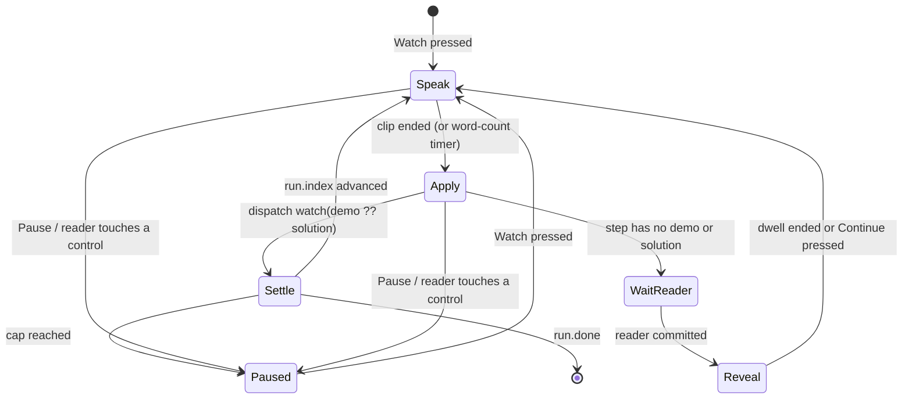
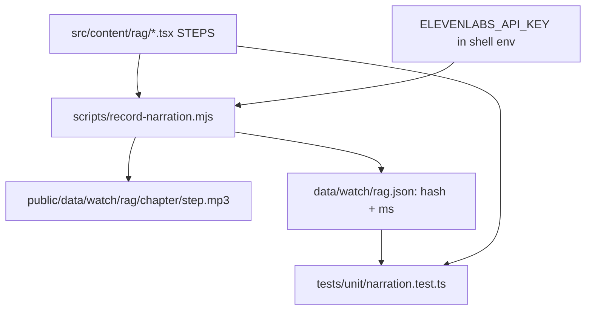

# RAG Watch Mode and Trailer - Plan

---

## Goal Capsule

- **Objective:** RAG chapters can play themselves, with ElevenLabs narration and a quiet music bed. The reader can take over at any step. A HyperFrames trailer on `/rag/` shows the animations up front.
- **Authority:** `AGENTS.md` (site-wide rules: static site, no API key, copy budgets, predict → reveal) → this plan's Product Contract → `docs/modules/rag.md`.
- **Stop conditions:** stop and ask if Watch mode would need a backend, a runtime API key, or a chapter/step id rename. Also stop if a predict or quiz step would have to reveal before the reader picks.
- **Execution profile:** one branch and one PR, following `AGENTS.md` Commits. ElevenLabs calls run once, by hand, with `ELEVENLABS_API_KEY` taken from the environment. The outputs are committed, and CI never calls ElevenLabs.
- **Tail ownership:** the executor runs the Verification Contract and opens the PR.

---

## Product Contract

### Summary

Add a **Watch** mode to RAG chapters. The live picture plays each step itself while a recorded voice reads the narration, over a quiet music bed. **Pause** hands control back to the reader at the exact current state. Predict and quiz steps always wait for the reader's own pick. Add a 30–60 s HyperFrames trailer to the RAG intro page. RAG is the pilot, and the mechanism lives in shared `StepRunner` code so other modules can opt in later.

### Problem Frame

Readers aren't finding the RAG module interesting. One likely reason is that each chapter opens with text and asks for clicks before the reader has seen anything move. A flat video would show the motion, but it would lose what Tinker is for, which is doing the thing. It would also drift from the live picture whenever a chapter changes. The repo already has the parts this needs:

- every step is data, and puzzle steps carry a `solution`
- `scripts/record-voice.mjs` turns script lines into committed ElevenLabs MP3s
- `videos/` holds HyperFrames projects that used ElevenLabs Music and SFX

There is no analytics, so "more interesting" can't be measured here (see Success Criteria).

### Key Decisions

- **The interactive video is the live chapter playing itself, not an MP4.** An MP4 can't be clicked, and it goes stale whenever the picture changes. (session-settled: user-approved — chosen over a HyperFrames MP4 per chapter: an MP4 isn't interactive and would drift from the live scene.) Governs R1, R2, R3.
- **HyperFrames is used only for the trailer.** (session-settled: user-approved — chosen over Watch mode only: the trailer gives an up-front hook on the intro page and on social.) Governs R8, R9.
- **RAG pilot first.** (session-settled: user-approved — chosen over rolling out to every module: prove it on one module before recording audio for 40 modules.) Governs R10.
- **The voice is pre-recorded ElevenLabs narration. There is no speech input.** (session-settled: user-directed — chosen over spoken commands: the user pointed to the existing `ELEVENLABS_API_KEY` narration path.) Governs R4.
- **The pilot is judged by one-click feedback through FormSubmit.** This is the site's second outbound send, a named exception to "nothing leaves the browser". (session-settled: user-directed — chosen over privacy-friendly analytics and over asking readers by hand: it adds no third party and keeps the exception to one click.) Governs R11.
- **Stale narration falls back to captions instead of failing tests.** (session-settled: user-directed — chosen over failing tests until re-recorded: copy edits never need the paid key.) Governs R7.
- **The trailer ships first, recorded by scripted hand-play.** (session-settled: user-directed — chosen over filming it in Watch mode afterwards: it's the fastest test of the "show it up front" hook.) Governs R8.

### Requirements

**Watch mode**
- R1. The chapter intro offers **Watch** beside the existing start/continue link. Watch starts from the current step, so a resumed run watches from where the reader left off.
- R2. While watching, each step plays in this order: say the step's narration, apply the step's demo state to the live picture, wait for the picture to settle, then advance. At the end of the chapter (`run.done`), Watch stops and the music stops. The existing next-chapter link shows, with a Watch button for the next chapter. There is no autoplay into the next chapter.
- R3. **Pause** stops playback and leaves the reader on the current step with its real controls. Watch can resume from the current step. Reader input pauses only while a demo step is playing:
  - **Pauses:** a control's `apply` or `sync`, a canvas edit, and opening a drawer.
  - **Doesn't pause:** view-only gestures (hover, orbit, zoom, pan, the picture/second-view tab), the stage's async verdict `sync`, and the reader's answer on a waiting step (R5).
- R4. Each step's narration is spoken by an ElevenLabs voice. The words on screen stay the caption.
- R5. A step with neither `demo` nor `solution` (predict, quiz, "I'm not sure" choices) waits for the reader. Its question shows as usual, and its `act` is spoken because the reader really has to do it.
  - After the reader commits, the reveal and its `why` show. Watch holds for a word-count dwell before resuming, and the reader can press Continue to skip the dwell.
  - This keeps predict → reveal intact.
- R6. A quiet music loop plays under the narration while watching. Sound is on after the Watch press. One toggle, labelled Sound on / Sound off, mutes music and voice and is remembered per viewer. Muting keeps captions and word-count timing.
- R7. Watching never blocks the chapter. In these cases the step is timed by its word count and the caption carries the words:
  - a clip fails to load
  - sound is muted
  - a clip is stale, meaning it was recorded from text that differs from the step's current text

  With reduced motion, the state changes without animation.

**Trailer**
- R8. `/rag/` shows a 30–60 s narrated HyperFrames trailer, with music and captions. It's recorded from the live chapters by scripted hand-play and ships before Watch mode. It only plays when the reader asks.
- R9. The trailer never loads on page open. It uses a poster image, `preload="none"`, and a captions track.

**Reuse**
- R10. Watch mode lives in the shared step runner. A module opts in by giving steps a `demo` and recording narration. Modules that don't opt in render exactly as today.

**Pilot signal**
- R11. When a watched chapter ends, the reader sees "Was Watch better?" with Yes / No. One click sends the module, chapter and answer to the existing FormSubmit address, and nothing else.
  - The question shows at most once per chapter per viewer.
  - It never blocks the next-chapter link, and a failed send is ignored.
  - Watch mode for other modules waits until the owner has reviewed RAG's answers.

### Success Criteria

- A reader can press Watch on any RAG chapter and reach the end. The only things they need to do are answer its predict and quiz steps.
- Pause, followed by a control, behaves exactly like play-by-hand today: same progress, same recall results.
- The pilot is judged by R11's Yes / No answers, which the owner reviews before any rollout.

### Scope Boundaries

- No speech recognition or voice commands.
- No runtime TTS, no backend, and no API key in the browser.
- No MP4 per chapter.
- **Deferred to Follow-Up Work:** Watch mode for other modules (a `demo` on each step plus `pnpm record:narration <module>`), trailers for other modules, and a social cut of the trailer in `videos/`.

### Open Questions

- (deferred) Should narration be one voice or a second "teammate" voice for the Larkspur story? Default: one voice.

---

## Planning Contract

### Key Technical Decisions

- KTD1. **A new optional `demo` on `Step`, with `solution` as the fallback.** Reusing `solution` alone would show "Show me" on every step, because `StepRunner` keys that button on `solution`. Watch applies `demo ?? solution`. A step with neither waits for the reader (R5), so predict and quiz steps need no flag.
- KTD2. **A new `watch` reducer action applies the demo like `sync`.** A demo that misses the predicate never counts as a failed try and never raises a hint. It reuses `reduce`'s existing predicate → `enter` path, so saving, `done` and recall work unchanged.
- KTD3. **Advance on the run's index change, not on a timer.** Some RAG steps settle asynchronously: the canvas fetches the index, then a verdict arrives through `sync`. The watch loop waits for `run.index` or `run.done` to change, with a cap (about 8 s). If the cap is reached, it pauses with the reader's controls showing, rather than guessing.
- KTD4. **Narration text goes through a committed JSON script, as `record-voice.mjs` does with `data/voice/script.json`.** Plain Node can't import the `.tsx` chapters (JSX, JSON imports, no loader).
  - A Vitest-run builder writes `data/watch/rag.script.json` from `STEPS`: chapter, step id and spoken text (narration, plus `act` on waiting steps), with term markers stripped. Copy is never retyped.
  - A new `scripts/record-narration.mjs` reads only that JSON. It writes `public/data/watch/rag/<chapter>/<step>.mp3` and `data/watch/rag.json`, which holds the text each clip was recorded from and its duration.
  - The TTS call, cache and ffmpeg encode are extracted from `record-voice.mjs` into `scripts/lib/elevenlabs.mjs`, and `record-voice.mjs` keeps behaving the same.
- KTD5. **A unit test pins the script and the audio to the copy.** `rag.script.json` must equal what the builder would produce from the current `STEPS`. Every clip in it needs an entry in `rag.json` and an MP3 on disk; a missing or swapped clip fails.
  - A clip whose recorded text differs from the current text is stale. The test prints a warning naming the stale clips but doesn't fail.
  - At runtime the player compares the two strings and plays a stale clip as missing (R7).
- KTD6. **The music is separate from the clip player.**
  - Voice clips play through `src/lib/voice/audio.ts`. `playClip` takes a full clip URL, with `clipUrl` kept as the default for voice ids. The ownership check compares against the stored URL, and `playClip` returns a promise that settles on ended or error.
  - Music is `music.mp3` encoded at its final low level and played through a Web Audio `GainNode` for ducking. iOS Safari ignores `HTMLMediaElement.volume`. The audio context is created on the Watch press, so autoplay rules are met.
  - A single toggle, stored in `localStorage` `tinker-watch-sound`, covers both.
- KTD8. **Demos never set `verdict`.** RAG's verdict comes from the engine through the stage's `sync`, as in hand play. The U4 coverage test fills verdicts from the RAG engine over the committed index after each demo, as `tests/unit/accuracy.test.ts` already does.
- KTD9. **The island finds narration through `import.meta.glob('/data/watch/*.json', { eager: true })`**, keyed by module id. Watch shows only when that module's entry has the current chapter.
- KTD7. **The trailer is a HyperFrames project in `videos/rag-trailer/`.** It follows the `videos/tinker-clicks-rec` approach: Playwright plays the real chapters by scripted clicks, then the edit adds ElevenLabs narration and music and renders the MP4. Only the delivery files are committed under `public/video/` (MP4 under ~6 MB, poster JPEG, WebVTT captions).

### High-Level Technical Design

Watch loop per step:

Data flow for audio (build time only):

### Assumptions

- The ElevenLabs Music API is available to the same key, as it was for `videos/tinker-clicks`. If it isn't, use a hand-picked royalty-free loop and note its source next to the file.
- Narration at 32 kbps mono averages about 40 KB per step, so RAG's roughly 60 steps add about 2.5 MB of lazily fetched audio.

### Sequencing

U6 (trailer, independent, ships first) → U1 → U2 → U4 (RAG demos) → U5 (record audio) → U3 (UI, feedback and the RAG e2e, which needs demos and narration) → U7 (docs).

---

## Implementation Units

### U1. Step `demo` and the `watch` action

- **Goal:** the runner can apply a scripted step without counting it as an attempt.
- **Requirements:** R2, R5, R10. KTD1, KTD2.
- **Dependencies:** none.
- **Files:** `src/components/story/steps.ts`, `tests/unit/steps.test.ts` (extend the existing reducer tests, or create the file if none exist).
- **Approach:** add `demo?: (state: S) => S` to `Step`. Add `{ type: 'watch' }`, which reduces as `sync` with `(step.demo ?? step.solution)(state)` and returns the run unchanged when neither exists.
- **Test scenarios:**
  - A step with `demo` whose result passes the predicate advances to the next step.
  - A step with only `solution` uses it.
  - A step with neither returns the same run object.
  - A demo that misses the predicate leaves `fails` and `hint` unchanged.
  - Watching the last step sets `done`.
- **Verification:** the reducer tests pass, and "Show me" still appears only where `solution` exists.

### U2. Watch controller and audio

- **Goal:** a pure scheduler for the state diagram above, plus the music bed and sound toggle.
- **Requirements:** R2, R3, R6, R7. KTD3, KTD6.
- **Dependencies:** U1.
- **Files:** `src/components/story/watch.ts` (new), `src/lib/voice/audio.ts` (URL-based `playClip` returning a promise, per KTD6), `tests/unit/watch.test.ts`, the existing voice player tests.
- **Approach:**
  1. Write `useWatch(run, steps, dispatch, clipFor)`, which returns `{ phase, start, pause, skipDwell }`. `phase` follows the state diagram.
  2. Speak the clip through the shared player. Fall back to a word-count timer (about 2.6 words/s) on error or mute.
  3. Dispatch `watch`, then wait for an index change within the cap.
  4. On a waiting step, hold until the index changes, then run the reveal dwell.
  5. Create the audio context and music gain on `start`, and duck it while a clip plays.
- **Patterns to follow:** `setAudioFactory` fakes in the existing voice tests.
- **Test scenarios:**
  - Happy path: three demo steps play in order and stop at `done`.
  - A step without a demo stops in the waiting state. An external index change moves it to the reveal dwell, then on.
  - `skipDwell()` ends the dwell at once.
  - Voice clips still play from `/data/voice/<id>.mp3`, so the voice module is unchanged.
  - `pause()` mid-clip stops the clip and music, and no further dispatch happens.
  - A clip error falls back to the timer and still advances.
  - A stale clip (recorded text ≠ current text) isn't played, and the step is timed by its word count.
  - An async step whose index never changes pauses after the cap.
  - The sound toggle persists, and a throwing `localStorage` still works.
- **Verification:** the unit tests pass using fake timers and a fake audio factory.

### U3. Watch UI in `StepRunner`

- **Goal:** the Watch/Pause control on the chapter intro and step card.
- **Requirements:** R1, R3, R5, R7, R11.
- **Dependencies:** U2, U4, U5.
- **Files:** `src/components/story/StepRunner.tsx`, `src/components/story/WatchFeedback.tsx` (new), the chapter layout's step-card styles, `tests/e2e/watch.spec.ts`.
- **Approach:**
  1. Show **Watch** next to "Continue at step N" only when the module has narration (KTD9).
  2. While watching, a compact strip holding **Pause** and the sound toggle sticks to the top of the story column. On phones it sits under the picture. It stays reachable while the column scrolls.
  3. Pause per R3: wrap only reader-caused input (control `apply`/`sync`, stage `apply`, `inspect`), and only while the phase is speaking, applying or settling. The stage's `sync` is never wrapped.
  4. Keep within the copy budgets: labels only, no helper text.
  5. Accessibility while watching:
     - The narration live region is quiet, because the audio and caption carry it. Only state changes are announced.
     - Focus stays on the Watch/Pause control across steps. It moves to the step's control only on pause or on a waiting step.
  6. Feedback (R11): on `done` after a watched run, show "Was Watch better?" Yes / No beside the next-chapter link.
     - One click POSTs `{ module, chapter, answer }` to FormSubmit's AJAX endpoint for the address in `src/pages/index.astro` (`FORM`). Move that constant to a shared module rather than copying it.
     - Record the answer in `localStorage` `tinker-watch-feedback` so the question isn't shown twice. A thrown storage error or a failed send is ignored.
- **Watch states (label · status line):**

  | Phase | Control | Status |
  |---|---|---|
  | idle | Watch | — |
  | speaking / applying / settling | Pause | Watching |
  | waiting | Pause | Your pick |
  | reveal dwell | Continue | — |
  | paused by reader or cap | Watch | Your turn |
  | clip failed or muted | Pause | — (caption only) |
  | done | Watch next chapter | — |
- **Test scenarios:**
  - e2e: on RAG chapter 3, Watch passes the async 'retriever' step without pausing, plays to the predict step and waits. Picking shows the reveal, resumes after the dwell, and reaches the end with audio routed to a stub.
  - e2e: clicking a control mid-watch pauses, and the run continues by hand.
  - e2e: orbiting or zooming the canvas mid-watch doesn't pause.
  - e2e: a watched chapter ends with the feedback question. Yes sends one request with only module, chapter and answer (network stubbed), and the question doesn't return on reload.
  - e2e: a chapter played by hand shows no feedback question.
  - e2e: with the FormSubmit request failing, the next-chapter link still works and no error shows.
  - e2e: the offline test still passes, because nothing is sent before the click.
  - e2e: keyboard only — Watch and Pause are reachable, focus stays on the control across steps, state changes are announced, and axe is clean.
  - e2e: with reduced motion, Watch still completes.
  - e2e: at 390px, the Pause strip stays visible while the story column scrolls, with no horizontal overflow.
  - A module without narration shows no Watch button.
- **Verification:** the new e2e spec passes and the existing chapter e2e specs are unchanged.

### U4. RAG demos

- **Goal:** every non-question RAG step can play itself.
- **Requirements:** R2, R5.
- **Dependencies:** U1.
- **Files:** `src/content/rag/01-history.tsx` through `07-sandbox.tsx`, `tests/unit/watch-coverage.test.ts`.
- **Approach:** give each non-question step that has no `solution` a `demo` that performs its `act`, using the same state shape the control would apply. Demos never set `verdict` (KTD8).
- **Test scenarios:**
  - For every RAG chapter, play the steps from the initial state by applying `demo ?? solution`, filling verdicts from the engine (KTD8). Answer predict and quiz steps with their correct option. The run reaches `done` (covers the Success Criteria).
  - Every step with neither `demo` nor `solution` is a predict, quiz or choice step. This is asserted by its visible controls, so a forgotten demo is caught.
- **Verification:** the coverage test passes, and manual Watch runs through all 7 chapters on desktop and at 390px.

### U5. Narration and music recording

- **Goal:** committed audio plus a test that pins it to the copy.
- **Requirements:** R4, R6. KTD4, KTD5.
- **Dependencies:** U4 (final copy).
- **Files:**
  - `scripts/lib/elevenlabs.mjs` (new, extracted)
  - `scripts/record-voice.mjs` (use the shared code, same behaviour)
  - `scripts/record-narration.mjs` (new)
  - `package.json` (`record:narration`)
  - `data/watch/rag.script.json` and its Vitest builder
  - `data/watch/rag.json`
  - `public/data/watch/rag/**`
  - `public/data/watch/music.mp3`
  - `tests/unit/narration.test.ts`
- **Approach:**
  - Clip text comes from `rag.script.json` (KTD4). Use the cache key style of `record-voice.mjs`.
  - Music is one generated loop of about 60 s, quiet and instrumental, encoded at its final low level (KTD6).
  - The key comes only from the command's environment.
- **Test scenarios:**
  - `rag.script.json` equals the builder's output from the current `STEPS`.
  - Every RAG step has an entry and an existing MP3.
  - A clip whose recorded text differs from its current text warns and doesn't fail (KTD5).
  - A missing MP3, or a clip swapped with its neighbour, fails.
  - Every hash differs from the text spoken by the neighbouring clip, which catches swapped files.
  - `record-voice.mjs` with a warm cache produces unchanged `data/voice/envelopes.json`. This is a characterization check, run before and after the extraction.
- **Execution note:** run `record-voice.mjs` against its cache before extracting the shared code, and diff its outputs afterwards.
- **Verification:** `pnpm test` passes, and playing chapters 1 and 7 in Watch sounds right.

### U6. HyperFrames trailer

- **Goal:** a 30–60 s narrated trailer on `/rag/`.
- **Requirements:** R8, R9. KTD7.
- **Dependencies:** none. It ships first, before Watch mode.
- **Files:**
  - `videos/rag-trailer/` (HyperFrames project: `BRIEF.md`, `SCRIPT.md`, compositions, record script modelled on `videos/tinker-clicks-rec/`)
  - `public/video/rag-trailer.mp4`, `.jpg`, `.vtt`
  - `src/pages/rag/index.astro`
  - `tests/e2e/` (the intro page spec)
- **Approach:**
  - Run it through the `/hyperframes` workflow, routed to `/general-video` (narrated, real-site footage).
  - The script is about 5 beats taken from the module's story and chapter titles, and every number comes from the data.
  - Place the `<video controls preload="none">` with poster and a captions track in the intro's first section, under the one-example idea, with no visible caption paragraph. The Pictures/Words switch doesn't fold it.
  - The frame is a fixed 16:9 at full column width on phones. If the MP4 fails, the poster stays.
  - The end card points to chapter 1. Below the player, the existing start link leads on, and Watch joins it once U3 lands.
  - Narration for the trailer is recorded inside the HyperFrames project with ElevenLabs. It doesn't wait for U5.
  - Keep the Colorfigures credit on the end card.
  - Add an `AGENTS.md` rule (U7): re-render the trailer when a RAG picture it shows, or a fact it quotes, changes.
- **Test scenarios:**
  - e2e: `/rag/` makes no request for the MP4 before play.
  - e2e: the video has a captions track and an accessible name.
  - e2e: axe is clean on `/rag/` at desktop and phone width.
  - Unit: every number in `public/video/rag-trailer.vtt` appears in the RAG data files.
  - Test expectation for the render itself: none — it's a media asset, checked by eye in HyperFrames Studio before delivery.
- **Verification:** the trailer plays on `/rag/` with sound and captions, the MP4 stays under ~6 MB, and the Lighthouse page weight before play is unchanged apart from the poster.

### U7. Docs

- **Goal:** record the decisions so the next module can opt in.
- **Requirements:** R10.
- **Dependencies:** U1–U6.
- **Files:**
  - `AGENTS.md`: the Watch mode rule under "Making it stick", `pnpm record:narration` under Tooling, and the watched-chapter feedback added as the second exception to "Nothing a reader enters leaves the browser"
  - `docs/modules/rag.md`
  - `docs/writing-a-module.md`
- **Approach:** add short rules in the existing voice:
  - steps need a `demo` unless they ask the reader
  - rerun `pnpm record:narration <module>` after copy edits, and commit the MP3s
  - trailers live in `videos/<module>-trailer/`, and are re-rendered when a picture or quoted fact they show changes
- **Test expectation:** none — documentation only.
- **Verification:** the docs match what shipped.

---

## Verification Contract

| Gate | Command | Applies to |
|---|---|---|
| Types | `pnpm check` (0 errors, 0 warnings) | all units |
| Lint | `pnpm lint` (0 diagnostics) | all units |
| Unit | `pnpm test` (incl. `copy-budget`, `registry`, new `watch`, `watch-coverage`, `narration`) | U1, U2, U4, U5 |
| E2E | `pnpm test:e2e` (new `watch.spec.ts`, RAG intro spec, existing chapter play-throughs) | U3, U6 |
| Eyes | Watch chapters 1, 3, 7 and the trailer at desktop and 390px | U3, U4, U6 |

---

## Definition of Done

- Every RAG chapter can be watched end to end, with the reader answering only its predict and quiz steps.
- Pause hands back the live chapter, and progress, `done` and recall behave as in hand play.
- Narration and music are committed. The narration test fails on missing clips and warns on stale ones, and CI makes no ElevenLabs calls.
- The trailer is on `/rag/` with poster and captions, and doesn't load before play.
- A watched chapter asks "Was Watch better?" once. Its one click is the only new outbound request, and `AGENTS.md` names it.
- Modules without narration are unchanged.
- All four gates are green, `AGENTS.md` and the module docs are updated, and no dead or experimental code is left in the diff.

---

## Sources

- `src/components/story/steps.ts` — `Step`, `reduce` (predicate → `enter` auto-advance; `showMe` uses `solution`).
- `src/components/story/StepRunner.tsx` — intro "Continue at step N", "Show me" button.
- `src/lib/voice/audio.ts`, `src/components/story/ClipPlayer.tsx` — the shared clip player.
- `scripts/record-voice.mjs` — the ElevenLabs TTS, cache and ffmpeg pattern, with the key taken from the environment only.
- `videos/tinker-clicks/`, `videos/tinker-clicks-rec/` — the HyperFrames project with ElevenLabs Music/SFX and a Playwright recording of the live site.
