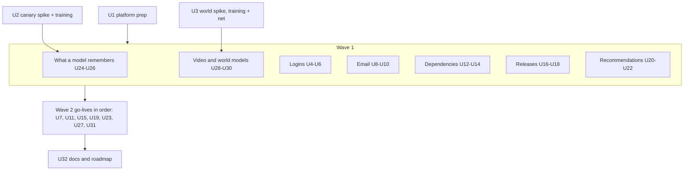
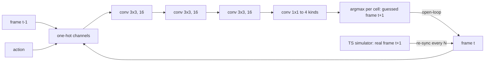
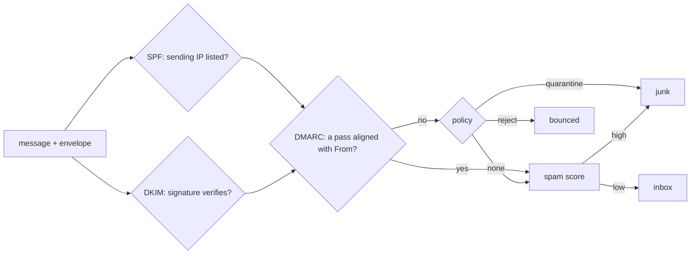

# The Final Seven Roadmap Modules - Plan

## Goal Capsule

- **Objective:** Take the seven planned roadmap cards live as modules 40–46 (KTD1):
  - 40 Logins and passwords
  - 41 How email arrives
  - 42 Dependencies
  - 43 Shipping a release
  - 44 Recommendations
  - 45 What a model remembers
  - 46 Video and world models

  Each module adds a picture mechanic no earlier scene has (R14). Seven new planned cards replace them (R16). Every module continues the Larkspur Supply Co. story.
- **Product authority:**
  - Product Contract requirements (R-IDs) win on product behaviour. Key Technical Decisions (KTD-IDs) win on mechanism.
  - AGENTS.md stays in force unless a KTD here changes it on purpose.
  - Shape and process follow `docs/plans/2026-10-25-1824-feat-last-seven-roadmap-modules-plan.md`; where this plan is silent, that plan's patterns apply. Its hero-board work (KTD14 there) does not: the hero is now a fixed board with a stand, and a new module needs only its `DRAW` entry.
- **Open blockers:** None.
- **Execution profile:** brownfield work on the Astro + React islands site, run in waves on **one local branch with one PR at the end**. The executor makes every call mid-build and notes any re-scope in the PR (the user's standing preference).
  - **Wave 0:** platform prep (U1), the canary model spike (U2), the world model spike and its engine (U3).
  - **Wave 1:** the seven modules' engines, scenes and chapters, each inside its own folders.
  - **Wave 2:** the go-lives, in KTD1 order.
  - **Wave 3:** docs and roadmap (U32).
  - Every wave leaves `pnpm check`, `pnpm lint`, `pnpm test` and `pnpm test:e2e` green.
- **Stop conditions** (resolve by the stated fallback, note it in the PR; stop outright only where no fallback is given):
  - A chapter needs a backend, a live LLM, an API key, real network traffic, real mail or training in the browser (R3). Stop.
  - U2's canary model misses its bar (KTD4). Fallback, one per cause, once each, then a stop:
    - the 1-repeat secret is extracted: retrain with fewer steps, or ship the earliest logged checkpoint where the 64-repeat secret is still extracted and the 1-repeat one is not;
    - the 64-repeat secret is not extracted: retry with more repeats on the top rung.
  - U3's world model misses its bar (KTD5). Fallback, never recorded frames:
    - too inaccurate: one retry at 24 channels within the size cap, then the grid shrinks to 12×12;
    - too accurate (no drift by step 16): lower capacity or training (fewer channels, fewer steps or less data) until the open-loop median falls inside the bar.
  - U2 or U3 changes any existing weight file, golden or sha256 pin (R15). Stop.
  - A source checked for a `facts.json` contradicts a chapter's lesson. The Appendix's "Moving facts" are re-checked on the access date.
  - A new mechanic cannot be done with a keyboard, or has no reduced-motion form (R14).
- **Tail ownership:** `ce-work` or the executor owns the branch, the PR and CI.

---

## Product Contract

### Summary

Tinker takes its last seven roadmap cards live. Four are classic tech:
- how a site knows it is you;
- how a message crosses the internet;
- code you did not write;
- how new code reaches everyone.

Three are AI:
- why the shop shows you this drill;
- what a model keeps from its training text;
- models that make moving pictures and guess what a world does next.

Each is drawn as a picture that does something new:
- a cracking race whose speed the reader sets;
- an envelope whose postmarks the reader peels off;
- a crate tower the reader pulls one crate from;
- a rollout dial the reader turns while the release runs;
- a taste map the reader moves a shopper across;
- a ranking column where a planted secret rises;
- a robot the reader drives inside the model's own dream.

Seven new roadmap cards keep the catalogue's "next up" row and the hero's building site honest.

### Problem Frame

These seven cards went onto the roadmap in the last build, so readers can already see them. Three of them are AI topics that need a model doing the real thing:
- **Memorisation:** a planted secret that the model really recites.
- **World models:** a model that really guesses the next frame from an action.
- **Recommendations:** a ranking that really learns tastes.

The other four are classic tech, and each one leans on a live module (Locks and keys, Opening a web page, Git, A/B testing). Each must teach what its neighbour doesn't (R17).

### Requirements

**Platform**

- R1. The seven modules go live as modules 40–46 in KTD1 order. Each has an intro, seven chapters, a recap, a recall bank with one pin, share images, a home card, a hero stand plot and an e2e spec.
- R2. Levels, tracks and prerequisites:

  | Module | Id | Level | Track | Prerequisites |
  |---|---|---|---|---|
  | Logins and passwords | `logins` | Beginner | Classic tech | `encryption` |
  | How email arrives | `email` | Beginner | Classic tech | `web-requests` |
  | Dependencies | `dependencies` | Intermediate | Classic tech | none |
  | Shipping a release | `releases` | Intermediate | Classic tech | none |
  | Recommendations | `recommendations` | Intermediate | AI | none |
  | What a model remembers | `memorisation` | Intermediate | AI | `pre-training` |
  | Video and world models | `video-models` | Advanced | AI | `diffusion` |

  The ids are the planned cards' ids; `pnpm new-module` already matches multi-line `planned(` calls.
- R3. There is no backend, no API key and no live LLM, and nothing trains in the browser. Nothing touches a real network or sends real mail, and no reader code runs. The canary model and the world models are trained once offline in Python and committed, as the experts model was. The recommendation factors are computed by a deterministic TS function, committed and recomputed by a test.
- R4. Every module is picture-first from its first commit:
  - the copy budgets hold;
  - every instruction is in `act`;
  - callouts (`say`) name parts the scene exports;
  - sources open through `Cite`;
  - chapter terms are marked where they are first used.
- R5. Every fact comes from `data/<id>/facts.json`, with its source and access date. Moving facts (hash-cracking speeds, recommended work factors, bulk-sender rules, published model specs, incident dates) say whose figure it is and when (Appendix).
- R6. Every stand-in is labelled wherever it shows: hand-written orders, accounts, messages and release histories; planning-number guess rates and error rates; demo keys, fake card numbers and fake PINs; fictional packages.
- R15. The 39 live modules and their saved progress do not change: no chapter id, step id, recording, golden, pinned output or share image changes. `tests/unit/step-ids.test.ts` enforces it. The exceptions are the KTD12 shared hotspots and mentions that newly link to a live module.

**Modules.** Chapters in order; chapter 7 is each module's workbench.

- R7. **Logins and passwords.** Larkspur opens trade accounts for its builders. The edge: "a site never keeps your password, only a slow, salted fingerprint of it, and after sign-in a cookie is the key".
  1. The sticky note: passwords stored as written, and a breach.
  2. A one-way fingerprint: hashing, and the leaked list that cracks common ones.
  3. A pinch of salt: the same password, two different fingerprints.
  4. Slow on purpose: the work factor, and guesses per second.
  5. The cloakroom ticket: the session cookie, and a stolen one.
  6. Sign in with another site: the redirect, the code and the signed ID token.
  7. Workbench: storage, second factor and session length per account type, against a set of attackers.
- R8. **How email arrives.** Larkspur's order confirmations land in spam, and a fake invoice "from Larkspur" lands in a customer's inbox. The edge: "anyone can write any From line; SPF, DKIM and DMARC are how the receiver checks it".
  1. An envelope and a letter: the envelope and the headers.
  2. Who takes it next: MX records and the hops, with postmarks read bottom-up.
  3. Anyone can write From: a forged invoice.
  4. The list of allowed senders: SPF.
  5. A seal on the letter: DKIM, and tampering caught.
  6. What to do with a failure: DMARC alignment and policy, then the spam filter's score.
  7. Workbench: Larkspur's mail records against a day of real, forwarded and forged messages.
- R9. **Dependencies.** Larkspur's shop app pulls in packages it did not write, and one morning the build breaks without a code change. The edge: "a version range lets updates in, and the lockfile decides when".
  1. Code you did not write: one import, many packages.
  2. What the numbers mean: major.minor.patch, and ranges.
  3. The tree: packages that need packages, and two versions of one.
  4. The same install every time: the lockfile.
  5. One bad patch: a release that breaks every caret range.
  6. Who published this? A hijacked package, install scripts, and pinning.
  7. Workbench: an update policy against a month of upstream releases.
- R10. **Shipping a release.** Larkspur's team ships a new checkout before the sale. The edge: "ship to a few first, watch, and keep a way back that is faster than a fix".
  1. Straight to everyone: one change, every customer.
  2. Tests on every change: the pipeline's gates, and the bug no test checks.
  3. A few first: a canary, and telling a bad canary from noise.
  4. Deploy now, switch on later: feature flags.
  5. Back it out: rollback, and the change that cannot roll back (expand, then contract).
  6. Step by step: a staged rollout that halts itself.
  7. Workbench: a release plan against a set of seeded bad changes.
- R11. **Recommendations.** Larkspur's shop wants a "you might also need" shelf. The edge: "a recommender ranks by what people like you bought, and what it shows shapes what gets bought next".
  1. The bestsellers shelf: everyone sees the same thing.
  2. People like you: similar customers.
  3. Bought together: similar products.
  4. Hidden tastes: two numbers per shopper and per product (factors), on a map.
  5. The new shopper and the new product: cold start.
  6. The loop: the shelf shapes the clicks that train the shelf.
  7. Workbench: blend and exploration share, scored on held-out orders and catalogue coverage.
- R12. **What a model remembers.** Larkspur wants to train its support model on old tickets that hold customers' card numbers. The edge: "a model can recite what it saw often, so keep secrets out of the training text".
  1. Seen once, seen often: repeated lines come back word for word.
  2. A planted secret: canaries, fake account PINs trained in on purpose.
  3. Ask it to finish: extraction from a prefix, live.
  4. How sure is it? Exposure: the true secret's rank among candidates.
  5. Copies make it worse: repeats against exposure, and removing duplicates.
  6. Keep it out: scrubbing before training, and a filter on the way out.
  7. Workbench: a data policy against planted canaries and model quality.
- R13. **Video and world models.** Larkspur wants to try warehouse robot routes in a simulator before it builds them. The edge: "a world model guesses the next frame from the last ones and an action, and its small errors pile up".
  1. A film is many pictures: frames, and what a second of video costs.
  2. Guess the next frame: the model's guess beside the real one.
  3. One frame is not enough: a crate's direction needs two frames.
  4. Press a key: action in, frame out; driving inside the model.
  5. Drift: guesses built on guesses, and the crate that vanishes.
  6. The big ones: frames that agree over time, and what large video models cost.
  7. Workbench: context frames and a re-sync interval against drift and compute.

**Pictures and story**

- R14. Each module's scene adds at least one mechanic no earlier scene has (KTD13). It keeps the house rules: Colorfigures style, label pills, one figure per stage, a precise tab, `say` callouts, escaped text, reduced motion and phones. The mechanic is never the only way to act: each has a keyboard path and a reduced-motion form.
- R16. Seven new planned cards follow the live modules (KTD14).
- R17. Each module teaches what its live neighbour doesn't, and links to it where they meet:
  - **Logins:** storing and proving a secret. Locks and keys teaches the hash and the signature themselves.
  - **Email:** mail's own trust checks. Opening a web page teaches DNS and the round trip; Locks and keys teaches signatures.
  - **Dependencies:** versions and resolution. Git teaches history and merging.
  - **Releases:** exposure control and the way back. A/B testing teaches deciding whether a change helped.
  - **Recommendations:** ranking from behaviour. Search teaches ranking from a query.
  - **What a model remembers:** what leaks out. Pre-training teaches data mixes, and its duplicated variant is cited, not retrained.
  - **Video and world models:** frames over time and actions. Diffusion teaches denoising one picture.
- R18. Every name shown (customers, accounts, senders, packages, products, people) is read from data. Packages, domains and senders are fictional (`.example` domains). Logins uses fixed, labelled demo keys and never a real credential, and says once "use a vetted library, never your own". No module names a vendor as the place to do the thing; products, incidents and model specs are cited as dated facts.

### Scope Boundaries

- Earlier modules' pictures, share images and saved progress stay as they are.
- No retrain of Larkspur mini, its fine-tunes, student, checkpoints, the masked model or the experts model. The canary model and world models are new files beside them.
- Maths stays optional, in fold-away "the maths" notes: guesses per second, semver ordering, cosine similarity, factorisation, exposure (log₂ of candidates over rank), per-pixel accuracy.
- **Logins:** no passkey or WebAuthn flow beyond one fact; no real OAuth provider.
- **Email:** no mail server; SPF covers `ip4`, `include` and `all` only; DKIM uses relaxed canonicalisation on fixture messages only.
- **Dependencies:** no real registry and no real package manager; one resolver whose rules are stated, with npm's behaviour cited where it differs.
- **Releases:** no CI product guide and no real deploy.
- **Recommendations:** no deep-learning recommender; large systems are cited facts.
- **What a model remembers:** no claim that the toy's memorisation rates match a large model's; differential privacy is one cited fact.
- **Video and world models:** no video diffusion in the browser; large models are cited facts. The toy is a next-frame world model, and the copy says so.

### Deferred to Follow-Up Work

- Building any of the seven new planned cards.
- Trailers for the seven modules (AGENTS.md allows one at go-live or later; only RAG has one today).
- Refreshing earlier modules' pictures with the new mechanics.

### Success Criteria

- After each module a reader can say its edge in plain words, as R7–R13 phrase it.
- `pnpm test` fails when any of these drifts from its pin:
  - a pinned output (a hash, a TOTP code, a verdict, a resolved tree, a rollout outcome, a ranking, an exposure, a predicted frame);
  - a workbench's `WINNERS`.

  It also fails when a new payload passes its budget.
- At 1280px and 390px, the catalogue shows 46 live modules under their levels and seven roadmap cards. The hero stand shows each new module in turn, and the first screen holds.

### Key Decisions

- All seven remaining planned cards go live in one plan, on one branch with one PR (session-settled: user-directed — chosen over per-wave PRs: the user's standing preference for module builds). Governs R1, R2.
- Seven new planned cards replace these seven (session-settled: user-approved — chosen over an empty roadmap: the catalogue keeps a "what's next" row). Governs R16.
- What a model remembers trains a canary copy of Larkspur mini offline, behind a spike with a stop bar (session-settled: user-approved — chosen over measuring only today's model: the extraction is real and runs live). Governs R3, R12.
- Video and world models trains a tiny next-frame world model offline, behind a spike (session-settled: user-approved — chosen over recorded frames from a simulator: the model's guesses are real). Governs R3, R13.
- Recommendations counts live and factorises with a committed, test-recomputed TS function (session-settled: user-approved — chosen over Python training: the maths is small, and nothing trains in the browser). Governs R3, R11.

---

## Planning Contract

### Key Technical Decisions

- KTD1. **Module numbers follow merge order:**
  - 40 Logins
  - 41 Email
  - 42 Dependencies
  - 43 Releases
  - 44 Recommendations
  - 45 What a model remembers
  - 46 Video and world models

  The cheap classic simulators come first. The two trained AI modules land last, behind their spikes (U2, U3).
- KTD2. **What runs live and what is computed offline:**

  | Module | Live in the browser | Computed offline and committed |
  |---|---|---|
  | Logins | SHA-256 (Locks and keys' `sha256.ts`), salting, PBKDF2 via Web Crypto, TOTP (HMAC-SHA1 via Web Crypto), ID-token verify (ECDSA, demo key), the cracking race | hand-written accounts and a leaked-password list (labelled); guess rates (dated facts) |
  | Email | header and `Received` parsing, the SPF evaluator, DKIM relaxed canonicalisation + RSA-SHA256 verify via Web Crypto, DMARC alignment, a naive-Bayes spam score from counts | fixture messages, fixture DNS records, a demo DKIM key pair and signatures |
  | Dependencies | semver parse, compare and range match; the resolver; the lockfile diff | a fictional registry with dated releases |
  | Releases | a seeded rollout simulator, the pipeline gates, flags, rollback | hand-written changes and error rates (labelled) |
  | Recommendations | popularity, cosine user-user and item-item, factor scores, hit@5, replaying the feedback loop | hand-written orders; factors and every loop run's per-round factors from `factorise()` (pinned, recomputed in a test) |
  | What a model remembers | the canary model's forward pass and greedy decoding, ranking a sample of candidates, the output filter | the canary model's weights; the exposure and quality runs |
  | Video and world models | the world-model forward pass, the warehouse simulator, rollouts, the reader's driving | the world models' weights, training rollouts' seeds, goldens |

- KTD3. **Logins reuses Locks and keys' crypto and adds only what logins need** (`src/lib/logins/`).
  - **Hashing:** `hashText` from `src/lib/encryption/sha256.ts`. Salts are fixed per demo account (`data/logins/accounts.json`) so every fingerprint is pinned.
  - **Slow hashes:** PBKDF2-SHA256 via `crypto.subtle` at the chosen iterations. Results are pinned. Guess rates per hash kind are dated facts on one named GPU, labelled as one benchmark's figure; time-to-crack is computed from them.
  - **The cracking race:** a pure function of the leaked list, the stored form and the rate, so the board's state at any tick is computable and testable.
  - **TOTP:** RFC 6238 over HMAC-SHA1. Its test vectors are a unit test. The demo secret is labelled, and the chapter's clock is a fixed demo time, so codes are pinned.
  - **Sign in with another site:** an authorisation-code flow drawn as `flat.ts` lanes. The ID token is a compact JWT signed with Locks and keys' demo ECDSA key and verified live. The `state`, redirect and PKCE checks are computed (the code challenge is `hashText` of the verifier, and a code redeemed with the wrong verifier fails), and a tampered token or a wrong audience fails.
- KTD4. **The canary model is Larkspur mini's shape trained from scratch on the training split plus planted canaries** (`scripts/train/train_canary.py`, standalone, seeded, CPU, one thread, byte-identical on rerun; it imports `train.py`'s `CFG`, `Mini` and `f16_blob`, as `train_moe.py` does).
  - **Canaries:**
    - four fictional customers, each with a fake 4-digit account PIN (labelled fake), in one fixed sentence shape that fits the 32-token context. A PIN is secret in a way a card's last four digits are not (those are printed on receipts); the story's card-number tickets remain the reason for scrubbing;
    - repeated 1, 4, 16 and 64 times, spread through the training split by a seeded shuffle;
    - names and digits come from `data/memorisation/canaries.json` and are encoded by `pnpm encode:lm` under a new `memorisation` key in `ids.json`.
  - **Runs:**
    - `canary` ships as `public/data/memorisation/canary.bin` (≤ 150 KB) with `meta.json`;
    - `dedup` (each canary once) and `scrubbed` (digits replaced by a placeholder) are scored but not shipped;
    - a fourth run combines `dedup` and `scrubbed` for the workbench grid.
  - **Measures per run** (into `data/memorisation/runs.json`):
    - greedy extraction from each canary's prefix (exact match);
    - exposure over all 10,000 four-digit candidates (Carlini 2019), computed offline;
    - held-out loss and top-5.
  - **Bar:**
    - in `canary`, the 64-repeat secret is extracted and the 1-repeat one is not;
    - exposure rises with repeats;
    - in `dedup` and `scrubbed`, no secret is extracted;
    - `canary`'s held-out top-5 is within 2 points of the base's.
  - It never starts from `model.bin`, so every existing sha256 pin holds. `load.ts` gains a `'canary'` weights kind.
  - **Live ranking:** chapter 4 ranks a pinned sample of 200 candidates plus the true one in the browser. The copy says it is a sample, and cites the full offline exposure beside it.
- KTD5. **The world model is a tiny convolutional next-frame predictor over a warehouse grid** (`scripts/train/train_world.py`, seeded, CPU, one thread, byte-identical on rerun).
  - **The world:**
    - a 16×16 grid in 4 kinds (floor, shelf, robot, crate);
    - the robot moves by action (up, down, left, right, stay) and is blocked by shelves;
    - a crate on the belt row moves one cell a tick and bounces at the ends;
    - collisions: within a tick the crate moves first; it bounces off the robot as off a belt end, and the robot is blocked by the crate as by a shelf.
  - **The simulator is the shared truth.** It is written in TS (`src/lib/video-models/world.ts`) and mirrored in Python. A test replays the Python training rollouts' recorded seeds and actions through the TS simulator and requires identical frames.
  - **Model:**
    - input: the last k frames as one-hot channels, plus the action broadcast as channels;
    - three 3×3 conv layers of 16 channels, with ReLU, then a 1×1 conv to the 4 kinds;
    - output: per-pixel logits over the 4 kinds.
  - **Two models:** `k1` and `k2` (context frames), each well under 30 KB in Float16, in `public/data/video-models/` with `meta.json` (layout, loss curves, held-out scores, goldens).
  - **Bar, on held-out rollouts:**
    - `k2`'s one-step accuracy on changed pixels is ≥ 90%;
    - its robot cell is right ≥ 95% of the time;
    - `k2` gets the belt crate's next cell right at a bounce-free step ≥ 90% of the time, and `k1` is near chance there;
    - a 16-step open-loop rollout keeps exactly one robot for a median of ≥ 6 steps, and does not do so for all 16 (drift must show).
  - The forward pass is `src/lib/video-models/net.ts`, plain TS, checked against the goldens within 1e-4. No hook in the LM forward pass changes.
- KTD6. **Email checks real mechanisms over fixture mail** (`src/lib/email/`).
  - **Messages:** RFC 5322 text files in `data/email/messages/`, from fictional `.example` domains, each with a `Received` chain.
  - **DNS:** MX, SPF and DKIM TXT records in `data/email/dns.json`. Nothing resolves for real.
  - **SPF:** an evaluator for `ip4`, `include` (depth-capped, with a test) and `all` with its qualifiers. It returns pass, fail, softfail or neutral.
  - **DKIM:**
    - relaxed header and body canonicalisation, and `rsa-sha256` verify via `crypto.subtle` with a demo key pair (labelled);
    - the signatures are made once by a script and committed;
    - a one-byte body change fails verify live.
  - **DMARC:** checks alignment of the From domain against the SPF and DKIM domains, then applies the policy (none, quarantine, reject). Forwarding breaks SPF and keeps DKIM, which is chapter 6's lesson and pinned.
  - **Spam score:** naive Bayes from word counts over a labelled, hand-written set, counted live. Counting is not training in the R3 sense, as Synthetic data's dedupe was not.
- KTD7. **Dependencies resolves over a fictional, dated registry** (`src/lib/dependencies/`).
  - **semver:** parse, compare, and `^`, `~`, exact and `x` ranges. The test cases are taken from semver.org's examples and npm's documented range table, cited.
  - **Resolver:**
    - per range, the highest satisfying version published on or before the install day;
    - on conflict, a nested copy (npm-style), so "two versions of one" is real;
    - deterministic, with a tree diff between two installs.
  - **Lockfile:** a snapshot of resolved versions. Installing with it ignores newer releases.
  - **Registry:** `data/dependencies/registry.json` holds packages, versions, publish days and flags (`breaks`, `fixes`, `hijacked`, `installScript`, `importPayload`), all fictional and labelled. The hijacked release is a transitive dependency reached through a caret range, and its payload runs both as an install script and on import, so an exact pin on the direct dependency and install scripts off do not stop it; only the lockfile with a reviewed update does. The left-pad (2016), event-stream (2018) and xz-utils (2024) incidents are dated facts, never re-enacted under real names.
- KTD8. **Releases is a minute-tick simulator in Consistency's shape** (`policyOf`, `simulate`, `runOf`, counted outcomes) over `data/releases/changes.json`.
  - **A change** carries a true error rate, whether a test covers its bug, and whether it includes a migration.
  - **Exposure:** set by the rollout stage or the flag. Errors are seeded Bernoulli draws over traffic.
  - **Canary detection:** compares the canary's error count against the baseline's with a stated threshold. Chapter 3 shows a false alarm and a miss, and links to A/B testing.
  - **Rollback:** takes a fixed number of minutes. A flag-off takes one. A change with a non-expand migration cannot roll back.
  - Rates and times are in `data/releases/assumptions.json` (the `note` / `words` pattern), labelled planning numbers.
  - The reader's dial and lever are events inserted into the seeded run, so the replay is deterministic (as Queues' crash is).
- KTD9. **Recommendations ranks over hand-written orders** (`data/recommendations/orders.json`: about 60 customers and 40 products, labelled hand-written; product names from Larkspur's existing catalogue data where it has them).
  - **Methods:** popularity; user-user and item-item cosine; factor scores from `factorise()`. `factorise()` is a seeded, fixed-iteration ALS with 2 factors, so the taste map is the factors themselves.
  - **Pinned factors:** `factors.json` is committed. `tests/unit/recommendations-engine.test.ts` recomputes it and fails on drift.
  - **Scoring:** hit@5 on each customer's held-out last order, plus catalogue coverage.
  - **Cold start:** a new shopper's factor is the mean of the products they pick; a new product has no factor until it has orders.
  - **The loop:** a seeded simulator. Shoppers buy from the shelf with a stated probability; each round's orders refactorise, and coverage narrows unless an exploration share shows random products. The blend and exploration share take discrete steps, so every loop run is finite: `factorise()` precomputes each run's per-round factors into a pinned `loop.json` that a test recomputes, and the browser only replays them. Nothing factorises in the browser (R3).
- KTD10. **Pinned outputs and `WINNERS`.**
  - Every effect a chapter teaches is pinned in `data/<id>/pinned.json` and rerun by a unit test.
  - Every workbench pins its `WINNERS` and recomputes them in a test, never solving at import.
  - The memorisation workbench's grid comes from training runs, so its `WINNERS` are read from `runs.json` and recomputed from it. The output filter is live, so it is the grid's third axis: 4 runs × filter on or off. A pinned bypass prompt makes the canary model reply with the digits spaced out, which the filter misses, so a filter-only policy still leaks and only scrubbing wins.
- KTD11. **Workbenches:**
  - **Logins:** a store (plain, SHA-256, salted SHA-256, PBKDF2 at three work factors), a second factor (none or TOTP) and a session length per account type. They face four attackers: a breach dump, a guesser at the login form with a rate limit, a stolen cookie and a phishing page. The score is accounts lost against sign-in friction (planning numbers). The phishing page relays TOTP codes in real time, so TOTP does not reduce accounts lost to it; its cell names the cited passkey fact (NIST SP 800-63B, phishing-resistant authenticators) as the fix outside the workbench.
  - **Email:** SPF record, DKIM on or off, and DMARC policy. A day's messages (real, forwarded, newsletter via a vendor, forged) give real mail delivered against forgeries delivered.
  - **Dependencies:** range style, lockfile on or off, update cadence with tests, and install scripts on or off, run against the registry's month. The score is broken builds, hijacked code shipped, a hijacked install script run (scored apart), and days late on a security fix.
  - **Releases:** canary share, bake time, flag on or off, and auto-rollback threshold, run against the seeded changes. The score is customer-minutes hurt against minutes to full rollout.
  - **Recommendations:** a popularity-versus-factors blend and an exploration share. The score is hit@5 against coverage after the loop's rounds.
  - **Video and world models:** context frames (1 or 2) and a re-sync interval (ground truth every N steps). The score is robot-cell accuracy over a 32-step rollout against model passes, in compute units from the conv's multiply count.
- KTD12. **Waves and shared hotspots** follow the last plan's KTD13, on one branch.
  - **Module work** touches only the module's own paths:
    - `src/lib/<id>/`, `src/content/<id>/`, `src/pages/<id>/` and `data/<id>/`;
    - its scene files and `src/dev/<id>.astro`;
    - its tests.
  - **Shared hotspots** change only in a go-live unit:
    - `src/lib/modules.ts`, `tests/unit/modules.test.ts` and `tests/unit/step-ids.test.ts`;
    - `src/pages/index.astro` (`CARD`) and `heroScene.ts` (`DRAW`);
    - `src/dev/og.astro` and `tests/e2e/catalogue.spec.ts`;
    - `README.md`, `AGENTS.md` and `public/og/home.jpg`;
    - `flat.ts`'s `Stamp` union.
  - The exceptions are U1, which may change `src/lib/modules.ts`, `tests/unit/modules.test.ts`, `tests/unit/new-module.test.ts`, `tests/e2e/catalogue.spec.ts`, `.github/workflows/checks.yml` and `public/og/home.jpg`; and the shared files U2 and U3 touch: `load.ts`, `ids.json` (a new key only), `encode-for-training.mjs`, `tests/unit/synthetic-data-runs.test.ts` and `scripts/train/README.md`.
  - Module work scaffolds by hand from `templates/module/`. Only the go-live runs the planned-line swap.
- KTD13. **New mechanics live in the module's kit, with a keyboard path and a reduced-motion form.** Every control is a real element beside or over the stage, never in the drawing.

  | Mechanic | Control (keyboard, touch, pointer) | Reduced motion |
  |---|---|---|
  | Logins: the cracking race | a native range input for the work factor and a radio group for the stored form; Play and Step; the board pops each cracked account as the guess counter passes it, and a text read-out gives cracked counts per minute | the board shows the final cracked set |
  | Email: peel the postmarks | the envelope's postmarks as a list of buttons, peeled bottom-up with Enter; each peel shows that hop's server and time; "Peel all" | the postmarks list without the peel |
  | Dependencies: pull a crate | each crate a button in a tower grid; pick a version from a native select beside it, or "Pull" to yank it; the resolver reruns and dependants turn tomato or topple | dependants recolour without the topple |
  | Releases: the rollout dial | a native range input for exposure while the run plays, a Pause, and a rollback button (the lever); events are recorded at the current minute | the run steps one minute per press |
  | Recommendations: move a shopper | the shopper is a focusable marker on the 2-D taste map, moved by arrow keys or drag; the shelf re-ranks live; the read-out names the top five | the shelf updates without the slide |
  | What a model remembers: the ranking column | a radio group for repeats (1, 4, 16, 64); the true secret's ball takes its rank in a column of 201; the read-out gives rank and exposure | the column shows final ranks |
  | Video and world models: drive the dream | arrow keys or four on-screen buttons step the robot; the model's frame and the real frame update side by side, with a re-sync button; on phones the buttons are ≥ 44 px | each press redraws without the slide |

  Each scene caps what it draws:
  - Logins: at most 12 accounts, with a count pill for the rest.
  - Email: at most 6 hops.
  - Dependencies: at most 12 crates, with deeper levels folded into a count pill.
  - Recommendations: the shelf shows 5; the map shows at most 40 products.
  - Video and world models: the grid's 256 cells as flat tiles.

  Each mechanic's text read-out is one polite `role="status"` region outside the drawing. It updates on each reader action and at named run milestones (a crack, an alarm, a rollback, a re-sync), never per tick, and each kit's scene test checks it exists.

  Nothing is promoted to a shared component unless two modules use it.
- KTD14. **The new planned cards**, three AI and four classic:
  - **Picking a model per question** (AI, Intermediate): a router and a cascade, cost against quality.
  - **Watermarks and made-by-AI** (AI, Intermediate): marking generated text and pictures, and why detectors guess.
  - **Writing a prompt** (AI, Beginner): instructions, examples and why order matters.
  - **Rate limits** (Classic, Beginner): a token bucket, a 429, and who gets turned away.
  - **Backups and recovery** (Classic, Beginner): copies, restore tests, and how much you can lose.
  - **Text and Unicode** (Classic, Beginner): bytes, UTF-8, and why an emoji breaks a form.
  - **Finding the way** (Classic, Intermediate): maps as graphs, shortest paths, and live traffic.

  Each card gets a one-line description in the house register. U1 greps the live registry and chapter titles for overlap, and swaps out any card a live module already covers before committing.

### High-Level Technical Design

Waves and dependencies:



The world model's step (KTD5):



How a message is judged (KTD6):



### Assumptions

- Larkspur's existing data has enough product names for Recommendations' 40 products; any missing ones go in `data/recommendations/products.json`, read from data as R18 requires.
- Web Crypto's PBKDF2, HMAC-SHA1, RSASSA-PKCS1-v1_5 and ECDSA P-256 run in every browser the e2e suite covers and in Node 22, as AES-GCM and ECDSA already do for Locks and keys.
- The world model trains in minutes on CPU at this size; if it does not, the channel count grows to 24 first, then the grid shrinks to 12×12 (KTD5 fallback).

### System-Wide Impact

- **Readers:** saved progress for the 39 live modules is untouched (R15). Seven new progress keys appear.
- **Home:** the catalogue counts change to "46 live · 7 planned". Each new module's `DRAW` entry joins the stand rotation, newest first.
- **CI:** seven more e2e specs. Measure shard times at U1 with the specs stubbed and raise the shard count only if a shard passes 12 minutes.
- **Payload:** new weights total under 210 KB (canary ≤ 150 KB, two world models under 30 KB each), loaded only on their modules' pages.
- **Shared engine:** `load.ts` gains two weights kinds, and nothing else in `src/lib/lm/` changes.

### Risks

| Risk | Mitigation |
|---|---|
| The 32-token context leaves little room for a canary sentence | KTD4 fixes a short sentence shape; U2 checks the token count before training |
| The canary model memorises the 1-repeat secret too (the toy overfits) | The stop condition's per-cause fallback: fewer steps or an earlier checkpoint, then stop |
| World-model drift is too fast or never happens | The bar requires both a working median and visible drift; the stop condition has a fallback for each direction |
| Web Crypto differences across browsers | Every crypto result is pinned and checked in Node and in e2e on each browser project |
| Real incident names in Dependencies read as accusations | Incidents are dated facts with sources; the re-enactment uses fictional packages only |
| Seven modules strain CI time | U1 measures, and the shard rule is fixed in advance |

---

## Output Structure

Per module (repeat for each id), following the last plan:

```text
src/lib/<id>/            engine, facts.ts, story.ts, workbench.ts
src/content/<id>/        module.ts, chapters, recall.ts, kit.tsx
src/pages/<id>/          index.astro, [chapter].astro, recap.astro
src/components/scenes/   <name>Scene.ts (a board name not already taken)
data/<id>/               facts.json, pinned.json, workbench.json, fixtures
src/dev/<id>.astro
tests/unit/<id>-*.test.ts
tests/e2e/<id>.spec.ts
docs/modules/<id>.md
```

New training outputs:

```text
scripts/train/train_canary.py     public/data/memorisation/{canary.bin, meta.json}   data/memorisation/runs.json
scripts/train/train_world.py      public/data/video-models/{k1.bin, k2.bin, meta.json}
```

---

## Implementation Units

Each module has four units: engine and facts, scene and kit, chapters, go-live. The patterns are the last plan's matching units; the per-module notes below say what differs.

### U1. Platform prep for forty-six

- **Goal:** The registry, its tests and CI are ready for 46 live modules and seven new planned cards.
- **Requirements:** R16, R15; KTD12, KTD14.
- **Dependencies:** none.
- **Files:** `src/lib/modules.ts`, `tests/unit/modules.test.ts`, `tests/unit/new-module.test.ts`, `tests/e2e/catalogue.spec.ts`, `.github/workflows/checks.yml`, `public/og/home.jpg`.
- **Approach:**
  1. Grep live titles and chapter titles for KTD14's topics and swap any overlap.
  2. Append KTD14's seven `planned()` lines after `releases`.
  3. Rebase `modules.test.ts`'s `ROADMAP` so its last seven are the new cards.
  4. Move `new-module.test.ts`'s real-registry case off `releases` (it goes live in this build) onto the last new card.
  5. Measure e2e shard times and adjust per System-Wide Impact. Regenerate `home.jpg`.
- **Patterns to follow:** the last plan's U1.
- **Test scenarios:**
  - The planned list ends with the seven new ids in order, each with its level and track, no chapters and no prereqs.
  - Every `ROADMAP` id no longer planned is live.
  - `new-module` against today's registry for `logins` removes its multi-line card and inserts `LOGINS_MODULE` after `MIXTURE_OF_EXPERTS_MODULE`.
  - The catalogue e2e counts "39 live · 14 planned" before any go-live.
- **Verification:** Home shows 14 roadmap cards; every check is green.

### U2. Canary spike and training

- **Goal:** A committed canary model and runs that meet KTD4's bar, or a stop.
- **Requirements:** R3, R12, R15; KTD4.
- **Dependencies:** none.
- **Files:** `data/memorisation/canaries.json`, `scripts/encode-for-training.mjs`, `data/lm/ids.json` (new `memorisation` key only), `scripts/train/train_canary.py`, `scripts/train/README.md`, `public/data/memorisation/canary.bin`, `public/data/memorisation/meta.json`, `data/memorisation/runs.json`, `src/lib/lm/load.ts`, `tests/unit/memorisation-model.test.ts`, `tests/unit/synthetic-data-runs.test.ts`.
- **Note:** `synthetic-data-runs.test.ts` hashes every `ids.json` key but `syntheticData`, so a new key fails it. Change it to hash only its six pinned keys (vocab, splits, prompts, styleSet, preTraining, diffusionLlms). Every existing pin stays the same, so this is not an R15 stop.
- **Approach:**
  1. Write the canaries. Encode them, and check each fits the context with its prefix.
  2. Train `canary`, `dedup`, `scrubbed` and `dedup+scrubbed`. Score each per KTD4.
  3. Write files only if the bar holds; otherwise apply the stop condition's fallback for that cause once, then stop.
  4. Compute goldens in float64 from the Float16-rounded weights. Add `'canary'` to `load.ts`.
- **Execution note:** Spike first. No memorisation chapter work starts until this commits.
- **Patterns to follow:** `scripts/train/train_moe.py`, `train_synth.py`, `tests/unit/mixture-of-experts-model.test.ts`.
- **Test scenarios:**
  - `canary.bin` is at most 150,000 bytes and matches its layout.
  - The TS forward pass matches the goldens (max |Δlogit| < 1e-4, same top-5).
  - Greedy decoding in TS from the 64-repeat canary's prefix yields its secret, and from the 1-repeat's prefix does not.
  - `runs.json` shows exposure rising with repeats in `canary` and no extraction in `dedup` or `scrubbed`.
  - Every existing weight file's sha256 pin and `ids.json`'s existing keys are unchanged.
  - Loading `'canary'` with a missing file rejects into the retry path.
- **Verification:** A rerun is byte-identical; the bar holds in `meta.json`.

### U3. World spike, training and forward pass

- **Goal:** A committed pair of world models that meet KTD5's bar, a TS simulator identical to training's, and a TS forward pass; or the fallback.
- **Requirements:** R3, R13; KTD5.
- **Dependencies:** none.
- **Files:** `src/lib/video-models/world.ts`, `src/lib/video-models/net.ts`, `scripts/train/train_world.py`, `scripts/train/README.md`, `public/data/video-models/k1.bin`, `public/data/video-models/k2.bin`, `public/data/video-models/meta.json`, `data/video-models/rollouts.json`, `tests/unit/video-models-world.test.ts`, `tests/unit/video-models-net.test.ts`.
- **Approach:**
  1. Write the TS simulator first. The Python mirror records seeds and actions for a few rollouts into `rollouts.json`.
  2. Train `k1` and `k2`. Write only if the bar holds; else apply KTD5's fallbacks in order.
  3. Write the TS conv forward pass and goldens.
- **Execution note:** Write the simulator-parity test first; the model is only meaningful if both sides agree.
- **Patterns to follow:** `scripts/train/train_diffusion.py` (a non-LM model with its own TS forward), `tests/unit/diffusion-*.test.ts`.
- **Test scenarios:**
  - Replaying `rollouts.json` through the TS simulator gives identical frames.
  - A shelf blocks the robot; the belt crate bounces at both ends.
  - Robot and crate meeting follows KTD5's collision rule (crate moves first, bounces off the robot, robot blocked), identically in TS and in a recorded Python rollout.
  - The TS forward matches goldens within 1e-4 on five frames.
  - On held-out rollouts in TS, `k2` meets each KTD5 bar and `k1` is near chance on the crate's direction.
  - A 16-step open-loop rollout from the pinned start drifts before step 16.
  - Each weights file is under 30 KB and matches its layout.
- **Verification:** A rerun is byte-identical; the bar holds in `meta.json`.

### U4. Logins engine and facts

- **Goal:** Hashing, salting, PBKDF2, the cracking race, TOTP and the ID-token check, all pinned.
- **Requirements:** R5, R6, R7, R18; KTD3, KTD10, KTD11.
- **Dependencies:** U1.
- **Files:** `src/lib/logins/` (`store.ts`, `race.ts`, `totp.ts`, `oidc.ts`, `workbench.ts`, `facts.ts`, `story.ts`), `data/logins/` (`facts.json`, `accounts.json`, `leaked.json`, `pinned.json`, `workbench.json`), `tests/unit/logins-engine.test.ts`, `tests/unit/logins-workbench.test.ts`.
- **Approach:** Reuse `sha256.ts` and Locks and keys' demo ECDSA key; build the JWT and its signature once with a script, and commit them. Read the race's guess rates from facts.
- **Patterns to follow:** `src/lib/encryption/real.ts`, `src/lib/encryption/workbench.ts`.
- **Test scenarios:**
  - The two accounts sharing a password share a plain hash and get different salted hashes.
  - PBKDF2 at each pinned iteration count matches `pinned.json`.
  - RFC 6238's SHA-1 test vectors produce their published codes.
  - The race cracks every leaked-list account under plain SHA-256 within the first tick. Under PBKDF2 at the top work factor, accounts whose passwords are on the leaked list still crack within the chapter's time and the others do not: slow hashing buys time against guessing, not against a known password.
  - The ID token verifies; a one-byte change, a wrong audience, a wrong `state` and a wrong PKCE verifier each fail with their own reason.
  - `WINNERS` recomputes to its pin.
- **Verification:** Engine and workbench tests pass; every fact has a source and an access date.

### U5. Cloakroom scene and kit

- **Goal:** Logins' scene (a cloakroom desk: a ticket for the coat is the session cookie; a key cabinet of fingerprints) with the cracking race mechanic and a second view.
- **Requirements:** R4, R14; KTD13.
- **Dependencies:** U4.
- **Files:** `src/components/scenes/<name>Scene.ts`, `src/content/logins/kit.tsx`, `src/dev/logins.astro`, `tests/unit/logins-scene.test.ts`.
- **Approach:** Draw the scene off the same run as the second view (the accounts table), and export its `PARTS`. Compose `officeScene` for the desk rather than redrawing it.
- **Patterns to follow:** the last plan's U18 (Locks and keys' paint shop and kit).
- **Test scenarios:**
  - Every exported part is drawn.
  - At most 12 accounts are drawn, plus a count pill.
  - The race's board at tick n matches `race.ts` at tick n.
  - With reduced motion, the board renders its final state.
  - Keyboard alone changes the work factor and steps the race.
- **Verification:** The dev page shows every chapter's picture at desktop and 390px.

### U6. Logins chapters

- **Goal:** Seven chapters, the recall bank and the recap for R7.
- **Requirements:** R1, R4, R6, R7, R17.
- **Dependencies:** U5.
- **Files:** `src/content/logins/` (`module.ts`, chapter files, `recall.ts`), `src/pages/logins/`, `tests/e2e/logins.spec.ts`.
- **Approach:** Write predict-then-reveal steps per chapter, with `act` lines, callouts and `Cite` marks. Chapter 2 links to Locks and keys' fingerprint chapter, and chapter 6 links to its signature chapter.
- **Patterns to follow:** the last plan's U19.
- **Test scenarios:**
  - The e2e spec plays every chapter to the end, including the workbench with a winning answer and a losing one.
  - Axe, keyboard-only, reduced-motion and 390px passes.
  - Copy budgets and callout targets pass in the shared tests.
- **Verification:** `tests/unit/registry.test.ts` names nothing missing except go-live items.

### U7. Logins go-live

- **Goal:** Module 40 is live.
- **Requirements:** R1, R2, R15; KTD1, KTD12.
- **Dependencies:** U6.
- **Files:** `src/lib/modules.ts`, `tests/unit/modules.test.ts`, `tests/unit/step-ids.test.ts`, `src/pages/index.astro`, `src/components/scenes/heroScene.ts`, `src/dev/og.astro`, `public/og/logins*.jpg`, `public/og/home.jpg`, `tests/e2e/catalogue.spec.ts`, `README.md`, `docs/modules/logins.md`.
- **Approach:**
  1. `pnpm new-module` swaps the planned line.
  2. Add the `CARD` entry and the `DRAW` plot.
  3. Append the step ids, then run `pnpm og logins` and regenerate `home.jpg`.
- **Patterns to follow:** the last plan's U8.
- **Test scenarios:**
  - The catalogue counts "40 live · 13 planned".
  - `hero.test.ts`'s plot and pill checks pass with Logins on the stand.
  - `step-ids.test.ts` gains Logins and passes with earlier modules unchanged.
- **Verification:** Home and the intro look right at desktop and 390px; all four checks are green.

### U8. Email engine and facts

- **Goal:** Parsing, SPF, DKIM, DMARC and the spam score over fixture mail, all pinned.
- **Requirements:** R5, R6, R8, R18; KTD6, KTD10, KTD11.
- **Dependencies:** U1.
- **Files:** `src/lib/email/` (`parse.ts`, `spf.ts`, `dkim.ts`, `dmarc.ts`, `spam.ts`, `workbench.ts`, `facts.ts`, `story.ts`), `data/email/` (`messages/`, `dns.json`, `demo-dkim.json`, `spam-set.json`, `facts.json`, `pinned.json`, `workbench.json`), `scripts/sign-email.mjs`, `tests/unit/email-engine.test.ts`, `tests/unit/email-workbench.test.ts`.
- **Approach:** Parse `Received` headers into hops (bottom-up). The signing script runs once and commits the signatures; the test verifies them and never re-signs.
- **Test scenarios:**
  - Each fixture message's hops come out in order with servers and times.
  - SPF gives pass, fail, softfail and neutral on the four fixture senders, and stops an `include` loop at its depth cap.
  - DKIM verifies on the real invoice; a one-byte body change fails, and a whitespace-only change under relaxed canonicalisation still passes.
  - The forwarded message fails SPF and passes DKIM, so DMARC passes on alignment.
  - The forged invoice fails DMARC, and each policy routes it as pinned.
  - The spam scores of the pinned messages match `pinned.json`.
  - `WINNERS` recomputes to its pin.
- **Verification:** Engine and workbench tests pass.

### U9. Post room scene and kit

- **Goal:** Email's scene (a post room with a sorting desk and stamp checks) with the peel-the-postmarks mechanic and a headers view.
- **Requirements:** R4, R14; KTD13.
- **Dependencies:** U8.
- **Files:** `src/components/scenes/<name>Scene.ts`, `src/content/email/kit.tsx`, `src/dev/email.astro`, `tests/unit/email-scene.test.ts`.
- **Approach:** The second view is the raw headers, rendered as React text. Hops are capped at 6.
- **Patterns to follow:** the last plan's U14.
- **Test scenarios:**
  - Every exported part is drawn.
  - Peeling in order reveals hops bottom-up, matching `parse.ts`.
  - Reduced motion lists the hops.
  - Keyboard alone peels every postmark.
- **Verification:** The dev page shows each chapter's picture at both widths.

### U10. Email chapters

- **Goal:** Seven chapters, recall and recap for R8.
- **Requirements:** R1, R4, R8, R17.
- **Dependencies:** U9.
- **Files:** `src/content/email/`, `src/pages/email/`, `tests/e2e/email.spec.ts`.
- **Approach:** Chapter 2 links to Opening a web page's DNS chapter, and chapter 5 to Locks and keys' signatures.
- **Test scenarios:** as U6, for Email.
- **Verification:** As U6.

### U11. Email go-live

- **Goal:** Module 41 is live.
- **Requirements, Files, Approach:** as U7, for `email`.
- **Dependencies:** U10, U7.
- **Test scenarios:** the catalogue counts "41 live · 12 planned"; the hero, step-ids and share-image checks pass.
- **Verification:** As U7.

### U12. Dependencies engine and facts

- **Goal:** semver, the resolver, the lockfile and the dated registry, all pinned.
- **Requirements:** R5, R6, R9, R18; KTD7, KTD10, KTD11.
- **Dependencies:** U1.
- **Files:** `src/lib/dependencies/` (`semver.ts`, `resolve.ts`, `lock.ts`, `workbench.ts`, `facts.ts`, `story.ts`), `data/dependencies/` (`registry.json`, `app.json`, `facts.json`, `pinned.json`, `workbench.json`), `tests/unit/dependencies-semver.test.ts`, `tests/unit/dependencies-engine.test.ts`, `tests/unit/dependencies-workbench.test.ts`.
- **Execution note:** Write the semver tests from the cited range table before the matcher.
- **Test scenarios:**
  - `^1.2.3` matches 1.9.0 and not 2.0.0; `^0.2.3` matches 0.2.9 and not 0.3.0; `~1.2.3` matches 1.2.9 and not 1.3.0; pre-releases order below their release.
  - An invalid version string throws a clear error.
  - Installing on day 10 and day 11 without a lockfile gives the pinned tree diff (the bad patch arrives); with the lockfile, the trees are equal.
  - Two incompatible ranges on one package give a nested second copy.
  - The hijacked transitive release is picked up through the direct dependency's `^` range even when the direct dependency is pinned exactly; with install scripts off its script is reported and not run, but its import payload still ships (nothing ever runs: both are flags in data). With the lockfile, it is not picked up.
  - `WINNERS` recomputes to its pin.
- **Verification:** Engine and workbench tests pass.

### U13. Crate tower scene and kit

- **Goal:** Dependencies' scene (a tower of crates in Larkspur's yard, each a package standing on what it needs) with the pull-a-crate mechanic and a tree-text view.
- **Requirements:** R4, R14; KTD13.
- **Dependencies:** U12.
- **Files:** `src/components/scenes/<name>Scene.ts`, `src/content/dependencies/kit.tsx`, `src/dev/dependencies.astro`, `tests/unit/dependencies-scene.test.ts`.
- **Approach:** Compose the existing crate drawing from `CRATE_BOARD`'s scene rather than redrawing a crate.
- **Test scenarios:**
  - Every part is drawn.
  - Pulling a crate turns exactly the resolver's dependants tomato.
  - At most 12 crates are drawn, plus a count pill.
  - Reduced motion recolours without the topple.
  - Keyboard alone picks a version and pulls.
- **Verification:** The dev page shows each chapter's picture at both widths.

### U14. Dependencies chapters

- **Goal:** Seven chapters, recall and recap for R9.
- **Requirements:** R1, R4, R9, R17.
- **Dependencies:** U13.
- **Files:** `src/content/dependencies/`, `src/pages/dependencies/`, `tests/e2e/dependencies.spec.ts`.
- **Approach:** Chapter 6 says plainly that this repo turns install scripts off for two packages, citing `pnpm-workspace.yaml`'s setting (`onnxruntime-node` and `protobufjs` set to false) as a real example.
- **Test scenarios:** as U6, for Dependencies.
- **Verification:** As U6.

### U15. Dependencies go-live

- **Goal:** Module 42 is live.
- **Requirements, Files, Approach:** as U7, for `dependencies`.
- **Dependencies:** U14, U11.
- **Test scenarios:** the catalogue counts "42 live · 11 planned"; the hero, step-ids and share-image checks pass.
- **Verification:** As U7.

### U16. Releases simulator and facts

- **Goal:** The rollout simulator, gates, flags and rollback, all pinned.
- **Requirements:** R5, R6, R10; KTD8, KTD10, KTD11.
- **Dependencies:** U1.
- **Files:** `src/lib/releases/` (`sim.ts`, `pipeline.ts`, `workbench.ts`, `facts.ts`, `story.ts`), `data/releases/` (`changes.json`, `assumptions.json`, `facts.json`, `pinned.json`, `workbench.json`), `tests/unit/releases-sim.test.ts`, `tests/unit/releases-workbench.test.ts`.
- **Patterns to follow:** `src/lib/consistency/` and `src/lib/queues/` simulators.
- **Test scenarios:**
  - A seeded run is identical on replay, including inserted dial and lever events.
  - The pipeline stops the tested bug and passes the untested one.
  - At the pinned seed, the canary shows one false alarm and one miss in chapter 3's runs.
  - Flag-off cuts errors within one minute; rollback takes the pinned minutes; the migration change refuses rollback until the expand step exists.
  - A staged rollout halts at the first stage over threshold.
  - `WINNERS` recomputes to its pin.
- **Verification:** Sim and workbench tests pass.

### U17. Signal box scene and kit

- **Goal:** Releases' scene (a signal box over the shop's tracks: lanes of customers, the share on the new track lit) with the rollout dial and an error-rate chart view.
- **Requirements:** R4, R14; KTD13.
- **Dependencies:** U16.
- **Files:** `src/components/scenes/<name>Scene.ts`, `src/content/releases/kit.tsx`, `src/dev/releases.astro`, `tests/unit/releases-scene.test.ts`.
- **Test scenarios:**
  - Every part is drawn.
  - The lit share matches the sim's exposure at each minute.
  - Reduced motion steps per press.
  - Keyboard alone turns the dial, pauses and rolls back.
- **Verification:** As U5.

### U18. Releases chapters

- **Goal:** Seven chapters, recall and recap for R10.
- **Requirements:** R1, R4, R10, R17.
- **Dependencies:** U17.
- **Files:** `src/content/releases/`, `src/pages/releases/`, `tests/e2e/releases.spec.ts`.
- **Approach:** Chapter 3 links to A/B testing's luck chapter.
- **Test scenarios:** as U6, for Releases.
- **Verification:** As U6.

### U19. Releases go-live

- **Goal:** Module 43 is live.
- **Requirements, Files, Approach:** as U7, for `releases`.
- **Dependencies:** U18, U15.
- **Test scenarios:** the catalogue counts "43 live · 10 planned"; the hero, step-ids and share-image checks pass.
- **Verification:** As U7.

### U20. Recommendations engine and facts

- **Goal:** Popularity, both similarities, `factorise()`, hit@5, coverage, cold start and the loop simulator, all pinned.
- **Requirements:** R3, R5, R6, R11; KTD9, KTD10, KTD11.
- **Dependencies:** U1.
- **Files:** `src/lib/recommendations/` (`similar.ts`, `factorise.ts`, `score.ts`, `loop.ts`, `workbench.ts`, `facts.ts`, `story.ts`), `data/recommendations/` (`orders.json`, `factors.json`, `loop.json`, `facts.json`, `pinned.json`, `workbench.json`), `tests/unit/recommendations-engine.test.ts`, `tests/unit/recommendations-workbench.test.ts`.
- **Test scenarios:**
  - `factorise()` over `orders.json` reproduces `factors.json` within 1e-9.
  - Each method's hit@5 matches its pin, and factors beat popularity on held-out orders.
  - Cosine similarity of a customer with themself is 1; a customer with no orders gets the popularity shelf.
  - A new product appears on no factor shelf until it has an order.
  - The loop at exploration 0 narrows coverage round over round, and at the pinned exploration share it holds.
  - `loop.json` recomputes from `factorise()` for every blend and exploration step.
  - `WINNERS` recomputes to its pin.
- **Verification:** Engine and workbench tests pass.

### U21. Shop shelf scene and kit

- **Goal:** Recommendations' scene (Larkspur's shop aisle with a "you might also need" shelf, and a taste-map floor) with the move-a-shopper mechanic and a ranking-table view.
- **Requirements:** R4, R14; KTD13.
- **Dependencies:** U20.
- **Files:** `src/components/scenes/<name>Scene.ts`, `src/content/recommendations/kit.tsx`, `src/dev/recommendations.astro`, `tests/unit/recommendations-scene.test.ts`.
- **Test scenarios:**
  - Every part is drawn.
  - The shelf's five match `score.ts` for the marker's position.
  - Arrow keys move the marker by a fixed step and re-rank.
  - Reduced motion updates without the slide.
- **Verification:** As U5.

### U22. Recommendations chapters

- **Goal:** Seven chapters, recall and recap for R11.
- **Requirements:** R1, R4, R11, R17.
- **Dependencies:** U21.
- **Files:** `src/content/recommendations/`, `src/pages/recommendations/`, `tests/e2e/recommendations.spec.ts`.
- **Approach:** Chapter 1 links to Search's ranking chapter, as the query-side contrast.
- **Test scenarios:** as U6, for Recommendations.
- **Verification:** As U6.

### U23. Recommendations go-live

- **Goal:** Module 44 is live.
- **Requirements, Files, Approach:** as U7, for `recommendations`.
- **Dependencies:** U22, U19.
- **Test scenarios:** the catalogue counts "44 live · 9 planned"; the hero, step-ids and share-image checks pass.
- **Verification:** As U7.

### U24. Memorisation engine and facts

- **Goal:** Live extraction, candidate ranking, the output filter and the workbench over `runs.json`, all pinned.
- **Requirements:** R5, R6, R12, R18; KTD4, KTD10, KTD11.
- **Dependencies:** U2.
- **Files:** `src/lib/memorisation/` (`extract.ts`, `rank.ts`, `filter.ts`, `workbench.ts`, `facts.ts`, `story.ts`), `data/memorisation/` (`facts.json`, `pinned.json`, `candidates.json`, `workbench.json`), `tests/unit/memorisation-engine.test.ts`, `tests/unit/memorisation-workbench.test.ts`.
- **Approach:** Ranking scores each candidate's log-likelihood under the canary model. Chapter 1 cites Pre-training's duplicated variant from `data/pre-training/runs.json` rather than training anything new.
- **Test scenarios:**
  - Extraction from each canary's prefix matches `pinned.json` (64 and 16 recited, 1 not).
  - The true secret's rank among the 201 candidates matches the pin for each repeat count.
  - The output filter redacts every four-digit run in a reply and leaves product codes that are not four digits.
  - The pinned bypass reply (digits spaced out) passes the filter, so the filter-only grid cells leak.
  - `WINNERS` recomputes from `runs.json` to its pin.
- **Verification:** Engine and workbench tests pass.

### U25. Ranking column scene and kit

- **Goal:** Memorisation's scene (Larkspur's support desk with the model as a clerk reciting from a ledger, and a column where candidate secrets settle by likelihood) with the ranking-column mechanic and a raw-continuation view.
- **Requirements:** R4, R14; KTD13.
- **Dependencies:** U24.
- **Files:** `src/components/scenes/<name>Scene.ts`, `src/content/memorisation/kit.tsx`, `src/dev/memorisation.astro`, `tests/unit/memorisation-scene.test.ts`.
- **Approach:** Compose RAG's LLM block for the model, as other AI scenes do.
- **Test scenarios:**
  - Every part is drawn.
  - The true ball's slot equals `rank.ts`'s rank.
  - Reduced motion shows final ranks.
  - Keyboard alone changes repeats.
- **Verification:** As U5.

### U26. Memorisation chapters

- **Goal:** Seven chapters, recall and recap for R12.
- **Requirements:** R1, R4, R12, R17.
- **Dependencies:** U25.
- **Files:** `src/content/memorisation/`, `src/pages/memorisation/`, `tests/e2e/memorisation.spec.ts`.
- **Approach:** Large-model findings (Carlini 2019, 2021; Kandpal 2022; Nasr 2023) are separate, labelled facts, never the toy's numbers.
- **Test scenarios:** as U6, for What a model remembers.
- **Verification:** As U6.

### U27. Memorisation go-live

- **Goal:** Module 45 is live.
- **Requirements, Files, Approach:** as U7, for `memorisation`.
- **Dependencies:** U26, U23.
- **Test scenarios:** the catalogue counts "45 live · 8 planned"; the hero, step-ids and share-image checks pass.
- **Verification:** As U7.

### U28. Video and world models engine and facts

- **Goal:** One-step guesses, open-loop rollouts, re-sync, compute counts and the workbench, all pinned.
- **Requirements:** R5, R6, R13; KTD5, KTD10, KTD11.
- **Dependencies:** U3.
- **Files:** `src/lib/video-models/` (`rollout.ts`, `compute.ts`, `workbench.ts`, `facts.ts`, `story.ts`), `data/video-models/` (`facts.json`, `pinned.json`, `workbench.json`), `tests/unit/video-models-engine.test.ts`, `tests/unit/video-models-workbench.test.ts`.
- **Approach:** `compute.ts` counts the conv's multiplies per pass. Chapter 1's cost per second of video uses Compression's byte counting, linked rather than reimplemented.
- **Test scenarios:**
  - The pinned rollout's frame at each step matches `pinned.json`.
  - The crate vanishes at the pinned step in chapter 5's rollout.
  - Re-sync every N restores the real frame at each multiple of N.
  - `k1` and `k2` disagree on the crate's next cell at the pinned bounce frame.
  - `WINNERS` recomputes to its pin.
- **Verification:** Engine and workbench tests pass.

### U29. Warehouse dream scene and kit

- **Goal:** The video-models scene (the warehouse floor as flat tiles, real beside the model's guess on a projector screen) with the drive-the-dream mechanic and a per-cell-confidence view.
- **Requirements:** R4, R14; KTD13.
- **Dependencies:** U28.
- **Files:** `src/components/scenes/<name>Scene.ts`, `src/content/video-models/kit.tsx`, `src/dev/video-models.astro`, `tests/unit/video-models-scene.test.ts`.
- **Test scenarios:**
  - Every part is drawn.
  - After each keypress, both frames match `world.ts` and `rollout.ts`.
  - Re-sync makes them equal.
  - On-screen buttons work on touch and are ≥ 44 px at 390px.
  - Reduced motion redraws without the slide.
- **Verification:** As U5.

### U30. Video and world models chapters

- **Goal:** Seven chapters, recall and recap for R13.
- **Requirements:** R1, R4, R13, R17.
- **Dependencies:** U29.
- **Files:** `src/content/video-models/`, `src/pages/video-models/`, `tests/e2e/video-models.spec.ts`.
- **Approach:** Chapter 6 links to Diffusion and cites the large models' published specs as dated facts.
- **Test scenarios:** as U6, for Video and world models.
- **Verification:** As U6.

### U31. Video and world models go-live

- **Goal:** Module 46 is live.
- **Requirements, Files, Approach:** as U7, for `video-models`.
- **Dependencies:** U30, U27.
- **Test scenarios:** the catalogue counts "46 live · 7 planned"; the hero, step-ids and share-image checks pass.
- **Verification:** As U7.

### U32. Docs and roadmap

- **Goal:** The docs describe what shipped.
- **Requirements:** R16; KTD14.
- **Dependencies:** U31.
- **Files:** `docs/lm-kit.md` (the canary model), `scripts/train/README.md`, `README.md`, `AGENTS.md` (only if a rule changed), `docs/modules/*.md` for any module touched by a new link.
- **Approach:** Record the canary model as `docs/lm-kit.md` records the experts model. Check the README module count and roadmap list against the registry.
- **Test expectation:** none -- docs only; the registry and README tests already cover counts.
- **Verification:** The docs match the registry; all four checks are green on the PR.

---

## Verification Contract

- `pnpm check` (0 errors, 0 warnings), `pnpm lint` (0 diagnostics), `pnpm test` and `pnpm test:e2e` pass after every wave.
- Each new page is looked at on desktop and at 390px.
- Each training script reruns byte-identically. Every existing sha256 pin, golden and step id holds.

## Definition of Done

- Seven modules are live as 40–46, each with every R1 item, and `registry.test.ts` names nothing missing.
- Seven new planned cards follow them.
- Every stop condition was met or its fallback is noted in the PR.
- One PR to `main` with conventional commits, CI green.

## Open Questions

- **Deferred to implementation:**
  - Scene file and board names (avoid taken names such as `CRATE_BOARD`, `TUBE_BOARD` and `FRAME_BOARD`).
  - Exact fixture contents, demo times and seeds.
  - Whether Recommendations needs `products.json`.

## Appendix

### Sources (verify and date in each `facts.json`)

- **Logins:** OWASP Password Storage Cheat Sheet; NIST SP 800-63B; RFC 6238 (TOTP) and RFC 4226 (HOTP); RFC 8018 (PBKDF2); RFC 6749, RFC 7636 (PKCE), RFC 9700 (OAuth security BCP) and OpenID Connect Core; RFC 6265 (cookies); one dated GPU cracking benchmark.
- **Email:** RFC 5321 and 5322; RFC 7208 (SPF); RFC 6376 (DKIM); RFC 7489 (DMARC); the 2024 bulk-sender requirements from the two largest mailbox providers, cited as dated facts.
- **Dependencies:** semver.org 2.0.0; npm docs on ranges, `package-lock.json` and `ignore-scripts`; the left-pad (2016), event-stream (2018) and xz-utils (2024) incident write-ups.
- **Releases:** Google's SRE books (canarying releases); Fowler on feature toggles and parallel change (expand/contract); DORA's metrics.
- **Recommendations:** Koren, Bell and Volinsky (2009), matrix factorization; Hu, Koren and Volinsky (2008), implicit feedback ALS; Chaney, Stewart and Engelhardt (2018), feedback loops; Covington et al. (2016), YouTube recommendations.
- **What a model remembers:** Carlini et al. (2019), The Secret Sharer; Carlini et al. (2021), extracting training data; Kandpal et al. (2022), deduplication; Nasr et al. (2023), scalable extraction; Abadi et al. (2016), DP-SGD.
- **Video and world models:** Ha and Schmidhuber (2018), World Models; Valevski et al. (2024), GameNGen; Bruce et al. (2024), Genie; published technical reports of large video models, as dated facts.

### Moving facts (re-check on the access date)

- Hash-cracking speeds and recommended work factors.
- Mailbox providers' bulk-sender rules.
- Large video models' published specs.
- Large-model extraction rates.
