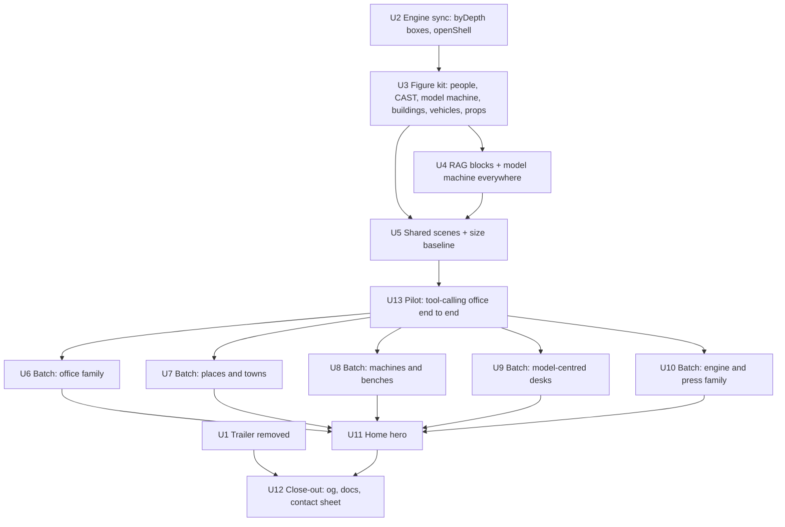

# Creative Scene Figures - Plan

## Goal Capsule

- **Objective:** Replace the "blocks, blocks, blocks" look in every ordinary-looking module scene with real objects and small people. Each reworked scene becomes a recognisable place unique to its module's Larkspur story beat. RAG's trailer comes off the site.
- **Authority:** this plan, then `AGENTS.md`, then each `docs/modules/<id>.md`. The user's words win over all three: "keep everything unique and align with the story."
- **Stop conditions:** stop and ask if a rework would do any of these:
  - rename a part id;
  - change what a scene shows from its run data;
  - need a picture decision in `docs/modules/<id>.md` reversed;
  - redraw an object that a step's narration, `act` or `say` text names as a different kind of thing.
- **Execution profile:** one branch, cut fresh from `main` (not from a branch with unrelated uncommitted work), and one PR at the end. Work in the unit order below. Shared pieces and the U13 pilot land before the batches.
- **Pilot pause:** none. The user chose to keep going after the pilot, which self-checks against the success criteria and fixes the kit before any batch, with no stop for review.
- **Tail:** the four checks in the Verification Contract, then `pnpm og`. The PR carries a contact sheet and the module-to-hero-object table.

---

## Product Contract

### Summary

Nearly every scene is built only from `box()`, `cyl()` and `rod()`. No scene calls `extrude()` or `loft()`. Depots, shops and offices are cubes, vans are two boxes, workers are two cylinders, and the model is a pink cube in about a dozen modules.

This plan does six things:

- Adds a figure kit (people, rounded machines, buildings with roofs, vehicles with wheels, props).
- Gives the model one signature machine.
- Redraws the shared scenes other scenes compose.
- Pilots the look on tool calling's office.
- Reworks 35 module scenes plus the home hero, each around a hero object of its own.
- Removes RAG's trailer.

### Problem Frame

The look is consistent but monotonous. Scenes read as diagrams of cubes, not places, and modules start to look alike. The engine already ships the tools for rounded bodies, cones, domes, jointed arms and open containers. The upgraded upstream Colorfigures adds box-aware depth sorting and `openShell`, and its toaster, lamp and claw examples show the target finish. None of this is used.

### Requirements

- **R1. People.** Every person a scene's story names or implies is a small stylised figure, never a box or token. That covers workers, customers, clerks, the employee, the operator, the eavesdropper, doormen and shoppers. Figures have poses (stand, walk, sit, reach, carry, fallen) and a fixed look per named character.
- **R2. Real objects.** Buildings have roofs, doors and windows, vehicles have wheels and cabs, and machines have rounded bodies. Containers are open shells with rims.
- **R3. Unique and on-story.** Each reworked scene has a hero object no other scene uses, chosen from its story beat (Scene Briefs below). Shared kit pieces fill the rest.
- **R4. One model machine.** The model is one recognisable machine in every module. It keeps the state screen (`OK` / `???` / `!!` / `...`) and scales from student to full size. Every hand-drawn pink box that stands in for a model uses it.
- **R5. Style unchanged.** Flat three-tone shading, heavy ink silhouettes, flat blue shadows, warm paper, the `PALS` palette, and label pills for all text.
  - Signs, podiums, scoreboards, dials and clocks carry no painted words or numerals. They read through shape, colour, pips, bars or pointer angle, and any wording goes in the part's pill.
- **R6. Contracts unchanged.** These stay as they are:
  - part ids, callout targets, pill anchors and counts;
  - each scene's `*At`/`state` functions;
  - the data-to-picture encodings each doc fixes (heights, colours, caps, broken-crate planks);
  - objects the chapter copy names (a crate stays a crate);
  - phone and reduced-motion behaviour.
- **R7. Kept modules.** These are already distinctive and keep their scenes: computer use, diffusion, load balancing, calibration, payments, databases, diffusion LLMs, logins, video models, recommendations, observability. They change only where they call a shared piece (the model machine, people, belts).
- **R8. Trailer removed.** RAG's intro has no trailer. Its component, tests and public files go. The trailer recipe stays in the docs, marked paused, and `videos/rag-trailer/` stays so it can return.

### Success Criteria

- A contact sheet of all module share images passes the uniqueness rubric:
  - **Same hero:** the largest or most-lit object is the same object class.
  - **Same layout:** the same board arrangement of hero object and people.
  - No two reworked scenes share either, and no reworked scene is still mainly plain cubes.
- Every person in a reworked scene reads as a person at 390px wide: at least 22 CSS px tall at phone scale, with a distinct head, body and limbs.
- All four checks pass with no change to any `PARTS` array or `say` target.

### Scope Boundaries

- Flat figures (`flat.ts`, `FlatStage`, the second-view lanes, charts and timelines) are not touched.
- Upstream see-through (`xrGhost`, `xrCallouts`) is not brought in, because a "See inside" x-ray was rejected for this repo. The free orbit camera, `mountKeypad` and soft tone blending (`SOFT`/`step3`) stay out too: Tinker offers only front and back views, and soft bands would change the flat look.
- No new chapters, story copy, steps or controls. Pill text changes only where a part's name is now wrong for its new object, and the id never changes.
- New people and props are static poses driven by run state. This plan adds no new animation.

### Deferred to Follow-Up Work

- A new trailer for RAG (or any module) after the visuals settle.
- Light touches on the kept modules beyond shared pieces.

### Sources

- Upstream Colorfigures skill, upgraded 2026-10-29: `~/.claude/skills/colorfigures/assets/core.js`, plus the examples `toaster.html` (rounded case), `lamp.html` (jointed arm, desk board, per-angle sorting) and `claw.html` (dense machine).
- Share images in `public/og/<id>.jpg` as of commit `3ebfcef`, reviewed as contact sheets during planning.

---

## Planning Contract

### Key Technical Decisions

- **KTD1. The kit lives beside the engine, in `src/lib/iso/figures.ts`.** `docs/writing-a-module.md` says a new figure kind goes beside `core.js`, never inside it. The kit builds on `extrude`, `loft`, `rod`, `cyl`, `hullInk` and `castShadow`. A piece moves into the kit only when two or more scenes use it. A one-scene piece lives in its scene file.
- **KTD2. Sync two upstream helpers into `core.js`**, as an upstream sync per AGENTS.md (diff, reapply `adapted:` changes):
  - box-aware `byDepth` (`boxMid`, `sepOrder`), which still accepts `{at}`-only items;
  - `openShell`, used by baskets, tins, sieves and bins.

  Upstream `sepOrder` reads the free camera's `CAM_V`. Mark it `adapted:` and give it the local view direction in model coordinates: (1,1,1) with the current `VIEW` turn undone, fractional `VIEW` included. Leave out `nearHalf`/`farHalf` until a piece needs them. See-through, camera, keypad and `SOFT` stay out (Scope Boundaries).
- **KTD3. Every kit piece returns `{shadow, items}`, not a joined string.** `items` are sortable `{at, box, svg}` entries with no shadow paint in them. A scene paints every piece's `shadow` first, as the floor layer, then runs one `byDepth` over all items, as `depotScene`/`officeScene` order things today. This follows upstream rule 1 (no fixed back-to-front order across separate parts) without one piece's shadow painting over another's body.
- **KTD4. People are toy-like "peg" figures:** a lofted tapered body, a lofted ball head, `rod` limbs jointed like the lamp arm, no faces.
  - A `CAST` registry in the kit fixes each named character's look, so Rosa, Tomás, Inés, Mira and Tom look the same wherever they appear.
  - Each entry differs by silhouette (hat, hair shape, held prop) as well as colour, so characters stay apart for colour-blind readers.
  - Generic shoppers and customers span a range of skin tones.
  - Names stay in pills (R5).
- **KTD5. Footprint-preserving rework.** Each reworked part keeps its footprint box and pill anchor point, so callout targets and the hero's pill layout hold.
  - Neither `say-targets` nor the hero test checks pills against bodies. A part that grows upward is checked by eye on its dev page at desktop and 390px for pills covered or people hidden.
  - RAG blocks and hero stand plots keep their current height (`spec.ht`), because their pill anchors sit on top.
- **KTD6. One model machine, `modelMachine(x, y, size, state, height?)` in the kit.** `BLOCKS.llm` calls it. So do the hand-drawn stand-ins: forge model, serve draft runner, router student, agent helper desk, engine head screens, and the hero plots.
  - **Form:** a rounded blush cabinet with a hood and a framed screen on short feet. U3 fixes the exact form on `/dev/figures` at student, draft and full size, in all four screen states, at 390px.
  - **Size and height:** at `size` 1 its footprint equals today's `llm` block, and other sizes scale it in proportion. `height` lets pre-training grow it per checkpoint.
  - **Marker:** its group carries `data-kit="model"`.
- **KTD7. RAG blocks keep `HALF`/`BH` footprints and heights but get distinct silhouettes.** RAG's canvas turns in four views, so every block is checked from all four (upstream rule 2: draw a face only when it faces the viewer).
- **KTD8. A per-scene SVG size budget fixed before the rework.** U5 measures each scene's rendered SVG length at `3ebfcef` (before any rework). `tests/unit/scene-size.test.ts` fails any scene above 3× its own baseline. A scene that needs more is raised in the PR on purpose, with a new number.
- **KTD9. Trailer removal takes the trailer off the site and pauses its rule.** Deleted:
  - `Trailer.astro` and its use in `src/pages/rag/index.astro`;
  - the trailer tests (`tests/unit/trailers.test.ts`, `tests/unit/rag-trailer.test.ts`, `tests/e2e/trailer.spec.ts`);
  - `public/video/rag-trailer.*`.

  The AGENTS.md trailer bullet becomes one line saying trailers are paused, with the recipe in `docs/writing-a-module.md`. That recipe section stays, marked paused. `docs/modules/rag.md` drops its trailer note. `videos/rag-trailer/` stays.

### High-Level Technical Design

### Scene Briefs

These are the hero objects and set dressing for each scene. Each brief is a direction, and the implementer may improve on it. Uniqueness (R3), the doc-fixed encodings and the objects named in copy (R6) are hard rules. Where two briefs share furniture (a desk, a cabinet), the hero object is what sets them apart.

| Module | Hero object (unique) | People | Dressing |
|---|---|---|---|
| ab-testing | Two different checkouts: an old till under an awning (A) and a slim one-page kiosk (B) | Shoppers walking through the turnstile | Crate towers as now (doc-fixed), on pallets; a scoreboard on legs |
| agents | The support lead's case handed across a counter | Support lead, helper clerks | Clipboard on a stand, dial gauge, an in-tray that becomes a ring binder |
| caching | Depot with a sawtooth roof and loading bay | Drivers in cabs | Corner shops with striped awnings, cubbies as window shelves, vans with wheels, a road sign |
| coding-agents | Rounded robot agent at a workbench | — | Cabinet with drawer pulls, traffic-light test lamps on a pole, a rounded terminal |
| compression | A weighing scale under the parcel | A packer at the sorting table | Trays with walls, a parcel with string and tape |
| consistency | Telegraph poles with crossarms and insulators | A clerk at each warehouse | Three different warehouses (barn, brick, round-roof), envelopes pegged on the wires |
| context | Reading desk with a banker's lamp under the glass case | A reader | Curled papers, the cache shelf and the memory cabinet as furniture |
| dependencies | A crane hook that pulls a crate (the pull bar) | Crane operator | Crate variants only in the tower (slatted, banded, stencil-marked), padlock with a round shackle |
| email | Pigeonhole sorting frame in Hollis's post room | Postal worker | Relay hops as sorting offices, spam gauge as a needle dial, wire trays, a pillar box |
| encryption | Paint tins with handles on the counter, a mixing paddle | Larkspur and Brightwater shopkeepers; Eve in a trench coat behind a pillar | Shelves of tins |
| evals | Grader's desk with a big rubber stamp and an inked pad | Grader | Card box for tests, a wall-mounted scoreboard |
| fine-tuning | Lever frame with real grips, a real wrench | Technician | A recipe-card box for the prompt, a clip-on adapter module |
| git | HEAD as a hanging lantern on a hook | Mira and Tom | Cloth flags on flagpoles, rails on sleepers |
| guardrails | Screening arch with a guard | Security guard | Pillar post box, striped barrier |
| inference | Diner counter whose stools are the batch seats | Customers queueing | Order-ticket rack as the KV shelf, a small model machine as the draft runner |
| interpretability | Cartridge fuses in clips on the panel | Electrician | Engine room as composed |
| memorisation | Ledger as a bound book on a lectern | — | A framed peg board holding the ranking balls, a sieve-like filter gate |
| mixture-of-experts | An apartment block with coloured front doors on open galleries | Doorman per landing | Conveyor with rollers |
| multimodal | Camera on a jointed arm (after `lamp.html`) | Warehouse worker holding a broken part | Invoice sheet with a photo |
| post-training | Chalkboard curve on an easel | Teacher grader | Answer cards in card holders |
| pre-training | Domed brick kiln with a chimney | Stoker | Conveyor with rollers, checkpoint shelf of ingots, the model machine growing |
| queues | Ticket rail with clips | Customers, workers (fallen pose when knocked over) | Till with a cash drawer, courier booth with a bike |
| rag | One silhouette per block (list below) | — | Workbench as now |
| reasoning | Spiral notepad propped on a lap desk | — | Stove-knob effort dial, alarm clock with bells |
| releases | Signal-box cabin with windows and a semaphore mast | Signalman, shoppers on a platform | Level-crossing gates |
| sandboxing | Greenhouse-frame glass room | Operator outside | Safe with dial and handle, a turnstile proxy booth |
| search | Card-catalogue cabinet with brass pulls | Librarian clerk | Reading table, a three-step podium |
| small-models | Big and small model machines as one family, a curved slide chute | Apprentice | Rail-switch lever as the router |
| structured-outputs | Stencil cut-out sheet in a frame | — | Shared press (see tokens), belt with rollers |
| synthetic-data | Office photocopier with lid and output tray | Clerk | Kitchen sieve with a handle, stacks fading by generation |
| tokens | Cast-iron letterpress with a wheel and lever | — | Paper strip off a spool, belt with rollers |
| tool-calling (office) | Mail-sorting machine with slots as the host | Employee at a counter with a desk phone | Cabinet with handles, potted plant |
| transformers | Open-plan factory floors with railings, clerks at the head desks | Clerks | Threads stay ink |
| voice | Gramophone horn ear and a loudspeaker horn mouth | — | Desk phone with a curly cord, stopwatch with crown and button |
| web-requests | Inés's house with a pitched roof and chimney | Inés at the door, Tomás later | Directory offices with columns, shop with an awning, seal office with a wax-seal emblem, postal carts with wheels |

**RAG blocks:**

| Block | Silhouette |
|---|---|
| docs | Binder stack |
| chunker | Paper guillotine |
| embedder | Dial press |
| index | Rotary card file |
| retriever | Grabber arm |
| rewrite | Typewriter |
| reranker | Sliding-bead sorting frame |
| assembler | Binding station |
| llm | Model machine |
| agent | Model machine wearing a headset, with a clipboard arm |
| graph | Pinboard with strings |
| grader | Stamp desk |

### Sequencing

- U1 and U2 are independent.
- U3 needs U2. U4 needs U3. U5 needs U3 and U4. U13 needs U5.
- Batches U6–U10 need U13 and can run in any order.
- U11 needs every batch, because the hero draws their plots. U12 is last.

### Assumptions

- "Remove trailer for now" means taking it off the site while keeping the recording sources and the recipe.
- With the local view direction swapped in, upstream's `sepOrder` keeps `{at}`-only items sorting as today. U2's tests prove it.

---

## Implementation Units

| U-ID | Title | Key files | Depends on |
|---|---|---|---|
| U1 | Remove RAG trailer | `src/components/intro/Trailer.astro`, `src/pages/rag/index.astro`, trailer tests, docs | — |
| U2 | Engine sync | `src/lib/iso/core.js` | — |
| U3 | Figure kit | `src/lib/iso/figures.ts`, `src/dev/figures.astro` | U2 |
| U4 | Model machine and RAG blocks | `src/lib/iso/blocks.ts` | U3 |
| U5 | Shared scenes and size budget | `officeScene.ts`, `engineScene.ts`, `crateScene.ts`, belt helper, `scene-size.test.ts` | U3, U4 |
| U13 | Pilot: tool-calling office | `officeScene.ts`, `mcpScene.ts` | U5 |
| U6 | Office family | agent, guard, sandbox, eval scenes | U13 |
| U7 | Places and towns | depot, stock, town, post, signal, split, rail scenes | U13 |
| U8 | Machines and benches | forge, copier, pile, tower, crate, train, desk, scan scenes | U13 |
| U9 | Model-centred desks | think, router, exam, recital, phone, serve, window, cabinet scenes | U13 |
| U10 | Engine and press family | engine, fuse, officeRooms, token, stencil, paint scenes | U13 |
| U11 | Home hero | `heroScene.ts` | U6–U10 |
| U12 | Close-out | `public/og/`, `docs/modules/*.md`, `AGENTS.md` | U11 |

### U1. Remove RAG trailer

- **Goal:** The site has no trailer surface. The recording sources and the recipe stay.
- **Requirements:** R8, KTD9.
- **Dependencies:** none.
- **Files:**
  - Delete `src/components/intro/Trailer.astro`, `tests/unit/trailers.test.ts`, `tests/unit/rag-trailer.test.ts`, `tests/e2e/trailer.spec.ts` and `public/video/rag-trailer.{mp4,jpg,vtt}`.
  - Modify `src/pages/rag/index.astro`, `AGENTS.md` (Pictures: trailers bullet becomes "paused"), `docs/writing-a-module.md` (Trailer section marked paused; done-checklist mentions dropped) and `docs/modules/rag.md` (trailer note).
- **Approach:** Remove the import and the hero-button use on the RAG intro. Check the intro's hero buttons still lay out at desktop and 390px. Grep for `video/` and `Trailer`, so no CSS or link is left behind.
- **Test scenarios:** `Test expectation: none -- removal; the existing RAG intro e2e and a11y specs prove the page still renders and passes axe.`
- **Verification:** `/rag/` renders without a trailer button, and nothing in `src/` or `tests/` references `public/video`.

### U2. Engine sync: box-aware sorting and open shells

- **Goal:** `core.js` gains upstream's `boxMid`, `sepOrder`, box-aware `byDepth` and `openShell`. `sepOrder` is adapted to the local view turn.
- **Requirements:** R5, KTD2.
- **Dependencies:** none.
- **Files:** modify `src/lib/iso/core.js`. Create `tests/unit/iso-sort.test.ts`.
- **Approach:**
  1. Diff upstream `core.js` against local for those helpers only.
  2. Copy `boxMid`, `byDepth` and `openShell` as written.
  3. Adapt `sepOrder` to the local view direction (KTD2) and mark it `adapted:`.
  4. Leave `tone`/`toneI` stepped. Do not import `SOFT`/`step3`.
- **Patterns to follow:** the existing `adapted:` markers (`withFrame`, `unrotXY`, `inkK`).
- **Test scenarios:**
  - Two items with boxes separated along x sort far-to-near at `VIEW` 0, and in the reverse order at `VIEW` 2.
  - Box order is correct at each whole `VIEW` 0–3 and at a fractional `VIEW` such as 1.5.
  - A long thin box beside a short tall box overlapping its centre depth sorts by separation, not centre.
  - A dense fixed set of about 10 overlapping boxes gives the same output order for several shuffled input orders. If it doesn't, replace the comparator sort with a topological sort over separation pairs.
  - Items with only `at` sort exactly as before: compare against the old comparator on a fixed set.
  - `openShell` output contains the far wall, then the contents, then the near wall, in that order.
- **Verification:** the new tests pass, and every existing scene unit test passes unchanged.

### U3. Figure kit, people and the model machine

- **Goal:** One module of reusable pieces that each return `{shadow, items}`, plus a dev page that shows every piece in every pose and view. The model machine's form is fixed here.
- **Requirements:** R1, R2, R4, R5, KTD1, KTD3, KTD4, KTD6.
- **Dependencies:** U2.
- **Files:** create `src/lib/iso/figures.ts`, `src/dev/figures.astro` and `tests/unit/figures.test.ts`.
- **Approach:** the pieces fall into four groups.
  - **People:** `person({x, y, z, facing, pose, look, holding})` with poses stand, walk, sit, reach, carry and fallen. `CAST` holds the named looks: Rosa, Tomás, Inés, Mira, Tom, the employee, the operator, Eve, the support lead, and generic shopper variants.
  - **Model:** `modelMachine` (KTD6).
  - **Buildings:** gable, sawtooth, flat-with-parapet and dome roofs, door, window and awning.
  - **Vehicles and props:** van, cart and bike with wheels (`cylX` with a rim and thickness, never a flat disc), conveyor with rollers, pole with crossarm, potted plant, lamp, basket and bin (open shells), padlock. Only pieces that two or more scenes will use belong here (KTD1).

  Each piece puts its cast shadow in `shadow` and its silhouette ink at upstream weights in `items`. It draws faces only when they face the viewer (`vis`). Its size defaults suit `CELL` = 56 boards. Write the parts and real-object notes at the top of each piece, as the upstream "Truth first" guidance asks.

  The dev page renders a grid of pieces at both offered turns and at phone pill scale. It also shows `modelMachine` at student, draft and full size in all four states. Fix the machine's form there before U4 starts.
- **Patterns to follow:**
  - `lamp.html` for jointed rods and per-angle ordering.
  - `toaster.html` for a rounded case via `extrude(rrUV…)` with its cap and hull ink.
  - The `BLOCKS` spec shape in `src/lib/iso/blocks.ts` for options.
- **Test scenarios:**
  - Every piece in every pose and all four views renders without `NaN`, with a non-empty item `svg`.
  - Every item a piece returns carries a `box`, and its box lies inside the declared footprint.
  - No item `svg` contains the shadow colour, and every piece's `shadow` does.
  - `person` with each `CAST` key renders that cast's palette and silhouette marker (its hat or prop). An unknown key falls back to a generic look.
  - A standing `person` at phone scale is at least 22 CSS px tall.
  - `modelMachine` in each state shows the matching `STATE_COL` screen colour. At `size` 1 its footprint equals today's `llm` block, and its group carries `data-kit="model"`.
  - Text passed to any piece's optional tag goes through `esc()`: a `<` in a name comes out escaped.
- **Verification:** `/dev/figures` shows every piece reading clearly at desktop and 390px from both turns, and the model machine form is settled.

### U4. Model machine everywhere and distinct RAG blocks

- **Goal:** `BLOCKS.llm` and every hand-drawn model stand-in use `modelMachine`. The other 11 RAG blocks get the silhouettes in the RAG blocks table.
- **Requirements:** R3, R4, R6, KTD6, KTD7.
- **Dependencies:** U3.
- **Files:**
  - Modify `src/lib/iso/blocks.ts`, plus the stand-ins in `forgeScene.ts`, `serveScene.ts`, `routerScene.ts`, `agentScene.ts` (`helperDesk`), `engineScene.ts` (head screens) and the hero plot helpers.
  - Test with `tests/unit/blocks.test.ts` (extend or create).
- **Approach:** Keep each block's footprint, its height, its `blockTag` anchor and its state hooks. Pre-training's growing model uses the `height` parameter, so `docs/modules/pre-training.md`'s "grows taller" decision holds. Check `/dev/blocks`, `/dev/canvas` and the RAG chapters in all four views, because the canvas turns.
- **Test scenarios:**
  - Every `BLOCK_TYPES` entry renders in all four views with no `NaN`. Its tag anchor and height are unchanged: snapshot the numbers, not the SVG.
  - `renderers.llm` in each of the states OK, ???, !! and none shows its screen colour.
  - Each scene that draws a model renders a `data-kit="model"` group for it. A model-class group without the marker fails. A colour grep is not used, because blush is a legitimate colour in many kept scenes.
- **Verification:** the RAG e2e specs (`ch1-2` to `ch7`, `canvas.spec.ts`) pass, and the canvas looks right when turned.

### U5. Shared scenes and the size budget

- **Goal:** The scenes other modules compose get the new look first, so the batches inherit it. The size budget is in place before any batch.
  - `officeScene` structure (U13 finishes its look).
  - `engineScene`: open-plan floors with railings, clerks at the head desks.
  - The belt helper `beltAt`: rollers and side rails.
  - `crate()`: slatted crate with corner posts.
- **Requirements:** R1–R3, R6, KTD5, KTD8.
- **Dependencies:** U3, U4.
- **Files:**
  - Modify `src/components/scenes/officeScene.ts`, `engineScene.ts`, `crateScene.ts` (its `crate()` only; the yard is U8), and wherever `beltAt` lives.
  - Create `tests/unit/scene-size.test.ts`, with baselines measured at `3ebfcef`.
  - Extend those scenes' existing unit tests.
- **Approach:** These signatures stay as they are: `OFFICE_PARTS`, `ENGINE_PARTS`, `splitOffice`, `officeLabel`, `archAt`, `barrierAt`, `enginePlot`, `beltAt` and `crate`. Every composer must still render:
  - **Office composers:** agents, guardrails, sandboxing, evals ch5, tool calling, the hero.
  - **Engine composer:** interpretability.
  - **`beltAt` composers:** cloak (logins, a kept module), depot, serve, phone, token, stencil, scan.
  - **`crate()` composer:** towerScene.
- **Test scenarios:**
  - Every `OFFICE_PARTS` and `ENGINE_PARTS` id still resolves to an anchor.
  - Every composing scene listed above renders with no `NaN`.
  - Every scene stays within 3× its own pre-rework baseline (KTD8).
- **Verification:** these e2e specs pass:
  - tool calling, agents, guardrails, sandboxing, transformers, interpretability;
  - logins, caching, inference, voice, tokens, structured outputs, multimodal, dependencies.

### U13. Pilot: tool-calling office end to end

- **Goal:** Prove the kit on one real scene before the batches. Rework tool calling's office (`officeScene`, `mcpScene`) to its brief:
  - the employee at a counter with a desk phone;
  - the host as a mail-sorting machine;
  - the model machine;
  - a cabinet with handles and a potted plant.
- **Requirements:** R1–R6.
- **Dependencies:** U5.
- **Files:** modify `src/components/scenes/officeScene.ts` and `mcpScene.ts`. Regenerate the tool-calling share images.
- **Approach:** Tool calling has no `src/dev/tool-calling.astro`. Check it through its live chapters and `/dev/og`. Generate its share images, and judge them against the success criteria at 390px. If the look misses, fix the kit in `figures.ts` before any batch starts.
- **Test scenarios:**
  - The existing tool-calling scene and state tests pass unchanged, and `say-targets` passes.
  - The office renders in every chapter state, in both turns, with no `NaN` and within its size budget.
  - Every composer of `officeScene` (agents, guardrails, sandboxing, evals ch5, hero) still renders.
- **Verification:** the tool-calling e2e specs pass, and its share images meet the success criteria.

### U6–U10. Module batches

Every batch follows the same contract. Each one lands as its own commit.

- **Goal:** Rework each listed scene to its Scene Brief, with a hero object no other scene has (R3). Add people from `CAST`/`person` (R1).
- **Requirements:** R1–R3, R5, R6, KTD3, KTD5, KTD8.
- **Approach, per scene:**
  1. Read `docs/modules/<id>.md` and the chapter copy. Keep every encoding the doc fixes and every object the copy names (R6).
  2. Swap the box stand-ins for kit pieces or new local pieces, keeping footprints and pill anchors (KTD5).
  3. Paint all shadows first, then one `byDepth` with boxes over every item (KTD3).
  4. Check the module's dev page (`src/dev/<id>.astro`) at desktop and 390px, front and back turn, every chapter state, and with reduced motion. Look for pills covered and people hidden by taller objects.
  5. Add one line to `docs/modules/<id>.md` naming the hero object.
- **Batches:**
  - **U6 Office family:** agents (`agentScene`), guardrails (`guardScene`), sandboxing (`sandboxScene`), evals (`evalScene` with `miniPipeline`).
  - **U7 Places and towns:** caching (`depotScene`), consistency (`stockScene`), web requests (`townScene`), email (`postScene`), releases (`signalScene`), A/B testing (`splitScene`), queues (`railScene`, including `railCard`).
  - **U8 Machines and benches:** pre-training (`forgeScene`), synthetic data (`copierScene`), compression (`pileScene`), dependencies (`towerScene`), git (`crateScene` yard and packing desk), fine-tuning (`trainScene`), coding agents (`deskScene`, including `deskCard`), multimodal (`scanScene`).
  - **U9 Model-centred desks:** reasoning (`thinkScene`), small models (`routerScene`), post-training (`examScene`), memorisation (`recitalScene`), voice (`phoneScene`), inference (`serveScene`), context (`windowScene`), search (`cabinetScene`).
  - **U10 Engine and press family:** transformers (`engineScene` finish), interpretability (`fuseScene`), mixture of experts (`officeRoomsScene`), tokens (`tokenScene`), structured outputs (`stencilScene`, redrawn to match the new press), encryption (`paintScene`).
- **Files:** the scene files above, their existing `tests/unit/*` scene tests, and `tests/unit/scene-size.test.ts`.
- **Test scenarios, per batch:**
  - Each scene's existing state tests (`*At`, `*Of`, `state`) pass unchanged. They test data, not drawing.
  - `tests/unit/say-targets.test.ts` passes with no edit to any `PARTS`.
  - Each reworked scene renders every chapter state in both turns with no `NaN`, and within 3× its baseline.
  - Doc-fixed encodings still hold. Examples:
    - the queues fallen worker renders in the fallen pose;
    - a dependencies broken crate still carries tomato plus crossed planks;
    - the A/B towers are still mint crates;
    - the encryption pot pill fill still equals the computed paint.
- **Verification:** each batch's module e2e specs pass. A contact sheet of the batch's share images (`pnpm og <ids…>`) passes the uniqueness rubric against every other module.

### U11. Home hero

- **Goal:** The workshop hero shows the new RAG row, office, model machine and stand plots. The building site gets a worker.
- **Requirements:** R1–R4, R6.
- **Dependencies:** U6–U10.
- **Files:** modify `src/components/scenes/heroScene.ts` and every `*Plot`/`*Card` helper it imports that the batches didn't already update. Test with `tests/unit/hero.test.ts`.
- **Approach:** The board size stays fixed. Each stand plot keeps its 4-pill budget and its current height (KTD5). Kept-module plots change only through shared pieces. Plot helpers return joined strings, so order within a plot is fixed by hand, as today.
- **Test scenarios:**
  - The existing `tests/unit/hero.test.ts` passes: no pill overlap at any registry size, every live module drawn, the board never grows.
  - The hero renders still with reduced motion.
- **Verification:** home at desktop and 390px shows the hero in the first screen, and every stand turn reads, people included, at the 1.5× stand scale.

### U12. Close-out

- **Goal:** Share images match the pages, the docs record the new picture rules, and a final review confirms uniqueness.
- **Requirements:** R3, R5, R8, success criteria.
- **Dependencies:** U11.
- **Files:**
  - Regenerate `public/og/*.jpg` with `pnpm og`.
  - Modify `AGENTS.md` (Pictures): name the figure kit, people via `CAST`, the model machine, the shadow-first `byDepth` rule and the size budget.
  - Modify `docs/writing-a-module.md` ("Draw the pictures"): reach for `figures.ts`, give the module a hero object unique to it, keep text off signs.
- **Approach:**
  1. Build a contact sheet of every module's share image.
  2. Apply the uniqueness rubric pairwise and fix any repeats.
  3. Attach the sheet and the module-to-hero-object table to the PR.
  4. Commit the JPEGs at quality 88.
- **Test scenarios:** `Test expectation: none -- generated images and docs. The e2e share-image test checks only that each image exists and is a distinct file; visual uniqueness is the manual contact-sheet gate above.`
- **Verification:** all four checks pass, and the contact sheet passes the rubric.

---

## Risks

- **Depth-sorting bugs multiply with detail.** KTD2 and KTD3 address this, as does the U2 dense-set test. Check both turns on every dev page, and all four views for RAG.
- **Phone legibility.** Small people and fine detail can turn to mush at 390px. Keep hairline counts low (upstream: repeated hairlines 8–18). Give people bold silhouettes over detail and the 22 px minimum.
- **Taller objects covering pills or people.** No automated test checks this (KTD5). It is a named step in every per-scene check.
- **Scale of work.** 35 scenes is the bulk of the work. The U13 pilot catches a wrong direction before it multiplies. The batches can run in any order, and each scene follows the same contract.
- **Loss of uniformity becomes noise.** The kit fixes line weights, palette and one model machine, so variety comes from objects, not styles.

---

## Verification Contract

- `pnpm check`: 0 errors, 0 warnings.
- `pnpm lint`: 0 diagnostics.
- `pnpm test`: includes the new `iso-sort`, `figures`, `blocks` and `scene-size` tests, unchanged `say-targets` and `hero`, and no trailer tests.
- `pnpm test:e2e`: every chapter played, axe, keyboard, reduced motion, phone, offline, share images.
- Manual:
  - each reworked module's dev page and live chapter at desktop and 390px, front and back turn;
  - RAG through `/dev/blocks`, `/dev/canvas` and its chapters in all four views;
  - tool calling through its chapters and `/dev/og`;
  - the home hero;
  - the contact-sheet uniqueness rubric.

## Definition of Done

- Every scene in U13 and U6–U10 matches its brief's hero object, and the contact sheet passes the uniqueness rubric.
- No reworked scene draws a person, vehicle, building or model as a plain box.
- The 11 kept modules are unchanged except through shared pieces.
- No `PARTS` id, `say` target, scene state function or copy-named object changed.
- The trailer is gone from the site. Its sources and recipe are kept, and the recipe is marked paused.
- Share images are regenerated and committed. The PR carries the contact sheet and the hero-object table.
- AGENTS.md and `docs/writing-a-module.md` describe the kit.
- All four checks pass.
- Experimental or abandoned drawing code is removed from the diff.
- One PR to `main` from a fresh branch, with conventional commits per unit.
