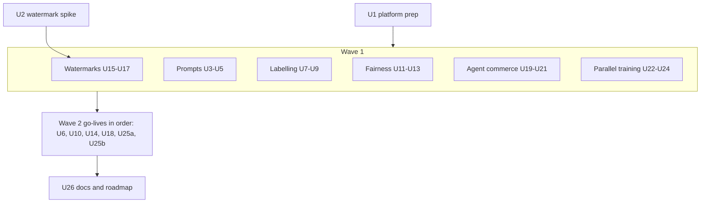
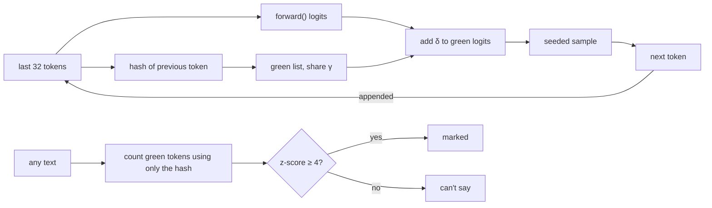
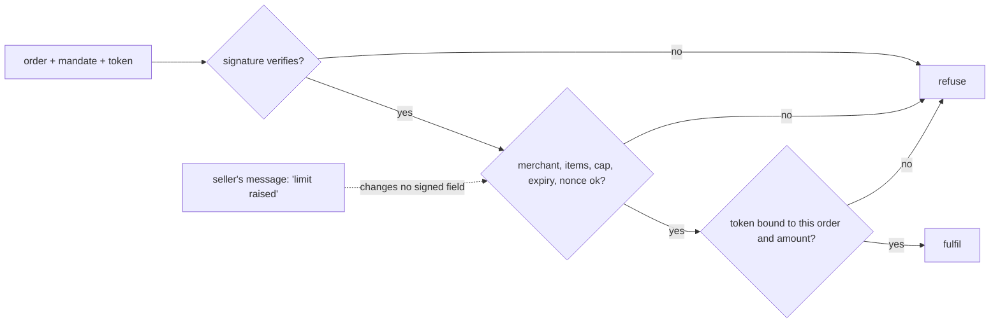
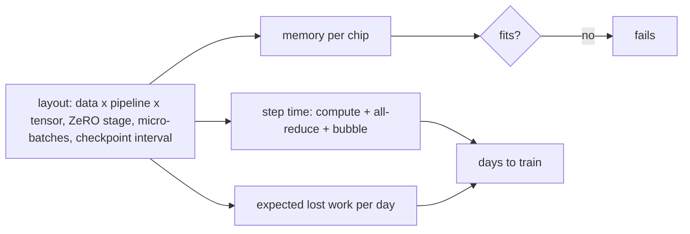

# Six AI Modules - Plan

## Goal Capsule

- **Objective:** Six AI modules go live as modules 47–52 (KTD1):
  - 47 Writing a prompt
  - 48 Who labels the data
  - 49 Bias and fairness
  - 50 Watermarks and made-by-AI
  - 51 When the buyer is an agent
  - 52 Many chips, one model

  Prompts, Fairness and Watermarks are today's AI roadmap cards. Labelling, agent commerce and parallel training are new topics no live module covers (R2). Each scene is a real place built around a hero object, with a picture mechanic no earlier scene has (R10). Three new AI roadmap cards replace the three that go live (R12).
- **Product authority:**
  - Product Contract requirements (R-IDs) win on product behaviour. Key Technical Decisions (KTD-IDs) win on mechanism.
  - AGENTS.md stays in force unless a KTD here changes it on purpose.
  - Shape and process follow `docs/plans/2026-10-28-2100-feat-final-seven-roadmap-modules-plan.md`; where this plan is silent, that plan's patterns apply.
  - The look follows `docs/plans/2026-10-29-0847-feat-creative-scene-figures-plan.md`: kit people, the model machine, real objects, no plain-cube scenes.
- **Open blockers:** None.
- **Execution profile:** brownfield work on the Astro + React islands site, on **one local branch with one PR at the end**. The executor makes every call mid-build and notes any re-scope in the PR (the user's standing preference).
  - **Wave 0:** platform prep (U1), the watermark spike (U2).
  - **Wave 1:** the six modules' engines, scenes and chapters, each inside its own folders.
  - **Wave 2:** the go-lives, in KTD1 order.
  - **Wave 3:** docs and roadmap (U26).
  - Every wave leaves `pnpm check`, `pnpm lint`, `pnpm test` and `pnpm test:e2e` green. There is no CI, so run all four locally before pushing.
- **Stop conditions** (resolve by the stated fallback, note it in the PR; stop outright only where no fallback is given):
  - A chapter needs a backend, a live LLM, an API key, real network traffic, a real payment or training in the browser (R3). Fallback: simulate it under KTD13. Stop only if no labelled simulation can teach the lesson honestly.
  - **What can't be real is simulated, never a stop** (KTD13). Every simulation is labelled where it shows, and the copy cites the research behind the behaviour it shows.
  - U2's watermark misses its bar (KTD3). Fallbacks in order, once each: fix γ at 0.25; raise δ past the sweep to 6; lengthen replies to 96 tokens (`forward()` still reads the last 32). If all three miss, the watermark runs on KTD13's simulated writer.
  - No API key for a recording (KTD4). The simulated replies of KTD13 take its place.
  - Prompts' single recording run does not show a pinned effect (KTD4). The chapter teaches what the recording shows, or that chapter uses KTD13's simulated replies, labelled as such. A run is never repeated in search of a better result.
  - Any existing weight file, golden, recording or sha256 pin changes (R11). Stop.
  - A source checked for a `facts.json` contradicts a chapter's lesson. Fallback: rewrite the chapter to match the source and note it in the PR. The Appendix's "Moving facts" are re-checked on the access date.
  - A new mechanic cannot be done with a keyboard, or has no reduced-motion form (R10).
- **Tail ownership:** `ce-work` or the executor owns the branch, the PR and the local checks.

---

## Product Contract

### Summary

Six AI modules go live. They move from the first thing a team does with a model (write a prompt) to the hardest thing a lab does (train across thousands of chips):

- how to ask a model for what you want;
- who decides what the right answer is;
- who the model gets wrong;
- telling made-by-AI text and pictures from the rest;
- a shop whose customer is someone else's agent;
- how one model is split across many chips.

Each is a place drawn with kit people and a hero object of its own, where the reader does something new to the picture (KTD10):
- clipping cards onto a work docket;
- sorting tickets into a pigeonhole rack;
- sliding the bar on a two-lane sorting gate;
- sweeping a UV lamp over a page;
- signing a spending slip that another counter checks;
- passing buckets round a ring of workers.

### Problem Frame

Three AI roadmap cards have been visible since the last build. With 46 modules live, the AI catalogue still has gaps a reader at an adopting company runs into:
- **Prompts:** everyone writes them first, and most never test them.
- **Fairness:** who the model gets wrong.
- **Watermarks:** proving where content came from.
- **Labelling:** the human work behind every eval and fine-tune.
- **Agent commerce:** a sales channel that arrived in 2025–26.
- **Parallel training:** why frontier training costs what it does.

Each needs a mechanism it can really run in the browser. The tiny model can't follow instructions (32-token context, about 51k parameters; `docs/lm-kit.md`). So Prompts and agent commerce use recorded replies keyed by signature, as Agents and Guardrails do. Watermarks runs the real green-list scheme on Larkspur mini's sampling. Fairness, Labelling and parallel training compute everything with deterministic TS functions.

### Requirements

**Platform**

- R1. The six modules go live as 47–52 in KTD1 order. Each has an intro, seven chapters, a recap, a recall bank with one pin, share images, a home card, a hero stand plot and an e2e spec.
- R2. Ids, levels, tracks and prerequisites:

  | Module | Id | Level | Prerequisites |
  |---|---|---|---|
  | Writing a prompt | `prompts` | Beginner | none |
  | Who labels the data | `labelling` | Intermediate | `evals` |
  | Bias and fairness | `fairness` | Intermediate | `calibration` |
  | Watermarks and made-by-AI | `watermarks` | Intermediate | `transformers` |
  | When the buyer is an agent | `agent-commerce` | Advanced | `agents`, `payments` |
  | Many chips, one model | `parallel-training` | Advanced | `pre-training` |

  All are track AI. `prompts`, `fairness` and `watermarks` keep their planned ids. The three new ids are not on the roadmap, so their modules are scaffolded with `pnpm new-module`, which appends after the last live module.
- R3. There is no backend, no API key and no live LLM, and nothing trains in the browser. Nothing touches a real network, a real payment or a real merchant. Larkspur mini and its weights are reused as they are, and nothing is retrained. Counting words per label (Labelling's triage, like Email's spam score) and a fixed-iteration fit run in tests (Fairness) are not training in the browser.
- R4. Every module is picture-first from its first commit:
  - the copy budgets hold;
  - every instruction is in `act`;
  - callouts (`say`) name parts the scene exports;
  - sources open through `Cite`;
  - chapter terms are marked where they are first used.
- R5. Every fact comes from `data/<id>/facts.json`, with its source and access date. Moving facts (protocol versions and partners, watermark deployments, chip memory and link speeds, published cluster failure rates) say whose figure it is and when (Appendix).
- R6. Every stand-in is labelled wherever it shows:
  - recorded or simulated model replies and agent turns, and any simulated writer or cluster (KTD13);
  - hand-written tickets, labels, applicants and orders;
  - planning-number step times and failure rates;
  - demo keys and demo mandates.

**Modules.** Chapters in order. Chapter 7 is each module's workbench.

- R7a. **Writing a prompt.** Larkspur's support team writes the prompt for its reply drafter. The edge: "a prompt is a spec: say the task, show an example, fix the format, then test it like code".
  1. The model only continues text: Larkspur mini finishing a line, live.
  2. Say what you want: a vague ask against a clear one.
  3. Show, don't tell: one or two examples, and the model copying their quirks.
  4. Put it in a shape: format instructions, and a reply a program can read.
  5. Order and emphasis: the same parts in a different order, and the buried rule.
  6. Test it like code: a prompt change scored on a question set (Evals' graders), then the same prompt on a smaller model.
  7. Workbench: build a prompt from cards against a set of tickets, on quality and length.
- R7b. **Who labels the data.** Larkspur labels support tickets by intent to train and grade its triage. The edge: "a label is a judgement; write the rule down, measure agreement, and check the checkers".
  1. Someone has to decide: three labellers, one ticket, three answers.
  2. How often do they agree? Agreement, and agreement by luck (kappa).
  3. Write the rule down: a guideline fixes most disagreements.
  4. Check the checkers: gold tickets catch a careless labeller.
  5. Many votes: majority vote, and when the minority was right.
  6. Label the hard ones first: the model's least-sure tickets, and a model as a labeller.
  7. Workbench: a labelling budget across people, votes, gold share and a model labeller, against label accuracy and cost.
- R7c. **Bias and fairness.** Larkspur's trade-account check approves builders for credit terms, and one group is turned down more often. The edge: "a model can be right on average and wrong for a group; measure each group, and know which fairness you are buying".
  1. Right on average: one accuracy number, and two groups inside it.
  2. Errors group by group: who is wrongly turned down.
  3. Where the skew comes from: a proxy feature (a postcode) and a thin sample.
  4. Dropping the column: removing the group field, and the proxy that keeps it.
  5. One bar or two: a shared threshold against per-group ones.
  6. You can't have every kind: equal precision and equal error rates (both kinds) at once when base rates differ.
  7. Workbench: features, sample fix and thresholds, against overall error and the gap between groups.
- R7d. **Watermarks and made-by-AI.** Larkspur wants to mark its assistant's replies, and a customer forwards a "Larkspur" email the assistant never wrote. The edge: "a watermark is a hidden pattern the writer puts in on purpose; a detector without one can only guess".
  1. Can you tell? Human replies and a real model's recorded replies side by side, and the reader guesses (Larkspur mini's text would be too easy to spot).
  2. A hidden pattern: green and red words, chosen from the word before.
  3. Leaning green: the nudge (δ) as the model writes, live, and what it costs the reply.
  4. Counting green: the detector's score, and why short text is unsure.
  5. Rewording washes it out: the reader swaps words in the reply and watches the score.
  6. Pictures and labels: an invisible mark in pixels, and a signed label (C2PA) that a crop or a screenshot drops.
  7. Workbench: δ and green share against reply quality, detection after edits and false alarms on human text.
- R7e. **When the buyer is an agent.** A builder's purchasing agent orders from Larkspur's shop, and Larkspur's own sales agent answers it. The edge: "an agent can only spend what a person signed for; the shop checks the signature, not the agent's word".
  1. A page for people: an agent reading the shop page, and what it gets wrong.
  2. A menu for agents: an agent card, and a catalogue an agent can read.
  3. Agent to agent: a task that asks a question back before it finishes.
  4. Who said it could buy? A signed mandate: what to buy, how much, until when.
  5. A seller that talks back: a seller's message that tries to raise the limit.
  6. Paying without the card: a single-use token bound to one order.
  7. Workbench: mandate limits and confirm rules against a set of sellers, honest and not.
- R7f. **Many chips, one model.** Larkspur's model vendor trains the next version on rented chips, and Larkspur's team needs to read the quote. The edge: "a model too big for one chip is split by data, by layers or within a layer, and every split trades memory for waiting".
  1. It doesn't fit: weights, gradients and optimiser state against one chip's memory.
  2. Copies and slices of data: data parallel, and averaging gradients round a ring.
  3. Split the copies' memory: sharding the optimiser state.
  4. Split by layers: a pipeline, its bubble, and micro-batches.
  5. Split inside a layer: tensor parallel, and why it stays inside one box.
  6. A chip fails: checkpoints, and how often to save.
  7. Workbench: a layout for a given model and cluster, against memory, step time and lost work.

**Pictures and story**

- R8. Every module continues the Larkspur Supply Co. story, and its people are `CAST` figures where the story names them.
- R9. Each module teaches what its live neighbour doesn't, and links to it where they meet:
  - **Prompts:** writing the ask. Structured outputs teaches enforcing the shape, Context teaches what fits, Evals teaches grading.
  - **Labelling:** making the reference answers. Evals teaches using them; Synthetic data teaches generated data.
  - **Fairness:** error rates per group. Calibration teaches whether confidence is honest; A/B testing teaches deciding from noise.
  - **Watermarks:** marking at generation. Transformers teaches sampling; Locks and keys teaches signatures.
  - **Agent commerce:** buying between agents. Agents teaches the loop, Guardrails teaches injection, Card payments teaches the network.
  - **Parallel training:** splitting the training run. Pre-training teaches what a run learns; Inference teaches serving.
- R10. Each module's scene has a hero object no other scene uses and a mechanic no earlier scene has (KTD10). It keeps the house rules:
  - Colorfigures style, kit people and the model machine;
  - label pills, one figure per stage, a precise tab, `say` callouts;
  - escaped text, reduced motion and phones.

  The mechanic is never the only way to act: each has a keyboard path and a reduced-motion form.
- R11. The 46 live modules and their saved progress do not change: no chapter id, step id, recording, golden, pinned output or share image changes. `tests/unit/step-ids.test.ts` enforces it. The exceptions are the KTD11 shared hotspots, and mentions that newly link to a live module.
- R12. Three new AI planned cards follow the live modules (KTD12). The four classic cards stay.
- R13. Every name shown (customers, labellers, applicants, agents, sellers, products) is read from data. Merchants and domains are fictional (`.example`). No module names a vendor as the place to do the thing; protocols, products and incidents are cited as dated facts. Fairness's groups are neutral, hand-made labels (two regions), never a protected class shown as data about real people. The copy names the protected-class setting once, with its legal source.

### Scope Boundaries

- Earlier modules' pictures, share images and saved progress stay as they are.
- No new weights and no retrain. Watermarks samples from `model.bin`; every other module runs on data and TS functions.
- Maths stays optional, in fold-away "the maths" notes: kappa, the green-count z-score, the fairness metrics, bytes per parameter, the pipeline-bubble fraction and the checkpoint interval.
- **Prompts:** recorded replies come from one main model on one date (KTD4), and the copy says so. Ch. 6 runs the winning prompt on a second, smaller model once, to show that a prompt is tested per model; there is no claim that the same prompt works on every model.
- **Labelling:** one task (ticket intent, 5 labels), with no image or span labelling.
- **Fairness:** binary approve or decline with two groups, and no legal advice. Causal fairness is one cited fact.
- **Watermarks:** green-list text marking only. The image mark is a toy spread-spectrum pattern on a small picture, labelled as a toy. SynthID and C2PA are cited facts, with C2PA's signature reusing Locks and keys' demo key.
- **Agent commerce:** no protocol is implemented to spec. The chapters follow the shared shapes (agent card, task states, signed mandate, scoped token) and cite AP2, ACP, UCP, A2A and MCP as dated facts.
- **Parallel training:** a timing model with labelled planning numbers, not a cluster simulator. The ring all-reduce runs on real numbers; nothing else does maths on gradients.

### Deferred to Follow-Up Work

- Building the three new AI planned cards and the four classic ones.
- Trailers (paused site-wide).

### Success Criteria

- After each module a reader can say its edge in plain words, as R7a–R7f phrase it.
- `pnpm test` fails when any of these drifts from its pin:
  - a pinned output (a watermarked reply, a z-score, a kappa, a fairness metric, a mandate verdict, a memory sum, a step time);
  - a workbench's `WINNERS`;
  - recording coverage.

  It also fails when a new payload passes its budget.
- At 1280px and 390px, the catalogue shows 52 live modules under their levels and seven roadmap cards. The hero stand shows each new module in turn, and the first screen holds.
- A contact sheet of the six new share images passes the creative-figures uniqueness rubric: no hero object class or board layout repeats an existing scene's.

### Key Decisions

- Six modules in one plan: the three roadmap AI cards plus three new AI topics (session-settled: user-directed — chosen over only the three roadmap cards: the user asked for both). Governs R1, R2.
- Watermarks runs a real green-list watermark on Larkspur mini's sampling in the browser (session-settled: user-approved — chosen over recorded examples: the reader generates and edits text and sees the score change). Governs R3, R7d.
- One branch and one PR, with the executor making mid-build calls (session-settled: user-directed — chosen over per-wave PRs: the user's standing preference). Governs R1.

---

## Planning Contract

### Key Technical Decisions

- KTD1. **Module numbers follow merge order:**
  - 47 Prompts
  - 48 Labelling
  - 49 Fairness
  - 50 Watermarks
  - 51 Agent commerce
  - 52 Parallel training

  The Beginner module comes first. Watermarks lands after its spike (U2). The two Advanced modules come last.
- KTD2. **What runs live and what is computed offline:**

  | Module | Live in the browser | Committed data |
  |---|---|---|
  | Prompts | Larkspur mini's continuation (ch. 1); assembling the prompt from cards; Evals' graders (`exactMatchOf`, `keyFactOf`) and a format check on each reply; token counts | recorded replies keyed by prompt signature (KTD4); Larkspur's tickets and references |
  | Labelling | agreement and Cohen's kappa; majority vote; gold scoring; a naive-Bayes triage model from counts (Email's spam-score pattern); least-sure ordering | hand-written tickets with true intents; each labeller's labels generated by a script from seeded profiles, reviewed and frozen; recorded model labels for 20 tickets |
  | Fairness | a logistic score from fixed weights; confusion counts, error rates and precision per group; thresholds | hand-made applicants; weights from `fit()`, pinned and recomputed in a test (Recommendations' `factorise()` pattern) |
  | Watermarks | Larkspur mini's forward pass and seeded sampling with the green-list nudge; the detector's z-score; the reader's word swaps re-scored; the toy pixel mark and its correlation detector; C2PA-shaped manifest verify (ECDSA) | human-written comparison replies; ch. 1's recorded real-model replies; seeds; pinned outputs; the manifest's signature (signed in tests, as Locks and keys does) |
  | Agent commerce | agent card and catalogue parsing; the task state machine; mandate signing and verify (ECDSA, the builder's demo key); limit, expiry and item checks; token binding | recorded agent turns keyed by signature; sellers; demo mandates; the builder's demo key pair |
  | Parallel training | memory sums per layout; the ring all-reduce over real numbers; the timing model; the pipeline schedule; expected lost work for a checkpoint interval | planning numbers for chip memory, link speeds and failure rates (dated facts, labelled) |

- KTD3. **The watermark is Kirchenbauer et al.'s green list on Larkspur mini** (`src/lib/watermarks/`).
  - **Green list:** a seeded hash of the previous token id splits the 768-token vocabulary, with γ (green share) of it green. δ is added to green logits before sampling.
  - **Sampling:** reuses Transformers' seeded sampler (`src/lib/transformers/sample.ts`: `mulberry32` and its softmax distribution) at temperature 1, with the nudge applied to the logits first. Every reply a chapter shows is pinned and re-derived in a test. It calls `forward()` from `src/lib/lm/model.ts` unchanged. Replies run to 64 tokens while `forward()` reads the last 32, and the copy says the model sees only its last 32.
  - **Detector:** a z-score against γ over the green count of each distinct (previous token, token) pair, each counted once, as Kirchenbauer et al. do for repeats. It always scores `encode(decode(reply))`, the same tokens a reader's text gives. It needs no model, and the chapter says so. Below 16 scored pairs it reports "too short to say".
  - **Bar (U2):** across 20 seeded 64-token replies from the pinned prompts, with fewer than half sharing their first 8 tokens:
    - at the chosen δ, the median z ≥ 4;
    - unmarked replies have a median z < 1, and none is ≥ 4;
    - mean held-out log-likelihood per token drops by at most 0.5 nats against the unmarked sampler, and ch. 3 states the measured drop;
    - swapping half the tokens through the reader's swap path drops the median z below 2.
  - **Pictures:** the toy mark adds a seeded ±1 pattern to a 64×64 picture's pixels. The detector correlates against the pattern. A crop shifts it, and a blur fades it, both pinned. The C2PA-shaped label is a JSON manifest over the picture's hash, signed in a test with Locks and keys' demo key (its sign-in-tests-only rule holds) and verified live. A screenshot path drops the manifest, and a re-encode changes the hash. If Watermarks runs long, ch. 6's pixel mark and label are the first to shrink, to a cited fact over a still picture.
- KTD4. **Recorded replies, keyed by what the model saw** (Agents' and Guardrails' pattern).
  - **Prompts:** a prompt is a docket of fixed slots: role, task (vague or clear), examples (0, 1, 2, or 2 with a quirk), format (none, list, JSON) and the rules card's place (first or last). Order is never a free permutation. Each chapter opens only the slots its lesson needs, and the docket can reach only recorded combinations; a card with no slot open is disabled with a one-line reason.
    - Replies live in `data/prompts/replies/<chapter>.json`, keyed by the assembled prompt's signature, with the recording model's name and date in `meta`.
    - Every chapter control has a finite domain (`DOMAINS`, `WORKBENCH_DOMAINS`). The workbench scores against 6 tickets, and all recordings together stay at most 400 replies and 150 KB; the coverage test asserts both.
    - `tests/unit/prompts-coverage.test.ts` runs every combination and fails on a `norecord`, on a signature recorded twice and on a recording nothing reaches.
    - Grades are computed live, never recorded.
  - **Agent commerce:** turns live in `data/agent-commerce/turns/<chapter>.json`, keyed by the visible history, as in Agents. Host checks (mandate verify, limits, token binding) are live, and they decide outcomes, never a recorded turn.
  - **Recording:** replies come from one dated run of a named model through a script (`scripts/record/<id>.mjs`). The script runs by hand and is never run in tests, as with the existing recordings. Each file is reviewed before commit, and each effect is recorded once (see the stop conditions).
  - **Provider: the NVIDIA API** (`https://integrate.api.nvidia.com/v1`, OpenAI-compatible chat completions), through a new `scripts/lib/nvidia.mjs` shaped like `scripts/lib/elevenlabs.mjs`. Its `apiKey(script)` reads `NVIDIA_API_KEY` from the environment and exits with a one-line hint when the key is unset. The key is never written to a file in the repo, a recording or a log.
  - **Models** (checked callable on 2026-10-29; many listed models return 404 for this account):
    - `nvidia/nemotron-3-ultra-550b-a55b`, the recording model for every module;
    - `openai/gpt-oss-20b`, a second, smaller model. It answers only Prompts' "same prompt, another model" step and serves as the cross-check labeller in Labelling ch. 6.

    The script lists `/v1/models` and makes one probe call before recording. If a named model has gone, it picks the nearest callable model of the same family and writes the choice into `meta`.
  - **Calls:** temperature 0 and a fixed seed, but replies are not reproducible (they varied across runs on 2026-10-29), so the frozen file is the record and a test never calls the API. Reasoning models get a large `max_tokens`, and only `message.content` is kept. A reply cut off at the length limit (`finish_reason: length`) or empty is retried, up to 3 times with backoff on errors and 429s, then marked `norecord` for KTD13 to fill.
  - **`meta`** for each file holds the model id, the access date, the settings and the script's git hash.
  - **No key, or the provider is down:** the missing files are produced by KTD13's simulator in the same shape. `meta` names "simulated", the simulator's version and the date, and the PR says so.
- KTD5. **Labelling's labels are script-generated from seeded labeller profiles** over hand-written tickets (`data/labelling/tickets.json`: about 120 tickets, 5 intents).
  - Three `CAST` labellers: careful, rushed (a seeded error rate) and one who reads "refund" and "return" as the same intent (a systematic confusion the guideline in ch. 3 fixes).
  - Labels are generated once by a committed script from the profiles, then reviewed and frozen. A test recomputes kappa and the votes.
  - The model labeller labels only the 20 least-sure tickets, recorded (KTD4).
  - Seed-dependent effects are compared against the median of 20 seeded random orders, never one, and the copy states the held-out size.
- KTD6. **Fairness uses a hand-made population with a stated generator** (`data/fairness/applicants.json`, about 400 rows, two regions).
  - Region B is smaller (the thin sample) and has a different base rate of repaid accounts.
  - A postcode feature correlates with region (the proxy).
  - `fit()` is a deterministic logistic regression: fixed iterations, fixed order, float64. Its weights and every chapter's metrics are pinned, and a test recomputes them.
  - Ch. 6's impossibility (Chouldechova 2017; Kleinberg et al. 2016) is shown on these numbers: with unequal base rates, no threshold pair makes precision, the false-positive rate and the false-negative rate all equal across groups. A test searches every threshold pair on the grid and confirms none meets all three within 1 point. The copy says the search shows it here and cites the proof.
- KTD7. **Agent commerce's mandate is a signed, scoped slip.**
  - **Fields:** buyer, merchant, items or category, cap, currency, expiry and a nonce. The builder (the person) signs it with their own demo ECDSA key pair (`data/agent-commerce/`, labelled demo) via Web Crypto. The buying agent carries the signed slip but never the key.
  - **Live signing:** the reader's "Sign" signs in the page, which departs on purpose from Locks and keys' sign-in-tests-only rule. ECDSA signatures are randomised, so only verdicts are pinned, never signature bytes.
  - **Shop checks** (live): signature, merchant match, cap, expiry, item scope and nonce reuse. A seller turn that "raises the limit" changes no signed field, so the check fails it.
  - **Single-use token:** bound to order id and amount, so replaying it on a second order fails.
  - **Task states:** submitted, working, input-required, completed, failed and canceled, following A2A's published lifecycle (a dated fact).
- KTD8. **Parallel training's numbers are arithmetic plus labelled planning figures** (`src/lib/parallel-training/`).
  - **Memory:** bytes per parameter for weights, gradients and Adam state in mixed precision (the ZeRO paper's 16 bytes per parameter), plus activations from a stated rule. Sharding divides the optimiser state, then the gradients, then the weights (ZeRO stages 1–3).
  - **Ring all-reduce:** a real reduce-scatter and all-gather over small Float64 vectors per worker. Its output equals the plain mean, and its sent-bytes count is 2(N−1)/N of the vector per worker.
  - **Pipeline:** a GPipe-style schedule; the bubble fraction is (p−1)/(m+p−1).
  - **Tensor parallel:** two all-reduces per layer, timed on the inside-box link and the between-box link (planning numbers).
  - **Failures:** a seeded failure stream at a cited rate per chip-day. Lost work is half an interval plus restart time; the best interval is computed, and the Young/Daly approximation is the optional maths.
- KTD9. **Pinned outputs and `WINNERS`** follow the last plan's KTD10. Every effect a chapter teaches is pinned in `data/<id>/pinned.json` and rerun by a unit test. Every workbench pins its `WINNERS` and recomputes them in a test, never solving at import.
- KTD10. **Scenes, hero objects and mechanics.** Each scene is a real place in the creative-figures look, read off the same run as its second view. New mechanics live in the module's kit, with every control a real element beside or over the stage, never in the drawing.

  | Module | Scene and hero object | Mechanic (keyboard, touch, pointer) | Reduced motion | Second view |
  |---|---|---|---|---|
  | Prompts | the support desk's **work-order docket board**: a clipboard docket the model machine reads; Rosa at the desk | **clip cards onto the docket:** each card a button in a tray; Enter clips it into its slot, and a clipped card can be unclipped. Where the chapter opens it, one toggle moves the rules card first or last (KTD4). The machine's screen state and the reply slip update | cards appear in place without the slide | the assembled prompt as text, with its reply and grades |
  | Labelling | a **pigeonhole sorting rack** with three labellers at a long table and a gold-star tray | **sort the ticket:** the current ticket and five pigeonhole buttons; number keys 1–5 or a click files it, and the three labellers' picks drop into the same holes with a tally | tallies update without the drop | the agreement matrix and kappa |
  | Fairness | a **two-lane sorting gate** at the trade counter: applicants queue in two coloured lanes past a score post, and a gate arm splits approve from decline | **slide the bar:** one native range per lane (linked in ch. 1–4, split from ch. 5); applicants step through, and the wrongly turned-down ones are drawn with a dropped bag | lanes show the final split | per-group error and precision bars |
  | Watermarks | a **print room with a UV lamp** over a reply page on a light table | **sweep the lamp:** a native range moves the lamp along the page's tokens, and tokens under it show green (raised tile) or red (flat, notched tile); "Light all". To reword, the reader picks a tile and swaps it for one of the model's six next-best tokens from a `Select`, or presses "Reword all" (a pinned paraphrase); the page re-scores | the page shows all colours at once | the token strip, in two 32-token rows, with its green count and z-score meter |
  | Agent commerce | a **two-counter trading hatch**: the buyer's agent (a model machine with a satchel) at one counter, Larkspur's sales agent at the other, and a wax-sealed slip passed through the hatch | **sign the slip:** the reader sets cap, expiry and items in a form, then "Sign"; the slip travels and the shop's checks stamp each field pass or fail; a tamper toggle edits one field after signing | stamps show without the travel | the task's state lane (`flat.ts`) with each turn |
  | Parallel training | a **round table of chip workers** (kit people at workbenches) passing buckets of gradient sand round a ring, with a rack wall behind | **pass the buckets:** Step advances one ring hop, and Play runs it (Play turns into Pause, never starts by itself, stops at the last hop, and is hidden under reduced motion, leaving Step); each worker's bucket shows its chunk filling. The worker count is a radio group (2, 4, 8). From ch. 4 the same table becomes a pipeline, with a micro-batch count range | the ring shows each finished stage | a timeline of compute, waiting and bubble per worker (`flat.ts` lanes) |

  Each scene caps what it draws:
  - Prompts: at most 6 cards on the docket.
  - Labelling: 5 holes, with one ticket at a time.
  - Fairness: at most 12 applicants per lane, with a count pill for the rest.
  - Watermarks: the reply's 64 tokens, in two rows.
  - Agent commerce: one slip and at most 6 checks.
  - Parallel training: at most 8 workers.
  - On phones Fairness draws at most 6 applicants per lane, and every mechanic control is a target at least 44 px.

  **Steps and controls.** Each step's predicate watches one named control, as StepRunner requires. The step's `act` names it, and the kit's other controls stay usable as exploration but never gate the step.

  **Chapter pictures.** Each scene unit writes a chapter-to-picture table in `docs/modules/<id>.md` before chapter work begins: what each chapter's picture shows, whether the mechanic is live, the step's control and its `say` parts.

  **Not by colour alone.** Every two-way state has a second cue:
  - watermark tiles are raised or notched;
  - Fairness's lanes differ by side and by a marker shape on the post;
  - each Agent commerce stamp sits on its own field of the slip.

  **Read-out.** Each mechanic's text read-out is one polite `role="status"` region outside the drawing. It carries only the new result (a split, a z-score, a verdict per field), never narration, and it is cleared when the step changes. It updates on each reader action and at named milestones (start, end, each finished phase), never per tick, and each kit's scene test checks it exists.

  Nothing is promoted to the figure kit unless two scenes use it. The UV lamp is a variant of the kit's `lamp`, and the chip workers use `person`.
- KTD11. **Waves and shared hotspots** follow the last plan's KTD12, on one branch.
  - **Module work** touches only the module's own paths: `src/lib/<id>/`, `src/content/<id>/`, `src/pages/<id>/`, `data/<id>/`, its scene file, `src/dev/<id>.astro` and its tests.
  - **Shared hotspots** change only in a go-live unit:
    - `src/lib/modules.ts`, `tests/unit/modules.test.ts` and `tests/unit/step-ids.test.ts`;
    - `src/pages/index.astro` (`CARD`) and `heroScene.ts` (`DRAW`);
    - `src/dev/og.astro` and `tests/e2e/catalogue.spec.ts`;
    - `README.md` and `public/og/home.jpg`.
  - The exceptions are U1, which may change `src/lib/modules.ts`, `tests/unit/modules.test.ts`, `tests/unit/new-module.test.ts`, `tests/e2e/catalogue.spec.ts` and `public/og/home.jpg`; and `src/lib/iso/figures.ts`, if a second scene needs a new piece.
- KTD12. **The new planned cards** (AI), described in the house register:
  - **Choosing a model** (Beginner): leaderboards, price per answer, speed, and testing on your own questions.
  - **Models on your device** (Intermediate): a model on a phone, with memory, battery and what never leaves it.
  - **Robots that act** (Advanced): from camera frames to motor commands, and why a robot learns from demonstrations.

  U1 greps the live registry and chapter titles for overlap, and swaps out any card a live module already covers before committing.
- KTD13. **Simulate what can't be real.** Where the browser can't run the real thing (a capable model, a frontier cluster, a live merchant), a deterministic, seeded TS simulator stands in, and the copy says "simulated" wherever its output shows.
  - **Rules over outputs:** each simulator's behaviours are written as stated rules in `src/lib/<id>/simulate.ts`, each rule citing the source that observed it in real models. Examples: a model copies its examples' quirks (Zhao et al. 2021); a rule in the middle of a long prompt is missed more often than one at the end (Liu et al. 2023); a vague task gets a generic reply. The simulator writes replies from Larkspur's own reply templates and references, so text is read from data.
  - **Effects are by construction:** a simulated effect is true because a rule makes it so. The chapter says so in one line and points to the cited finding, never presenting the simulation as a measurement.
  - **Where it applies:**
    - Prompts' replies and Agent commerce's turns, whenever there's no recording (KTD4);
    - Labelling's model labeller (a seeded error profile);
    - Watermarks ch. 1's machine replies, written to read like a capable model's and labelled so;
    - Watermarks' writer, if U2's bar fails: a bigram writer whose next-token odds are counted from `data/corpus/` by a TS function (pinned, recomputed in a test). It has more spread than Larkspur mini, and the green list and detector run on it unchanged;
    - Parallel training's cluster, which was always a simulation (KTD8).
  - **Tests:** each simulator is pinned like a recording. Its rules each have a test that the effect appears, and the coverage tests treat simulated files exactly like recorded ones.

### High-Level Technical Design

Waves and dependencies:



The watermark's write and check (KTD3):



How the shop judges an agent's order (KTD7):



Parallel training's workbench score (KTD8):



### Assumptions

- Larkspur mini's top tokens vary enough over the pinned prompts for a green list to bite. U2 tests this before any Watermarks chapter work.
- The NVIDIA API's free tier covers the recording runs: at most 400 Prompts replies, 20 labels per model and the agent-commerce turns. The scripts throttle to stay under its rate limit. Wherever it falls short, KTD13's simulator fills the gap.
- Two regions are a fair way to teach group error rates without data about real people (R13).
- Larkspur's ticket corpus has enough intents for Labelling's 120 tickets. Any missing ones are hand-written and labelled.

### System-Wide Impact

- **Readers:** saved progress for the 46 live modules is untouched (R11). Six new progress keys appear.
- **Home:** the catalogue reads "52 live · 7 planned". Each new module's `DRAW` entry joins the stand rotation, newest first.
- **E2E time:** six more specs. Measure at U1 with the specs stubbed and split long specs before adding workers.
- **Payload:** no new weights. Watermarks loads `model.bin`, which other modules already load. Recordings stay under 150 KB per module.
- **Shared engine:** nothing in `src/lib/lm/` changes. Watermarks wraps `forward()`.

### Risks

| Risk | Mitigation |
|---|---|
| The tiny model's text is too repetitive for a green list to show | U2's bar and fallbacks run before any chapter work |
| Recorded replies read as claims about every model | Every reply view names the model and date (R6); scope boundary on one model |
| Simulated effects read as measurements | Each is labelled "simulated", states it is true by a rule, and cites the finding the rule comes from (KTD13) |
| Fairness reads as a claim about real groups | Neutral hand-made regions, the generator stated in copy, one cited legal fact (R13) |
| Agent-commerce protocols change between plan and build | Chapters teach the shapes and cite protocols as dated facts, re-checked on the access date |
| Planning numbers in parallel training age fast | Each is a dated fact with its source; the lesson rests on ratios, not absolutes |
| A "new" mechanic repeats an earlier one | Each scene unit compares against the mechanics tables in the last three plans before building |

---

## Output Structure

Per module, as in the last plan:

```text
src/lib/<id>/            engine, facts.ts, story.ts, workbench.ts
src/content/<id>/        module.ts, chapters, recall.ts, kit.tsx
src/pages/<id>/          index.astro, [chapter].astro, recap.astro
src/components/scenes/   <name>Scene.ts (a board name not already taken)
data/<id>/               facts.json, pinned.json, workbench.json, fixtures
src/dev/<id>.astro
tests/unit/<id>-*.test.ts
tests/e2e/<id>.spec.ts
docs/modules/<id>.md
```

Recording scripts (run by hand, never in tests):

```text
scripts/record/prompts.mjs          data/prompts/replies/*.json
scripts/record/labelling.mjs        data/labelling/model-labels.json
scripts/record/agent-commerce.mjs   data/agent-commerce/turns/*.json
```

---

## Implementation Units

Each module has four units: engine and facts, scene and kit, chapters, go-live. The patterns are the last plan's matching units (U4–U7 for one module); the notes below say what differs. Go-live units follow the last plan's U7 shape, and only the go-live step changes per module.

### U1. Platform prep for fifty-two

- **Goal:** The registry, its tests and the catalogue are ready for 52 live modules and the new planned cards.
- **Requirements:** R2, R11, R12; KTD11, KTD12.
- **Dependencies:** none.
- **Files:** `src/lib/modules.ts`, `tests/unit/modules.test.ts`, `tests/unit/new-module.test.ts`, `tests/e2e/catalogue.spec.ts`, `public/og/home.jpg`.
- **Approach:**
  1. Grep the live titles and chapter titles for KTD12's topics and swap any overlap.
  2. Append KTD12's three `planned()` lines after `prompts`, before `rate-limits`.
  3. Rebase `ROADMAP` in `modules.test.ts`.
  4. Point `new-module.test.ts`'s real-registry case at a card that stays planned.
  5. Measure the e2e time. Regenerate `home.jpg`.
- **Test scenarios:**
  - The planned list holds the three current AI cards, the three new ones and the four classic cards, each with its level and track, no chapters and no prereqs.
  - `new-module` for a new id (not on the roadmap) inserts after the last live module and removes no card.
  - The catalogue e2e reads "46 live · 10 planned" before any go-live.
- **Verification:** Home shows ten roadmap cards; every check is green.

### U2. Watermark spike

- **Goal:** The green-list watermark on Larkspur mini meets KTD3's bar, or the stop.
- **Requirements:** R3, R7d; KTD3.
- **Dependencies:** none.
- **Files:** `src/lib/watermarks/greenlist.ts`, `src/lib/watermarks/sample.ts`, `src/lib/watermarks/detect.ts`, `data/watermarks/prompts.json`, `data/watermarks/spike.json`, `tests/unit/watermarks-greenlist.test.ts`.
- **Approach:**
  1. Write the hash, green list, seeded sampler and detector.
  2. Run the bar over 20 seeded 64-token replies at a δ sweep (1, 2, 4) and γ 0.25 and 0.5.
  3. Record the chosen δ and γ, the measured quality drop and the bar in `spike.json`. If the bar fails, apply the stop condition's fallbacks in order.
- **Execution note:** Spike first. No Watermarks chapter work starts until the bar holds.
- **Patterns to follow:** `src/lib/transformers/sample.ts` (the seeded sampler to reuse); `tests/unit/memorisation-model.test.ts` (tests over a loaded model).
- **Test scenarios:**
  - The same seed and prompt give the same reply token for token.
  - At δ 0 the sampler gives the same tokens as Transformers' `sample()` at temperature 1 and the same seed.
  - The detector on unmarked replies gives no z ≥ 4 across the 20 seeds, and a looping unmarked reply (one bigram repeated) does not reach z ≥ 4.
  - At the chosen δ the median z ≥ 4; after half the tokens are swapped it falls below 2.
  - The mean held-out log-likelihood drop per token is at most 0.5 nats.
  - Every pinned reply scores the same z on `encode(decode(ids))` as on its ids, or its re-tokenised z is the one pinned.
  - Fewer than half of the 20 replies share their first 8 tokens.
  - The green list depends only on the previous token and the key: a different key gives a different list.
  - `model.bin`'s sha256 pin is unchanged.
- **Verification:** `spike.json` shows the bar met; the existing LM tests are green.

### U3. Prompts engine, recordings and facts

- **Goal:** Card assembly, signatures, the recorded replies, live grading and pinned effects.
- **Requirements:** R5, R6, R7a, R13; KTD4, KTD9.
- **Dependencies:** U1.
- **Files:** `src/lib/prompts/` (`cards.ts`, `assemble.ts`, `grade.ts`, `simulate.ts`, `workbench.ts`, `facts.ts`, `story.ts`), `data/prompts/` (`facts.json`, `tickets.json`, `references.json`, `replies/*.json`, `pinned.json`, `workbench.json`), `scripts/record/prompts.mjs`, `scripts/lib/nvidia.mjs`, `tests/unit/prompts-engine.test.ts`, `tests/unit/prompts-coverage.test.ts`.
- **Approach:** Grade with Evals' `exactMatchOf` and `keyFactOf` against Larkspur references, plus a format check (JSON parses, list has the asked items). Ch. 1 uses `forward()` greedy continuation from `model.bin` and pins its output.
- **Patterns to follow:** `src/lib/agents/` recordings and `DOMAINS`, `tests/unit/agent-coverage.test.ts`, `src/lib/evals/graders.ts`. `src/lib/prompts/simulate.ts` (KTD13) can fill every signature in `DOMAINS`, so the module never waits on a key.
- **Test scenarios:**
  - Every combination in `DOMAINS` and `WORKBENCH_DOMAINS` finds a recorded reply. No signature is recorded twice, and no recording is unreached.
  - The recordings total at most 400 replies and 150 KB.
  - The rules card first and last give different signatures. The same slots give the same signature whatever the clip history.
  - A card whose slot the chapter doesn't open can't be clipped.
  - The pinned effects hold:
    - the clear task beats the vague one on key facts;
    - the quirky example's quirk appears in the reply;
    - the JSON format card's reply parses;
    - the buried rule is missed in the pinned order and kept when moved last.
  - Ch. 1's continuation matches its pin.
  - `WINNERS` recomputes to its pin.
- **Verification:** Engine and coverage tests pass; every reply file names its model and date.

### U4. Docket board scene and kit

- **Goal:** Prompts' scene with the clip-cards mechanic and the prompt-text second view.
- **Requirements:** R4, R8, R10; KTD10.
- **Dependencies:** U3.
- **Files:** `src/components/scenes/docketScene.ts`, `src/content/prompts/kit.tsx`, `src/dev/prompts.astro`, `tests/unit/prompts-scene.test.ts`.
- **Approach:** Compose `officeScene`'s desk, with Rosa from `CAST` and the model machine reading the docket. The machine's screen state follows the reply's grade. Write the KTD10 chapter-to-picture table in `docs/modules/prompts.md` first; the other five scene units do the same for their modules.
- **Patterns to follow:** the last plan's U5; `src/components/scenes/officeScene.ts`.
- **Test scenarios:**
  - Every exported part is drawn.
  - At most 6 cards are drawn.
  - The docket's card order matches the assembled prompt.
  - Keyboard alone clips and unclips cards and moves the rules card.
  - With reduced motion, cards render in place.
  - The status region exists and names the reply's grade.
- **Verification:** The dev page shows every chapter's picture at desktop and 390px.

### U5. Prompts chapters

- **Goal:** Seven chapters, the recall bank and the recap for R7a.
- **Requirements:** R1, R4, R6, R7a, R9.
- **Dependencies:** U4.
- **Files:** `src/content/prompts/` (`module.ts`, chapter files, `recall.ts`), `src/pages/prompts/`, `tests/e2e/prompts.spec.ts`.
- **Approach:** Write predict-then-reveal steps per chapter, with `act` lines, callouts and `Cite` marks. Ch. 4 links to Structured outputs, ch. 5 to Context and ch. 6 to Evals.
- **Test scenarios:**
  - The e2e plays every chapter to the end, including the workbench with a winning and a losing prompt.
  - Axe, keyboard-only, reduced-motion and 390px pass.
  - Copy budgets and callout targets pass in the shared tests.
- **Verification:** `registry.test.ts` names nothing missing except go-live items.

### U6. Prompts go-live

- **Goal:** Module 47 is live.
- **Requirements:** R1, R2, R11; KTD1, KTD11.
- **Dependencies:** U5.
- **Files:** `src/lib/modules.ts`, `tests/unit/modules.test.ts`, `tests/unit/step-ids.test.ts`, `src/pages/index.astro`, `src/components/scenes/heroScene.ts`, `src/dev/og.astro`, `public/og/prompts*.jpg`, `public/og/home.jpg`, `tests/e2e/catalogue.spec.ts`, `README.md`, `docs/modules/prompts.md`.
- **Approach:**
  1. `pnpm new-module` swaps the planned line.
  2. Add the `CARD` entry and the `DRAW` plot: a mini docket on a clipboard.
  3. Append the step ids, then run `pnpm og prompts` and regenerate `home.jpg`.
- **Test scenarios:**
  - The catalogue reads "47 live · 9 planned".
  - `hero.test.ts` passes with Prompts on the stand.
  - `step-ids.test.ts` gains Prompts, and earlier modules are unchanged.
- **Verification:** Home and the intro look right at desktop and 390px; all four checks are green.

### U7. Labelling engine and facts

- **Goal:** Agreement, kappa, guideline relabels, gold scoring, votes, the naive-Bayes triage and least-sure ordering, all pinned.
- **Requirements:** R5, R6, R7b, R13; KTD5, KTD9.
- **Dependencies:** U1.
- **Files:** `src/lib/labelling/` (`agree.ts`, `vote.ts`, `triage.ts`, `simulate.ts`, `workbench.ts`, `facts.ts`, `story.ts`), `data/labelling/` (`facts.json`, `tickets.json`, `labels.json`, `model-labels.json`, `pinned.json`, `workbench.json`), `scripts/make-labels.mjs`, `scripts/record/labelling.mjs`, `tests/unit/labelling-engine.test.ts`, `tests/unit/labelling-workbench.test.ts`.
- **Approach:** `make-labels.mjs` writes `labels.json` once from seeded labeller profiles; a test reruns it and compares. The triage model counts words per intent, as Email's spam score does.
- **Patterns to follow:** `src/lib/email/` spam score; `src/lib/evals/` labels.
- **Test scenarios:**
  - Kappa on a hand-checked 2×2 case matches the textbook value.
  - The confusing labeller's refund and return disagreements fall to near zero under the ch. 3 guideline.
  - Gold tickets flag the rushed labeller above the pinned threshold and no one else.
  - Majority vote beats each single labeller on accuracy, and the pinned ticket where the minority was right exists.
  - Training the triage model on noisy labels scores below clean labels on held-out tickets, as pinned.
  - Least-sure-first reaches the pinned accuracy with fewer labels than the median of 20 seeded random orders.
  - `WINNERS` recomputes to its pin.
- **Verification:** Engine and workbench tests pass; every fact has a source and an access date.

### U8. Pigeonhole rack scene and kit

- **Goal:** Labelling's scene with the sort-the-ticket mechanic and the agreement-matrix second view.
- **Requirements:** R4, R8, R10; KTD10.
- **Dependencies:** U7.
- **Files:** `src/components/scenes/pigeonholeScene.ts`, `src/content/labelling/kit.tsx`, `src/dev/labelling.astro`, `tests/unit/labelling-scene.test.ts`.
- **Approach:** Three `CAST` labellers at a long table, each told apart by silhouette. A gold-star tray holds the gold tickets.
- **Test scenarios:**
  - Every exported part is drawn.
  - Five holes, and the tallies match `agree.ts`.
  - Number keys 1–5 file a ticket.
  - With reduced motion, tallies update without the drop.
  - The status region exists.
- **Verification:** The dev page shows every chapter's picture at desktop and 390px.

### U9. Labelling chapters

- **Goal:** Seven chapters, the recall bank and the recap for R7b.
- **Requirements:** R1, R4, R6, R7b, R9.
- **Dependencies:** U8.
- **Files:** `src/content/labelling/`, `src/pages/labelling/`, `tests/e2e/labelling.spec.ts`.
- **Approach:** Ch. 1 and ch. 6 link to Evals (people's labels, model judge). Ch. 6 links to Synthetic data.
- **Test scenarios:** as U5's, for Labelling.
- **Verification:** as U5's.

### U10. Labelling go-live

- **Goal:** Module 48 is live.
- **Requirements:** R1, R2, R11; KTD1, KTD11.
- **Dependencies:** U9, U6.
- **Files:** as U6's, for `labelling`.
- **Approach:** As U6, except that `pnpm new-module labelling "Who labels the data"` appends after Prompts (no planned card to swap). The `DRAW` plot is a mini pigeonhole rack.
- **Test scenarios:** the catalogue reads "48 live · 9 planned"; the hero and step-ids tests pass.
- **Verification:** as U6's.

### U11. Fairness engine and facts

- **Goal:** The population, `fit()`, per-group metrics, thresholds and the impossibility search, all pinned.
- **Requirements:** R5, R6, R7c, R13; KTD6, KTD9.
- **Dependencies:** U1.
- **Files:** `src/lib/fairness/` (`population.ts`, `fit.ts`, `metrics.ts`, `workbench.ts`, `facts.ts`, `story.ts`), `data/fairness/` (`facts.json`, `applicants.json`, `weights.json`, `pinned.json`, `workbench.json`), `tests/unit/fairness-engine.test.ts`, `tests/unit/fairness-workbench.test.ts`.
- **Approach:** `applicants.json` comes from a seeded generator in `population.ts`; a test regenerates and compares. `fit()` runs with and without the region and postcode features.
- **Patterns to follow:** `src/lib/recommendations/` `factorise()` pin-and-recompute; `src/lib/calibration/`.
- **Test scenarios:**
  - `fit()` reproduces `weights.json` exactly.
  - Overall accuracy meets its pin, while region B's false-decline rate is at least twice region A's (the pinned gap).
  - Dropping the region field leaves the gap above the pinned share because of the postcode proxy. Dropping both shrinks it and raises overall error.
  - The exhaustive threshold-pair search finds no pair with precision, the false-positive rate and the false-negative rate all within 1 point across groups.
  - Per-group thresholds can equalise false-decline rates; the pinned pair does.
  - `WINNERS` recomputes to its pin.
- **Verification:** Engine and workbench tests pass; the legal fact has a source and an access date.

### U12. Sorting gate scene and kit

- **Goal:** Fairness's scene with the slide-the-bar mechanic and the per-group bars second view.
- **Requirements:** R4, R8, R10; KTD10.
- **Dependencies:** U11.
- **Files:** `src/components/scenes/gateScene.ts`, `src/content/fairness/kit.tsx`, `src/dev/fairness.astro`, `tests/unit/fairness-scene.test.ts`.
- **Approach:** Applicants are generic shoppers across `SKIN` tones in both lanes, so lane colour, not people's looks, marks the region (R13).
- **Test scenarios:**
  - Every exported part is drawn.
  - At most 12 applicants per lane, plus a count pill.
  - Each lane's split matches `metrics.ts` at the range's value.
  - The ranges are linked in ch. 1–4 and separate from ch. 5.
  - With reduced motion, the final split renders.
  - The status region exists.
- **Verification:** The dev page shows every chapter's picture at desktop and 390px.

### U13. Fairness chapters

- **Goal:** Seven chapters, the recall bank and the recap for R7c.
- **Requirements:** R1, R4, R6, R7c, R9, R13.
- **Dependencies:** U12.
- **Files:** `src/content/fairness/`, `src/pages/fairness/`, `tests/e2e/fairness.spec.ts`.
- **Approach:** Ch. 1 links to Calibration, and ch. 2 to A/B testing on noise in a small group. The copy says once that the applicants are hand-made.
- **Test scenarios:** as U5's, for Fairness.
- **Verification:** as U5's.

### U14. Fairness go-live

- **Goal:** Module 49 is live.
- **Requirements:** R1, R2, R11; KTD1, KTD11.
- **Dependencies:** U13, U10.
- **Files:** as U6's, for `fairness`.
- **Approach:** As U6; the planned line is swapped. The `DRAW` plot is a mini two-lane gate.
- **Test scenarios:** the catalogue reads "49 live · 8 planned"; the hero and step-ids tests pass.
- **Verification:** as U6's.

### U15. Watermarks engine and facts

- **Goal:** U2's watermark wrapped for chapters, plus the edit re-score, the toy pixel mark, the signed label and pinned effects.
- **Requirements:** R5, R6, R7d, R13; KTD3, KTD9.
- **Dependencies:** U2.
- **Files:** `src/lib/watermarks/` (`edit.ts`, `pixels.ts`, `label.ts`, `simulate.ts`, `workbench.ts`, `facts.ts`, `story.ts`), `data/watermarks/` (`facts.json`, `human.json`, `picture.json`, `pinned.json`, `workbench.json`), `tests/unit/watermarks-engine.test.ts`, `tests/unit/watermarks-workbench.test.ts`.
- **Approach:** A word swap replaces one token with one of the model's six next-best and re-scores `encode(decode(reply))`. "Reword all" is a pinned paraphrase. The label's signature is made in a test with Locks and keys' demo key over `hashText`, then committed. Ch. 1's real-model replies are recorded (KTD4).
- **Patterns to follow:** `src/lib/encryption/real.ts`.
- **Test scenarios:**
  - Each chapter's pinned reply re-derives from its seed.
  - Swapping the pinned tokens moves z from its pinned value to its pinned lower value. Under 16 scored pairs the detector says "too short to say".
  - The pixel mark's correlation is high on the marked picture and near zero on the unmarked one. A 4-pixel crop and a blur each fall below the detection line, as pinned.
  - The signed label verifies, fails after one changed pixel, and is absent after the screenshot path.
  - Human replies in `human.json` score below 4, and the pinned false-alarm share at a lower line is reproduced.
  - `WINNERS` recomputes to its pin.
- **Verification:** Engine and workbench tests pass.

### U16. UV print room scene and kit

- **Goal:** Watermarks' scene with the sweep-the-lamp mechanic and the token-strip second view.
- **Requirements:** R4, R8, R10; KTD10.
- **Dependencies:** U15.
- **Files:** `src/components/scenes/uvScene.ts`, `src/content/watermarks/kit.tsx`, `src/dev/watermarks.astro`, `tests/unit/watermarks-scene.test.ts`.
- **Approach:** The page shows tokens as tiles, never words painted on faces; text sits in pills or the second view. The lamp is a variant of the kit's `lamp`.
- **Test scenarios:**
  - Every exported part is drawn.
  - Exactly the tokens under the lamp's range are lit, and their colours match `greenlist.ts`.
  - A word swap from the `Select` re-scores and redraws.
  - With reduced motion, all colours show at once.
  - The status region exists and gives the z-score.
- **Verification:** The dev page shows every chapter's picture at desktop and 390px.

### U17. Watermarks chapters

- **Goal:** Seven chapters, the recall bank and the recap for R7d.
- **Requirements:** R1, R4, R6, R7d, R9.
- **Dependencies:** U16.
- **Files:** `src/content/watermarks/`, `src/pages/watermarks/`, `tests/e2e/watermarks.spec.ts`.
- **Approach:** Ch. 2 links to Transformers' choosing-the-next-token chapter, and ch. 6 to Locks and keys' signatures. Ch. 1's guess quiz reveals a cited finding that detectors misjudge human writing.
- **Test scenarios:** as U5's, for Watermarks.
- **Verification:** as U5's.

### U18. Watermarks go-live

- **Goal:** Module 50 is live.
- **Requirements:** R1, R2, R11; KTD1, KTD11.
- **Dependencies:** U17, U14.
- **Files:** as U6's, for `watermarks`.
- **Approach:** As U6; the planned line is swapped. The `DRAW` plot is a mini UV lamp over a page.
- **Test scenarios:** the catalogue reads "50 live · 7 planned"; the hero and step-ids tests pass.
- **Verification:** as U6's.

### U19. Agent commerce engine, recordings and facts

- **Goal:** Agent card and catalogue parsing, task states, mandate sign and verify, shop checks, token binding and recorded turns, all pinned.
- **Requirements:** R5, R6, R7e, R13; KTD4, KTD7, KTD9.
- **Dependencies:** U1.
- **Files:** `src/lib/agent-commerce/` (`card.ts`, `task.ts`, `mandate.ts`, `shop.ts`, `token.ts`, `simulate.ts`, `workbench.ts`, `facts.ts`, `story.ts`), `data/agent-commerce/` (`facts.json`, `shop.json`, `sellers.json`, `turns/*.json`, `pinned.json`, `workbench.json`), `scripts/record/agent-commerce.mjs`, `tests/unit/agent-commerce-engine.test.ts`, `tests/unit/agent-commerce-coverage.test.ts`.
- **Approach:** Build sign and verify on Web Crypto as `src/lib/encryption/real.ts` does, with the builder's own demo key pair (KTD7). Ch. 1 shows the agent misreading a human page, using a recorded turn over the page's text. The ch. 5 seller turn is a Guardrails-style injection in the seller's message.
- **Patterns to follow:** `src/lib/agents/`, `src/lib/guardrails/`, `src/lib/encryption/real.ts`, `src/lib/payments/`.
- **Test scenarios:**
  - A valid mandate, signed live with the builder's key, verifies; a slip signed with any other key fails.
  - Each failure is refused with its own reason: a changed cap, a past expiry, an out-of-scope item, a wrong merchant or a reused nonce.
  - The "limit raised" seller message leads to a refusal, whatever the recorded turn says.
  - A token used on a second order or a different amount fails.
  - Task transitions follow the state list, and an illegal transition throws.
  - Every combination in the domains finds a recorded turn.
  - `WINNERS` recomputes to its pin.
- **Verification:** Engine and coverage tests pass; every protocol fact has a source and an access date.

### U20. Trading hatch scene and kit

- **Goal:** Agent commerce's scene with the sign-the-slip mechanic and the task-lane second view.
- **Requirements:** R4, R8, R10; KTD10.
- **Dependencies:** U19.
- **Files:** `src/components/scenes/hatchScene.ts`, `src/content/agent-commerce/kit.tsx`, `src/dev/agent-commerce.astro`, `tests/unit/agent-commerce-scene.test.ts`.
- **Approach:** Two model machines (`modelMachine`) at two counters, with a builder from `CAST` behind the buyer's agent. The checks stamp by colour and shape, never by painted words. The lane reuses `flat.ts`.
- **Test scenarios:**
  - Every exported part is drawn.
  - The stamps match `shop.ts`'s verdict per field.
  - The tamper toggle after signing turns the signature stamp to fail.
  - Keyboard alone fills, signs and sends the slip.
  - With reduced motion, the stamps show without the travel.
  - The status region exists.
- **Verification:** The dev page shows every chapter's picture at desktop and 390px.

### U21. Agent commerce chapters

- **Goal:** Seven chapters, the recall bank and the recap for R7e.
- **Requirements:** R1, R4, R6, R7e, R9.
- **Dependencies:** U20.
- **Files:** `src/content/agent-commerce/`, `src/pages/agent-commerce/`, `tests/e2e/agent-commerce.spec.ts`.
- **Approach:** Ch. 3 links to Agents, ch. 5 to Guardrails and ch. 6 to Card payments.
- **Test scenarios:** as U5's, for agent commerce.
- **Verification:** as U5's.

### U22. Parallel training engine and facts

- **Goal:** Memory sums, the ring all-reduce, the timing model, the pipeline schedule and the checkpoint maths, all pinned.
- **Requirements:** R5, R6, R7f; KTD8, KTD9.
- **Dependencies:** U1.
- **Files:** `src/lib/parallel-training/` (`memory.ts`, `ring.ts`, `timing.ts`, `pipeline.ts`, `failures.ts`, `workbench.ts`, `facts.ts`, `story.ts`), `data/parallel-training/` (`facts.json`, `pinned.json`, `workbench.json`), `tests/unit/parallel-training-engine.test.ts`, `tests/unit/parallel-training-workbench.test.ts`.
- **Patterns to follow:** `src/lib/inference/` timing with planning numbers; `src/lib/releases/` seeded simulator.
- **Test scenarios:**
  - The ring all-reduce over 2, 4 and 8 workers equals the plain mean. Its bytes sent per worker equal 2(N−1)/N of the vector.
  - Memory for the pinned model is 16 bytes per parameter before sharding. Stages 1–3 divide the right parts by N.
  - The bubble fraction matches (p−1)/(m+p−1) for the pinned p and m. The schedule's idle slots count the same.
  - Tensor parallel across boxes is slower than inside one box for the pinned sizes.
  - The best checkpoint interval from the search is within one grid step of the Young/Daly value.
  - `WINNERS` recomputes to its pin.
- **Verification:** Engine and workbench tests pass; every planning number is labelled and dated.

### U23. Round table scene and kit

- **Goal:** Parallel training's scene with the pass-the-buckets mechanic and the per-worker timeline second view.
- **Requirements:** R4, R8, R10; KTD10.
- **Dependencies:** U22.
- **Files:** `src/components/scenes/ringScene.ts`, `src/content/parallel-training/kit.tsx`, `src/dev/parallel-training.astro`, `tests/unit/parallel-training-scene.test.ts`.
- **Approach:** Workers are kit `person` figures at small workbenches round a table, with buckets showing fill by height. From ch. 4 the table is redrawn as a line (the pipeline) from the same run state.
- **Test scenarios:**
  - Every exported part is drawn.
  - At most 8 workers.
  - Bucket fills after k steps match `ring.ts` after k hops.
  - The idle workers in pipeline mode match `pipeline.ts`.
  - With reduced motion, each finished stage shows.
  - The status region exists.
- **Verification:** The dev page shows every chapter's picture at desktop and 390px.

### U24. Parallel training chapters

- **Goal:** Seven chapters, the recall bank and the recap for R7f.
- **Requirements:** R1, R4, R6, R7f, R9.
- **Dependencies:** U23.
- **Files:** `src/content/parallel-training/`, `src/pages/parallel-training/`, `tests/e2e/parallel-training.spec.ts`.
- **Approach:** Ch. 1 links to Pre-training, and ch. 5 to Inference.
- **Test scenarios:** as U5's, for parallel training.
- **Verification:** as U5's.

### U25a. Agent commerce go-live

- **Goal:** Module 51 is live.
- **Requirements:** R1, R2, R11; KTD1, KTD11.
- **Dependencies:** U21, U18.
- **Files:** as U6's, for `agent-commerce`.
- **Approach:** As U10, a new id; the `DRAW` plot is a mini hatch with a sealed slip.
- **Test scenarios:** the catalogue reads "51 live · 7 planned"; the hero and step-ids tests pass.
- **Verification:** as U6's.

### U25b. Parallel training go-live

- **Goal:** Module 52 is live.
- **Requirements:** R1, R2, R11; KTD1, KTD11.
- **Dependencies:** U24, U25a.
- **Files:** as U6's, for `parallel-training`.
- **Approach:** As U10, a new id; the `DRAW` plot is a mini round table with buckets.
- **Test scenarios:** the catalogue reads "52 live · 7 planned"; the hero test's pills never overlap with 52 modules.
- **Verification:** as U6's; the six share images pass the uniqueness rubric on a contact sheet.

### U26. Docs and roadmap

- **Goal:** The docs describe what shipped.
- **Requirements:** R12; KTD12.
- **Dependencies:** U25b.
- **Files:** `docs/lm-kit.md` (Watermarks as a user of the kit), `README.md`, `AGENTS.md` (only if a rule changed), `docs/modules/*.md` for the six modules and any module touched by a new link.
- **Approach:** Add Watermarks to `docs/lm-kit.md`'s list of users and record its sampler. Check the README module count and roadmap list against the registry.
- **Test expectation:** none -- docs only; the registry and README tests already cover counts.
- **Verification:** The docs match the registry; all four checks are green.

---

## Verification Contract

- `pnpm check` (0 errors, 0 warnings), `pnpm lint` (0 diagnostics), `pnpm test` and `pnpm test:e2e` pass after every wave, run locally.
- Each new page is looked at on desktop and at 390px.
- Every existing sha256 pin, golden, recording and step id holds.

## Definition of Done

- Six modules are live as 47–52, each with every R1 item, and `registry.test.ts` names nothing missing.
- Three new AI planned cards and the four classic cards follow them.
- Every stop condition was met, or its fallback is noted in the PR, including every place KTD13's simulator stands in for something real.
- One PR to `main` with conventional commits, all four checks green locally.

## Open Questions

- **Deferred to implementation:**
  - Final δ and γ (U2).
  - Whether the KTD4 models are still callable on the recording date (the script picks substitutes and records them).
  - The pigeonhole and hatch plots' width on the hero stand (checked at go-live).
  - Exact fixture contents, seeds and planning numbers.
  - Whether the UV lamp variant joins the figure kit (only if a second scene uses it).

## Appendix

### Sources (verify and date in each `facts.json`)

- **Prompts:** the major model providers' published prompting guides; Brown et al. (2020), few-shot learning; Liu et al. (2023), "Lost in the Middle"; Zhao et al. (2021), "Calibrate Before Use" (example order and bias).
- **Labelling:** Cohen (1960), kappa; Snow et al. (2008), cheap labels and votes; Northcutt et al. (2021), label errors in test sets; Settles (2009), active learning survey; Gilardi et al. (2023), model labellers against crowd workers.
- **Fairness:** Hardt, Price and Srebro (2016), equal opportunity; Kleinberg, Mullainathan and Raghavan (2016) and Chouldechova (2017), impossibility; Barocas, Hardt and Narayanan, *Fairness and Machine Learning*; one legal source on protected characteristics in credit decisions (dated).
- **Watermarks:** Kirchenbauer et al. (2023), a watermark for LLMs; Dathathri et al. (2024), SynthID-Text; the C2PA specification (current version); Liang et al. (2023), detectors biased against non-native writers; Sadasivan et al. (2023), paraphrase attacks.
- **Agent commerce:** the A2A specification (agent card, task lifecycle); Google's AP2 (mandates) and its FIDO Alliance standardisation; OpenAI and Stripe's ACP; Google and Shopify's UCP; MCP. All dated, all moving.
- **Parallel training:** Rajbhandari et al. (2020), ZeRO; Huang et al. (2019), GPipe; Shoeybi et al. (2019), Megatron-LM; Narayanan et al. (2021), 3-D parallelism; the Llama 3 paper (2024) on interruptions during training; Young (1974) and Daly (2006) on checkpoint intervals; one chip's published memory and link speeds.

### Moving facts (re-check on the access date)

- Agent-commerce protocol versions, partners and standards bodies.
- Watermark deployments (which products mark text, images or audio).
- Chip memory, link speeds and published failure rates.
- Prompting guidance in providers' guides.
