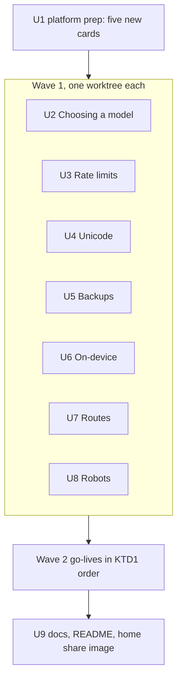
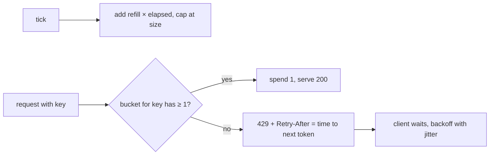

# Seven Roadmap Modules with Creative Scenes - Plan

## Goal Capsule

- **Objective:** The seven roadmap cards on home go live as modules 53–59 (KTD1), each a real place with a hero object and a picture mechanic no earlier scene has (R10). Five new roadmap cards replace them (R12).
- **Product authority:**
  - Requirements (R-IDs) win on product behaviour; Key Technical Decisions (KTD-IDs) win on mechanism.
  - AGENTS.md stays in force unless a KTD here changes it on purpose.
  - Shape, waves and per-unit patterns follow `docs/plans/2026-10-29-1438-feat-six-ai-modules-plan.md` (its U3–U6 for one module). Where this plan is silent, that plan applies.
  - The look follows `docs/plans/2026-10-29-0847-feat-creative-scene-figures-plan.md`: kit people, the model machine, real objects, no plain-cube scenes.
- **Open blockers:** None.
- **Execution profile:** brownfield, **one local branch, one PR at the end**; the executor makes every mid-build call and notes any re-scope in the PR (the user's standing preference).
  - **Wave 0:** platform prep (U1).
  - **Wave 1:** the seven modules' engines, scenes and chapters, each in its own folders (may run in parallel, one worktree per module).
  - **Wave 2:** go-lives in KTD1 order, on the feature branch.
  - **Wave 3:** docs and roadmap (U9).
  - Every wave leaves `pnpm check`, `pnpm lint`, `pnpm test` and `pnpm test:e2e` green. No CI: run all four locally before pushing.
- **Stop conditions** (resolve by the stated fallback, note it in the PR):
  - A chapter needs a backend, a live LLM, an API key, a real robot, real network traffic or training in the browser (R3). Fallback: a labelled, seeded simulator (KTD9).
  - Any existing weight file, golden, recording, step id or sha256 pin changes (R11). Stop.
  - A source checked for `facts.json` contradicts a chapter's lesson. Fallback: rewrite the chapter to the source, note it in the PR.
  - A mechanic has no keyboard path or no reduced-motion form (R10). Fallback: drop to the previous chapter's control for that step.
  - A module runs long. Fallback: chapter 6 shrinks to a cited fact over a still picture; never fewer than seven chapters.
- **Tail ownership:** `ce-work` owns the branch, the PR and the local checks.

---

## Product Contract

### Summary

The last seven roadmap cards go live: three AI (picking a model, a model on a phone, a robot that acts) and four classic tech (rate limits, backups, text encoding, route finding). Each is a Larkspur Supply Co. place with a hero object and a hands-on mechanic:

- weighing models on a **steelyard balance** by sliding its poise weights;
- **packing a phone-shaped crate** with weight bricks and watching its battery tank drain;
- **driving a claw gripper** over a parts bin, then watching it copy you;
- **holding the flood button** at a drip-fed rain barrel;
- **dropping a disaster** on a building and its copies;
- **punching paper tape** for typed text and reading it back with the wrong table;
- **closing a road** in a toy town and watching the van reroute.

### Problem Frame

The seven cards have sat on the roadmap since the last builds; readers see them as promises. Each is a question a product manager or analyst meets at work: which model to buy, whether it can run on the phone, what a warehouse robot learns, why the API says 429, whether last night's backup works, why a customer's name shows as `é`, how the delivery app picks a route. Every one can run for real in the browser over committed data except the robot and the model market, which use labelled simulations and hand-set numbers.

### Requirements

**Platform**

- R1. The seven modules go live as 53–59 in KTD1 order. Each has an intro, seven chapters, a recap, a recall bank with one pin, share images, a home card, an e2e spec, and (AI only) a hero stand plot.
- R2. Ids, levels, tracks and prerequisites (ids are the planned ones, so `pnpm new-module` swaps each card):

  | Module | Id | Level | Track | Prerequisites |
  |---|---|---|---|---|
  | Choosing a model | `choosing-models` | Beginner | AI | `evals` |
  | Models on your device | `on-device` | Intermediate | AI | `inference` |
  | Robots that act | `robots` | Advanced | AI | `multimodal` |
  | Rate limits | `rate-limits` | Beginner | Classic tech | `web-requests` |
  | Backups and recovery | `backups` | Beginner | Classic tech | `databases` |
  | Text and Unicode | `unicode` | Beginner | Classic tech | none |
  | Finding the way | `routes` | Intermediate | Classic tech | none |

- R3. No backend, API key, live LLM, real network traffic or browser training. Larkspur mini's weights are reused as they are; nothing retrains. Fitting a nearest-neighbour policy to the reader's own demonstrations (Robots) is lookup, not training.
- R4. Picture-first from the first commit: copy budgets hold; every instruction is in `act`; `say` callouts name exported parts; sources open through `Cite`; terms are marked at first use.
- R5. Every fact comes from `data/<id>/facts.json` with source and access date. Moving facts (prices, leaderboard positions, phone memory, battery figures, HTTP RFC numbers, Unicode version and counts, backup incident figures) say whose figure and when.
- R6. Every stand-in is labelled wherever it shows: hand-set model scores, prices and speeds; planning-number energy figures; the simulated robot world and its noise; hand-made traffic traces, disasters and town maps.

**Modules.** Chapters in order; chapter 7 is each module's workbench.

- R7a. **Choosing a model.** Larkspur picks the model behind its reply drafter. Edge: "a leaderboard ranks models on someone else's test; your own questions, the price per answer and the wait decide".
  1. The leaderboard: three candidate machines ranked on a public test.
  2. Your own questions: the same three on Larkspur's 20 questions, and the order changes.
  3. Price per answer: tokens in and out times the price, per thousand replies.
  4. The wait: time to first word and words per second, and what a customer feels.
  5. Good enough is enough: the cheapest model that clears the bar.
  6. Models change: a new version re-run on the same questions; pin the version.
  7. Workbench: weights for quality, cost and wait, against Larkspur's three teams' needs.
- R7b. **Models on your device.** Larkspur wants its stock-lookup assistant on the warehouse handhelds, offline. Edge: "a model on a phone must fit its memory and spare its battery; in return, nothing leaves the device".
  1. Will it fit? Parameters × bytes against a phone's free memory.
  2. Smaller numbers: Larkspur mini at 8, 4 and 2 bits, live, and what the reply loses (links to Inference ch. 4).
  3. The working memory: the context's cache grows with every word.
  4. The battery tank: energy per reply (planning numbers), and replies per charge.
  5. Heat and speed: a hot phone slows down (cited), and short replies.
  6. What never leaves: a request diagram of on-device against the cloud, and when to fall back.
  7. Workbench: model size, bits and reply length against fit, quality, battery and privacy.
- R7c. **Robots that act.** Larkspur's warehouse tries a picking arm over its parts bins. Edge: "a robot maps what its camera sees to motor moves many times a second; it learns best from people showing it, and small mistakes snowball".
  1. See, decide, move: the loop, and how often it runs.
  2. What the camera gives: a frame turned into a grid of what's where.
  3. Rules break: a hand-written rule fails on a new bin layout.
  4. Show it: the reader drives the claw; a copy-what-you-did policy (nearest neighbour) replays on new bins.
  5. Mistakes snowball: one off-by-one and the policy is somewhere no demo went; corrections fix it (DAgger, cited).
  6. Practice in a game first: a simulated bin with randomised lighting and slip, and the gap to the real one (cited).
  7. Workbench: number of demos, corrections and practice noise against success on held-out bins.
- R7d. **Rate limits.** Larkspur's stock API is hit by a partner's runaway script on sale day. Edge: "a rate limit is a bucket of tokens: it refills at a steady pace, each request spends one, and an empty bucket says 429 and when to come back".
  1. Too many at once: a flood takes the server down for everyone.
  2. Count per minute: a fixed window, and the double burst at its edge.
  3. The token bucket: size sets the burst, refill sets the pace.
  4. The 429 reply: status, `Retry-After`, and a client that listens.
  5. Back off with jitter: retrying clients that stampede, and spreading them out.
  6. Who gets turned away: one bucket per key, so one partner can't starve the rest.
  7. Workbench: bucket size, refill and per-key quotas against a recorded-shape traffic trace (hand-made, labelled).
- R7e. **Backups and recovery.** Larkspur's order database. Edge: "a backup counts only when a restore works; how often you copy sets what you lose, how fast you restore sets how long you're down".
  1. One copy is no copy: the disk dies.
  2. How often: copy schedule and the work lost (RPO).
  3. Full and since-last: full and incremental copies, and the chain a restore needs.
  4. Not in the same building: a fire takes the copy too; 3-2-1.
  5. Ransomware: it encrypts the backups it can reach; a locked, offline copy.
  6. Test the restore: a copy that never restores, and the time a restore takes (RTO).
  7. Workbench: schedule, copy types and places against a set of disasters, on lost work, downtime and cost.
- R7f. **Text and Unicode.** A customer's name, Zoë, arrives as `Zoë`. Edge: "every character is a number; UTF-8 writes it in 1 to 4 bytes, and text breaks when the reader uses a different table from the writer".
  1. Letters are numbers: ASCII's 128.
  2. One number for every character: code points across scripts.
  3. UTF-8: 1 to 4 bytes, and why English stays one byte.
  4. The wrong table: UTF-8 read as Latin-1, live, and the `Ã` signature.
  5. One emoji, many numbers: joined emoji and skin tones, and three different lengths of one string.
  6. Same look, different bytes: é composed or not (normalisation), and lookalike letters in a web address.
  7. Workbench: a name field's limit (bytes, code points or what people see) and normalisation against a set of real-world names.
- R7g. **Finding the way.** Larkspur's delivery van in town. Edge: "a map is a graph of junctions and roads; Dijkstra settles the nearest junction first, A* leans toward the goal, and live traffic only changes the road weights".
  1. Roads as a graph: junctions, roads and minutes.
  2. Fewest roads or fewest minutes: hop count against travel time.
  3. Dijkstra: the frontier grows from the depot, cheapest first.
  4. A*: lean toward the goal, and fewer junctions looked at.
  5. Live traffic: a jam raises one road's minutes and the route flips.
  6. Whole-country maps: shortcuts computed overnight (contraction hierarchies, cited).
  7. Workbench: algorithm and heuristic weight against a day of deliveries and closures, on minutes and junctions looked at.

**Pictures and story**

- R8. Every module continues the Larkspur story; named people are `CAST` figures.
- R9. Each teaches what its live neighbour doesn't and links where they meet: Choosing models → Evals, Small models, Inference; On-device → Inference (quantisation), Small models, Context; Robots → Multimodal, Computer use, Synthetic data; Rate limits → Web requests, Queues, Load balancing; Backups → Databases, Consistency, Locks and keys; Unicode → Tokens; Routes → Search.
- R10. Each scene has a hero object no other scene uses and a mechanic no earlier scene has (KTD8), with the house rules: Colorfigures style, kit people, label pills, one figure per stage, `say` callouts, escaped text, reduced motion, phones. Every mechanic has a keyboard path and a reduced-motion form, and is never the only way to act.
- R11. The 52 live modules and their saved progress do not change, except the shared hotspots (KTD10) and new links to new modules.
- R12. Five new planned cards follow the live modules (KTD11), so the roadmap is never empty.
- R13. Every name shown is read from data. Models are fictional ("Machine A/B/C", hand-set numbers), never a vendor ranked by Tinker; real leaderboards, chips and RFCs are cited as dated facts. Domains are `.example`.

### Scope Boundaries

- Earlier modules' pictures, share images and saved progress stay as they are.
- No new weights. On-device quantises `model.bin` in memory with Inference's `quantize.ts`; nothing is saved.
- Maths stays optional in fold-away notes: price arithmetic, bytes per parameter, token-bucket formula, RPO/RTO sums, UTF-8 bit layout, Dijkstra's invariant.
- **Choosing a model:** hand-set scores and prices for three fictional machines; no live benchmark.
- **Robots:** a grid world simulator, labelled; no physics engine, no real robot data.
- **Routes:** one hand-made town of about 30 junctions; contraction hierarchies are a cited fact with a picture, not implemented.
- **Unicode:** real `TextEncoder`/`TextDecoder` and `Intl.Segmenter`; no font rendering lessons.

### Deferred to Follow-Up Work

- Building the five new planned cards.
- Trailers (paused site-wide).

### Success Criteria

- After each module a reader can say its edge in plain words as R7a–R7g phrase it.
- `pnpm test` fails when a pinned effect, a workbench's `WINNERS` or a share image drifts.
- At 1280px and 390px the catalogue reads "59 live · 5 planned"; the hero stand shows the three new AI modules in turn; the first screen holds.
- A contact sheet of the seven new share images repeats no hero object class or board layout from an existing scene.

### Key Decisions

- Build all seven remaining roadmap cards in one plan with creative scenes (session-settled: user-directed — chosen over a subset: "plan to create other modules with creative visuals… take the best decisions"). Governs R1, R2.
- One branch, one PR, executor decides mid-build (session-settled: user-directed — the user's standing preference and "No need to wait for me"). Governs R1.

---

## Planning Contract

### Key Technical Decisions

- KTD1. **Module numbers follow merge order:** 53 Choosing a model, 54 Rate limits, 55 Unicode, 56 Backups, 57 On-device, 58 Routes, 59 Robots. Beginners first, the three Beginner classic modules grouped; Robots last as the riskiest.
- KTD2. **What runs live and what is committed:**

  | Module | Live in the browser | Committed data |
  |---|---|---|
  | Choosing a model | ranking, price per 1,000 answers, wait from TTFT and speed, the bar check, weighted score | three fictional machines' hand-set public scores, per-question results on Larkspur's 20 questions, prices and speeds (labelled) |
  | On-device | memory sums; `quantize.ts` over `model.bin` and `forward()` greedy replies at 8/4/2 bits; KV cache growth; battery sum | phone profiles and energy per token (planning numbers, cited) |
  | Robots | the grid world, the scripted rule, the nearest-neighbour policy over the reader's demos, the DAgger correction loop, seeded noise | bin layouts, pinned demo sets for the tests, held-out bins |
  | Rate limits | fixed window, token bucket, per-key buckets, backoff with jitter, all over a seeded trace | hand-made traffic traces per partner |
  | Backups | a timeline simulator of writes, copies and disasters; lost work and downtime; restore chain | the order write log, disasters, copy costs (planning numbers) |
  | Unicode | `TextEncoder`/`TextDecoder` (utf-8, and Latin-1 via `windows-1252`), `codePointAt`, `Intl.Segmenter`, `normalize()` | names set, lookalike pairs |
  | Routes | BFS, Dijkstra, A* with a weight, traffic edits | the town graph with coordinates and minutes, the day's deliveries and closures |

- KTD3. **Choosing a model never ranks a real model.** Machines A, B and C are fictional, with hand-set numbers chosen so the public-test order differs from Larkspur's own order (pinned, recomputed in a test). Real leaderboards and their caveats (contamination, preference voting) are cited facts with dates.
- KTD4. **On-device reuses Inference's quantiser** (`src/lib/inference/quantize.ts`) over `model.bin`, with `quantize()` and `memory()` widened to take any bit width (`number`); `BITS` and `Bits` stay `[16, 8, 4]` so Inference ch. 4 and the Mixture-of-experts workbench are unchanged (R11). If 8-bit rounding flips a greedy token on the chosen prompt, pick a different pinned prompt; the replies at each bit width are pinned and re-derived in a test. Memory uses 1, 0.5 and 0.25 bytes per weight plus the KV cache per token from Larkspur mini's config, then scales to cited phone-sized models by the same formula.
- KTD5. **Robots is a seeded grid world** (`src/lib/robots/world.ts`): a bin of cells, parts and a goal tray; a state is the camera grid around the claw; actions are four moves, grip and drop. The policy is nearest neighbour over (state → action) pairs from demos. DAgger adds the reader's corrections where the policy went off-demo. Effects are pinned against the median of 20 seeded layouts, never one.
- KTD6. **Rate limits and Backups simulate on a tick clock** (`src/lib/<id>/sim.ts`), deterministic and seeded, read off the same run by scene and second view. Rate limits uses milliseconds of a hand-made trace; Backups uses hours of a week's write log. Unicode and Routes run directly over their data and need no clock.
- KTD7. **Pinned outputs and `WINNERS`** follow the last plan's KTD9: every taught effect lives in `data/<id>/pinned.json` and a unit test re-derives it; every workbench pins its `WINNERS` and recomputes them in a test.
- KTD8. **Scenes, hero objects and mechanics.** Controls are real elements beside the stage; each mechanic has one polite `role="status"` read-out outside the drawing, updated on actions and milestones, never per tick.

  | Module | Scene and hero object | Mechanic (keyboard, touch, pointer) | Reduced motion | Second view |
  |---|---|---|---|---|
  | Choosing a model | a market hall with three model machines on plinths and a **brass steelyard balance** hung from a beam, its pan holding the chosen machine's reply slips | **slide the poise weights:** one native range per criterion (quality, cost, wait) moves a poise along the beam; the beam tips toward the winning machine | the beam shows its final tilt | a score table per machine |
  | On-device | the warehouse picking aisle, a handheld scanner drawn as a **walk-in phone-shaped crate** with a battery water tank on its back | **pack the crate:** a radio group for model size and one for bits; weight bricks fill the crate (overflow spills out); "Ask" runs a reply and the tank drains | bricks and level show at the end state | memory and battery bars |
  | Robots | a parts bay with a **claw gripper on a gantry** over a gridded bin, the goal tray beside it | **drive the claw:** arrow buttons (arrow keys too, scroll prevented only while the control group has focus) and Grip; "Hand over" (disabled, with the reason, until one demo is finished) lets the policy replay on a fresh bin, stopping at a step cap with a stuck or off-grid read-out and Try again (demos kept); a correction button takes the wheel back | the claw jumps cell to cell | the camera grid and the action log |
  | Rate limits | the shop's API door with a **rain barrel on a stand**: a drip pipe refills it, a tap pours one cup per request, partners' couriers queue with cups | **hold to flood:** press and hold to send requests (capped at 20 a second, 200 a hold; release or pointer-cancel stops); beside it a plain **Send 10** button for click, Enter, Space and assistive tech. A range sets the drip. An empty barrel turns the tap off, turned-away couriers get a red ticket, and the read-out announces the first 429 once | only Send 10 shows; counts update without the walk | requests over time, served and 429 |
  | Backups | Larkspur's office block with a server room, a **tape-reel cabinet** of copies, and a **courier's lockbox on a handcart** for the off-site copy | **drop the disaster:** a `Select` picks the disaster and a range picks the hour; "Strike" hits; lost copies are drawn charred or padlocked | the struck end state shows | the week's timeline: copies, disaster, restore point |
  | Unicode | a telegraph office with a **paper-tape punch** and its reader | **punch the tape:** type into a text field; each byte punches a row of holes; a `Select` picks the reader's table, and the read-out shows what comes back | the whole tape appears at once | byte table: character, code point, bytes |
  | Routes | a toy town on a table, a **delivery van and signposted junctions**, flags planted as junctions settle | **close a road:** a listbox of roads (arrow keys, Enter toggles a roadblock, also clickable on the map); Step / Play grows the frontier | settled flags all show | the frontier list and route minutes |

  Workbenches follow the house shape: named controls (ranges or `Select`), a live read-out of the result metrics, a goal line, a solved state on first reaching a `WINNERS` entry, and Show me.

  Caps: Choosing models 3 machines; On-device 16 bricks; Robots an 8×6 bin; Rate limits 12 couriers drawn plus a count pill; Backups 7 copies; Unicode 24 bytes drawn plus a count pill; Routes about 30 junctions. On phones every control is ≥ 44 px.

  Each scene unit first writes the chapter-to-picture table in `docs/modules/<id>.md` (picture, mechanic live, the step's control, `say` parts). Nothing joins the figure kit unless two scenes use it; candidates are checked against `src/lib/iso/figures.ts` first.
- KTD9. **Simulate what can't be real** (the last plan's KTD13): seeded TS simulators with rules citing their source, labelled "simulated" where they show, effects true by construction and said so.
- KTD10. **Shared hotspots** change only in a go-live unit: `src/lib/modules.ts`, `tests/unit/modules.test.ts`, `tests/unit/step-ids.test.ts`, `src/pages/index.astro` (`CARD`), `heroScene.ts` (`DRAW`, AI modules only), `src/dev/og.astro`, `tests/e2e/catalogue.spec.ts`. `README.md` and `public/og/home.jpg` belong to U9 alone. U1 may change the registry, its tests and the catalogue spec.
- KTD11. **The five new planned cards:** AI — *Assistants that remember* (Intermediate), *Red-teaming a model* (Intermediate), *Machine translation* (Beginner); classic — *Time and clocks* (Beginner: time zones, clock drift, leap seconds), *How GPS finds you* (Intermediate: satellites, timing, trilateration). U1 greps live titles and chapters for overlap and swaps any card already covered.

### High-Level Technical Design

The token bucket (R7d), the core of Rate limits:

---

## Implementation Units

Each module unit (U2–U8) is the last plan's four units in one: engine and facts, scene and kit, chapters, then go-live. Within a worktree, the first step is `pnpm new-module <id> "<Title>"` (it refuses once the files exist); restore `src/lib/modules.ts` before committing the scaffold. Module-only commits come next and the go-live commit last, which makes the registry edit itself (the import and the `<ID>_MODULE` entry after the last live module, the planned card removed), so it can be re-applied on the feature branch in KTD1 order. Go-lives leave `README.md` and `home.jpg` to U9.

### U1. Platform prep and the new roadmap

- **Goal:** Registry and catalogue ready for 59 live modules and five new planned cards.
- **Requirements:** R2, R11, R12; KTD10, KTD11.
- **Dependencies:** none.
- **Files:** `src/lib/modules.ts`, `tests/unit/modules.test.ts`, `tests/unit/new-module.test.ts`, `tests/e2e/catalogue.spec.ts`.
- **Approach:**
  1. Grep live titles and chapters for KTD11's topics; swap any overlap.
  2. Append the five `planned()` lines (AI after the AI cards, classic after the classic cards).
  3. Rebase the roadmap list in `modules.test.ts`; point `new-module.test.ts` at a card that stays planned.
- **Test scenarios:**
  - The planned list holds the seven current cards and five new ones, each with level and track, no chapters, no prereqs.
  - The catalogue e2e reads "52 live · 12 planned".
- **Verification:** Home shows twelve roadmap cards; all four checks green.

### U2. Choosing a model (53)

- **Goal:** R7a end to end: engine, steelyard scene, seven chapters, recall, recap, go-live.
- **Requirements:** R1–R11, R13; KTD2, KTD3, KTD7, KTD8.
- **Dependencies:** U1.
- **Files:** `src/lib/choosing-models/` (`machines.ts`, `price.ts`, `score.ts`, `workbench.ts`, `facts.ts`, `story.ts`), `data/choosing-models/` (`facts.json`, `machines.json`, `questions.json`, `pinned.json`, `workbench.json`), `src/components/scenes/steelyardScene.ts`, `src/content/choosing-models/`, `src/pages/choosing-models/`, `src/dev/choosing-models.astro`, `docs/modules/choosing-models.md`, `tests/unit/choosing-models-*.test.ts`, `tests/e2e/choosing-models.spec.ts`, plus KTD10 hotspots at go-live.
- **Patterns to follow:** `src/lib/evals/` (question sets and graders), `src/content/prompts/` (a recent AI module's full shape), `src/components/scenes/docketScene.ts`.
- **Test scenarios:**
  - Public-test order and Larkspur-set order differ, as pinned.
  - Price per 1,000 answers equals tokens × price for each machine; a pinned cheaper machine clears ch. 5's bar.
  - The new version in ch. 6 changes at least one pinned answer.
  - Each poise range's value maps to the beam tilt from `score.ts`; keyboard alone moves every poise.
  - `WINNERS` recomputes to its pin; the e2e plays every chapter, axe, keyboard, reduced motion and 390px pass.
- **Verification:** `registry.test.ts` names nothing missing; catalogue "53 live · 11 planned".

### U3. Rate limits (54)

- **Goal:** R7d end to end with the turnstile scene.
- **Requirements:** R1–R11, R13; KTD2, KTD6, KTD7, KTD8.
- **Dependencies:** U1.
- **Files:** `src/lib/rate-limits/` (`window.ts`, `bucket.ts`, `backoff.ts`, `sim.ts`, `workbench.ts`, `facts.ts`, `story.ts`), `data/rate-limits/` (`facts.json`, `traces.json`, `pinned.json`, `workbench.json`), `src/components/scenes/turnstileScene.ts`, `src/content/rate-limits/`, `src/pages/rate-limits/`, `src/dev/rate-limits.astro`, `docs/modules/rate-limits.md`, `tests/unit/rate-limits-*.test.ts`, `tests/e2e/rate-limits.spec.ts`.
- **Patterns to follow:** `src/lib/load-balancing/` and `src/lib/queues/` (tick simulators), `src/content/queues/`.
- **Test scenarios:**
  - A fixed window lets through twice its limit across a boundary, as pinned.
  - A bucket of size B and refill r serves a burst of B then r per second; `Retry-After` equals the time to the next token.
  - Synchronised retries stampede; jittered retries peak lower, as pinned.
  - Per-key buckets keep the quiet partner's success rate above its pin while the runaway one is limited.
  - Holding the flood button (pointer and Space) sends requests; releasing stops; reduced motion sends bursts of ten.
  - `WINNERS`, e2e, axe, keyboard, reduced motion and 390px as U2.
- **Verification:** as U2, "54 live".

### U4. Text and Unicode (55)

- **Goal:** R7f end to end with the paper-tape scene.
- **Requirements:** R1–R11, R13; KTD2, KTD7, KTD8.
- **Dependencies:** U1.
- **Files:** `src/lib/unicode/` (`bytes.ts`, `mojibake.ts`, `graphemes.ts`, `normalise.ts`, `workbench.ts`, `facts.ts`, `story.ts`), `data/unicode/` (`facts.json`, `names.json`, `lookalikes.json`, `pinned.json`, `workbench.json`), `src/components/scenes/tapeScene.ts`, `src/content/unicode/`, `src/pages/unicode/`, `src/dev/unicode.astro`, `docs/modules/unicode.md`, `tests/unit/unicode-*.test.ts`, `tests/e2e/unicode.spec.ts`.
- **Patterns to follow:** `src/lib/tokens/` (bytes and `siteEncoding`), `src/lib/compression/` (live byte views).
- **Test scenarios:**
  - "Zoë" encodes to the pinned 4 bytes and decodes as `windows-1252` to `Zoë`.
  - Byte counts for 1-, 2-, 3- and 4-byte characters match UTF-8's ranges.
  - A family emoji has pinned lengths in UTF-16 units, code points and graphemes, all different.
  - NFC and NFD é compare unequal before `normalize()` and equal after.
  - Typed text of any length draws at most 24 bytes plus a count pill; untrusted input renders as text only.
  - `WINNERS`, e2e, axe, keyboard, reduced motion and 390px as U2.
- **Verification:** as U2, "55 live".

### U5. Backups and recovery (56)

- **Goal:** R7e end to end with the cargo-bike safe scene.
- **Requirements:** R1–R11, R13; KTD2, KTD6, KTD7, KTD8.
- **Dependencies:** U1.
- **Files:** `src/lib/backups/` (`sim.ts`, `copies.ts`, `disasters.ts`, `restore.ts`, `workbench.ts`, `facts.ts`, `story.ts`), `data/backups/` (`facts.json`, `writes.json`, `disasters.json`, `pinned.json`, `workbench.json`), `src/components/scenes/safeScene.ts`, `src/content/backups/`, `src/pages/backups/`, `src/dev/backups.astro`, `docs/modules/backups.md`, `tests/unit/backups-*.test.ts`, `tests/e2e/backups.spec.ts`.
- **Patterns to follow:** `src/lib/databases/`, `src/lib/releases/` (timeline and dial).
- **Test scenarios:**
  - Lost work equals the gap since the last copy that survives the disaster, as pinned per disaster.
  - An incremental chain with one missing link restores only up to the break.
  - Fire destroys on-site copies; ransomware encrypts every reachable copy; only the off-site locked copy survives both.
  - The corrupt copy in ch. 6 is caught only by a test restore; downtime equals restore time.
  - `WINNERS`, e2e, axe, keyboard, reduced motion and 390px as U2.
- **Verification:** as U2, "56 live".

### U6. Models on your device (57)

- **Goal:** R7b end to end with the phone-crate scene.
- **Requirements:** R1–R11, R13; KTD2, KTD4, KTD7, KTD8.
- **Dependencies:** U1.
- **Files:** `src/lib/inference/quantize.ts` (types only), `src/lib/on-device/` (`memory.ts`, `battery.ts`, `replies.ts`, `workbench.ts`, `facts.ts`, `story.ts`), `data/on-device/` (`facts.json`, `phones.json`, `pinned.json`, `workbench.json`), `src/components/scenes/phoneCrateScene.ts`, `src/content/on-device/`, `src/pages/on-device/`, `src/dev/on-device.astro`, `docs/modules/on-device.md`, `tests/unit/on-device-*.test.ts`, `tests/e2e/on-device.spec.ts`.
- **Patterns to follow:** `src/lib/inference/quantize.ts` (widened per KTD4, listed in Files), `src/content/inference/04-smaller-numbers.tsx`, `tests/unit/memorisation-model.test.ts`.
- **Test scenarios:**
  - Memory sums match params × bytes plus KV cache for each pinned size and bit width.
  - Larkspur mini's greedy reply at 8 bits matches full precision and at 2 bits differs, as pinned.
  - Replies per charge equals battery energy over energy per reply, as pinned.
  - `model.bin`'s sha256 pin is unchanged.
  - `WINNERS`, e2e, axe, keyboard, reduced motion and 390px as U2.
- **Verification:** as U2, "57 live".

### U7. Finding the way (58)

- **Goal:** R7g end to end with the toy-town scene.
- **Requirements:** R1–R11, R13; KTD2, KTD7, KTD8.
- **Dependencies:** U1.
- **Files:** `src/lib/routes/` (`graph.ts`, `bfs.ts`, `dijkstra.ts`, `astar.ts`, `traffic.ts`, `workbench.ts`, `facts.ts`, `story.ts`), `data/routes/` (`facts.json`, `town.json`, `deliveries.json`, `pinned.json`, `workbench.json`), `src/components/scenes/townScene.ts`, `src/content/routes/`, `src/pages/routes/`, `src/dev/routes.astro`, `docs/modules/routes.md`, `tests/unit/routes-*.test.ts`, `tests/e2e/routes.spec.ts`.
- **Patterns to follow:** `src/lib/search/`, `src/lib/consistency/` (map-style picture with movable marker).
- **Test scenarios:**
  - BFS's fewest-roads route takes more minutes than Dijkstra's, as pinned.
  - Dijkstra settles junctions in non-decreasing distance; A* with weight 1 gives the same cost and settles fewer junctions.
  - Closing a road on the route reroutes; closing a bridge that cuts the town reports no route.
  - A pinned jam flips the route.
  - `WINNERS`, e2e, axe, keyboard, reduced motion and 390px as U2.
- **Verification:** as U2, "58 live".

### U8. Robots that act (59)

- **Goal:** R7c end to end with the claw-gantry scene.
- **Requirements:** R1–R11, R13; KTD2, KTD5, KTD7, KTD8, KTD9.
- **Dependencies:** U1.
- **Files:** `src/lib/robots/` (`world.ts`, `rules.ts`, `policy.ts`, `dagger.ts`, `workbench.ts`, `facts.ts`, `story.ts`), `data/robots/` (`facts.json`, `bins.json`, `demos.json`, `pinned.json`, `workbench.json`), `src/components/scenes/clawScene.ts`, `src/content/robots/`, `src/pages/robots/`, `src/dev/robots.astro`, `docs/modules/robots.md`, `tests/unit/robots-*.test.ts`, `tests/e2e/robots.spec.ts`.
- **Patterns to follow:** `src/lib/computer-use/`, `src/content/multimodal/`.
- **Test scenarios:**
  - The scripted rule succeeds on the training layout and fails on the pinned new one.
  - The nearest-neighbour policy from the pinned demos succeeds on its pinned share of 20 held-out bins; more demos raise it.
  - One forced off-by-one move leads to failure without corrections and success with them, as pinned.
  - Randomised practice noise raises held-out success under the pinned "real" noise.
  - The reader's own demos (driven in e2e) are used by "Hand over".
  - `WINNERS`, e2e, axe, keyboard, reduced motion and 390px as U2.
- **Verification:** as U2, "59 live".

### U9. Docs and roadmap close

- **Goal:** README, AGENTS-neutral docs and home share image reflect 59 live modules.
- **Requirements:** R1, R12.
- **Dependencies:** U2–U8.
- **Files:** `README.md`, `public/og/home.jpg`.
- **Test expectation:** none -- docs and a regenerated image; the catalogue e2e already counts.
- **Verification:** all four checks green; the seven intros and a chapter of each look right at 1280px and 390px.

---

## Verification Contract

- `pnpm check` (0 errors, 0 warnings), `pnpm lint` (0 diagnostics), `pnpm test`, `pnpm test:e2e` all green on the feature branch after the last go-live.
- `tests/unit/step-ids.test.ts` shows no change to existing modules.
- Each new page has its own share image; the e2e share-image check passes.

## Definition of Done

- Seven modules live as 53–59, five new roadmap cards, one PR to `main` listing any re-scope taken under the stop conditions.

## Risks

| Risk | Mitigation |
|---|---|
| Fictional machines read as a real ranking | Names are A/B/C, every number labelled hand-set (KTD3) |
| Robots' grid world reads as real robotics | "simulated" on every view; real findings cited (KTD9) |
| Seven parallel worktrees collide on hotspots | Go-live commits are last and re-applied in KTD1 order (KTD10) |
| A scene repeats an earlier hero object | Each scene unit checks the hero objects in `docs/modules/*.md` before drawing (turnstiles, safes and hoppers are taken) |
| Moving facts (prices, RFCs, Unicode counts) age | Each is a dated fact; lessons rest on ratios and mechanisms |

## Sources & Research

- Local only: the last two module plans, `docs/modules/*.md` hero-object and mechanic lines, `src/lib/inference/quantize.ts`, `src/lib/modules.ts`. External facts are gathered per module at build time into `facts.json` with access dates (R5).
