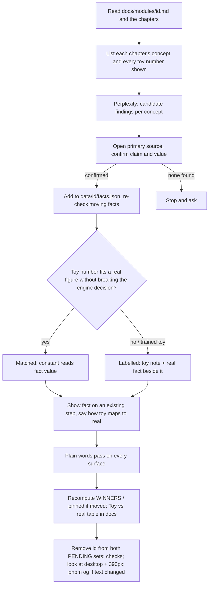

# Plain Words and Research Behind Every Chapter - Plan

## Goal Capsule

- **Objective:** Every chapter of all 59 live modules rests on at least one cited real-world finding shown beside its toy, uses toy numbers that match that research or are labelled as toy where they can't, and reads in plain words on every surface a reader sees.
- **Product authority:**
  - Requirements (R-IDs) win on product behaviour. Key Technical Decisions (KTD-IDs) win on mechanism.
  - AGENTS.md stays in force unless a KTD here changes it on purpose. Copy budgets, id stability, `Cite`, "every fact comes from the data" and the labelling rules all still hold.
  - `docs/modules/<id>.md` holds each module's engine decisions. Where a calibration would break one of them, label the toy instead (KTD4).
- **Stop conditions:**
  - Stop and ask if a real finding contradicts what a chapter teaches, not just a number in it. That is a content change, not a calibration.
  - Stop and ask if calibrating a toy would mean retraining a model (KTD5) or renaming a step, chapter or module id.
  - Stop and ask if no primary source can be found for a chapter's concept after the research step. Never fall back to a secondary source or to Perplexity's own answer.
- **Execution profile:** One module at a time, in the waves of U4–U10. The pilot wave (U4) ends with a review against the recipe, and the recipe is updated before U5 starts.
- **Tail:** One branch, one PR at the end (house convention for multi-module work). All four checks in the Verification Contract pass locally before push.

---

## Product Contract

### Summary

Readers say the courses look like simple visuals with no research behind them, and some wording is hard to follow. Measured on 2026-10-30, every module except RAG has a sourced `facts.json`, but in about a third of modules only 2–4 of the 7 chapters show a fact. RAG has none. Narration already scores about US grade 1–4 on syllable and sentence length. What makes it hard is jargon and toy shorthand ("the claw rides a gantry… one turn of the control loop"). This plan adds a cited real finding to every chapter, sets each toy's numbers against the research, and swaps out or defines jargon everywhere, with tests that stop all three from sliding back.

### Problem Frame

Tinker's audience (PMs, engineers and analysts with no background) trusts a picture when it can see that the picture matches something real. Today the toys carry most chapters on their own. Real numbers show up unevenly, and readers can't tell which toy numbers are realistic and which are made up. Learning research says a toy model helps transfer only when its link to real data is made explicit: which toy quantity maps to which real one, and where the toy stops matching (Goldstone & Son 2005; Fyfe et al. 2014). The language problem is jargon rather than sentence length, so a readability score can't find it or fix it (ISO 24495-1:2023 and the readability-formula critiques in Sources).

### Requirements

**Research behind every chapter**

- R1. Every chapter of every live module shows at least one fact from its module's `facts.json`, opened from a `Cite` mark.
- R2. Each new fact cites a primary source: a paper, spec/RFC, official doc, official postmortem, or a vendor benchmark labelled as vendor-reported. Perplexity is only for finding sources. It is never cited and never paraphrased as the source.
- R3. Each fact names whose figure it is and when, as AGENTS.md already requires. Moving facts (prices, limits, model sizes, availability) that a module already has are re-checked during that module's pass, and their `accessed` date is updated.
- R4. RAG gets a module facts file like every other module, so R1 holds there too.

**Toys set against the research**

- R5. Every toy quantity a chapter shows as a number (rates, sizes, latencies, counts, error rates) is either *matched* (it equals or derives from a cited fact's `value`) or *labelled* (the copy says it is a toy or planning number, and a real figure from R1 sits beside it).
- R6. Where a chapter's fact relates to its toy, the copy makes the link explicit: what the toy's number stands for in the real system, or where the toy stops matching.
- R5a. R5 is checked by the Toy vs real table in each module doc: a test requires the section to exist, and each wave's review checks that it lists every number.
- R7. Puzzles still accept every winning answer, and pinned outputs still match their tests after calibration. Any WINNERS or pinned data that calibration moves is recomputed, never hand-typed.

**Plain words**

- R8. One shared list of flagged words (jargon and toy shorthand), each paired with a plain swap.
- R9. A flagged word may appear in a chapter's copy only if that chapter or an earlier chapter of the same module declares it as a term ("Words you'll meet"), so it is defined at first use. A chapter can declare it only if the word also appears in its narration or `act`, as `copy-budget.test.ts` already requires. On module-level surfaces (module `description` and `story`, intro page, kit text, recall bank), the word passes if any chapter of the module declares it. Otherwise it is swapped.
- R10. R9 covers every reader-visible surface: step narration and `act`, the intro's story, goal, learn and term definitions, quiz questions, options, `why` and explanations, callouts, kit captions and notes, module `description` and `story`, the module intro pages, and the recall bank (`recall.ts`) shown on recap and warm-up.
- R11. Plain words never drop precision. Units, conditions, uncertainty and the source's scope ("in their test") stay.

**Guard rails**

- R12. A unit test fails any chapter without a fact (R1) and any flagged word outside a declared term (R9). While the waves run, both tests ratchet through a pending list that only shrinks and ends empty.

### Scope Boundaries

- No new chapters, steps, scenes or layout changes. Facts go into existing steps' controls (KTD6).
- No renamed module, chapter or step ids.
- No retrained toy models (KTD5).
- No readability-grade gate (KTD2).
- Trailers stay paused.

### Deferred to Follow-Up Work

- An automated stale-fact check for moving facts (a re-check interval per fact). For now AGENTS.md's "re-check when a module changes" rule covers it.
- Reader comprehension testing with real non-expert readers. The research recommends it (Sources), but it needs people and is outside a code change.

### Success Criteria

- The research-coverage and plain-words tests pass with empty pending lists.
- Each module's `docs/modules/<id>.md` has a "Toy vs real" table that names every toy number the reader sees as matched or labelled.
- Pages changed by this work look right at desktop and 390px, and every share image whose text changed is regenerated.

---

## Planning Contract

### Key Technical Decisions

- KTD1. **Coverage comes from chapter source, not new exports.** The research-coverage test reads each chapter file's raw source through Vite's `?raw` glob. It counts only rendered `<Fact id=…>` uses (the kit component that draws the `Cite` mark), because that is what the reader sees. A bare `fact('…')` call (a matched constant under KTD4, or `.claim` quoted in a quiz) doesn't count, and a locally defined `fact` helper (fine-tuning 01) is ignored. For an expression id (`id={mode === 'chained' ? 'a' : 'b'}`, voice 06), every quoted literal inside the braces counts as a candidate. A fully dynamic id (`id={s.card}`, mixture-of-experts 07) gets an `ALLOW` entry naming the file and where its ids come from. At least one id must exist in `data/<id>/facts.json`. Adding a `FACTS` export to every chapter would duplicate what the code already says.
- KTD2. **A word list, not a readability score.** Readability formulas measure surface features, disagree with real usability for adult technical readers, and narration already scores low. The plain-words test checks a curated list instead: a flagged word must either be a declared chapter term or not appear (R9). This follows the research rule: keep a term when it adds precision and define it, replace it when it doesn't. The list lives in `src/components/story/plain-words.ts`, beside `terms.ts`, as pairs of flagged word and plain swap, so the test can name the swap in its failure.
- KTD3. **Two depths of check, matched to how the copy is stored.** Structured copy (chapter `STEPS`, quiz exports, `intro`, module `description`/`story`) is checked exactly, as `copy-budget.test.ts` already does. Kit captions and intro `.astro` pages are free text. For those, the test scans string literals, template literals and JSX text of three or more words, with comments stripped, so identifiers and import paths (`policy.ts`) don't trip it. The heuristic misses some text and the exact pass covers the rest. Each wave also re-reads both surfaces by eye.
- KTD4. **Matched or labelled, decided per number.** A toy number becomes *matched* when the real figure fits the toy without breaking its engine decision. The constant then reads the fact's `value` (as robots already does with `RT1`), so copy and code can't drift. Otherwise it stays as it is and becomes *labelled*: the kit's toy note names it as a toy, and a real fact sits beside it. The 20 kits without a toy note (pre-training among them) get one, modelled on robots' `SimNote`. Each module's `docs/modules/<id>.md` records the decision in a "Toy vs real" table. An honest label beats a realistic toy that no longer teaches.
- KTD5. **No retraining.** Toys trained ahead of time (the shared tiny model in `docs/lm-kit.md`, pinned model outputs) are labelled, never recalibrated. A retrain means new prompts and reruns of the pinned-output tests, which this plan doesn't take on.
- KTD6. **Facts go into existing steps.** A chapter missing a fact gets it as a control on an existing step (`visibleControls: ['fact', …]`), usually the reveal step after a prediction. Adding a step would change step ids and restart saved runs. The fact's claim sits outside the narration word budget, as it does today.
- KTD7. **Perplexity finds, primary sources prove.** Per module, a Perplexity search (the user-named `perplexity` skill, run one query at a time because parallel calls hit its rate limit) proposes candidate findings per chapter concept. The agent then opens each primary source, confirms the exact claim and number there, and only then writes the fact. Raw Perplexity output is never committed.
- KTD8. **Ratchet, then empty.** Both new tests carry a `PENDING` set of module ids, seeded in U1 with every module that fails today. Each wave removes its modules. U11 deletes the set. The suite stays green throughout and can't regress a finished module.

### High-Level Technical Design

The per-module recipe every wave unit runs:

### Assumptions

- The pilot's five modules are the thinnest by chapter coverage (video-models 2/7, synthetic-data 2/7, then robots, pre-training and recommendations at 3/7; small-models also has 3/7 and was left for U5 so the pilot spans more kinds of toy), so they test the recipe on the hardest cases.
- Wave order after the pilot follows the registry order in `MODULES`, so the split is deterministic without a hand-made list.

---

## Implementation Units

| U-ID | Title | Key files | Depends on |
|---|---|---|---|
| U1 | Guard tests and word list | `tests/unit/research-coverage.test.ts`, `tests/unit/plain-words.test.ts`, `src/components/story/plain-words.ts` | none |
| U2 | Writing rules and template | `AGENTS.md`, `docs/writing-a-module.md`, `templates/module/` | U1 |
| U3 | RAG module facts and plain words | `data/rag/facts.json`, `src/lib/rag/facts.ts`, `src/content/rag/` | U1, U4 |
| U4 | Pilot wave | five pilot modules | U1, U2 |
| U5–U8 | AI waves | remaining AI modules, registry order | U4 |
| U9–U10 | Classic tech waves | 20 classic modules | U4 |
| U11 | Close | both tests, home, `public/og/` | U3, U5–U10 |

### U1. Guard tests and word list

**Goal:** Both guard tests exist, the word list is seeded, and every module that fails today sits in a pending set.

**Requirements:** R1, R8, R9, R10, R12; KTD1, KTD2, KTD3, KTD8.

**Dependencies:** none.

**Files:**
- `src/components/story/plain-words.ts` (new)
- `tests/unit/plain-words.test.ts` (new)
- `tests/unit/research-coverage.test.ts` (new)

**Approach:**
1. Seed the word list from an audit, run as a scratch script and not committed. Collect every reader-visible word across all modules, rank the ones outside common English by how often they appear, and hand-pick the jargon and toy shorthand with a plain swap each. Words every chapter defines on purpose (model, token) are left off.
2. Write the research-coverage test (KTD1), shaped like `tests/unit/copy-budget.test.ts`: per live module, every chapter renders at least one `<Fact>` from its own facts file, and `docs/modules/<id>.md` has a "Toy vs real" section (R5a).
3. Write the plain-words test (KTD3): an exact check over structured copy and a heuristic scan over kits and intro pages. Failures read as `module/chapter: "gantry" → "rail"`, adding "(or declare it as a term)" only when the word is in that chapter's narration or `act`. The matcher accepts `-s`, `-es` and `y → ies` plurals, beyond `markTerms`' optional `s`.
4. Seed both `PENDING` sets with today's failures.

**Patterns to follow:** `tests/unit/copy-budget.test.ts` (glob over chapters, readable overrun lines), `unmarked` and `markTerms` in `src/components/story/terms.ts` (word-boundary and plural matching).

**Test scenarios:**
- A chapter rendering `<Fact id="rt1-loop">` passes coverage. With that removed it fails, naming `robots/01-see-decide-move`.
- A chapter whose only fact use is `fact('x').value` in a constant fails coverage.
- voice 06's ternary id passes. mixture-of-experts 07's `id={s.card}` passes only through its `ALLOW` entry.
- A module doc without a "Toy vs real" section fails, unless the module is in `PENDING`.
- A fact id the facts file doesn't have fails coverage (`factsOf` throws at import).
- A flagged word in narration fails. Declared in that chapter's `terms`, it passes. Declared in an earlier chapter of the module, it passes. Declared only in a later chapter, it fails.
- A flagged word in a module `description` or a recall item passes when any chapter of the module declares it, and fails otherwise.
- A flagged word in a plural (`gantries`) or possessive form is caught. Inside another word (`policyholder` vs `policy`), it isn't.
- In a kit, the flagged word in a comment or an import path doesn't fail. In a JSX caption of three or more words, it does.
- A module in `PENDING` that now passes fails the test with "remove from PENDING", so the ratchet can't go stale.

**Verification:** `pnpm test` is green. Both pending sets list exactly today's failing modules.

### U2. Writing rules and template

**Goal:** Future modules are written to these rules from the first commit.

**Requirements:** R1–R11; KTD4, KTD7.

**Dependencies:** U1.

**Files:** `AGENTS.md`, `docs/writing-a-module.md`, `templates/module/` (chapter template and module doc template), `CONTRIBUTING.md`.

**Approach:** The template's chapter uses a non-throwing `DATA.facts.find` and quotes `.claim` with no `Cite`. Replace that with a `src/lib/__ID__/facts.ts` built with `factsOf`, a kit `Fact` that renders `Cite`, a toy note, and a scaffold chapter showing `<Fact id=…>` on a step's control. Add to AGENTS.md's "Story and content rules": one fact per chapter, primary sources only, Perplexity for finding them, matched or labelled toy numbers, and the flagged-word list. Add a "Toy vs real" table to the module doc template. Keep AGENTS.md additions to a few lines; the recipe detail goes in `docs/writing-a-module.md`.

**Test expectation:** none, docs and template only. `pnpm new-module` output still passes `registry.test.ts` and the new tests' expectations for a scaffold (run on a scratch id, then discard).

**Verification:** A fresh scaffold carries the fact control and the table stub.

### U3. RAG module facts and plain words

**Goal:** RAG gets a facts file and every RAG chapter shows a fact (R4).

**Requirements:** R1–R4, R6, R8–R11; KTD6, KTD7.

**Dependencies:** U1, U4 (RAG runs on the recipe as the pilot leaves it).

**Files:** `data/rag/facts.json` (new), `src/lib/rag/facts.ts` (new, `factsOf`), RAG chapter files under `src/content/rag/`, a new RAG `Fact` component bound to RAG's own facts and modelled on robots' kit `Fact` (sibling kits' `Fact`s read their own facts files, so they can't be reused), `docs/modules/rag.md`, `tests/unit/research-coverage.test.ts` (shrink PENDING).

**Approach:** Run the recipe without the calibration step. RAG's numbers come from its built index, which is real data. Keep `data/history/timeline.json` and `data/answers/` as they are. The new file holds findings about retrieval (for example the original RAG paper and published retrieval studies), not RAG's corpus. Don't rebuild the index. Then run the plain-words pass on every RAG surface.

**Test scenarios:**
- All seven RAG chapters pass coverage.
- Every RAG chapter is still played end to end in e2e with its saved-run step ids unchanged.

**Verification:** RAG is out of both pending sets. Its chapters look right at desktop and 390px.

### U4. Pilot wave

**Goal:** Run the full recipe on video-models, synthetic-data, robots, pre-training and recommendations, then update the recipe from what the pilot teaches.

**Requirements:** R1–R11; KTD4–KTD7.

**Dependencies:** U1, U2.

**Files (per module `<id>`):** `data/<id>/facts.json`, `src/lib/<id>/` (constants that become matched), `src/content/<id>/*.tsx`, `src/content/<id>/kit.tsx`, `src/content/<id>/module.ts`, `src/pages/<id>/index.astro`, `docs/modules/<id>.md` (Toy vs real table), that module's existing unit tests, `public/og/<id>*.jpg` when page text changed.

**Approach:**
1. Per module, run the High-Level Technical Design recipe in full.
2. After all five, review the diff against the recipe: words the list missed, facts that ended up on the wrong step, labels that read badly. Count matched against labelled numbers per module. Toys trained on the shared tiny model can only be labelled (KTD5), so check that each label's copy states the toy-to-real mapping (R6). Fold the fixes into `docs/writing-a-module.md` and the word list before U5.

**Execution note:** Start each module by listing every number the reader sees and its source (fact, built data or hand-set). That list is the Toy vs real table, and it scopes the calibration.

**Test scenarios:**
- Each pilot module passes coverage and plain words, and is out of both pending sets.
- A matched constant (for example robots' loop rate) equals `Number(fact(id).value)`. Changing the fact's value changes the copy and the sim together.
- A WINNERS set or pinned output moved by calibration is recomputed by its existing test, which still passes with no hand edit.
- A labelled toy number appears next to its toy note and a cited real figure on the same step.
- Copy budgets still pass for every changed step.

**Verification:** Four checks green. Each pilot module's intro and chapters reviewed at desktop and 390px. The recipe update is committed.

### U5–U8. AI waves

**Goal:** Run the recipe on the remaining AI modules (33, excluding RAG and the pilot), in `MODULES` registry order, about nine per wave.

**Requirements, dependencies, files, approach and test scenarios:** as U4, per module. Each wave ends with all four checks green and its modules out of both pending sets. Modules already showing a fact in all seven chapters (for example tokens, transformers, context) still get the calibration, plain-words and moving-fact passes.

### U9–U10. Classic tech waves

**Goal:** Run the recipe on the 20 classic-tech modules, in registry order, ten per wave.

**Approach:** As U4. For classic tech, prefer specs and RFCs (HTTP, TLS, SMTP, Unicode), official docs and official postmortems over papers. Rate limits, payments and email have moving facts (published limits, fees, sender rules), so those get re-checked.

**Test scenarios:** as U4.

### U11. Close

**Goal:** The ratchet is gone and the site reflects the new copy.

**Requirements:** R12; success criteria.

**Dependencies:** U3, U5–U10.

**Files:** both new tests (delete `PENDING`), `src/lib/pages.ts` if any descriptions changed, `public/og/`, `README.md` if it describes the courses' sourcing.

**Approach:** Delete both pending sets. Run `pnpm og` for every page whose title, description or picture changed across the waves. Check that the home finder still finds each module by its new `description` wording.

**Test scenarios:**
- Both tests pass with no pending set.
- The e2e share-image test passes with no missing or shared image.

**Verification:** The Definition of Done holds.

---

## Verification Contract

- `pnpm check`: 0 errors, 0 warnings.
- `pnpm lint`: 0 diagnostics.
- `pnpm test`: all unit tests, including `research-coverage` and `plain-words`. If newly added chapter files read as missing, clear `node_modules/.vitest-cache`.
- `pnpm test:e2e`: every chapter played, axe, keyboard, reduced motion, phone, offline, share images.
- Visual: every changed intro and chapter looked at on desktop and at 390px.

## Definition of Done

- Every chapter of all 59 live modules shows a cited primary-source fact (R1, R4). Both guard tests pass with no pending set (R12).
- Every module doc has a Toy vs real table, and every listed toy number is matched or labelled (R5).
- No flagged word appears outside a declared term on any checked surface (R9, R10).
- Share images are regenerated for every page whose text changed.
- No abandoned experiments, scratch audit scripts or Perplexity output in the diff.
- All four checks pass locally on the final branch.

---

## Risks

- **Toy calibration moving puzzle answers.** Mitigated by R7 and KTD5: winners and pinned data are recomputed by their existing tests, and trained toys are only labelled.
- **Over-simplifying into wrong statements.** R11: units, conditions and the source's scope stay. The stop condition covers findings that contradict a chapter.
- **Heuristic scan noise in kits and astro pages.** KTD3 limits it to strings of three or more words with comments stripped. A real false positive is reworded, or added to an `ALLOW` list in the test as `file + word + reason`, never by removing the word from the list.
- **Perplexity rate limits.** Queries run one at a time (seen on 2026-10-30: parallel calls returned 429).
- **Size of the diff.** 59 modules in one PR is large. Waves land as separate commits, so review can go wave by wave.

## Sources & Research

- ISO 24495-1:2023, Plain language, Part 1: governing principles (https://www.iso.org/standard/86938.html). Reader-centred: relevant, findable, understandable, usable. Shaped R9–R11.
- Readability formulas as a warning signal, not a target (ISO preview: https://webstore.ansi.org/preview-pages/ISO/preview_ISO+24495-1-2023.pdf; "Place of readability formulas in technical communication": https://pure.psu.edu/en/publications/place-of-readability-formulas-in-technical-communication). Shaped KTD2.
- Goldstone & Son (2005) and Fyfe et al. (2014) on concreteness fading and on making the toy-to-real mapping explicit, as surveyed in a 2020 *Educational Psychology Review* article (https://link.springer.com/article/10.1007/s10648-020-09581-7), not opened directly. Shaped R5, R6 and KTD4.
- Kornell, Hays & Bjork (2009) and Pan & Carpenter (2023 review) on the pretesting effect. Supports placing the fact on the reveal step after a prediction (KTD6).
- Source hierarchy (specs and official docs, then papers, then postmortems, with vendor benchmarks labelled) and as-of dating for moving facts. Shaped R2, R3 and KTD7.
- Local audit, 2026-10-30: per-module chapter fact coverage and narration reading grade (Flesch–Kincaid 1.4–3.9). Shaped the problem frame and the pilot choice.
