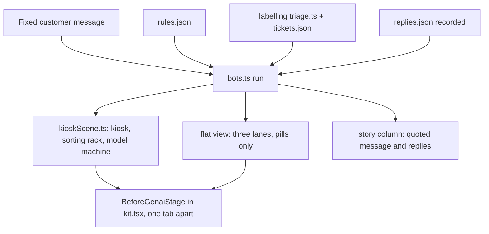

# Before GenAI Prequel Module - Plan

## Goal Capsule

- **Objective:** ship a "Module 0" prequel, `before-genai`, that every new reader meets first: what chatbots and AI did before GenAI, what changed, and what did not. It hands the reader into RAG.
- **Authority:** AGENTS.md rules win over this plan, except where KTD1 and KTD2 change a rule; U9 writes that change into AGENTS.md. `docs/writing-a-module.md` governs chapter shape.
- **Execution profile:** one feature branch, one PR at the end, no mid-build questions (the author's standing preference for module builds).
- **Stop conditions:**
  - A cited fact cannot be traced to a primary source: drop the claim, never soften it.
  - Larkspur mini fails the top-5 gate on a chapter 4 prompt: pick another corpus prompt, never retrain.
  - A recorded reply does not show the failure its chapter 8 step needs: change the message and re-record, never hand-edit the reply.
- **Tail:** `pnpm check`, `pnpm lint`, `pnpm test`, `pnpm test:e2e` all pass; `pnpm og` images committed; PR opened to `main`.

---

## Product Contract

### Summary

Add a Beginner AI module, "Before GenAI", placed first in the registry and numbered Module 0.
Its eight chapters follow Larkspur Supply Co.'s help desk through three bots: a scripted bot, a trained intent bot, and a GenAI assistant.
The reader plays each bot on the same customer messages, sees where the older ones break, learns what turned guessing the next word into GenAI, and ends on four gaps GenAI left, each pointing to the module that fixes it.
"Start with the basics" on the home page opens this module.

### Problem Frame

Every AI module starts in the GenAI era.
A reader new to the field meets RAG without knowing that chatbots, spam filters and recommendations used AI for decades, or what makes GenAI different from them.
Without that, "the model" reads as magic, and the reader cannot tell which old limits GenAI removed and which it kept.

### Requirements

**Module and placement**

- R1. A live Beginner AI module `before-genai`, titled "Before GenAI", sits first in `MODULES`.
- R2. Every page that shows a module number shows Module 0 for the prequel; every other module keeps its current number.
- R3. "Start with the basics →" opens the prequel's intro on a first visit.
- R14. Home's Continue never sends a reader with saved progress in another module to the prequel as their "next unfinished" module.
- R4. Its story continues Larkspur's: the help desk's bots before you join the team that builds the assistant in RAG.

**Chapters**

- R5. Eight chapters, in this order (ids are permanent):

| # | id | Title | The idea | Control |
|---|---|---|---|---|
| 1 | `scripted` | The bot that followed a script | Keyword rules answer only what someone wrote down | Predict (answers / falls back); then a `Select` of candidate keywords from the missed message |
| 2 | `intents` | The bot that sorted messages | A trained classifier copes with new wording, but only for a fixed list of intents and hand-written replies | One message per step, a `Select` of intent bins; predict the off-list message |
| 3 | `predictive-ai` | AI that picks from a list | Spam filters and recommendations: AI was already everywhere, choosing, not writing | One example per step, predict its pick from its fixed list |
| 4 | `next-word` | A machine that guesses the next word | A language model predicts the next word | One predict step against Larkspur mini's top 5 |
| 5 | `scale` | More text, bigger models | The transformer and scale turn guessing into writing that can do tasks it was never trained for | Predict toy vs real size; date order |
| 6 | `chat` | Taught to follow instructions | Instruction tuning turns a text continuer into an assistant; ChatGPT puts it in front of everyone | Predict which reply came from which model |
| 7 | `what-changed` | Same messages, three bots | Pick from a list vs write a new reply; one model, many tasks | Four messages, one step each: which bots answer it? |
| 8 | `what-stayed` | What GenAI didn't fix | Four gaps, each fixed by a later module | One `Select` per gap: which module fixes it? |

- R6. Every chapter has predict → reveal, an `act` line on every step that asks something, and at least one `<Fact>` on a reveal.
- R15. Chapters 4–6 teach what changed, not how it works: each ends its last reveal with a link to the chapter that goes deeper (Transformers ch1, Post-training ch1, Prompts ch1), read from the registry.
- R7. Chapter 8 shows four gaps, each with one failure and one fixing module, linked from the registry: made-up answer → Evals; no company knowledge → RAG; can't act → Tool calling; says what it shouldn't → Guardrails.
- R8. The intro page defines GenAI at first use; "intent" and "language model" are chapter terms at first use.
- R16. Readers pick from a fixed message set; there is no free-text message input.

**Pictures**

- R9. The module has its own scene with a hero object no other module uses: Larkspur's scripted help kiosk (button panel, fixed reply cards).
- R10. The second view is a flat side-by-side of the three bots on the current message, read off the same run as the scene.
- R17. Message and reply sentences render as quoted transcript lines in the story column; the scene and flat view carry only pills (bot name, "answered", "fell back") and shape or colour states. On phones the flat view's lanes stack.
- R11. The home hero gives the module a stand turn through a `DRAW` entry; it takes the first turn and is the module on the stand in the home share image.

**Honesty**

- R12. Every number and date comes from `data/before-genai/facts.json` with source and access date.
- R13. GenAI replies in chapters 7–8 are recordings of a real model, labelled recorded with model and date. Chapter 6's two replies are written for the site and labelled so, as Post-training ch1 does. The scripted and intent bots run live in the browser.

### Scope Boundaries

- Classic-tech modules get no prequel; this one is about AI.
- No broad "history of AI" timeline page; the flat view and facts carry the dates the chapters need.
- No hosted LLM and no API key in the browser; the only live model is Larkspur mini (KTD5).

### Deferred to Follow-Up Work

- A one-line "Then → now" on each AI module's intro (e.g. keyword search → RAG). It would repeat this module's lesson ~38 times and needs ~38 cited facts; revisit once readers have played Module 0.
- Adding `before-genai` to other modules' `prereqs`: not shown on any page today.

### Success Criteria

- A reader with no background passes chapter 7's which-bot-answers steps and chapter 8's gap-to-module match without hints.
- Existing readers keep their progress, their module numbers and their Continue target.

### Key Decisions

- **A prequel module, not per-module history boxes.** One playable story answers the shared question once; boxes on every intro would be the secondary text AGENTS.md tells us to cut. Governs R1, R5.
- **Module 0, first in the registry.** Learning order puts it first; numbering it 0 keeps every existing number, link and hand-typed kicker true. Governs R1, R2.
- **First-visit entry only.** Readers already playing elsewhere are not routed backwards into it. Governs R3, R14.
- **Larkspur's help desk as the story.** Continues the site's one story and lands the reader at RAG's opening. Governs R4.
- **Eight chapters, what-changed altitude.** Chapter 3 widens "before" beyond chatbots; chapters 5 and 6 split scale from instruction tuning, two different turns. Mechanism stays in Transformers, Post-training and Prompts, so chapters 4–6 hand off rather than repeat them. Governs R5, R15.

---

## Planning Contract

### Key Technical Decisions

- KTD1. **Numbering lives in one helper.** Add `moduleNumber(m)` to `src/lib/modules.ts`: the prequel is 0, others count from 1 among the live modules after it. Every site that computes a number calls it:
  - the two card kickers in `src/pages/index.astro`;
  - `introMeta` in `src/lib/pages.ts`;
  - the ~74 `src/pages/<module>/index.astro` and `recap.astro` files that compute `NUMBER` from the live index (find them with a grep for `status === 'live').findIndex` and `.indexOf`).
  Hand-typed kickers ("Module 1"–"Module 5") stay as they are and stay true.
- KTD2. **AGENTS.md exception, not a new rule.** "New modules go after the last live module" still holds; the prequel is the one fixed exception. `pnpm new-module` needs no change.
- KTD3. **The hero's caller reorders; the scene stays positional.** In `heroScene.ts`'s module-level wiring (`HOME_HERO`, `heroLabel`, `undrawn`, `HERO_TURNS`), order the AI modules as RAG, tool calling, the rest in registry order, then the prequel last. `heroScene()` keeps its positional contract, so `tests/unit/hero.test.ts`'s synthetic fixtures stay valid. The stand runs newest first (reverse order), so the prequel takes the first turn and is the share image's module (R11).
- KTD4. **Three bots, one engine, reusing what ships.** `src/lib/before-genai/bots.ts` runs a message through all three and returns one run the scene and flat view both read:
  - Scripted bot: ordered keyword rules from `data/before-genai/rules.json`, first match wins, else a fallback card.
  - Intent bot: `train`/`scores`/`margin` from `src/lib/labelling/triage.ts`, trained on `data/labelling/tickets.json` with Labelling's intents (refund, return, delivery, product, account). A margin under a set floor falls back. This keeps one Larkspur intent list across modules.
  - GenAI bot: the recorded reply for the message from `data/before-genai/replies.json`.
- KTD5. **Chapter 4 runs Larkspur mini live, once.** It reuses `src/lib/lm/` (`load.ts`, `forward`) for one predict step. The prompt must have its expected next token in the top 5 (the lm-kit gate). The copy labels it a toy and puts GPT-3's parameter count beside it.
- KTD6. **Recordings follow `scripts/record/`.** `scripts/record/before-genai.mjs` (pattern: `scripts/record/prompts.mjs`, client `scripts/lib/nvidia.mjs`, needs `NVIDIA_API_KEY`) sends the fixed message set to one named instruction-tuned model once. It writes `replies.json` with model id and date. A human reads the output before commit. Re-recording means new messages, not hand edits.
- KTD7. **Puzzles accept every winner.** Chapter 1's keyword `Select` offers the words of the missed message; `WINNERS` are computed from the rules engine (a word wins if it makes the message match and breaks no earlier match) and checked in a test.
- KTD8. **Chapter 3 reuses earlier pieces.** The spam step reads `src/lib/email/spam.ts` and draws the Email module's scene piece in `mini`; the recommendations step draws the shelf from `src/components/scenes/shelfScene.ts` in `mini`. No new piece for chapter 3.

### High-Level Technical Design

One run feeds both views, so they never disagree:

Scene composition: the kiosk (new hero object), a sorting rack with intent bins (new), and `modelMachine` from `src/lib/iso/figures.ts` for the GenAI bot. A customer from `CAST` hands in a blank message card; the sentence itself lives in the story column (R17).

### Assumptions

- The author wants decisions made without check-ins; scope above was not confirmed live.
- Module id `before-genai` and the eight chapter ids are final once shipped.
- Facts come from these primary sources, each re-checked with an access date at implementation:
  - Weizenbaum's ELIZA paper (CACM, 1966) — chapter 1.
  - Apple's Siri announcement (2011) — chapter 2, intent assistants reach phones.
  - A Dialogflow or Rasa doc on intents and fallback — chapter 2.
  - A primary source for spam filtering — chapter 3 (reuse the Email module's facts where they fit).
  - "Attention Is All You Need" (arXiv 1706.03762) and GPT-3 (arXiv 2005.14165) — chapters 4–5.
  - InstructGPT (arXiv 2203.02155) and OpenAI's ChatGPT post (30 Nov 2022) — chapter 6.
  - Ji et al., "Survey of Hallucination in Natural Language Generation" (ACM Computing Surveys, 2023) — chapter 8's made-up-answer gap.
  - Moffatt v. Air Canada, 2024 BCCRT 149 — chapter 8, cited only for what it rules: a company answers for what its chatbot tells customers.
  - Facts already in `data/transformers/`, `data/post-training/` and `data/email/` may be copied, keeping their source.

---

## Implementation Units

### U1. Registry, numbering, Continue and the hero order

- **Goal:** the prequel exists as a live module first in the registry, numbered 0, with every existing number, the Continue target and the hero order still correct.
- **Requirements:** R1, R2, R3, R14; KTD1, KTD2, KTD3.
- **Dependencies:** none.
- **Files:** `src/lib/modules.ts`, `src/pages/index.astro`, `src/lib/pages.ts`, the ~74 `src/pages/<module>/index.astro` and `recap.astro` that compute a number, `src/components/scenes/heroScene.ts`, `src/content/before-genai/module.ts` (from `pnpm new-module`), `src/pages/before-genai/`, `tests/unit/modules.test.ts`, `tests/unit/registry.test.ts`, `tests/e2e/catalogue.spec.ts`.
- **Approach:**
  1. Run `pnpm new-module before-genai "Before GenAI"`, then move its entry to the head of `MODULES`.
  2. Add `moduleNumber` and replace every computed numbering site (KTD1).
  3. In the home Continue script, leave the prequel out of the next-unfinished pick when the reader has progress in any other module.
  4. Reorder the hero's caller list (KTD3). The `DRAW` entry waits for U3.
  5. Update the tests that pin live positions: `modules.test.ts` positions and prefixes, `catalogue.spec.ts` `NUMBERED`, kicker checks, `TURNS` and the first-visit `/rag/` expectations.
- **Patterns to follow:** registry entries in `src/lib/modules.ts`; `introMeta` in `src/lib/pages.ts`.
- **Test scenarios:**
  - `moduleNumber` gives 0 for `before-genai`, 1 for `rag`, 2 for `tool-calling`, and the robots module keeps its pre-change number.
  - Every intro and recap kicker reads the same number as before the change, for every module except the prequel.
  - `MODULES[0].id` is `before-genai`; `introMeta('before-genai').kicker` reads "Tinker · Module 0".
  - e2e: a fresh visit's "Start with the basics" links to `/before-genai/`; the first Beginner AI card is Module 0.
  - e2e: a reader who has finished RAG gets Continue to tool calling, not the prequel.
  - e2e: a reader who finished the prequel gets Continue to RAG.
  - The hero's caller list starts with RAG and tool calling and ends with the prequel.
- **Verification:** home shows Module 0 first in Beginner AI; every other card and intro shows its old number.

### U2. Facts, messages and the three bots

- **Goal:** the data and engine every chapter reads.
- **Requirements:** R12, R13, R16; KTD4, KTD6, KTD7.
- **Dependencies:** U1.
- **Files:** `data/before-genai/facts.json`, `data/before-genai/rules.json`, `data/before-genai/messages.json`, `data/before-genai/replies.json`, `scripts/record/before-genai.mjs`, `src/lib/before-genai/bots.ts`, `src/lib/before-genai/facts.ts`, `tests/unit/before-genai-bots.test.ts`.
- **Approach:**
  1. Write ~12 Larkspur customer messages: some the script handles, some rephrased, one off-list, four that drive chapter 8's gaps.
  2. Write keyword rules so each message lands where its chapter needs it.
  3. Record GenAI replies; store model id and date.
- **Patterns to follow:** `src/lib/tokens/facts.ts` for fact lookup; `scripts/record/prompts.mjs` for recording; `src/lib/labelling/triage.ts` for the classifier.
- **Test scenarios:**
  - The scripted bot answers "where is my order" and falls back on "my parcel hasn't turned up".
  - The intent bot routes the rephrased parcel message to `delivery` and falls back below the margin floor on the off-list message.
  - Every message has a recorded reply with model id and date; a missing one fails the test.
  - Chapter 1's `WINNERS`: every winning word makes the missed message match and breaks no earlier match; every non-winner fails one of those.
  - Every fact has `source`, `url` and `accessed`.
- **Verification:** the engine reproduces each chapter's intended outcome for every message.

### U3. Scene, flat view, stage and hero plot

- **Goal:** the picture both views read from one run, and the prequel's stand turn.
- **Requirements:** R9, R10, R11, R17; KTD3, KTD8.
- **Dependencies:** U2.
- **Files:** `src/components/scenes/kioskScene.ts`, `src/content/before-genai/kit.tsx`, `src/content/before-genai/before-genai.css`, `src/components/scenes/heroScene.ts` (`DRAW` entry), `src/dev/og.astro`, `tests/unit/kiosk-scene.test.ts`, `tests/unit/hero.test.ts`.
- **Approach:** kiosk and sorting rack stay in the scene file until a second scene uses them. Export `KIOSK_PARTS` for callouts (≤ 16 characters). Text sits in pills only (R17). The `DRAW` plot is the kiosk in `mini`, no taller than its neighbours.
- **Patterns to follow:** `src/components/scenes/shelfScene.ts`; a module `kit.tsx` with `<Module>Stage` (e.g. `src/content/tokens/kit.tsx`); `FlatStage` lanes.
- **Test scenarios:**
  - The scene draws every part in `KIOSK_PARTS`.
  - For a message, the scene's lit bot and the flat view's answering lane agree.
  - A fallback in the run shows the kiosk's fallback card and the flat view's fallback pill.
  - The scene stays within the scene-size budget.
  - Hero: `undrawn` is empty, pills never overlap, and the prequel takes the first stand turn.
- **Verification:** desktop and 390px wide show one figure in a fixed frame; tabs switch views; lanes stack on phones.

### U4. Chapters 1–3: the old bots and predictive AI

- **Goal:** the reader plays the scripted bot, the intent bot, and sees AI that picks from a list.
- **Requirements:** R5, R6, R8; KTD7, KTD8.
- **Dependencies:** U3.
- **Files:** `src/content/before-genai/01-scripted.tsx`, `02-intents.tsx`, `03-predictive-ai.tsx`, `src/content/before-genai/module.ts`, `src/pages/before-genai/[chapter].astro`, `tests/unit/before-genai-chapters.test.ts`, `tests/e2e/before-genai-flow.ts`, `tests/e2e/before-genai.spec.ts`.
- **Approach:** controls per R5's table. Chapter 3 shows spam and recommendations as two picks from fixed lists, then reveals the common shape.
- **Patterns to follow:** a Beginner module's chapters (e.g. `src/content/tokens/01-what-the-model-reads.tsx`); `StepRunner`, `Select`, `Cite`.
- **Test scenarios:**
  - Copy budgets, plain words and research coverage pass for each chapter (existing tests pick them up).
  - Every `say` names a part the scene draws.
  - e2e: chapters 1–3 play to the end by keyboard, including the keyword puzzle with a non-winning pick first.
- **Verification:** each chapter plays end to end at both widths.

### U5. Chapters 4–6: next word, scale, instructions

- **Goal:** the reader sees the two turns that made GenAI, at what-changed altitude.
- **Requirements:** R5, R6, R8, R13, R15; KTD5.
- **Dependencies:** U4.
- **Files:** `src/content/before-genai/04-next-word.tsx`, `05-scale.tsx`, `06-chat.tsx`, `tests/unit/before-genai-chapters.test.ts`.
- **Approach:**
  - Chapter 4: one predict step, Larkspur mini's top 5 as the reveal, then the Transformers ch1 link.
  - Chapter 5: toy vs real size side by side (labelled toy), dated transformer and GPT-3 facts.
  - Chapter 6: one request with a base-model continuation and an assistant answer, both written for the site and labelled; ChatGPT launch fact; Post-training ch1 and Prompts ch1 links.
- **Patterns to follow:** `src/content/transformers/` for Larkspur mini; `src/content/post-training/01-base-or-assistant.tsx` for the labelled base-vs-assistant pair.
- **Test scenarios:**
  - The chapter 4 prompt has its expected token in Larkspur mini's top 5.
  - Each number shown either reads a fact's value or carries a toy label beside a real figure.
  - Each go-deeper link resolves to a live chapter in the registry.
  - e2e: chapters 4–6 play to the end, including a model load that fails once and retries.
- **Verification:** the model loads and the chapters play offline (existing offline e2e).

### U6. Chapters 7–8: what changed, what stayed

- **Goal:** the side-by-side lesson and the hand-off to later modules.
- **Requirements:** R5, R6, R7, R13.
- **Dependencies:** U5.
- **Files:** `src/content/before-genai/07-what-changed.tsx`, `08-what-stayed.tsx`, `tests/unit/before-genai-chapters.test.ts`.
- **Approach:** chapter 7 shows four messages, one step each; the reveal shows all three bots' replies in the story column. Chapter 8 shows the four gaps of R7, each with its recorded reply; the reveal links the module via the registry.
- **Test scenarios:**
  - Each gap links to a live module id in the registry.
  - The made-up-answer step cites Ji et al.; the Air Canada fact is worded as company liability only.
  - e2e: chapters 7–8 play to the end; the RAG link opens RAG's intro.
- **Verification:** finishing chapter 8 makes home's Continue point to RAG.

### U7. Recall bank and recap

- **Goal:** recap and warm-up work for the module.
- **Requirements:** R6.
- **Dependencies:** U6.
- **Files:** `src/content/before-genai/recall.ts`, `src/pages/before-genai/recap.astro`.
- **Approach:** at least one item per chapter, one `pin`ned, every option with a `why`.
- **Test scenarios:**
  - The registry test finds a recall bank with a pinned item.
  - e2e (`tests/e2e/recap.spec.ts` pattern): recap shows items only for finished chapters.
- **Verification:** the recap page works at any progress.

### U8. Intro page and share images

- **Goal:** the module's intro and every page's own share image.
- **Requirements:** R2, R4, R8.
- **Dependencies:** U7.
- **Files:** `src/pages/before-genai/index.astro`, `src/dev/og.astro`, `public/og/before-genai*.jpg`, `public/og/home.jpg`.
- **Approach:** intro per AGENTS.md (level tag, the idea in one example, how it works, the story's company, chapter cards). Run `pnpm og before-genai home`.
- **Test scenarios:**
  - The e2e share-image check finds one distinct image per page.
  - The intro meta description is ≤ 160 characters.
- **Verification:** the intro reads well in Pictures and Words modes at both widths.

### U9. Docs

- **Goal:** the repo records the prequel decisions.
- **Requirements:** KTD1, KTD2, KTD3.
- **Dependencies:** U8.
- **Files:** `AGENTS.md`, `docs/modules/before-genai.md`, `docs/lm-kit.md` (add the module to its user list), `README.md` if it lists modules.
- **Approach:** AGENTS.md Modules section: the prequel is Module 0, fixed first, numbered through `moduleNumber`, a first-visit entry only. Pictures section: the hero caller's order. `docs/modules/before-genai.md` keeps the scene notes and the toy-vs-real table.
- **Test expectation:** none -- docs only.
- **Verification:** AGENTS.md says nothing the code contradicts.

---

## Verification Contract

| Gate | Command | Applies to |
|---|---|---|
| Types | `pnpm check` (0 errors, 0 warnings) | all units |
| Lint | `pnpm lint` (0 diagnostics) | all units |
| Unit | `pnpm test` (clear `node_modules/.vitest-cache` if new chapter files read as missing) | U1–U8 |
| E2E | `pnpm test:e2e` | U1, U4–U8 |
| Images | `pnpm og before-genai home` | U3, U8 |

Look at home, the intro and every chapter at desktop and 390px wide.

## Definition of Done

- R1–R17 hold and every unit's verification passes.
- All four gates pass locally.
- Share images are committed for every new page and the home.
- No experimental or abandoned code remains in the diff.
- One PR to `main` with conventional-commit messages.

---

## Risks

- **A numbering site is missed.** One module shows N+1. Mitigation: KTD1's grep, and U1's every-kicker test.
- **The recorded model won't fail on cue.** A chapter 8 gap needs a model reply that shows it. Mitigation: the stop condition; pick messages that need Larkspur-only facts, where any model must guess.
- **Larkspur mini on help-desk text.** Its 32-token context and corpus may not fit a customer message. Mitigation: chapter 4 uses a corpus prompt; the story column says so.
- **Recorded replies age.** Mitigation: the copy names model and date; re-recording is cheap.

## Sources & Research

- `src/pages/index.astro` (`FIRST = LIVE[0]`, `LIVE.indexOf(m) + 1` kickers, Continue script).
- `src/lib/pages.ts` (`introMeta`; RAG, Tool calling, Agents hand-typed kickers).
- `src/pages/<module>/index.astro`, `recap.astro` (computed `NUMBER`).
- `src/components/scenes/heroScene.ts` (`live.slice(2)`, `HERO_TURNS`, `DRAW`).
- `src/lib/labelling/triage.ts`, `data/labelling/tickets.json`, `src/lib/email/spam.ts` (reused classifiers).
- `src/content/post-training/01-base-or-assistant.tsx` (labelled base-vs-assistant precedent).
- `docs/lm-kit.md` (Larkspur mini and its top-5 gate).
- `scripts/record/prompts.mjs`, `scripts/lib/nvidia.mjs` (recording precedent).
