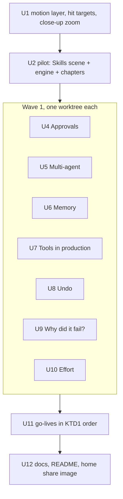
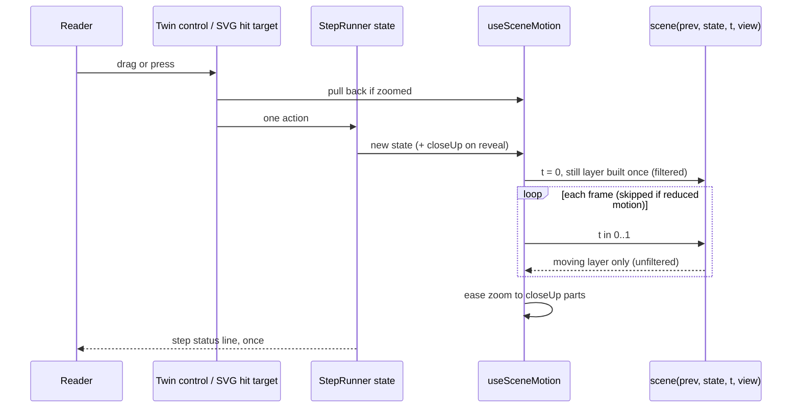

# Eight Agent Modules with Living Scenes - Plan

## Goal Capsule

- **Objective:** The first eight agent-engineering roadmap cards go live as modules 60–67 (KTD1). Each one gets a **living scene**: a place that moves between states, that the reader handles directly in the picture, and that closes in on its hero object at the reveal (R9–R11). Earlier waves had none of these.
- **Product authority:**
  - Requirements (R-IDs) win on product behaviour. Key Technical Decisions (KTD-IDs) win on mechanism.
  - AGENTS.md stays in force unless a KTD here changes it on purpose.
  - The shape of each module (engine, scene, chapters, go-live) follows `docs/plans/2026-10-30-0831-feat-last-roadmap-seven-modules-plan.md`. Its per-module units follow `docs/plans/2026-10-29-1438-feat-six-ai-modules-plan.md` U3–U6. Where this plan is silent, those plans apply.
  - The look follows `docs/plans/2026-10-29-0847-feat-creative-scene-figures-plan.md`: kit people, the model machine, real objects.
- **Open blockers:** none.
- **Execution profile:** brownfield. **One local branch and one PR at the end.** The executor makes every mid-build call and notes any re-scope in the PR.
  - **Wave 0:** the motion and close-up layer, with a pilot (U1, U2).
  - **Wave 1:** each module's engine, scene and chapters in its own folders (U4–U10). These may run in parallel.
  - **Wave 2:** the go-lives, in KTD1 order (U11).
  - **Wave 3:** docs and roadmap (U12).
  - Every wave leaves `pnpm check`, `pnpm lint`, `pnpm test` and `pnpm test:e2e` green.
- **Stop conditions.** Resolve each with its fallback and note it in the PR:
  - A chapter would need a live LLM, an API key, a backend or a real MCP server. Fallback: a labelled hand-written example run or seeded simulator (KTD3).
  - An existing step id, golden, recording or saved-progress shape changes. Stop.
  - The motion layer can't hold 30 fps, or it breaks `say` pills. Measure with a Chrome performance trace at 390px and 4× CPU throttling, on the pilot's ch. 1 tip-over and on Memory's densest board (16 cards with threads); the median frame must stay under 33 ms. Fallback: move more pieces to the still layer (KTD2); then shorter motions; last, stills with motion only on reveals.
  - A source checked for `facts.json` contradicts a chapter's lesson. Fallback: rewrite the chapter to match the source.
  - One module can't meet R9–R11 (or its picture-read check) within its unit. Fallback: it ships with end-state stills, twin controls and `status` lines (R10a), the gap goes in the PR, and it never blocks the other modules' go-lives.
- **Tail ownership:** `ce-work` owns the branch, the PR and the local checks.

---

## Product Contract

### Summary

Eight Larkspur agent-engineering modules go live:

- Skills
- Approvals and permissions
- Multi-agent systems
- Memory you can trust
- Tools and MCP in production
- Undo for agents
- Why did it fail?
- Where the effort goes

The user asked for "more creative visuals", so this wave goes past one still scene with controls beside it. In these modules the picture **moves**, the reader **acts inside it**, and the reveal **closes in** on the part that matters. Each module also has one visual device that no earlier module uses (KTD5), such as dye that spreads, threads you can pull, a marble that rolls, or a cable car that runs backwards.

### Problem Frame

Larkspur's assistant from Agents, Tool calling and Computer use now runs real work, and the gap has moved from "what is an agent" to "how do you run one safely". Readers' companies meet these problems first: too many instructions, approvals nobody reads, helpers that pass work badly, memories nobody can trace, tools that change, half-finished jobs, failures nobody can explain, and spend in the wrong place.

These problems are about **flow over time**: taint spreading, messages passing, effects rolling back, cause and effect. Still pictures with sliders beside them have taught "what state is it in" well. They teach "what happened, in what order, because of what" less well. Motion and direct handling suit this wave in particular.

### Requirements

**Platform**

- R1. The eight modules go live as 60–67 in KTD1 order. Each has an intro, seven chapters, a recap, a recall bank whose pinned item asks for the module's edge (R6), share images, a home card, an e2e spec and a hero stand plot.
- R2. Ids are the planned card ids, so `pnpm new-module` swaps each card. Levels and prerequisites:

  | Module | Id | Level | Prerequisites |
  |---|---|---|---|
  | Skills | `skills` | Intermediate | `context`, `tool-calling` |
  | Approvals and permissions | `action-approvals` | Intermediate | `guardrails`, `sandboxing` |
  | Multi-agent systems | `multi-agent` | Advanced | `agents` |
  | Memory you can trust | `agent-memory` | Advanced | `agents`, `context` |
  | Tools and MCP in production | `tools-in-production` | Advanced | `tool-calling`, `dependencies` |
  | Undo for agents | `agent-undo` | Advanced | `agents`, `queues` |
  | Why did it fail? | `causal-evals` | Advanced | `evals`, `observability` |
  | Where the effort goes | `adaptive-compute` | Advanced | `reasoning`, `choosing-models` |

- R3. Nothing needs a backend, an API key, a live LLM, a real MCP server or training in the browser. Agent runs are hand-written example runs or seeded simulations, labelled as such (KTD3).
- R4. Chapters are picture-first from the first commit. Copy budgets hold, every instruction is in `act`, `say` callouts name exported parts, sources open through `Cite`, terms are marked at first use, and every chapter shows at least one cited fact.
- R5. Every fact comes from `data/<id>/facts.json`, with its source and access date. A moving fact names whose figure it is and when: MCP spec revisions, vendor-reported multi-agent token costs, attribution accuracy figures and tool-search savings.

**Modules.** Chapters in order. Chapter 7 is each module's workbench. Each module's edge is the one sentence a reader should be able to say afterwards.

- R6a. **Skills.** Larkspur's assistant has a 40-page prompt and keeps getting returns wrong. Edge: "a skill is a folder the assistant opens only when a task needs it; only the label sits in every prompt".
  1. The 40-page prompt: everything on the desk at once, and the right rule buried.
  2. A label and a folder: the name and one line are always loaded, and the body only on demand.
  3. Picking the binder: the label decides which skill opens, so a vague label never gets picked.
  4. Steps, not facts: a skill holds a procedure, and its scripts run without being read into the prompt.
  5. Two skills fight: overlapping labels open the wrong one, so sharpen the labels.
  6. A skill from outside: a downloaded skill can carry instructions, so read it before installing (links to Dependencies).
  7. Workbench: write labels for six skills against twelve requests, scored on right picks and words loaded.
- R6b. **Approvals and permissions.** The assistant handles supplier email and can issue refunds. Edge: "only the person can approve an action, never text the agent read; and approvals add up and run out".
  1. The approve button: a person clicks yes forty times a day, and stops reading (links to Sandboxing's "Fewer prompts").
  2. Text that gives orders: an email says "refund order 88", and the dye shows where it came from.
  3. Following the dye: anything the agent writes after reading the email carries its dye (links to Guardrails' "The trifecta").
  4. Small steps, big harm: three harmless refunds that add up to one harmful one, against a running total.
  5. Approvals run out: a yes for one order, for one hour, then never again.
  6. Two minds: a planner that never reads the email and a reader that can't act (the dual-LLM and CaMeL designs, cited).
  7. Workbench: set the dye rules, risk budget and expiry against a hand-written week of mail, scored on harm stopped and prompts shown.
- R6c. **Multi-agent systems.** Larkspur wants a supplier report built from 30 catalogues. Edge: "split work only where the parts don't need to talk, and check every helper's answer".
  1. One agent, one desk: the report done in a single loop, and where it runs out of room.
  2. A lead and helpers: split by catalogue, and the token bill (vendor-reported figure, cited).
  3. The hand-off: a helper gets a vague brief and duplicates another's work.
  4. Agreed shapes: a capsule that fits only its port, so a malformed reply bounces.
  5. Waiting on each other: two helpers each wait for the other (deadlock), and a timeout.
  6. Trusting a helper: a helper's confident wrong number, and checking before merging (MAST failure study, cited).
  7. Workbench: number of helpers, brief detail and checks against three report jobs, scored on correct, cost and time.
- R6d. **Memory you can trust.** The assistant remembers customers between chats. Edge: "every memory names its source, so when a source goes bad you can undo everything it taught".
  1. What to keep: a chat produces twelve candidate memories, and most are noise.
  2. Where it came from: each memory card hangs by a thread to its source.
  3. Old and new disagree: a moved address, and the newer, better-sourced memory wins.
  4. Forgetting on purpose: an expiry date per kind, and a customer's "forget me".
  5. A poisoned note: a planted web page teaches a false rule (memory-injection attacks, cited).
  6. Undo the source: pull the bad thread and everything that hung from it comes down.
  7. Workbench: keep, expiry and trust rules against a hand-written month of chats with two planted sources, scored on right answers and poison left.
- R6e. **Tools and MCP in production.** Larkspur's assistant now uses 60 tools from four MCP servers. Edge: "load tools only when needed, and check each one is still the tool you approved".
  1. Sixty tools, one prompt: the descriptions eat the room and picks get worse.
  2. Fetch when needed: a tool search, and tokens saved (vendor-reported, cited).
  3. The tool changed: a server renames a field overnight and the outline no longer fits.
  4. A fingerprint per tool: pin what you approved and flag the drift.
  5. Hidden instructions: a tool description that tells the model to send files (tool poisoning, cited).
  6. Who is calling: the server's own login on the user's behalf (MCP authorization, OAuth, cited), never a shared key.
  7. Workbench: which servers to trust, pin and load lazily against a hand-written week of server changes, scored on tasks done, tokens and incidents.
- R6f. **Undo for agents.** The assistant handles a return: restock, refund, email the customer, book the courier. Step four, the courier booking, fails. Edge: "give every step an opposite step, and do the step you can't undo last".
  1. Halfway done: three steps went through and the fourth failed, so now what?
  2. Save points: record each finished step so a restart resumes rather than redoes.
  3. The opposite step: refund ↔ charge back, restock ↔ unstock (sagas, cited).
  4. Some things can't be undone: the email from step three gets a follow-up, not an unsend.
  5. Do the risky step last: reorder so the email runs after everything that can fail, and the follow-up is never needed.
  6. Only once: a retry and an idempotency key (links to Payments' "Pressed Pay twice").
  7. Workbench: order the steps and pick opposites and keys against twenty failure injections, scored on clean finishes and customer harm.
- R6g. **Why did it fail?** An example agent run sent the wrong replacement part. Edge: "the step where it went wrong isn't always the step that caused it; replay with one thing changed, and the change that flips the outcome is the cause".
  1. The failed run: eight steps, and the wrong part at the end.
  2. Blame the last step: the obvious guess, and why it's wrong here.
  3. Replay with one change: swap one step's output and rerun.
  4. Take a piece out: remove a step (ablation) and see what still works.
  5. Break it on purpose: inject a tool timeout and watch how the run copes (fault injection).
  6. Many runs: one replay is luck, twenty seeded replays are evidence, and failure attribution is hard even for models (cited).
  7. Workbench: spend a budget of replays to find the causing step in four hand-written failed runs, scored on found and replays used.
- R6h. **Where the effort goes.** Larkspur's assistant answers many kinds of question on a fixed budget. Edge: "no setting is best for every request; send extra effort where it changes the answer: thinking longer, looking it up, checking, or a bigger model".
  1. One setting for all: maximum effort on every question, and the bill.
  2. Think longer: helps on puzzles and not on lookups (links to Reasoning's effort dial).
  3. Look it up: helps on facts the model can't know (links to RAG).
  4. Check the work: a checker catches arithmetic, and costs a second pass.
  5. The bigger model: helps on hard reading, and is the priciest (links to Choosing models).
  6. Deciding per request: a cheap sorter routes each request (test-time compute and routing studies, cited).
  7. Workbench: set the routing rules over 40 example requests with hand-set outcomes against a budget, scored on correct answers and spend.

**Pictures and story**

- R7. Every module continues the Larkspur story. Named people are `CAST` figures, and the assistant is the kit's model machine or the Agents module's robot agent.
- R8. Each module teaches what its live neighbour doesn't and links where they meet (the links named in R6).
- R9. **Living scene: motion.** When the run moves from one state to the next, the scene animates between them. People walk, items travel, parts open and close, and the hero object's mechanism runs. Each change takes 300–1200 ms. With reduced motion the scene jumps to the end state. Motion never carries meaning alone: the end state shows it too.
- R10. **Living scene: hands in the picture.** Each module's main mechanic is done on the hero object in the SVG itself (drag, pull, tap or turn it). Every in-picture action has a twin control beside the stage, which is keyboard and screen-reader reachable and at least 44 px on phones. The twin is the accessible path; the in-picture action is the delight.
- R10a. **Every step has an end-state line.** Every step of a living-scene module carries a one-sentence `status` naming what the end state shows (which cards fell, which letters are dyed), within copy budgets and announced once in the existing `role="status"` read-out. This is the non-visual equivalent of the motion.
- R11. **Living scene: the close-up.** At each chapter's reveal (the step after a prediction), the stage closes in on the part, or pair of parts, that answers it and pulls back on the next step. It uses `IsoStage`'s `zoom`, with no resize and no reflow. Reduced motion cuts instead of gliding. While zoomed, every pill hides except the answering part's, which is drawn at the phone pill scale (`scale` 2) and placed beside the part, not over it. The close-up applies to the picture tab only: switching to the second view resets zoom and snaps motion to its end, and returning re-applies the step's close-up. Any reader action first pulls the stage back; hit targets are inert while zoomed or moving, and twin controls stay live.
- R12. Each scene has a hero object and a visual device no other scene uses (KTD5). The house rules apply: Colorfigures style, label pills, one figure per stage, escaped text, phones.
- R13. The live modules (60 with the prequel) and their saved progress do not change, except the shared hotspots (KTD8) and new links to new modules.
- R14. Every name shown comes from data. Companies, servers and tools are fictional (`.example` domains). Real protocols, papers and vendor reports are cited as dated facts.

### Scope Boundaries

- Earlier modules don't adopt the motion layer in this PR (deferred).
- No new weights and no live models.
- Maths stays in fold-away notes: the risk budget sum, token counts, replay statistics and the cost and accuracy frontier.
- Nothing from the x-ray "See inside" mode that was rejected earlier, no free orbit camera, and no sound.

#### Deferred to Follow-Up Work

- `agent-incidents`, `agent-scheduling` and `cache-reuse` go live in the next wave. `agent-incidents` is the capstone and draws on this wave.
- Retrofitting motion and close-ups to earlier modules, once the layer has proven itself here.
- The five older roadmap cards (translation, open weights, AI energy, clocks, GPS).

### Success Criteria

- After each module, a reader can say its edge in plain words as R6 phrases it.
- On the pilot (Skills), a reviewer in a fresh context sees each step's start and end frames with the narration hidden and names what changed. The pass mark is every step's change named to match the chapter-to-picture table, and Wave 1 waits for it (U2).
- At 1280px and 390px, the catalogue's live count rises by eight and its planned count reads 8. The hero stand shows the eight new modules in turn, and the first screen still holds.
- A contact sheet of the eight new share images repeats no hero object class or board layout from any existing scene.
- `pnpm test` fails when a pinned effect, a workbench's `WINNERS`, a scene's end frame (`t = 1` equals its still) or a share image drifts.

### Key Decisions

- **Build the first eight agent cards** (`skills` through `adaptive-compute`). This is session-settled and user-approved, chosen over all eleven agent cards, all sixteen cards, and the five older cards. Governs R1, R2.
- **Use living scenes as the creative step-up**, meaning motion, hands in the picture and a close-up, plus one unique device per module. This is session-settled and user-directed ("be more creative with visuals… take the best decisions"), chosen over a richer still-scene style and over a 3D camera per module. Governs R9–R12.
- **One branch and one PR, with the executor deciding mid-build.** This is session-settled and user-directed (the user's standing preference). Governs R1.

---

## Planning Contract

### Key Technical Decisions

- **KTD1. Module numbers follow merge order:**
  - 60 Skills
  - 61 Approvals
  - 62 Multi-agent
  - 63 Memory
  - 64 Tools in production
  - 65 Undo
  - 66 Why did it fail?
  - 67 Where the effort goes

  This is the card order. Skills comes first because it is the pilot and the only Intermediate module besides Approvals.
- **KTD2. Motion is one shared layer, `src/lib/iso/motion.ts` plus a `useSceneMotion` hook.** All eight scenes need it, so the kit rule (two or more users) holds.
  - **Contract:** a scene is a pure function `scene(prev, state, t, view)`, returning `{ still, moving }` SVG strings.
    - `t` runs from 0 to 1 from `prev` to `state`.
    - `view = { closeUp?: string[]; zoomT: number; phone: boolean }` lets the scene's pill helper drop every pill except the close-up part's while `zoomT > 0` (R11).
    - `useSceneMotion(state, durationMs)` returns `{ prev, t }`. On an interrupt, `prev` becomes the state that was being moved to and `t` restarts at 0.
    - Under `prefers-reduced-motion` (read synchronously from `matchMedia`, SSR-safe) and in hidden tabs, `t` is 1 at once. `og.astro` renders at build time with no hooks, so it calls `scene(state, state, 1, { zoomT: 0 })` directly, and no flag is needed.
  - **Why:** this keeps scenes deterministic and testable, since `scene(s, s, 1, …)` equals the still. It also keeps the "same run, two views" rule, and gives one owner for `prev`.
  - **Self-contained:** `motion.ts` imports `ease` from `core.js` and defines its own `tween` and `useReduced`, modelled on `src/components/canvas/Canvas.tsx` and `src/content/releases/kit.tsx`. Live kits keep their copies, so no live module changes (R13). Merging the five existing `useReduced` copies is a later cleanup. RAG's 600 ms track-to-bench morph is the precedent for a per-frame scene string.
  - **Two layers, for speed:** `IsoStage` gets an optional `moving` string. `still` renders in the filtered group, memoised on the target state, so the hand-drawn `feTurbulence` filter rasterises once per state. `moving` renders in an unfiltered group above it and is the only markup that changes per frame. Moving pieces get the filter back when `t` reaches 1 and they join `still`.
  - **Easing and length:** one ease-in-out curve, one duration per scene step (R9), and no spring physics.
- **KTD3. Agent runs are hand-written or simulated.**
  - Approvals, Memory, Tools, Undo, Causal evals and Adaptive compute replay hand-written example runs, labelled as such, (JSON under `data/<id>/`). These use the `Recording`/`Turn` shapes from `src/lib/agents/` wherever they fit.
  - Multi-agent and Undo also run seeded simulators (`src/lib/<id>/sim.ts`) for their workbenches.
  - Skills' label matching uses a small committed lexical scorer, labelled as a stand-in for the model's pick, rather than a model.
  - Every taught effect is pinned in `data/<id>/pinned.json` and re-derived in a test. Every workbench pins its `WINNERS` and recomputes them.
- **KTD4. In-picture handling uses one hit-target helper.** Draggable or tappable parts render a transparent `<g data-hit="<part>">` over their footprint, outside the wobble filter (through `IsoStage`'s `children`). Targets are projected inside `withFrame(stageFrame(board, view))`, as `Canvas.tsx` does. Pointer events map to the same action the twin control fires, and both share one handler and one status read-out, so state has one way in. Every hit target meets the same states:

  | State | Behaviour |
  |---|---|
  | idle | `cursor: grab` or `pointer`, plus a dashed outline on hover; on touch screens the target pulses once when its step opens |
  | pressed or dragging | the piece lifts and follows the pointer; `touch-action: none` on the active target only, so the page scrolls everywhere else |
  | over a legal target | the target glows |
  | illegal drop | the piece snaps back and the status line says why |
  | cancel | Escape or `pointercancel` snaps back |
  | busy | inert while moving or zoomed (R11) |

  Each in-picture footprint is at least 44 CSS px at 390px, padded invisibly when the drawn part is smaller. Arrow keys work on the twin, never on the SVG.

  **Twin contract:** each twin uses a native role that matches its job: a `Select` for picking, `type="range"` with value text for a turnable valve, a list with Move up and Move down buttons for ordering, and buttons for actions. Each has an accessible name, and after every action the status line describes the new end state (R10a).
- **KTD5. Scenes, hero objects, devices and mechanics.** No hero object repeats any in `docs/modules/*.md` (checked at planning time against that list and every file in `src/components/scenes/`).

  | Module | Scene and hero object | Unique visual device (motion) | Hands in the picture (twin control) | Close-up at reveals | Second view |
  |---|---|---|---|---|---|
  | Skills | the returns desk beside a **revolving binder carousel** (a lazy-susan stand of labelled binders, spines out); a desk where only opened binders land | the carousel spins to the matching spine, which swings out and opens on the desk; in ch. 1 every binder is open at once and buries the desk | drag a request ticket onto the carousel (a `Select` of requests and an Ask button) | the spine label that got picked | the words-loaded bar per request |
  | Approvals | Larkspur's refund office: an in-tray, the agent's desk and a **toll booth with a boom barrier and an hourglass** for each pass | **dye**: text read from a document is tinted, and the tint flows down pipes into whatever the agent writes after reading it | drop mail into the in-tray, then flip a pass's hourglass to approve (buttons per letter, plus Approve) | the dyed request at the barrier | a taint table of action, sources and allowed |
  | Multi-agent | a back office around an **operator's cord switchboard**: the lead agent at the board, helpers at desks, each desk wired to a jack | patch cords snake from jack to jack as work is handed off; a plug the wrong shape for its jack won't seat and springs back; in a deadlock two lamps blink at each other on hold | drag a cord from the lead's jack to a helper's jack to hire them (helper count and brief radio groups) | the two blinking lamps or the plug that won't seat | the message timeline lanes |
  | Memory | the support room with a **cork board on an easel**, memory cards pinned with red thread to source papers | **pull a thread**: the card and every card hanging from that source drop into the bin | drag a thread's end off its source (a listbox of sources plus Undo source) | the poisoned source's thread | memory table: card, source, age, trust |
  | Tools in prod | the workshop's **shadow board** (pegboard with painted tool outlines) fed by four supplier vans, each crate wax-sealed | a tool that has changed no longer fits its painted outline; lazy loading means tools arrive by van only when called | drag a tool from a crate onto its outline (a tool `Select` plus Hang, Pin and Trust toggles) | the ill-fitting outline or the broken seal | the fingerprint table per tool and day |
  | Undo | a hillside with a **funicular cable car** stopping at four stations (stock, refund, post box, courier) in R6f's order | when the courier booking fails, the car runs back down the hill, stopping to undo each station; at the post box the letter can't be taken back, so a second, apology letter goes in; with the post box moved to the top (ch. 5) the car never reaches it | drag the stations into an order along the track (an ordered list with up and down buttons, plus Run) | the station that can't be undone | the saga log of steps, opposites and keys |
  | Why did it fail? | an inspector's bench with a wooden **marble run**, one chute piece per run step | the marble rolls the recorded path; a swapped or removed piece changes where it lands | swap a chute piece for its alternative, or lift it out, then Replay (a step `Select`, Swap, Remove and Replay) | the piece whose change flipped the outcome | the replay table of change, outcome and runs |
  | Effort | a mill yard with a **water tower and a valve manifold** feeding four mills (thinking wheel, library wheel, checking sieve, big model machine) | water (the effort budget) flows to the open valves, the wheels turn, and the tower's level drops with the bill | turn a valve wheel per request type (one range per rule) | the mill that changed the answer | cost and accuracy points per routing rule |

  The marble run is a wooden chute frame, not Calibration's jars of marbles, so the hero class differs.

  Caps: Skills 6 binders, Approvals 8 letters, Multi-agent 5 helpers, Memory 16 cards, Tools 12 outlines, Undo 4 stations, Marble run 8 pieces, Effort 4 mills.

  Each scene unit first writes the chapter-to-picture table in `docs/modules/<id>.md` (picture, motion, hands, close-up target, the step's control and its `say` parts).
- **KTD6. Close-ups use existing `IsoStage` zoom.** Each chapter's reveal step declares `closeUp: [<part>]` (one or two parts) next to `say`. The kit maps the parts' joint footprint box to `Zoom {k, u, v}`, with k at most 2.2 and the box filling at most 70% of the frame, and eases there through KTD2's hook. A unit test checks that every `closeUp` names exported parts, extending `say-targets`. The share image always renders unzoomed.
- **KTD7. Step data grows by two optional fields: `closeUp` (KTD6) and `status` (R10a).** The existing `focus` field, which names the control a step highlights, is unchanged. Motion reads the existing state change, so step ids and saved runs keep their shape. `StepRunner` passes `closeUp` to the stage beside `focus` and `say`, and live modules never set it, so they are untouched. A unit test requires `status` on every step of a living-scene module (a kit flag), within copy budgets.
- **KTD8. Shared hotspots change only in a go-live unit:** `src/lib/modules.ts`, `tests/unit/modules.test.ts`, `tests/unit/step-ids.test.ts`, `src/pages/index.astro` (`CARD`), `heroScene.ts` (`DRAW`), `src/dev/og.astro` and `tests/e2e/catalogue.spec.ts`. U11 also owns `src/components/story/plain-words.ts` and the links added to neighbour modules: Wave 1 units list what they need in their doc, and U11 applies it. `README.md` and `public/og/home.jpg` belong to U12 alone. U1 may touch `StepRunner`, `steps.ts`, `IsoStage`, `Canvas.tsx` (lifting `tween` out), `releases/kit.tsx` (lifting `useReduced` out), the `say-targets` test and `src/lib/iso/`.
- **KTD10. Scaffold first, register last,** as the 2026-10-30 plan did. Each module unit starts by running `pnpm new-module <id> "<Title>"` in its worktree, so the pages, template files and e2e spec exist. It then restores `src/lib/modules.ts` before committing, keeping the registry edit applied locally while it verifies its pages. U11 re-applies each registry edit (import, `<ID>_MODULE` after the last live module, planned card removed) in KTD1 order; it does not run `new-module` again, because the script refuses ids whose files already exist.
- **KTD9. Sources to check during each engine unit.** These are candidates; the executor reads each one and records title, URL and access date:
  - **Skills:** Anthropic's Agent Skills docs and engineering post (Oct 2025), and the Agent Skills open specification.
  - **Approvals:** Willison's "lethal trifecta" (June 2025), Debenedetti et al. "Defeating Prompt Injections by Design" (CaMeL, 2025), and Willison's dual-LLM pattern (2023).
  - **Multi-agent:** Anthropic "How we built our multi-agent research system" (June 2025, vendor-reported token multiple), Cemri et al. "Why Do Multi-Agent LLM Systems Fail?" (MAST, 2025), and the A2A protocol spec.
  - **Memory:** the MINJA and AgentPoison memory-poisoning papers, and the OWASP agentic threats guide.
  - **Tools:** the MCP specification (latest dated revision, with its authorization and `listChanged` sections), Invariant Labs' tool-poisoning disclosure (2025), and Anthropic's tool search tool docs (vendor-reported savings).
  - **Undo:** Garcia-Molina and Salem "Sagas" (1987), and Stripe's idempotent requests docs.
  - **Causal evals:** Zhang et al. "Which Agent Causes Task Failures and When?" (ICML 2025, Who&When), and a primary source on fault injection (Netflix's Chaos Monkey or Principles of Chaos).
  - **Effort:** Snell et al. "Scaling LLM Test-Time Compute Optimally…" (2024), and Ong et al. "RouteLLM" (2024).

### High-Level Technical Design

How a step change becomes a moving picture (KTD2, KTD4, KTD6):

U3 is intentionally unused, so units keep the module order of KTD1 (Skills is U2).

---

## Implementation Units

### U1. Motion layer, hit targets and close-up zoom

**Goal:** the shared layer that makes scenes live, without changing any live module.
**Requirements:** R9, R10, R10a, R11, R13; KTD2, KTD4, KTD6, KTD7.
**Dependencies:** none.
**Files:**
- create `src/lib/iso/motion.ts` (`useSceneMotion`, interpolation helpers for positions and openness, plus its own `tween` and `useReduced`) and `src/lib/iso/hits.tsx` (hit-target layer and its states)
- modify `src/lib/iso/IsoStage.tsx` (optional `moving` layer, eased zoom), `src/components/story/steps.ts` (`closeUp?`, `status?`) and `src/components/story/StepRunner.tsx` (pass `closeUp`, announce `status`)
- tests: `tests/unit/motion.test.ts` and `tests/unit/say-targets.test.ts` (closeUp targets, `status` presence)
- create `src/dev/motion.astro`, a dev page showing a sample scene stepping, zooming and dragging
- add shared e2e helpers to `tests/e2e/helpers.ts`: play a chapter by twin controls, run axe zoomed and unzoomed, and assert no sideways scroll at 390px

**Approach:**
1. Build `useSceneMotion` per KTD2: `{ prev, t }`, with interrupt and reduced-motion rules.
2. Add the still and moving layers to `IsoStage`, and ease zoom through the same hook. The viewBox math stays in `IsoStage`.
3. Hit targets render as `children`, projected per KTD4, with `aria-hidden` (the twin is the accessible path) and the state table.
4. Run the frame-time measurement from the stop conditions on the dev page's sample, to set a baseline before the pilot.

**Patterns to follow:** `tween` and the per-frame morph in `src/components/canvas/Canvas.tsx`; its wire drag through `IsoStage` `children` with CTM pointer maths; the pointer drop targets in `src/content/search/kit.tsx`.
**Test scenarios:**
- `t` goes from 0 to 1 over the duration and stays at 1 after it.
- Under the reduced-motion media query, `t` is 1 on the first render, with no flash of the start frame.
- A state change mid-motion makes the target state `prev` and restarts at 0, with no frame at t > 1.
- `scene(s, s, 1, {zoomT: 0})` equals the sample scene's still output.
- A `closeUp` naming a part the chapter's `PARTS` doesn't export fails the test, with chapter and step named. The live modules' existing `focus` values are not checked by it.
- Zooming in and out keeps the `<svg>` element's client size unchanged (checked in the Skills e2e, since dev pages are not in the preview build).
- A hit-target drag calls the same handler as the twin button (component test).
- An illegal drop snaps back and sets the status line. Escape cancels a drag.
- While zoomed, pressing a twin control pulls the stage back before the state changes.

**Verification:** the dev page steps smoothly at desktop and 390px under `astro dev`. Every live module's e2e still passes untouched.

### U2. Skills: engine, binder-carousel scene, chapters (pilot)

**Goal:** the first living-scene module, end to end except the go-live. It proves the layer and fixes the kit before Wave 1.
**Requirements:** R1–R12 for `skills`; R6a; KTD3, KTD5, KTD9.
**Dependencies:** U1.
**Files:**
- `src/lib/skills/` (label scorer, request set, words-loaded sum)
- `data/skills/{facts,pinned,requests}.json`
- `src/components/scenes/carouselScene.ts`
- `src/content/skills/` (`module.ts`, chapter files, `recall.ts`, `kit.tsx`) and `src/pages/skills/` (scaffolded)
- `docs/modules/skills.md`
- tests: `tests/unit/skills.test.ts` and `tests/e2e/skills.spec.ts`

**Approach:**
1. Scaffold per KTD10.
2. Write the chapter-to-picture table first, with each step's `status` line.
3. Build the engine and pins.
4. Build the scene per KTD2: carousel turn, the binder swinging out and opening, and the ch. 1 desk buried in open binders.
5. Build the kit with the request `Select` twin and the drag-to-carousel target.
6. Write chapters 1–3 within the copy budgets.
7. **Pilot gate**, on the scene, the kit and chapters 1–3.
   - Run the frame-time measurement.
   - Send a fresh-context subagent each step's start and end frames, without narration, and check its answers against the table (Success Criteria).
   - Check phones and reduced motion.
   - Fix `motion.ts` and `hits.tsx` until the gate passes. U4–U10 start once it does.
8. Write chapters 4–7, the recall bank and the e2e spec, in parallel with Wave 1.

**Patterns to follow:** the U3–U5 shape of `docs/plans/2026-10-29-1438-feat-six-ai-modules-plan.md`; `src/content/robots/kit.tsx` for twin controls with arrow keys; `Canvas.tsx` and `src/content/search/kit.tsx` for pointer handling in the picture.
**Test scenarios:**
- The scorer picks the pinned skill for each of the 12 requests. Pinned words-loaded totals re-derive.
- The workbench `WINNERS` recompute from the scorer.
- A vague label (pinned case) loses to a specific one.
- e2e: play all seven chapters by twin controls only.
- e2e: drag a ticket onto the carousel and the matching binder opens. Dropping it off the carousel snaps it back.
- e2e: with reduced motion, the end state shows immediately.
- e2e: axe passes with the stage zoomed.
- e2e: at 390px, controls are at least 44 px and the zoomed answering pill is readable.

**Verification:** `/skills/` plays fully at desktop and 390px, with the registry edit applied locally (KTD10). The pilot gate has passed.

### U4–U10. The other seven modules

Each unit has the same shape as U2: engine and facts, a scene with its KTD5 device, a kit with in-picture handling and twin controls, a doc table, seven chapters, a recall bank, a unit test and an e2e spec. Each runs in its own folders.

| Unit | Module | Engine files | Scene file | Distinct test focus |
|---|---|---|---|---|
| U4 | Approvals | `src/lib/action-approvals/` (taint propagation over a hand-written run, risk budget, pass expiry) | `tollScene.ts` | dye reaches every action derived from tainted text and none other; the cumulative budget blocks the pinned third refund; an expired pass refuses |
| U5 | Multi-agent | `src/lib/multi-agent/sim.ts` (seeded lead and helpers, message schemas, deadlock detector, timeouts) | `switchboardScene.ts` | a malformed message bounces; the pinned two-helper wait is reported as deadlock and the timeout clears it; token cost grows with helpers as pinned |
| U6 | Memory | `src/lib/agent-memory/` (memory store with source, age and trust; conflict rule; expiry; undo-by-source) | `corkScene.ts` | undoing a source removes exactly its descendants; the newer, better-sourced memory wins the pinned conflict; "forget me" leaves no card for that customer |
| U7 | Tools in prod | `src/lib/tools-in-production/` (tool fingerprints, drift detection, lazy-load token sum, poisoned-description check over a hand-written server week) | `shadowScene.ts` | a renamed field changes the fingerprint and the outline fails; lazy loading pins the token saving; a pinned server rejects a changed tool |
| U8 | Undo | `src/lib/agent-undo/sim.ts` (saga runner, opposites, save points, idempotency keys, failure injection) | `funicularScene.ts` | failure at step 4 runs opposites 3→1 in reverse and the email gets a follow-up; a retry with a key refunds once; the email-last order wins the pinned injections |
| U9 | Why did it fail? | `src/lib/causal-evals/` (replay with one change over hand-written runs, ablation, fault injection, seeded repeats) | `marbleScene.ts` | the pinned causing step flips the outcome and the last step doesn't; 20 seeded replays give the pinned flip rate; the replay budget is enforced |
| U10 | Effort | `src/lib/adaptive-compute/` (per-request routing over hand-set outcomes for each effort option; cost and accuracy sums) | `millScene.ts` | each option helps only its pinned request kinds; the routed policy beats max-effort on cost at equal accuracy (pinned); `WINNERS` recompute |

**Requirements:** R1–R12 for each module and its R6 entry; KTD3, KTD5, KTD9.
**Dependencies:** U2 (the layer settled by the pilot).
**Files:** per row, plus for each `<id>`:
- `data/<id>/{facts,pinned}.json` and example runs
- `src/content/<id>/` and `src/pages/<id>/` (scaffolded per KTD10)
- `docs/modules/<id>.md`
- tests: `tests/unit/<id>.test.ts` and `tests/e2e/<id>.spec.ts`

**Approach:** as U2 steps 1–6 and 8. Before the module is handed to U11, run the pilot's picture-read check on it: a fresh-context subagent names each step's change from its start and end frames, narration hidden, against the module's table. Rework the scene until every change is named. The executor writes runs by hand from the cited failure patterns and labels them "hand-written example run", never "recorded" (that word means captured model turns in Agents). For each module, the reduced-motion end state must show what the motion showed: dye as a colour, the fallen cards in the bin, the car's final station with ticks for undone steps, the marble's landing tray, the tower's level.
**Test scenarios:** the row's distinct focus, plus for every module:
- All chapters play by twin controls (shared helper).
- One in-picture action works by pointer (Playwright drag or tap).
- The reduced-motion end state is identical to the still frame.
- Every `closeUp` and `say` names an exported part, and every step has a `status` line.
- An illegal drop snaps back with a status message.
- Axe passes zoomed and unzoomed (shared helper).
- At 390px, nothing scrolls sideways.

**Verification:** each module plays fully at desktop and 390px, and its share-image candidate renders unzoomed.

### U11. Go-lives

**Goal:** the eight modules join the registry as 60–67.
**Requirements:** R1, R2, R13; KTD1, KTD8.
**Dependencies:** U2, U4–U10.
**Files:**
- re-apply each unit's registry edit (KTD10)
- `src/components/story/plain-words.ts` and neighbour-module links, as listed in each module's doc (KTD8)
- `src/lib/modules.ts`, `tests/unit/modules.test.ts`, `tests/unit/step-ids.test.ts`
- `src/pages/index.astro` (`CARD`), `src/components/scenes/heroScene.ts` (`DRAW`: a `mini` of each hero object, no taller than its neighbours)
- `src/dev/og.astro`, `tests/e2e/catalogue.spec.ts`
- `public/og/<id>*.jpg` via `pnpm og <id>`

**Approach:** one go-live at a time in KTD1 order. After each, run `pnpm check`, `pnpm lint`, `pnpm test` and that module's e2e spec. Run the full `pnpm test:e2e` once after the eighth. Clear `node_modules/.vitest-cache` if new chapter files read as missing.
**Test scenarios:**
- The registry test passes with the eight live modules in KTD1 order and three agent cards plus five older cards still planned.
- The hero test shows no pill overlap with 8 more stand entries.
- The catalogue e2e's live count is eight above `main`'s, and its planned count reads 8.
- The share-image e2e finds a distinct image for each new page.

**Verification:** home at 1280px and 390px, the stand cycles the new modules, and no earlier module's number changes.

### U12. Docs, README and home share image

**Goal:** the docs record the living-scene layer for future modules.
**Requirements:** R12; the second Key Decision.
**Dependencies:** U11.
**Files:** `AGENTS.md` (a short "Living scenes" bullet under Pictures saying living scenes are the default for every new module from now on, set by the kit flag, while earlier modules stay still until a retrofit plan: motion through `motion.ts`, hands with a twin, `closeUp` close-ups, `status` lines, reduced motion jumps); `docs/writing-a-module.md` (how to write `scene(prev, state, t, view)`, `closeUp` and `status`); `README.md`; `public/og/home.jpg`.
**Test expectation:** none, because this unit changes docs and one regenerated image.
**Verification:** the PR carries a contact sheet of the eight new share images and the module-to-hero-object table.

---

## Verification Contract

- `pnpm check` (0 errors, 0 warnings), `pnpm lint`, `pnpm test` and `pnpm test:e2e` all pass locally after each wave. There is no CI.
- Every new page is looked at at desktop and 390px, once with motion and once with reduced motion.
- `pnpm og` is run for the new modules and home, and the JPEGs are committed.

## Definition of Done

- Modules 60–67 are live with all seven chapters, recaps, recall banks, share images and stand plots.
- Every new scene animates between states, takes one in-picture action with a twin control, and closes in at reveals. All of it degrades to stills under reduced motion.
- The earlier modules are unchanged apart from KTD8 hotspots and links.
- AGENTS.md records the living-scene rules, and one PR to `main` describes any re-scope.

## Risks

- **Performance on phones.** Re-rendering an SVG string per frame could stutter on dense scenes. Mitigations: memoise still pieces, cap the moving pieces, and take the stop-condition fallback (motion on reveals only).
- **Motion that distracts from reading.** Keep each change at most 1.2 s, and never animate while the reader types or drags anything except the dragged piece.
- **Overlap with live modules** (Sandboxing, Guardrails, Payments, Queues, Agents). Each R6 chapter that touches a neighbour links to it instead of reteaching it.

## Sources

- The roadmap cards and topic map: `docs/plans/2026-10-31-1949-feat-agent-engineering-roadmap-plan.md`.
- Per-module source candidates: KTD9, checked and dated during each engine unit.
