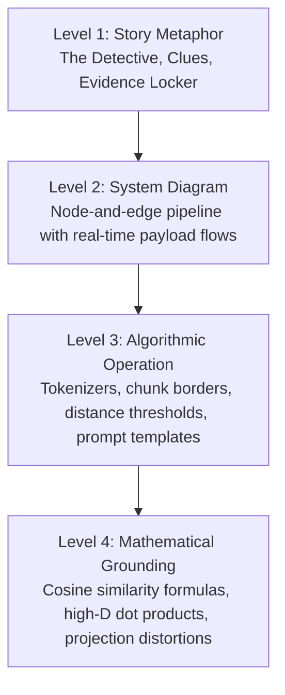
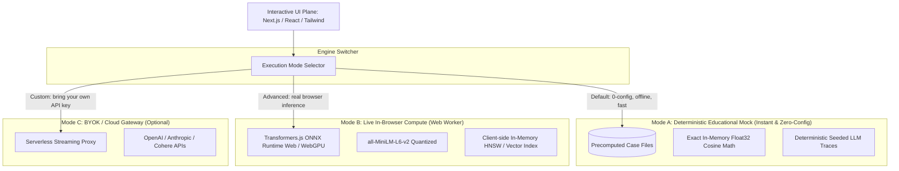

# Master Blueprint & Curriculum: Visual RAG Interactive Playground

> **Version:** 1.0.0  
> **Status:** Grounded Research Specification & Reusable Design Blueprint  
> **Target System:** Story-driven, interactive visual simulation for Generative AI & Retrieval-Augmented Generation (RAG)

---

## 1. Executive Vision & Core Philosophy

The goal of the **Visual RAG Playground** is to provide an intuitive, mathematically grounded, and emotionally engaging mental model of Generative AI and Retrieval-Augmented Generation.

Rather than presenting RAG as a static corporate architecture diagram ("User $\rightarrow$ Vector DB $\rightarrow$ LLM"), the playground treats RAG as an **interactive forensic evidence pipeline**:
1. **The Core Narrative Metaphor ("The Amnesiac Detective & The Archive"):**
   - **The Detective (The LLM):** Possesses fluent reasoning, grammar, and world knowledge, but suffers from amnesia regarding private, specialized, or recent facts. If forced to answer without external records, the detective hallucinates convincing but fabricated stories.
   - **The Archive (The Vector Store):** A vast library of historical records. Because whole books are too large for the detective's brief attention window, records must be shredded into index cards (**chunks**), categorized by semantic essence rather than alphabetical keywords (**embeddings in vector space**), and indexed for quick retrieval.
   - **The Investigation (Retrieval & Synthesis):** When a case question arrives, an archivist casts a net to gather the nearest cards (**top-$k$ vector search**), filters out misleading decoys (**reranking**), clips the best clues into a case folder (**context assembly**), and hands it to the detective to formulate a grounded verdict with citations.

2. **The "Martini Glass" Pedagogical Progression:**
   - **Stem (Guided Linear Narrative):** The user begins with an unskippable (or fast-forwardable) story case that reproduces a catastrophic hallucination, then introduces the archive to fix it.
   - **Neck (Constrained Stage-by-Stage Explorables):** The user interacts with 5 isolated mechanical stages (Chunking, Embedding Space, Vector Search, Reranking, Prompt Synthesis).
   - **Bowl (Interactive Debugging Puzzles & Open Sandbox):** The user fixes broken RAG pipelines (fixing chunk mutilation, overcoming lost-in-the-middle, filtering distractors) and can finally enter a free-form sandbox with custom text and parameter sliders.

---

## 2. Research Foundations & Artifact Map

This master blueprint synthesizes three comprehensive deep research investigations conducted via Perplexity AI (`sonar-deep-research`):

| Artifact | File | Core Content & Citations |
|---|---|---|
| **01. Storytelling & Pedagogy** | `research/01_visual_rag_storytelling_and_pedagogy.md` | Narrative metaphors (Detective, Archivist, Space Log); 4 representational levels (Metaphor $\rightarrow$ Diagram $\rightarrow$ Algorithm $\rightarrow$ Math); learnings from Transformer Explainer, CNN Explainer, Diffusion Explainer, and Google PAIR. |
| **02. Technical Architecture** | `research/02_simulation_technical_architecture.md` | Dual-mode execution engine (Deterministic Mock Engine + Transformers.js / ONNX WebGPU Web Worker); client-side vector search and 2D/3D projection (PCA/UMAP); DOM control plane vs Canvas/WebGL render plane; immutable state machine with URL serialization. |
| **03. Failure Modes & Puzzles** | `research/03_rag_failure_modes_and_interactive_puzzles.md` | Taxonomy of 33 failure modes (Barnett et al. 7 failure points, Liu et al. Lost-in-the-Middle); diagnostic invariants; hands-on puzzle designs (The Stale Policy, The Broken Sentence, The Distractor Attack). |

---

## 3. Four Representational Levels (Progressive Disclosure)

Every stage in the playground offers a unified 4-level toggle or accordion, preventing beginners from being overwhelmed while allowing engineers to inspect the exact math:



1. **Level 1 (Story Metaphor):** Animated visual actors (e.g., Detective reading notes, Archivist searching drawers).
2. **Level 2 (System Diagram):** Interactive block diagram where each block displays its input/output schema and latency.
3. **Level 3 (Algorithmic Operation):** Highlighting tokens, sliding chunk boundary brackets, vector neighbor graphs, and reranker score deltas.
4. **Level 4 (Mathematical Truth):** Real vector coordinates ($d=384$ or $768$), cosine similarity calculation:
   $$\text{sim}(\mathbf{q}, \mathbf{d}) = \frac{\mathbf{q} \cdot \mathbf{d}}{\|\mathbf{q}\| \|\mathbf{d}\|}$$
   and explicit projection distortion metrics (stress/trustworthiness) so users never mistake 2D proximity for true high-dimensional similarity.

---

## 4. Chapter-by-Chapter Curriculum & Interactive Mechanics

```text
================================================================================
CHAPTER 1: THE AMNESIAC DETECTIVE (The Hallucination Dilemma)
--------------------------------------------------------------------------------
Concept:     Parametric Knowledge vs Non-Parametric Ground Truth.
Story:       Detective Holmes is asked: "What was the secret passcode used by
             the suspect at the bank vault yesterday?" Holmes sounds 100% 
             confident, inventing a plausible passcode ("AURORA-492").
Interaction: User toggles "Expose Internal Memory". A thought bubble reveals
             the model has weights trained in the past, but zero ground truth.
Aha Moment:  LLMs generate fluent language based on probability, not facts.

================================================================================
CHAPTER 2: THE SHREDDER & THE INDEX (Document Parsing & Chunking)
--------------------------------------------------------------------------------
Concept:     Token limits, chunk size, chunk overlap, boundary mutilation.
Story:       The archivist receives a 50-page police case file. It cannot fit 
             on a single evidence card. It must be cut into fragments.
Interaction: Sliders for:
             - Chunk Size (tokens / characters)
             - Chunk Overlap (%)
             - Splitting Strategy (Fixed-length vs Sentence vs Semantic)
Failure Lab: Set Overlap = 0 and Chunk Size = 50. A crucial sentence: 
             "The suspect did NOT enter the building; rather, his twin brother
             entered" gets sliced exactly between "did NOT" and "enter".
Aha Moment:  Bad chunking physically destroys semantics before search even starts!

================================================================================
CHAPTER 3: THE MAP OF MEANING (Embedding Space & High-D Vectors)
--------------------------------------------------------------------------------
Concept:     Text to dense vectors, semantic proximity vs keyword match.
Story:       The archivist doesn't file by alphabetical title ("Bank", "Bicycle").
             Cards are pinned onto a 2D/3D celestial star map where cards with
             similar meanings cluster together.
Interaction: - 2D/3D interactive Star Map (Canvas / Three.js).
             - Type any query: see it projected into the constellation.
             - Compare: "dog" vs "canine" (close in vector, far in keyword)
               vs "bank (money)" vs "bank (river)" (semantic disambiguation).
             - Projection Warning Tooltip: Hovering shows true 384-D cosine
               score vs 2D projected distance.
Aha Moment:  Vectors capture semantic intent, but 2D projection lies slightly!

================================================================================
CHAPTER 4: THE FISHING NET (Vector Search, Top-K & Distance Metrics)
--------------------------------------------------------------------------------
Concept:     Cosine similarity, Euclidean distance, top-k recall vs precision.
Story:       The detective issues a query: "Was there a red getaway car?"
             The archivist casts a magnetic net into the vector constellation.
Interaction: - Drag the Query Pin across the star map.
             - Adjust Top-K slider (1 to 10).
             - Adjust Similarity Threshold slider (e.g., minimum cosine 0.70).
Failure Lab: - Top-K too low (k=1): Misses the actual clue (ranked #2).
             - Top-K too high (k=10): Catches 8 distractor cards about red apples
               and red traffic lights, burying the signal.
Aha Moment:  Retrieval is a delicate balance of recall (don't miss clues) and 
             precision (don't flood the detective with noise).

================================================================================
CHAPTER 5: THE SIEVE (Reranking & Filtering)
--------------------------------------------------------------------------------
Concept:     Bi-encoders (fast vector search) vs Cross-encoders (deep rerankers).
Story:       Bi-encoder retrieval is fast but superficial (like scanning index
             cards in 1 second). A strict inspector reranks the top-10 cards by 
             carefully reading query + card together.
Interaction: - Side-by-side comparison of Vector Ranking vs Cross-Encoder Ranking.
             - Watch the true clue jump from #8 up to #1!
Aha Moment:  Dense retrieval finds candidates; rerankers re-score semantic nuances.

================================================================================
CHAPTER 6: THE BRIEFING ROOM (Context Assembly & Generation)
--------------------------------------------------------------------------------
Concept:     Prompt injection, context window packing, Lost-in-the-Middle.
Story:       The archivist tapes the retrieved cards onto the detective's clipboard.
             The detective writes the final report with source citations.
Interaction: - Drag-and-drop evidence card order in the prompt.
             - Place the gold clue at Position 1 (Top), Position 5 (Middle), 
               or Position 10 (Bottom).
Failure Lab: Lost-in-the-Middle: When placed in the middle of 10 long chunks,
             the LLM fails to notice it and says "No evidence found".
Aha Moment:  Position matters! LLMs pay more attention to the start and end.
================================================================================
```

---

## 5. Guided Debugging Puzzles (Hands-On Challenges)

The playground features structured diagnostic puzzle cases where users must inspect intermediate artifacts to fix failing pipelines:

| Puzzle | Mystery Scenario | Hidden Root Cause | How User Solves It |
|---|---|---|---|
| **Case #1: The False Alibi** | Suspect was convicted because RAG said he was in Paris, but the text says his alibi was disproven. | **Chunk Boundary Split:** The clause `"However, surveillance later proved this was a fabrication"` was sliced into chunk #2 and not retrieved. | Increase Chunk Overlap from 0 to 50 tokens or switch to Sentence-aware splitting. |
| **Case #2: The Hidden Needle** | Model insists "The murder weapon was never found", although Page 23 mentions a titanium wrench. | **Top-K Truncation + Lost in Middle:** $k=3$ retrieved 3 generic police interview reports; the weapon was ranked #4. When $k$ is raised to 10, it gets lost in the middle. | Enable Reranker to promote the clue to rank #1, or increase $k$ and place highest-scoring chunks first. |
| **Case #3: The Stale Blueprint** | Building code regulations changed in 2025. The LLM quotes the outdated 2018 code. | **Semantic Similarity Bias / No Metadata Filter:** The 2018 document has 95% word overlap with the query; 2025 update has 82%. | Add a Metadata Filter (`year >= 2025`) or hybrid search with recency decay. |
| **Case #4: The Poisoned Clue** | The LLM suddenly hallucinates an imaginary suspect named "Agent Phantom". | **Adversarial / Distractor Injection:** A retrieved chunk contained a hypothetical thought experiment. | Adjust Reranking Confidence Threshold to drop low-grounding chunks. |

---

## 6. Technical Architecture & Simulation Engine

### 6.1 Progressively Enhanced Dual-Engine Model



1. **Default Mode (Deterministic Mock Engine):**
   - 100% offline, zero network requests, instant (<10ms) responses.
   - Pre-computed 384-dimensional embeddings (using `all-MiniLM-L6-v2`) serialized as JSON arrays for the built-in story scenarios.
   - Real mathematical operations: true cosine similarity calculations computed directly in JavaScript on typed `Float32Array` buffers.
   - Exact counterfactual branching: predictable, reproducible failure states for classroom teaching.

2. **Advanced Local Mode (Transformers.js in Web Worker):**
   - Enables users to paste custom documents and type custom queries without an external backend.
   - Embeds text dynamically using `Xenova/all-MiniLM-L6-v2` (quantized q8, ~23MB) via ONNX Runtime Web in a background Web Worker.
   - Fallback to CPU/WASM if WebGPU is unavailable.

3. **BYOK Cloud Mode (Optional):**
   - For users wishing to test live generation with GPT-4o, Claude 3.5 Sonnet, or Cohere Rerank.
   - Secure stateless serverless proxy; keys never stored.

### 6.2 Frontend Technology Stack

- **Framework:** Next.js (App Router) or Vite + React with TypeScript.
- **Styling & Layout:** Tailwind CSS with responsive dark/light mode support (terminal/evidence room aesthetics).
- **Visualization Components:**
  - *Pipeline Flow:* SVG / React Flow for dynamic node connections and data packets.
  - *Embedding Constellation:* HTML5 2D Canvas (with D3-zoom / Pixi.js) or Three.js for 3D point clouds with UMAP/PCA projections.
  - *Document Chunking Inspector:* Interactive text visualizer with color-coded bracket spans, token counters, and overlap diffing.
  - *Prompt Clipboard:* Dynamic Markdown / Code block with color-coded source injection chips.
- **State Machine & Run History:**
  - Zustand or XState for managing pipeline step transitions (`IDLE`, `CHUNKING`, `EMBEDDING`, `RETRIEVING`, `RERANKING`, `GENERATING`, `EVALUATING`).
  - Immutable run manifests with URL hash serialization: users can share a link with the exact document, query, chunk size, top-k, and failure state preserved.

---

## 7. Reusable Materials Summary

This repository now contains complete research and specification materials:
- `research/00_master_blueprint_and_curriculum.md` (This file: master architecture, story script, curriculum, puzzles)
- `research/01_visual_rag_storytelling_and_pedagogy.md` (Deep research on pedagogical storytelling and visualization)
- `research/02_simulation_technical_architecture.md` (Deep research on browser simulation, Web Workers, vector math, UI tech)
- `research/03_rag_failure_modes_and_interactive_puzzles.md` (Deep research on 33 failure modes, diagnostics, and puzzle mechanics)
